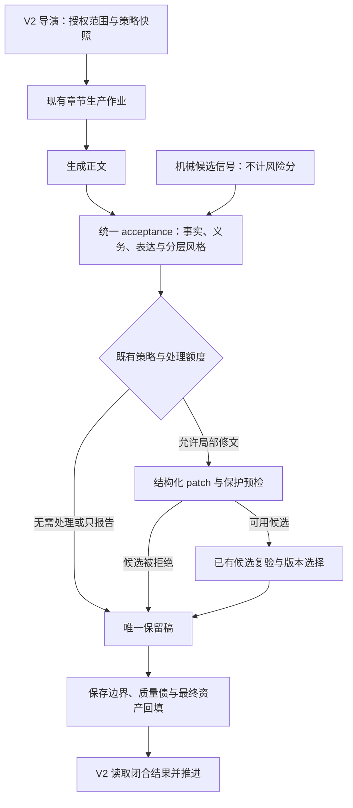

# 去 AI 味能力升级方案：对齐导演 V2 与统一章节生产链

> 日期：2026-10-11
> 状态：方案，尚未实施；本文中的新增字段、限制与评测指标均为目标设计。
> 核对基线：`ff862131`，结合当前工作区的 V2 编辑器接入情况。已有未提交编辑器修改不属于本方案交付。
> 目标：在既有写法合同、统一验收和局部补丁内，提高风格问题的可解释性、修文安全性与可验证性，保住作者语气和整本小说完成率。

## 1. 修正现状认知

| 原报告认识 | 当前实现与维护依据 | 对方案的影响 |
| --- | --- | --- |
| 自动正文依靠 `PostGenerationStyleReviewRunner` 检测后整章改写 | `ChapterContentFinalizationService` 调用统一接收闸门，从 `acceptance.styleReviewReport` 构造报告；旧 Runner 在当前生产源码中没有执行调用方 | 不重新接入旧 Runner，不以它的 35 分阈值设计 V2 自动处理 |
| 写法诊断只有扁平规则列表 | 独立检测已有 `source` 和 `issueCategory=style_expression/story_structure`；统一验收通过 `styleReview.issueCodes` 引用同次 `voice` 证据 | 新增诊断层次要兼容既有问题分类和引用，不能另造一份章节审校 |
| 机械检查需要从零建设 | `runtime/proseQuality/` 已有表达缺陷检测和新增严重问题预检 | 风格候选信号与严重表达安全缺陷分开，复用可复用的基础能力 |
| 自动修文只靠最小改动 prompt | 已有结构化 patch、锚点唯一性/重叠校验、`repairVerification`、V2 候选版本选择和最终资产提交 | 在现有补丁及复验上增加纪律和保护，避免退回整章文本重写 |
| 自动导演可以再组织一次去 AI 味 | V2 `chapter_batch` 只监督底层章节作业及闭合结果，不能重复执行审校、修文或资产同步 | 风格能力属于章节链，导演只消费结果、质量债和显式停止信号 |
| 手动去 AI 味和章节精修都需要新交互 | 已有粘贴稿检测/修订预览，章节编辑器已有选区候选、原子 diff、本章版本、`expectedUpdatedAt` 和来源页问题处理 | 复用来源页和候选确认，不增加独立去 AI 味工作台 |

主要依据：

- [章节生产链：写法执行边界](../wiki/workflows/chapter-production-chain.md#写法与反-ai-检测的执行边界)
- [V2 导演事实层](../wiki/architecture/director-next-fact-layer.md)
- [V2 步骤适配边界](../../server/src/modules/director/steps/README.md)
- [章节生产模块](../../server/src/services/novel/production/README.md)
- [表达安全预检](../../server/src/services/novel/runtime/proseQuality/README.md)
- [章节编辑闭环](../wiki/workflows/chapter-editor.md)

## 2. 产品与架构决策

1. 输出风格风险、正文证据和修改方向；`riskScore` 是模型的风险等级分，不是作者身份判断、AI 生成概率或“AI 率”。
2. AI 对是否构成风格问题、问题层次和修复方向负责。字词统计只提供候选证据；零命中不等于通过，有命中不等于违规。
3. 专项诊断沿用 `postGenerationStyleReviewEnabled`。关闭时不执行新增风格扫描/诊断；既有事实、义务和严重正文缺陷检查继续运行。
4. 写法引擎没有改动人物事实、剧情因果、核心动机、章节义务或规划路线的权限。叙事层风格提醒不自动修文。
5. 默认完成优先：可用正文有局部风格问题时保留正文并记录质量债。质量优先且统一决策为 `pause_for_manual` 时保留既有人工恢复锁；不得以“去味失败继续”为由清除暂停。
6. 纯风格问题不得单独要求整章重写、`plan_misalignment` 或全局重规划。实际事实/义务冲突仍由对应验收合同判断，不能被风格标签掩盖。
7. 自动修文复用 job + chapter 的持久处理额度与现有 token 限制。保护检查拒绝候选不退还已消耗额度，也不另开去味重试。
8. 只为唯一保留稿保存权威验收与资产事实。候选稿不提前写入角色状态、资源、伏笔或事实账本。
9. 运行记录保持只读。采纳、重试、AI 辅助处理和显式恢复留在小说导演台或正文编辑来源页。

## 3. 接入链路与归属

| 能力 | 当前所有者/目标落点 | 禁止扩展的职责 |
| --- | --- | --- |
| 风格候选统计 | `styleEngine/diagnostics/` 下的纯函数，通过 `index.ts` 消费 | 不调用模型、不决定违规/修文、不输出停止信号 |
| 分层语义判断 | `novel.chapter.acceptance_assessment`；手动入口的 `style.detection` | 不增加自动正文的独立检测调用 |
| 风格权限与报告投影 | `runtime/acceptance/` 及写法服务的同一权限能力 | 不从规则名、建议文字或错误文案猜层次/动作 |
| 补丁生成与应用 | `ChapterPatchRepairService`、共享 patch 合同 | 不从纯风格问题降级到整章重写 |
| 编辑预算及保护 | `styleEngine/rewrite/` 拥有策略与校验，运行时负责调用顺序 | 不把原稿事实当作绝对正确，不控制导演状态 |
| 正文安全退化检查 | 既有 `runtime/proseQuality/` | 不把普通风格候选升级为严重缺陷 |
| 候选复验与取舍 | `runtime/selection/`、现有 repair verification | 不额外组织每段一次的事实判断调用 |
| 写入及连续性闭合 | 生命周期、定稿服务、`artifactSync/` | 不在改写服务里直接改章节或回填候选事实 |

上述新目录仅在实际有对应代码时创建；不先建空接口、通用工具或占位服务。实施前检查目标文件行数，遵守长文件与高密度目录规则。

## 4. 诊断合同：层次与执行权限分开

### 4.1 分类依据

| layer | 判断对象 | 自动修文边界 |
| --- | --- | --- |
| `surface` | 措辞、句式、标点、无信息增量的重复表达 | AI 判断可局部修改，且权限与保护全部通过时允许 |
| `discourse` | 信息组织、段落承接、解释密度、视角衔接 | 只允许不改变事件顺序、信息揭示顺序和场景职责的局部表达补丁 |
| `narrative` | 人物动机、事件因果、关系复杂度、冲突解决与结局职责 | 只报告，并给出有上下文的 AI 辅助处理方向 |

按实际问题和修改影响定层，不能把“瞳孔微震”“他终于明白了”等短语固定映射为叙事问题。“单线因果”“大团圆”也不是天然缺陷，必须结合题材、章节职责和现有证据判断。

既有 `issueCategory` 保留：它表示表达/故事问题归属；`layer` 表示诊断层次。历史缺少 layer 的记录正常展示，但不得默认为 surface 来取得新的自动修文权限。规则库的 `autoRewrite=true` 仅表示规则许可，不能覆盖 AI 对当前实例的不可修判断。

### 4.2 统一验收的最小扩展

- `styleReview.issueCodes` 继续引用同次真实 `voice` 问题，不重复输出其证据和建议。
- 被引用的可修 `voice` 项增加 `layer`，新模型输出必须明确为 surface 或 discourse。
- 为叙事提醒、低风险提醒和规则禁自动修改的项，在 `styleReview` 下增加有上限的 `observations`（初始最多 3 项），包含稳定 code、可空的 styleRuleId、layer、severity、原文证据、原因、建议。其权限固定为只报告，不进入修文清单。
- 同一问题只能在修文项或 observations 中出现一次；从修文项降为只报告时仍保留完整诊断，不能只压成 riskTags。
- 真实剧情/事实硬冲突继续进入现有对应问题类别；不能为保留“叙事只报告”而把硬冲突藏进 observations，也不能因一个叙事风格提醒制造硬冲突。
- 公共报告合并以上两种来源。`StyleDetectionViolation`、运行包 Zod Schema、投影、API 返回及编辑器消费必须同步支持 layer；旧数据读取允许缺省，新输出校验不允许缺省。

服务器最终许可取交集：有效规则许可、AI 当前实例许可、层次/影响边界许可、用户授权范围与任务策略许可。报告总开关由实际可修项推导；`riskScore` 不单独授予执行权限。

### 4.3 精选诊断信号

在同一份表达诊断规范中维护以下 12 条语义信号，由两个 PromptAsset 复用，避免两套手抄列表漂移：

| 层次 | 精选信号 |
| --- | --- |
| 表层 | 模板衔接聚集；模糊修饰/动作副词堆叠；句式或排比机械重复；空转表达与标点节奏失衡 |
| 语篇 | 段落失去当前场景的问题与目标；解释挤占行动且没有新的信息/关系变化；转场与视角承接失去依据；段落推进方式反复同构 |
| 叙事 | 说教总结替代有依据的人物变化；事件与选择缺乏可信动机；关系反应扁平且违背既有人物；冲突收束缺乏代价或违反章节职责 |

连续三段屏幕行数相同不作为判据。每项需有正文证据和明确读感损失；口头禅、角色说话习惯、必要术语、题材修辞和有意反复应被允许。

## 5. 机械候选扫描：为 AI 提供证据

首版纯函数形态为 `scanStyleSignals(content, policy)`，无 IO、无模型调用。输出 ruleId、匹配项/计数、excerpt、from/to 和扫描版本；同章同规则合并证据，上限每规则 2 个片段、总计 8 个，防止扩大输入。

| 信号 | 首轮试验阈值 | 范围与重复口径 |
| --- | --- | --- |
| `template.transition` | 同一词表表达在一章至少出现 2 次 | 给出后续出现的定位；首次出现不单独报告 |
| `rhythm.comma-density` | 同句至少 80 个非空白 Unicode 字符、至少 4 个逗号 | 给出句子统计，不要求同一长句出现两遍 |
| `surface.repeated-softeners` | 同句词表项总出现次数至少 3 | 可以是不同词表项，给出聚集证据，不宣称每个词违规 |
| `surface.action-adverb-stack` | 同句词表项总出现次数至少 3 | 与上项一致，保留对白和叙述上下文供 AI 判断 |

短于 12 个非空白字符的句子跳过句内密度检查；章内模板重复统计仍计数。排比结构留给语义判断，不在首版增加泛化正则。

明确句边界（句号、问号、感叹号、段落边界及中英文变体），补齐省略号、引号、无终止标点和 CRLF 测试；阈值字符计数与定位坐标是两种口径。定位复用编辑器换行规范化与 UTF-16 坐标，不 trim 原文、不压缩空白。

以上数值是待校准的工程初值，没有经过真实小说评测。policy 显式传入，首版不做高级配置 UI。新增策略进入现有章节作业载荷的版本化快照，恢复同一作业不读取变化的全局阈值；历史作业无快照时维持既有执行协议，不静默启用新的自动修改规则。

扫描版本、阈值和实际输入信号参与验收缓存身份。准备身份与执行调用必须使用同一纯函数及同一快照；只升 Prompt 版本不能覆盖所有运行策略变化。

不加机械风险分，不由扫描结果生成违规，不在零命中时省略语义验收。AI 不可用时只保留明确标注为候选信号的统计，不伪造风格报告或用扫描器接管修文。

## 6. 修文纪律与事实保护

### 6.1 改写形式

自动链只复用结构化 patch。每个补丁应关联真实可修问题 ID，使用当前原文唯一锚点；未知 ID、只报告问题、越界或重叠补丁拒绝应用。多个问题共享片段时合并成一个原子补丁。

独立 `StyleRewriteService` 是手动预览入口，改为通过注册的 `style.rewrite` 生成结构化补丁，复用共享 patch Schema、应用函数和保护能力，继续返回兼容的完整 `content`，附带保护结果。该资产从 text 模式升为 structured，调用方同步切到结构化执行；不反向依赖章节运行时内部服务。不得把全文生成后长度相似当作最小改动。

客户端提交的规则名、建议和层次只能作为请求数据，不能授予改写权限。服务器使用与正文/有效合同匹配的权威报告；无可验证报告时，在用户本次显式修订请求中执行一次结构化检测。首版不增加签名票据或新缓存表；该手动调用的成本应记录，不能宣称已有预检必然免重复检测。V2 自动章节仍只调用既有统一验收。

### 6.2 可计算的编辑预算

删除固定“替换 74% / 删除 18% / 新增 8%”配额，改为以下指标：

- **触及比例**：所有不重叠补丁 targetExcerpt 的非空白字符数 / 原文字符数，衡量修改范围。
- **新增量**：插入与替换内部净增加的字符量，另计纯插入量；不得被其他补丁删除抵消。
- **篇幅变化率**：最终保留稿长度差 / 原文长度，只作末端保护，不代表编辑率。
- **范围外一致性**：补丁目标以外正文必须原样保留，包括空格和段落。

整章风格修文首轮可用触及比例上限 30%、篇幅增长上限 5%、篇幅绝对变化上限 30% 进行离线评测，均为工程候选值，达标前不作为经验证默认。选区与短稿分别校准，不能直接套整章比例。超过预算时保留原文并给出原因，不截断正文、不自动多轮改写。

修文只允许使用原文或已确认上下文支持的细节。保留原题材、视角、语域、人物口吻和有功能的重复；“自然化”不意味着全面口语化。删除/还原测试作为模型自检指导，不能被描述为程序已经证明质量提高。

### 6.3 两级保护，而非正则事实鉴定

**确定性层：**校验正文版本与锚点、范围外文本、编辑预算、明确受保护的数值/时间/实体及其出现次数；保留既有新增严重表达缺陷预检。只对明确来源的锁定项实施原样保护，不能仅比较数字集合，更不能把所有对白当专名锁死。

**语义层：**候选复验在已有验收调用内检查行为主体/对象、事件结果、关系/立场、否定语义、信息知晓边界和场景职责，复用角色硬事实、章节义务、位置、资源与保密约束。不额外每段抽取事实，也不将候选 artifact_delta 当复验依据。

保留原稿验收基线与必要短片段，扩展修文复验的结构化检查与来源校验。原稿片段只能置于明确的原稿/候选比较区，不重新填入候选 currentEvidence，也不破坏现有逐项核对清单去除历史 evidence 的规则；候选原句和 hash 只能证明引用来源，不能证明语义相同。缺少必要证据不能标为“事实通过”。

候选选择对保护结果执行前置否决：已拒绝或缺少必需语义核对的自动候选不能因为问题总数变少而被选中。表达改善与事实纠错分别说明依据，不用更高风格分抵消事实退化。

| 情况 | 处理 |
| --- | --- |
| “张三给李四100元”变为“李四给张三100元” | 即使词项与长度一致，也必须被语义复验识别为主体/对象翻转 |
| “他没有拒绝”变为“他答应了” | 由上下文语义判断，不因否定词数量变化直接拒绝 |
| 原稿数字错误，真实连续性修复要求改数字 | 原稿不是正史；仅允许有对应结构化问题及权威上下文依据的纠错，不受纯风格数字冻结误拦 |
| 同一补丁同时处理风格和事实问题 | 明确关联真实问题与纠错依据，不得通过随意挂一个问题 ID 绕过保护；依据不足时拒绝候选 |
| 粘贴稿没有角色/世界合同 | 只声明做了原文与编辑保护，不声明设定一致；维持预览，由作者确认 |
| 模型复验没有可信比较结果 | 候选不得自动替换；沿用既有质量债和问题策略 |

不使用 `assertRewriteFactLock()` 抛错统包这两种保护。定义带 sourceContentHash、policyRevision、逐项 `passed/blocked/not_checked` 及具体原因的保护报告；新增字段贯穿手动响应与 runtime Schema。候选被拒绝后权威风险报告仍对应原稿，拒绝原因单独保留，不伪称原稿已修好。

### 6.4 输入隔离

检测、补丁和独立改写 Prompt 的静态规则明确：正文、引用片段、模型自由文本建议中的指令性语句属于任务数据，不能改任务、输出合同或事实保护。保留明确的数据分区；参数校验、补丁权限、版本校验和输出校验共同生效。

这不替代正文指令混入问题的原始修复，也不能仅凭加一句 system 声明宣称完成安全验证。

## 7. Prompt、兼容与状态边界

- 方案调查基线为 `novel.chapter.acceptance_assessment@v10`、`novel.review.patch@v8` 与 `style.detection/style.rewrite@v2`。实施及真实 API 回归后版本为验收 v18、补丁 v9、手动检测 v9、手动修文 v4；注册信息和输出合同同步维护，旧版本结果不能冒充新版验收。
- 不修改 `audit.chapter.full` 六维职责，不添加服务内业务 prompt，不增加新的全书风格 Agent 或导演生成步骤。
- `AntiAiRule` 首版不新增数据库 layer 字段。层次由 AI 对具体实例判断；规则 ID、启用状态和 autoRewrite 继续复用，避免把规则永久锁到错误层次。
- 新输出层次、只报告项和保护结果在共享类型与 Zod Schema 统一声明。历史记录仅兼容展示；历史缺字段不授权新补丁，不后台重写旧报告。
- 验收持久缓存合同随新字段升级，并核对有效消息、规则权限、模型、策略版本与阈值。缺失或不兼容结果不能当新版通过结论；对旧表不执行清空或重置。
- writer 的书级合同仍可复用前缀缓存。信号、正文版本和复验基线属于本次动态输入，不塞进书级稳定块。
- 保护失败是候选拒绝，和数据库/租约/事实存储完整性失败分开。后者沿用安全停止与显式恢复，不能降级成普通风格警告。
- V2 恢复复用原作业、额度、执行 epoch、授权范围与定稿凭据；进入资产补收尾时不再调用生成、风格检测或修文。

## 8. 来源页交互

自动路径：继续现有开关和运行方式，不要求作者选择一组新术语。正文来源页先显示是否保留原稿、主要表达提醒和下一步；风险分作为辅助，不用百分号。

手动路径：检查 → 问题定位 → 局部修订预览 → 原子差异选择 → 快照与版本校验 → 保存。复用选区、diff 和 `expectedUpdatedAt`；不把当前工作区尚未提交的编辑器接入描述为本方案完成。

部分采纳后针对实际写回组合重新校验原文锚点与确定性保护；同一问题必须协同完成的补丁整体采纳，不能仅按 diff token 拆开。完整候选的语义复验结论不能自动套给部分采纳结果；保存仍是作者确认的编辑操作，不触发隐式付费再分析。

叙事问题给出一条推荐路径及影响范围，例如“让 AI 提供本章动机调整建议”，先出方案与预览，由作者决定；不要求新手自行改人物弧线，也不把点击来源导航解释成重规划授权。

显示保护失败的具体用户原因，例如“修订稿改变了人物行为，保留原稿”。问题只有在正文保存并走既有来源页确认流程后才能关闭；保存本身不自动再分析，不伪造问题已解决。检查点或历史报告与当前正文 hash 不同，应显示为旧版本结果。

三档模式、用户自定义词表、阈值编辑和新的逐条操作面均延后。已有原子 diff 与问题卡优先复用，运行记录不增加状态修改按钮。

## 9. 分阶段实施与验收

### P0：合同、权限与修文保护

实施记录（2026-10-11）：已接入分层诊断、结构化只报告项、实例/规则权限交集、手动补丁服务、修改预算、明确词项保护与现有候选事实复验。服务端和共享包编译通过；合同回归验证原稿回退、调用预算和终态资产选择。真实模型事实判断、正常章误修率及编辑预算校准仍未验收，不据此宣称去味质量达标。

范围：先补结构化 layer/observations/保护结果及新旧读取边界；统一 AI 与规则权限交集；落实手动服务权限；在既有 patch、候选复验及版本选择中接入风格范围和编辑预算。此阶段不增加机械扫描或新的剧情修复能力。

验收：

- 规则许可 true、AI 实例许可 false 时不自动改；narrative、缺 layer、只报告项不能被手动/自动旁路取得补丁权限。
- 只报告项完整保留；surface 与 narrative 混合时只修被授权的表达项，不能为获取全局高风险分而扩大修改。
- 补丁越界、未知 ID、重叠、版本变化、超预算及明确保护项被改时保留原稿；保护状态通过 runtime Schema 往返不丢失。
- 角色主客体翻转、否定语义和有依据事实纠错覆盖复验合同；单元桩只证明执行边界，语义正确性另做真实模型评测。
- 候选拒绝不退额度；完成优先继续处理质量债，质量优先的显式暂停保留；候选资产不写入，旧正文不得被覆盖。被拒绝候选即使问题数量减少也不能被版本选择器采纳。

### P1：候选证据与诊断校准

实施记录（2026-10-11）：四类纯函数信号、精选语义规范、作业策略快照与缓存身份已接入统一验收。边界测试覆盖首现、79/80 字、3/4 逗号、2/3 词项、短句、对白、省略号、CRLF、Unicode 坐标与证据上限。策略更新、缓存失效和历史无快照读取通过合同测试；输入成本与真实误修率仍需语料评测。

范围：纯函数扫描、12 条语义信号共用、版本化阈值快照、缓存身份与调用输入一致。先以报告/离线对比验证新增信号，不凭机械命中扩大既有自动修文。

验收：每条扫描规则至少覆盖命中、不命中、边界；特别覆盖 79/80 字、3/4 逗号、2/3 词项、重复首现、短句、对白、CRLF、Unicode 坐标、跨段与证据上限。零命中仍可得到语义诊断；AI 失败时统计不得升级为有效违规报告。

同正文改变扫描版本、阈值、规则权限或 Prompt 后缓存 miss；恢复同作业使用原策略；自动正文调用数保持原有验收/修文次数，不出现独立 style detection 或去味循环。

### P2：真实评测、来源页展示与启用

实施记录（2026-10-11）：写法资产与反 AI 规则的手动测试入口已展示分层报告、局部预览与保留原稿的保护原因；正文或检测配置变化后隐藏旧结果。直接预览由服务端完成一次权威检测，客户端建议不能授予修文许可。手动粘贴稿未经过书级事实复验，页面提示结合人物与设定核对，不宣称事实验证通过。

验证记录：共享包与服务端编译、前端类型检查通过；表达引擎、验收、修文复验、缓存、V2 完成边界、HTTP 请求与提示词注册的定向回归共 117 项通过。此前作业状态、执行与服务的 14 项检查仍适用，本轮未修改其执行路径，因此未重复运行。界面交互由用户验收，未运行浏览器或截图检查。

真实 API 验证记录（2026-10-11）：使用用户已配置的 deepseek-flash，六段原创合成文本运行检测与统一验收，并验证手动预览、否定翻转和主体交换候选。修复统计标签混入规则 ID、拼接证据、重复生成关联编号和遗漏报告等合同问题；统计线索改为每类一个示例，密集样本输入 Token 增量从 18.26% 降到 8.01%。手动 Prompt 对新增微动作与物件细节明确按事实保护，防止以虚构细节替代总结。详见 [实测记录](../evaluations/style-risk-review-2026-10-11.md)。

本阶段尚未完成：自动章节来源页展示和候选逐项采纳接入（相关工作台已有独立未提交改动，本方案未修改）；真实用户语料、盲评、完整导演作业和多题材成本/误触发率校准。合成片段的合同通过不能证明正常文误触发率低于 10%。手动预览仍未做语义事实复验，收紧提示词后仍观察到新增笔迹与动作，未达到质量验收标准，不能把确定性保护通过当成事实安全。功能分支保留用于后续验收，不据此合入 beta。

范围：完成用户可读问题与保护结果展示；校准编辑预算和提示词体积，再逐步启用经过验证的自动表达修文。保持已有非风格质量机制，不用新增 UI 模式替代核心边界。

评测必须区分两种证据：

| 验证 | 可以证明 | 不可以证明 |
| --- | --- | --- |
| 固定结构化模型返回、纯函数和服务合同单测 | 分层传递、权限、预算、缓存、回退与状态不变量 | AI 能判断小说风格与事实 |
| 同输入真实模型多次对比、人工盲评 | 样本中的误修、读感、事实回归与成本 | 所有题材和所有模型的稳定效果 |

首轮复用原计划 10 篇问题章 + 20 篇正常章，只作 pilot。样本需获准使用并脱敏，保存来源、题材、有效写法合同、模型/参数与人工标签；不抓取整部作品，也不修改用户真实章节。无授权样本时先做可复现合成用例，真实验收保持未完成。

pilot 后以不少于 100 篇覆盖多题材的正常章和不少于 30 篇问题章作为校准目标，保留独立留出集，代表性模型每篇至少重复 3 次。此规模是工程起点，仍需报告比例区间和题材差异，不能以单次平均值宣称普适有效。

记录并分别报告：

- 正常章误启动修文率、最终采纳的错误修文率、候选被保护拒绝率；不把“最终回退了”混同为“没误触发”。
- 人工确认的表达改善、有效修辞/人物口吻保留、事实新增/删除/翻转；事实回归一例即停止扩大启用并修复，零观察病例不等于证明零风险。
- 段落触及比例、新增量、篇幅变化、叙事报告比例和层次判断重复稳定性。
- 相同模型/参数/上下文预算下的实际输入输出 Token、调用次数、延时与候选保留率；报告中位数与尾部值，不能只比较 prompt 字符数。

“正常章误启动修文率 <10%”保留为校准目标，不作为小样本证明。若新增 prompt 输入成本相对同合同基线超过预先登记的试验预算（首轮目标 10%），先删冗余规范和重复证据，不额外加模型抽检调用、不裁掉硬事实。

## 10. 实施验证、分支与不做清单

实施从独立 feature 分支开展，阶段完成后定向验证和提交，再合入 beta 做组合验证；未完成真实样本评测时明确记载缺口，不声称去味质量通过。现有工作区其他改动不纳入本方案提交。

测试优先扩展 `styleAcceptance.test.js`、`acceptanceCache.test.js`、`repairEfficiency.test.js`、`chapterPatchRepair.test.js`、`v2CompletionBoundary.test.js` 和独立 style 服务合同测试；新增纯函数测试按明确子模块归属组织。运行依赖 dist 的测试前构建最新 shared/server，不能复用改动前 dist。

只改本文档时检查链接与 diff，不运行构建。实施后按实际触及范围做共享/服务端构建或类型检查和定向测试；UI 工作按仓库规则由用户验收，不默认浏览器或截图测试。真实模型评测显式记录输入输出与费用，不能用 mock 报告替代。

本方案首版不做数据库迁移、清库、用户数据批量重写、独立全书去味作业、新导演步骤、模型指纹鉴定、禁词裁决或用户自定义规则执行器。后续如需数据库字段，另按双库增量迁移与数据保护规约实施。

完成代码阶段时维护本模块 README 与对应 Wiki；有用户可见功能再更新 release notes 和 README。此方案及架构边界说明属于内部设计文档，不作为已发布产品能力。
