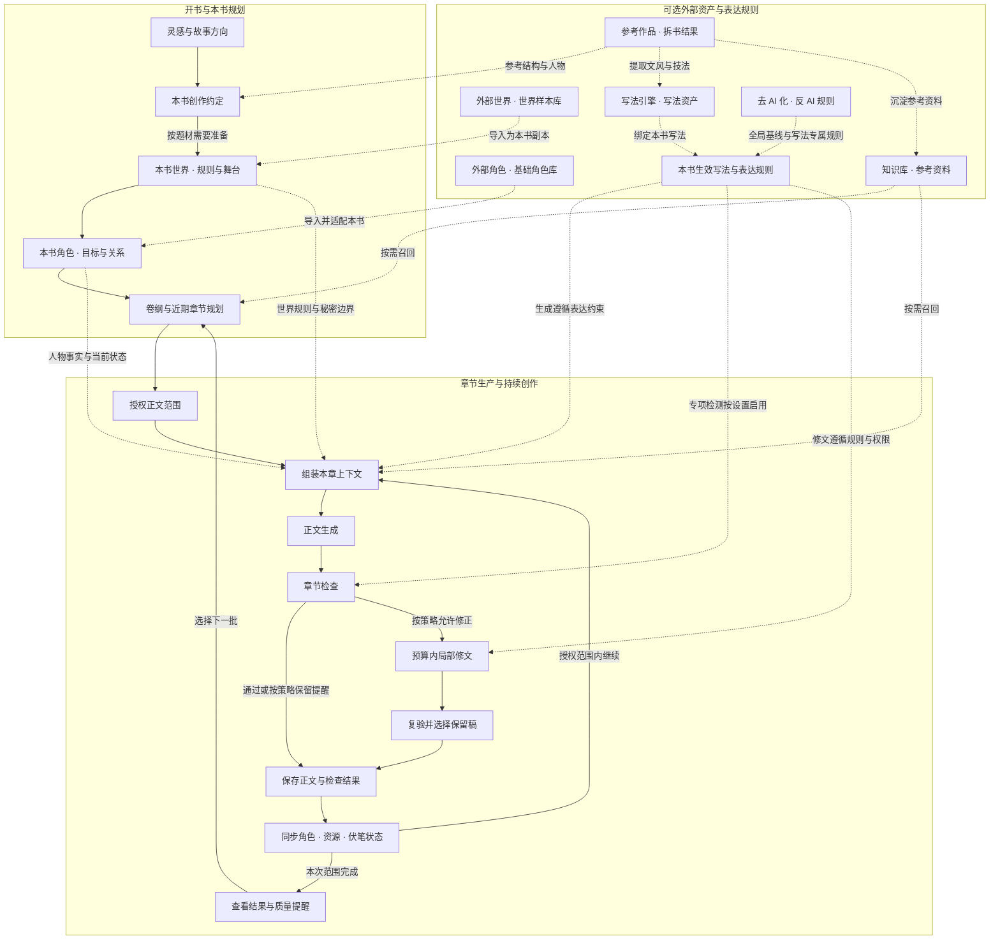

Biz Novel Studio 把「从一句灵感到完整章节」分成清晰的入口和链路。你不需要一次准备全部设定，系统会在不同阶段帮你补齐方向、世界、角色和章节任务。

<Frame caption="创作工作室，从念头开始输入灵感并生成创作方向">
  
</Frame>

本文先介绍四种开书方式，再展示长篇的完整创作链，以及外部资产如何进入本书、状态怎样回流。最后附上一张功能速查表，帮助你按需找到对应工具。

## 四种创作入口

根据你手头已有的内容，选择最合适的入口进入创作流程。

| 想写什么 | 推荐入口 | 前提条件 | 后续链路 |
| --- | --- | --- | --- |
| 连续推进的长篇小说 | 小说列表中的「AI 自动导演开书」 | 配置好模型 | 选择 V1 或 V2，进入方向候选、世界、角色和章节生产链 |
| 一次读完、有完整结局的短篇 | 小说列表或首页的「创作短篇」 | 配置好模型 | AI 整理方向与篇幅，连续生成、检查和导出 |
| 参考一本作品开新书 | 先完成拆书，再选「照着一本书写」 | 至少一份成功的拆书结果 | 选择续写原作或参考创作新书，带入拆书结论后开书 |
| 已有完整大纲，按大纲开书 | 创建或导入大纲，确认后交接为小说 | 采用的大纲修订 | 进入本书导演台，按大纲推进逐章写作（v0.8.0 新增） |

如果你还没有明确想法，可以从热门题材雷达浏览市场信号，找一个感兴趣的方向再进入自动导演。短篇有独立的完整成稿流程，不经过自动导演。已有正文或参考资料需要回溯时，还可以使用原稿修订相关能力（默认关闭，需要时开启 `VITE_MANUSCRIPT_REVISION_ENABLED`）。

<CardGroup cols={2}>
  <Card title="自动导演 V1/V2" icon="wand-magic-sparkles" href="/features/auto-director">
    选择导演版本和推进方式，持续规划和生成后续章节
  </Card>
  <Card title="短篇创作" icon="feather" href="/features/short-story">
    3,000 至 30,000 字短篇的独立完整成稿流程
  </Card>
  <Card title="拆书工作台" icon="book-open" href="/features/book-analysis">
    拆解参考作品，获得结构、人物和写法资料
  </Card>
  <Card title="大纲工作台" icon="list-check" href="/features/outline-workbench">
    建立、编辑和导入大纲，确认后交接为小说（v0.8.0 新增）
  </Card>
</CardGroup>

## 从灵感到章节的创作链

下面这张图展示长篇持续创作的完整路径。实线表示创作推进，虚线表示按需导入资料或提供约束。短篇进入独立的计划、生成与全篇检查流程。

### 三条核心规律

这段创作链的设计遵循三个核心规律，帮助你理解为什么系统要这样编排：

1. **先确定创作约定，再进入世界与角色。** 书级定位、承诺和硬约束要先定下来，世界搭建和角色生成才有稳定的坐标系。如果方向摇摆，后续的世界规则和人物目标会跟着漂移。

2. **稳定资料前置，动态信息随章更新。** 写法规则、世界设定和角色背景等复用资料被放在输入前部，本章任务、近期事件和人物状态放在后面。这让模型更容易复用相同前缀，同时保证正文基于最新剧情生成。

3. **每章完成后回流状态，下章基于已发生的事实继续。** 角色关系、资源变化和伏笔状态在保存后同步更新，下一章的上下文会自动纳入这些变化，避免连载中出现事实矛盾。

## 外部资产如何进入本书

创作链中的虚线部分表示外部资产如何进入本书并参与后续生产。了解这些边界，可以帮助你更好地准备和使用长期资料。

### 参考作品与拆书

通过拆书工作台分析参考作品后，拆书结论可以走三条虚线路径进入创作流程：

- **结构与人物路径：** 拆书的「剧情结构」和「人物系统」小节被参考到开书方向中，用于生成新书的故事走向。
- **文风与技法路径：** 拆书的「文风与技法」小节可以被提取为写法资产，沉淀到写法引擎，后续绑定到本书。
- **资料沉淀路径：** 拆书结果可以发布到知识库，后续规划或章节生成时按需召回。

如果选择「续写原作」，拆书的人物状态、时间线和未完线索会被带入本书；如果选择「参考创作新书」，则只借鉴结构和写法经验，角色与世界规则会重新生成。

### 世界样本库与角色库

世界样本库中的世界设定和角色库中的角色资产，都可以导入到当前小说。导入时会创建本书副本，你可以在此基础上按当前故事调整。本书的剧情变化不会自动同步回原始资产，长期资料由你决定是否更新。

<CardGroup cols={2}>
  <Card title="世界样本库" icon="globe" href="/features/world-library">
    保存、复用和导入可复用的世界设定
  </Card>
  <Card title="角色库" icon="users" href="/features/character-library">
    管理基础角色资产，导入到任意小说
  </Card>
</CardGroup>

### 写法引擎与反 AI 规则

写法资产和反 AI 规则共同构成本书的表达约束。写法引擎提供叙事风格与技法，反 AI 规则提供去 AI 化的全局基线和写法专属规则。

这些规则以虚线方式进入三个环节：章节生成时遵循表达约束，章节检查时按设置启用专项检测，局部修文时遵守规则权限。只提醒而不强制修正的规则会保留为章节质量提醒。

<CardGroup cols={2}>
  <Card title="写法引擎" icon="pen-nib" href="/features/style-engine">
    创建和管理可复用的叙事风格资产
  </Card>
  <Card title="反 AI 规则" icon="shield-halved" href="/features/anti-ai-rules">
    检测和修正 AI 痕迹，提升自然度
  </Card>
</CardGroup>

### 知识库按需召回

知识库中的参考资料通过 RAG 检索按需召回。它不像拆书那样有明确的结构化小节，而是在规划或章节生成时根据当前任务内容，检索最相关的资料片段参与上下文组装。

知识库不是首次写作的前置条件。先跑通正文章节后，再逐步配置知识库和 Embedding 模型，可以减少初期配置工作量。

## 状态回流与持续创作

生成链最右侧的「同步角色、资源、伏笔状态」是整个系统连续创作的关键。每次章节保存后，系统会整理本章发生的事实变化，写回本书的角色状态、资源台账和伏笔计划，使下一章的上下文基于最新的故事事实。

这种状态回流保证了以下效果：

- 角色关系、能力和目标的变化会被后续章节继承。
- 新埋下的伏笔会在后续规划中被标记为待回收。
- 已回收的伏笔会从待办状态移出，避免重复兑现。
- 世界规则的破坏或补充会成为后续章节的基础设定。

如果你按大纲开书（v0.8.0 新增），大纲中独立设置的伏笔计划会与正文证据关联。正文证据出现后，系统会关联实际台账；手动调整本书规划时，来源版本会被保留，新版大纲仅提示差异。

## 当范围完成时

当你提交一个授权范围（例如第 1 至 3 章），系统会在范围内自动推进。范围完成后，结果会展示在本书导演台，你可以：

1. 查看已保存的正文和质量提醒。
2. 处理需要人工确认的暂停事项。
3. 选择下一段范围继续推进。

全自动不会擅自写超出授权范围的内容。遇到模型不可用、配额耗尽、连续修复失败或需要重新规划时，系统也会主动停下等待处理。

## 按需求找到对应功能

如果你不确定某个创作环节应该使用哪个功能，下面这张速查表可以帮助你快速定位。

| 你想完成的事 | 工作台怎样帮助你 | 相关功能页 |
| --- | --- | --- |
| 把一个点子变成一本书的方向 | 自动导演整理题材、卖点、人物目标和候选方向；也可从热门题材或完成的拆书起步 | [小说与开书入口](/features/novels) |
| 写一篇完整短篇 | 从想法与方向选择进入 3,000 至 30,000 字短篇生产，连续阅读、修改和导出；也可另建长篇延展原故事 | [短篇创作](/features/short-story) |
| 持续写出后续章节 | V2 围绕授权范围推进近期规划、章节任务、场景、正文、检查与保存；V1 保留原工作流程 | [自动导演](/features/auto-director) |
| 维护同一本书的世界与人物 | 保存本书世界、角色、关系和章节状态，查看世界地图与角色关系图，为后续创作提供资料 | [世界样本库](/features/world-library) · [角色库](/features/character-library) |
| 控制作品的表达方式 | 写法资产与反 AI 规则参与正文生成、检查和局部修文；检测与自动修正按本书设置生效 | [写法引擎](/features/style-engine) · [反 AI 规则](/features/anti-ai-rules) |
| 学习参考作品并复用资料 | 拆书分析结构、人物与写法，回溯原文证据；结果可用于知识库、写法资产或参考开书 | [拆书工作台](/features/book-analysis) |
| 让长期资料参与写作 | 知识库与 RAG 检索召回相关资料，配合本书世界、角色和写法组装章节上下文 | [知识库](/features/knowledge-base) |
| 看懂 AI 在做什么、消耗多少 | AI 实况查看执行过程并在断线后重连；V2 小说用量页查看已记录的调用消耗；运行记录查看进度与来源 | [运行记录](/features/task-center) · [用量说明](/features/token-usage) |
| 减少连续创作中的重复消耗 | 稳定资料与动态剧情分开组织，保留可复用的输入前缀，并减少相同条件下的重复审校 | [Token 用量](/features/token-usage) |
| 让不同任务使用合适的模型 | 在页面配置供应商、连接测试与模型路由，为规划、正文、审阅、拆书分别选择模型 | [模型配置](/model-configuration) |
| 把小说延展成其他素材 | 从已有章节、人物与场景整理漫画分镜、角色视觉资产和短剧素材 | [漫画工作台](/features/comic-workspace) · [短剧工作台](/features/short-drama-workspace) |

<CardGroup cols={2}>
  <Card title="热门题材雷达" icon="chart-line" href="/features/market-radar">
    从公开榜单提炼可核对的题材信号，找到开书灵感
  </Card>
  <Card title="创作中枢" icon="lightbulb" href="/features/creative-hub">
    对话式创作引导和工具调用，帮你找到下一步
  </Card>
</CardGroup>
