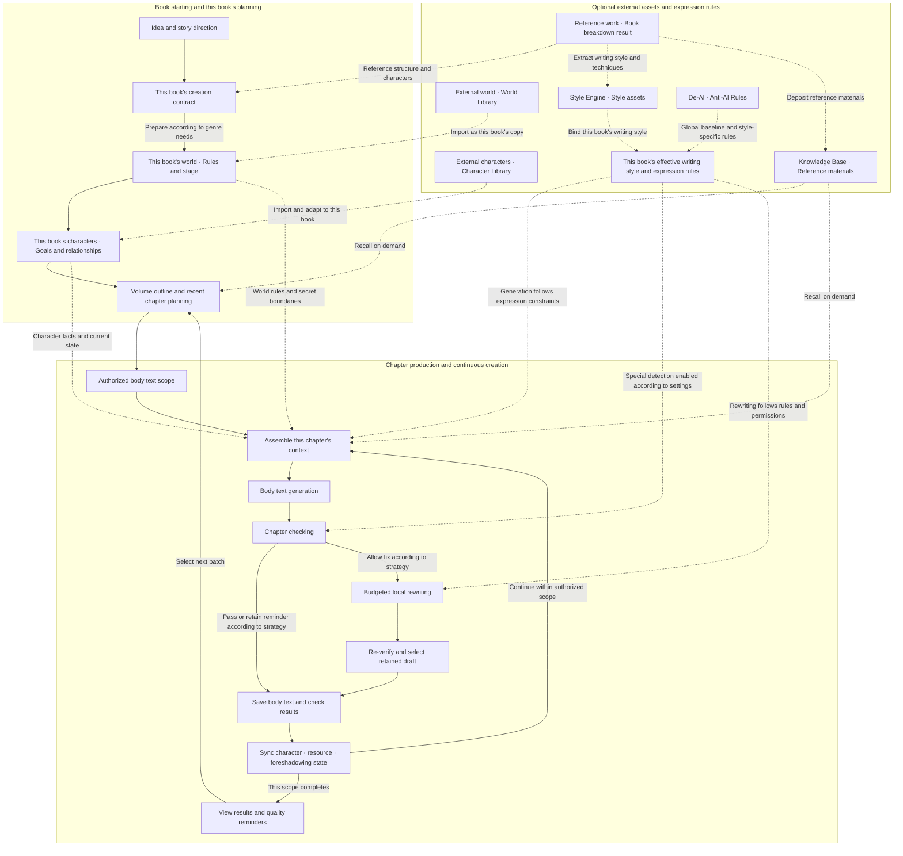

Biz Novel Studio divides "from a spark of inspiration to a complete chapter" into clear entries and chains. You do not need to prepare all settings at once; the system will help you fill in direction, world, characters, and chapter tasks at different stages.

This article first introduces four book-starting methods, then shows the complete creation chain for long-form novels, and how external assets enter this book and how states backflow. Finally, a feature quick reference table is attached to help you find the corresponding tool on demand.

## Four Creation Entries

Choose the most suitable entry based on what you already have.

| What you want to write | Recommended entry | Prerequisites | Subsequent chain |
| --- | --- | --- | --- |
| Continuously advancing long novel | "AI Auto Director starts book" in the novel list | Model configured | Choose V1 or V2, enter direction candidates, world, characters, and chapter production chain |
| Short story with a complete ending | "Create short story" in the novel list or homepage | Model configured | AI organizes direction and length, continuous generation, checking, and export |
| Start a new book referencing a work | First complete book breakdown, then select "Write based on a book" | At least one successful book breakdown result | Select continue original work or reference creation of new book, bring in breakdown conclusions, then start book |
| Have a complete outline, start from outline | Create or import outline, confirm and hand over as novel | Adopted outline revision | Enter this book's director console, advance chapter-by-chapter writing according to outline (v0.8.0 new) |

If you do not have a clear idea yet, you can browse market signals from the Trending Genre Radar to find an interesting direction, then enter the Auto Director. Short stories have an independent complete drafting workflow and do not go through the Auto Director. When you need to trace existing body text or reference materials, you can also use manuscript revision related capabilities (disabled by default, enable `VITE_MANUSCRIPT_REVISION_ENABLED` when needed).

<CardGroup cols={2}>
  <Card title="Auto Director V1/V2" icon="wand-magic-sparkles" href="/en/features/auto-director">
    Select director version and advancement mode, continuously plan and generate subsequent chapters
  </Card>

  <Card title="Short Story Creation" icon="feather" href="/en/features/short-story">
    Independent complete drafting workflow for 3,000 to 30,000 word short stories
  </Card>

  <Card title="Book Breakdown Workbench" icon="book-open" href="/en/features/book-analysis">
    Break down reference works to obtain structure, character, and writing style materials
  </Card>

  <Card title="Outline Workbench" icon="list-check" href="/en/features/outline-workbench">
    Build, edit, and import outlines; confirm and hand over as novel (v0.8.0 new)
  </Card>
</CardGroup>

## Creation Chain from Inspiration to Chapter

The diagram below shows the complete path for long-form continuous creation. Solid lines indicate creation advancement; dashed lines indicate on-demand import of materials or provision of constraints. Short stories enter an independent planning, generation, and full review flow.

### Three Core Principles

This creation chain follows three core principles, helping you understand why the system arranges things this way:

1. **Determine the creation contract first, then enter world and characters.** Book-level positioning, promises, and hard constraints must be set first, so that world building and character generation have a stable coordinate system. If direction wavers, subsequent world rules and character goals will drift along.
2. **Stable materials go in front, dynamic information updates per chapter.** Writing rules, world settings, and character backgrounds and other reusable materials are placed at the front of the input; this chapter's tasks, recent events, and character states are placed after. This makes it easier for the model to reuse the same prefix, while ensuring body text is generated based on the latest plot.
3. **After each chapter completes, states backflow; the next chapter continues based on what has already happened.** Character relationships, resource changes, and foreshadowing states are updated after saving; the next chapter's context automatically incorporates these changes, avoiding factual contradictions in serialized writing.

## How External Assets Enter This Book

The dashed lines in the creation chain indicate how external assets enter this book and participate in subsequent production. Understanding these boundaries can help you better prepare and use long-term materials.

### Reference Works and Book Breakdown

After analyzing a reference work through the Book Breakdown workbench, breakdown conclusions can enter the creation flow through three dashed paths:

- **Structure and character path:** The "plot structure" and "character system" sections of the breakdown are referenced in the book-starting direction, used to generate the new book's story trajectory.
- **Writing style and technique path:** The "writing style and technique" section of the breakdown can be extracted as style assets, deposited into the Style Engine, and subsequently bound to this book.
- **Material deposition path:** Breakdown results can be published to the Knowledge Base, and subsequently recalled on demand during planning or chapter generation.

If you select "Continue original work", the breakdown's character states, timeline, and unfinished threads are brought into this book; if you select "Reference creation of new book", only structure and writing style experience are borrowed, and characters and world rules are regenerated.

### World Library and Character Library

World settings in the World Library and character assets in the Character Library can both be imported into the current novel. A copy for this book is created upon import; you can adjust based on the current story. Plot changes in this book will not automatically sync back to the original assets; long-term materials are updated at your discretion.

<CardGroup cols={2}>
  <Card title="World Library" icon="globe" href="/en/features/world-library">
    Save, reuse, and import reusable world settings
  </Card>

  <Card title="Character Library" icon="users" href="/en/features/character-library">
    Manage base character assets, import into any novel
  </Card>
</CardGroup>

### Style Engine and Anti-AI Rules

Style assets and Anti-AI Rules together constitute this book's expression constraints. The Style Engine provides narrative style and techniques; Anti-AI Rules provide de-AI global baselines and style-specific rules.

These rules enter three stages in dashed lines: expression constraints are followed during chapter generation, special detection is enabled according to settings during chapter checking, and rules and permissions are followed during local rewriting. Rules that only remind without forcing correction are retained as chapter quality reminders.

<CardGroup cols={2}>
  <Card title="Style Engine" icon="pen-nib" href="/en/features/style-engine">
    Create and manage reusable narrative style assets
  </Card>

  <Card title="Anti-AI Rules" icon="shield-halved" href="/en/features/anti-ai-rules">
    Detect and correct AI traces, improve naturalness
  </Card>
</CardGroup>

### Knowledge Base Recalled on Demand

Reference materials in the Knowledge Base are recalled on demand through RAG retrieval. Unlike book breakdowns with clear structured sections, it retrieves the most relevant material fragments based on current task content during planning or chapter generation to participate in context assembly.

The Knowledge Base is not a prerequisite for first-time writing. Get body text chapters running first, then gradually configure the Knowledge Base and Embedding model to reduce initial configuration workload.

## State Backflow and Continuous Creation

The "Sync character, resource, foreshadowing state" on the far right of the generation chain is the key to the entire system's continuous creation. After each chapter is saved, the system organizes the factual changes that occurred in this chapter, writing them back to this book's character states, resource ledger, and foreshadowing plan, so that the next chapter's context is based on the latest story facts.

This state backflow ensures the following effects:

- Character relationships, abilities, and goal changes are inherited by subsequent chapters.
- Newly planted foreshadowing is marked as pending recovery in subsequent planning.
- Recovered foreshadowing is removed from the to-do state, avoiding duplicate fulfillment.
- World rule breaches or additions become foundational settings for subsequent chapters.

If you start from outline (v0.8.0 new), foreshadowing plans independently set in the outline are associated with body text evidence. After body text evidence appears, the system associates the actual ledger; when manually adjusting this book's planning, the source version is retained, and the new outline only prompts differences.

## When Scope Completes

When you submit an authorized scope (for example, chapters 1 to 3), the system automatically advances within the scope. After scope completion, results are displayed in this book's director console, where you can:

1. View saved body text and quality reminders.
2. Handle pause items requiring manual confirmation.
3. Select the next scope segment to continue advancing.

Full auto will not write beyond the authorized scope without permission. When models are unavailable, quotas are exhausted, consecutive fixes fail, or replanning is needed, the system will also proactively stop and wait for handling.

## Find the Corresponding Feature by Need

If you are unsure which feature to use for a certain creation step, the quick reference table below can help you quickly locate it.

| What you want to do | How the workbench helps | Related feature pages |
| --- | --- | --- |
| Turn an idea into a book's direction | Auto Director organizes genre, selling points, character goals, and candidate directions; can also start from trending genres or completed book breakdowns | [Novels and Book Starting Entry](/en/features/novels) |
| Write a complete short story | Enter from idea and direction selection into 3,000 to 30,000 word short story production, continuous reading, editing, and export; can also create a new long novel to extend the original story | [Short Story Creation](/en/features/short-story) |
| Keep writing subsequent chapters | V2 advances recent planning, chapter tasks, scenes, body text, checking, and saving within authorized scope; V1 retains original workflow | [Auto Director](/en/features/auto-director) |
| Maintain worlds and characters for the same book | Save this book's world, characters, relationships, and chapter states; view world maps and character relationship graphs to provide materials for subsequent creation | [World Library](/en/features/world-library) · [Character Library](/en/features/character-library) |
| Control the work's expression style | Style assets and Anti-AI Rules participate in body text generation, checking, and local rewriting; detection and auto-correction take effect according to this book's settings | [Style Engine](/en/features/style-engine) · [Anti-AI Rules](/en/features/anti-ai-rules) |
| Learn from reference works and reuse materials | Book breakdown analyzes structure, characters, and writing style, with traceable original text evidence; results can be used for Knowledge Base, style assets, or reference book starting | [Book Breakdown Workbench](/en/features/book-analysis) |
| Let long-term materials participate in writing | Knowledge Base and RAG retrieval recall relevant materials, assembling chapter context together with this book's world, characters, and writing style | [Knowledge Base](/en/features/knowledge-base) |
| Understand what AI is doing and how much it consumes | AI Live View watches execution process and reconnects after disconnection; V2 novel usage page views recorded call consumption; Run History views progress and source | [Run History](/en/features/task-center) · [Usage Explanation](/en/features/token-usage) |
| Reduce repeated consumption in continuous creation | Stable materials and dynamic plot are organized separately, retaining reusable input prefixes, and reducing repeated review under the same conditions | [Token Usage](/en/features/token-usage) |
| Let different tasks use suitable models | Configure providers, connection testing, and model routing on the page; select different models for planning, body text, review, and book breakdown | [Model Configuration](/en/model-configuration) |
| Extend the novel into other materials | Organize comic storyboards, character visual assets, and short drama materials from existing chapters, characters, and scenes | [Comic Workbench](/en/features/comic-workspace) · [Short Drama Workbench](/en/features/short-drama-workspace) |

<CardGroup cols={2}>
  <Card title="Trending Genre Radar" icon="chart-line" href="/en/features/market-radar">
    Extract verifiable genre signals from public rankings to find book-starting inspiration
  </Card>

  <Card title="Creative Hub" icon="lightbulb" href="/en/features/creative-hub">
    Conversational creation guidance and tool invocation to help you find the next step
  </Card>
</CardGroup>
