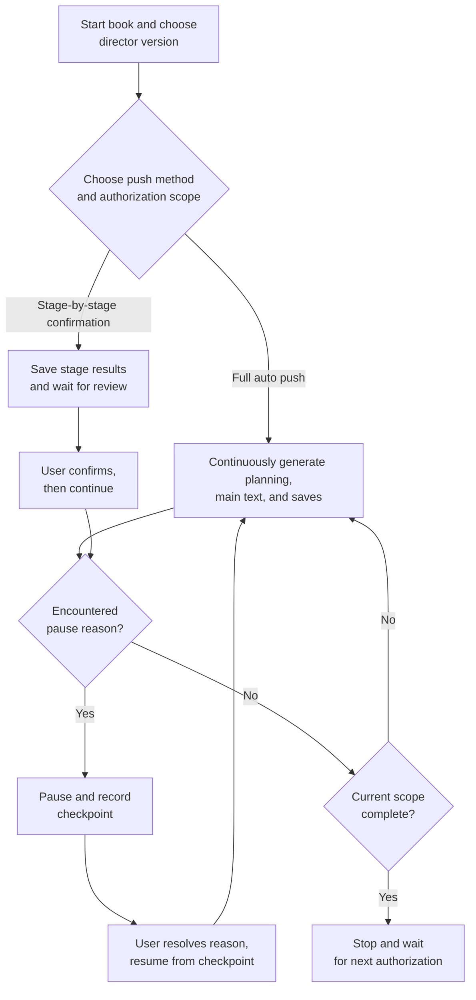
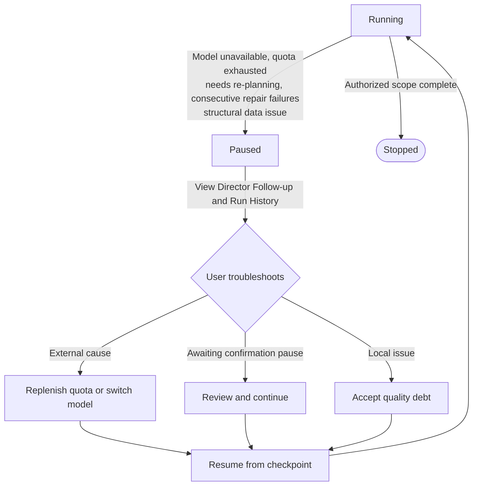

The Auto Director turns vague ideas into executable novel projects and continuously pushes world building, characters, volume planning, and chapter production. For long-form creation, you first choose between V1 and V2, then select the run mode for each push.

<Info>
  Short story creation has an independent complete-draft flow and does not go through the Auto Director.
</Info>

## How to Choose Between V1 and V2

|  | Director V1 | Director V2 |
| --- | --- | --- |
| Entry point | Original director and novel workbench, keeping staged creation entries | This book's director console, concentrating reading directory, main text, and materials, and pushing the next segment of creation |
| Suitable for | Continuing existing novels, or preferring the original workbench operations | Starting new books, planning and generating continuously within the authorized scope |
| Tasks and recovery | Uses its own tasks, checkpoints, and recovery flow | Uses its own runs, stage results, and save progress |
| Default choice | Historical novels keep their original version | When V2 is available, new books default to V2 |

The start page lets you choose an available director version. For existing novels, you must first end the current creation, then switch in the book settings; saved main text and history are retained. **Switching versions only saves the selection; it does not automatically start generation, nor does it restore another version's old tasks.**

To temporarily disable V2, explicitly set `DIRECTOR_NEXT_ENABLED=false`.

## V2 Run Modes: Full Auto and Stage-by-Stage Confirmation

The flowchart below shows the core run chain of the V2 this-book director console: after starting a book, choose the push method and authorization scope, then enter a continuous generation loop; it stops only when the scope is complete, a pause reason is encountered, or the user intervenes.

| Creation method | How AI pushes | What you need to do |
| --- | --- | --- |
| **Full auto push** | Within the current authorized scope, fill in required planning, write main text, check and save; ordinary stage results auto-continue | First choose direction and scope; handle explicit pause items when encountered, then continue from the book's director console |
| **Stage-by-stage confirmation (semi-auto)** | Save results at stages needing confirmation, wait for your review before continuing; main text is confirmed at batch end | Open the current stage result, review, then click confirm; no need to manually trigger the whole chain chapter by chapter |

The current mode is shown next to the book title and at the top of the director console; subsequent main text batches follow the selected mode.

## Why Full Auto May Still Stop

Full auto continues executing within your authorized scope; **after the scope is complete, you must choose the next segment**. For example, if you submit Chapters 1 to 3, it will not arbitrarily write Chapter 4 after completion.

The system also pauses when encountering the following:

- Model unavailable or quota exhausted
- Needs re-planning
- Single-chapter usage protection triggered
- Data integrity issue

Ordinary local quality issues are recorded as chapter reminders by default and the system continues; if the "quality priority" strategy is chosen, it may wait for manual handling after main text is saved.

## Director Push Flow

The step-through widget below shows the real stage order from "confirm direction" to "chapter execution". In the Auto Director, the user's most critical creative choice is confirming the direction; after confirmation, the system writes subsequent steps into the task queue and continues pushing.

<DirectorFlowWidget />

### Flow Description

| Stage | Description | Needs confirmation? |
| --- | --- | --- |
| Idea alignment | System understands input, genre preference, target chapter count | No |
| Project positioning | Forms book-level positioning, selling points, and target readers | No |
| Direction candidate batch | Generates optional start-book directions | Yes |
| Title candidate group | Generates titles for the selected direction | Yes |
| Create novel | Turns confirmed direction into a real project | No |
| Story macro | Generates long-term conflict and push cycle for the whole book | Depends on strategy |
| Book contract | Writes target readers, selling points, promises, and hard constraints | Depends on strategy |
| World building | Generates this book's world skeleton, rules, and factions | Depends on strategy |
| Character generation | Generates character candidates and lineup draft | Yes (stops if quality is not acceptable) |
| Apply character lineup | Writes approved characters into formal assets | Depends on strategy |
| Volume strategy | Generates volume strategy, goals, and push route | Yes |
| Volume skeleton | Generates volume list and tasks per volume | Depends on strategy |
| Beat board | Breaks volume planning into executable beat nodes | Depends on strategy |
| Chapter list | Generates chapter titles, order, and basic goals | Depends on strategy |
| Chapter sync | Syncs task data to chapter records | Depends on strategy |
| Chapter refinement | Generates chapter brief and execution resources | Depends on strategy |
| Chapter batch ready | Can begin writing this batch of chapters | Yes |
| Chapter execution | Generates main text, review, repair, and status backfill | Depends on strategy |

<Tip>
  Users often simplify the flow as "direction, world, characters, chapter breakdown, execution", but the real backend covers at least 17 stages. Stages can be paused, resumed, and retried between one another.
</Tip>

## Run Modes and Applicable Scope

| Mode | Auto runs until | Suitable for |
| --- | --- | --- |
| Prepare to ready for writing (recommended for beginners) | After confirming the plan, auto-completes planning, characters, volumes, and chapter tasks, stopping at ready-for-writing state | First-time book starters, those who want to review whether the plan is solid first |
| Full book auto-completion | After confirming the plan, continuously pushes planning, writing, review, and repair | Those who want to go from plan directly to novel output |
| Execute by scope | Only auto-executes the first N chapters or Volume 1, etc. | Those who want to validate a segment first, then expand the scope |
| Quality repair toggle (overlay) | After chapter main text is completed, enters AI detection removal, review, and fixable issue handling | Those who want a more complete automatic closed loop |

### What Happens After Interruption

**Full book auto-completion** stops **actively** and waits for user handling when encountering model unavailability, quota exhaustion, consecutive repair failures, requests for re-planning, or structural data issues, rather than retrying infinitely.

The diagram below shows the complete pause-to-recovery handling flow.

Handling steps:

1. Open Director Follow-up and check the pause reason
2. Open Run History and confirm the latest failed task and error message
3. Eliminate external causes (replenish quota, switch model, fix network)
4. Click **Continue Auto Director** (继续自动导演) in Director Follow-up to resume from the original checkpoint

Do not directly exit director mode or delete the project.

## Recovery and Re-Planning

When encountering a pause, judge in this order:

1. Is it only waiting to select a candidate, character, or volume plan?
2. Is there a retryable background task?
3. Is there already usable chapter content?
4. Is local repair needed or should quality debt be accepted?
5. Is re-planning explicitly required?

Only stop the global chain for explicit re-planning, irrecoverable generation failure, data integrity risk, or system security issues. Local quality debt does not equal global failure.

<Tip>
  For complete descriptions of pause reasons, continue entries, and takeover actions, see [Director Follow-up](/en/features/director-follow-up); for stage-by-stage symptom and recovery entry matching, see [Recovery by Phase](/en/guides/recovery-by-phase).
</Tip>

## Frequently Asked Questions

<AccordionGroup>
  <Accordion title="Can V1 and V2 be used on the same novel?">
    You cannot run both director versions simultaneously. Before switching, you must first end the current creation; saved main text and history are retained.
  </Accordion>

  <Accordion title="Is stage-by-stage confirmation troublesome?">
    No. The system only stops at key nodes, for example direction candidates, character confirmation, volume strategy, and chapter batch ready. You do not need to confirm chapter by chapter manually.
  </Accordion>

  <Accordion title="Why does it sometimes freeze?">
    First check the pause reason in Director Follow-up, then check the background status in Run History. In many cases it is simply waiting for approval, not a failure.
  </Accordion>

  <Accordion title="Can I change the model midway?">
    Yes. After correcting or switching the model in system settings, return to Director Follow-up and continue. Saved main text will not be regenerated.
  </Accordion>

  <Accordion title="Can the run mode be changed at any time?">
    You can adjust it in Director Follow-up's **Continue Auto Director** (继续自动导演) or takeover actions; switching does not lose completed stage products.
  </Accordion>
</AccordionGroup>

<CardGroup cols={2}>
  <Card title={"Novels & Starting a Book"} icon="book-open" href="/en/features/novels">
    Create a project and choose the initial direction
  </Card>

  <Card title="Director Follow-up" icon="compass" href="/en/features/director-follow-up">
    View pause reasons, continue, or take over the Auto Director
  </Card>

  <Card title="First Novel Walkthrough" icon="route" href="/en/guides/first-novel-walkthrough">
    Follow a complete case from idea to completed volume
  </Card>

  <Card title="Production Pipeline" icon="diagram-project" href="/en/guides/production-pipeline">
    Understand what each layer of the Auto Director does
  </Card>
</CardGroup>

export const DirectorFlowWidget = () => {
  const [active, setActive] = useState(0);
  const [mode, setMode] = useState("auto");
  const [playing, setPlaying] = useState(false);

  const steps = [
    { label: "Direction candidates", detail: "Generate optional book-level directions and title groups from the idea.", confirm: true },
    { label: "Project creation", detail: "Turn the confirmed direction into a novel project, writing candidate direction, title, and run parameters.", confirm: false },
    { label: "Story macro", detail: "Generate long-term conflict, push cycle, and mainline structure for the whole book.", confirm: false },
    { label: "World building", detail: "Generate this book's world skeleton, rules, factions, and locations.", confirm: false },
    { label: "Character generation", detail: "Generate character candidates and lineup draft.", confirm: true },
    { label: "Volume strategy", detail: "Generate volume strategy, push route, and volume goals.", confirm: true },
    { label: "Beat board", detail: "Break volume planning into executable chapter tasks.", confirm: false },
    { label: "Chapter refinement", detail: "Generate chapter brief, scene cards, and goals.", confirm: false },
    { label: "Chapter batch ready", detail: "Can begin writing this batch of chapters.", confirm: true },
    { label: "Main text generation", detail: "Generate main text draft by chapter brief.", confirm: false },
    { label: "Quality review", detail: "Check whether main text meets task and style requirements.", confirm: false },
    { label: "Repair and backfill", detail: "Local text repair, save main text, and sync character and foreshadowing status.", confirm: false },
  ];

  useEffect(() => {
    if (!playing) return;
    const timer = setInterval(() => {
      setActive((a) => {
        if (a >= steps.length - 1) {
          setPlaying(false);
          return a;
        }
        return a + 1;
      });
    }, 1000);
    return () => clearInterval(timer);
  }, [playing]);

  const navButton = {
    padding: "6px 14px",
    borderRadius: 8,
    border: "1px solid rgba(127,127,127,.35)",
    background: "transparent",
    color: "inherit",
    font: "inherit",
    cursor: "pointer",
  };

  return (
    

      

      

        <strong style={{ fontSize: 14 }}>Run mode:</strong>
        <label style={{ display: "flex", alignItems: "center", gap: 6, fontSize: 14, cursor: "pointer" }}>
          <input type="radio" checked={mode === "auto"} onChange={() => setMode("auto")} />
          Full auto push
        </label>
        <label style={{ display: "flex", alignItems: "center", gap: 6, fontSize: 14, cursor: "pointer" }}>
          <input type="radio" checked={mode === "confirm"} onChange={() => setMode("confirm")} />
          Stage-by-stage confirmation
        </label>
      

      

        <button type="button" style={navButton} onClick={() => { setActive(0); setPlaying(false); }}>
          Reset
        </button>
        <button type="button" style={navButton} onClick={() => setPlaying((p) => !p)}>
          {playing ? "Pause" : "Auto play"}
        </button>
        
          {active + 1} / {steps.length}
        
      

      

        {steps.map((step, i) => {
          const isActive = i === active;
          const isPast = i < active;
          const isFuture = i > active;
          const showWait = mode === "confirm" && step.confirm && isActive;
          return (
            <button
              key={i}
              type="button"
              onClick={() => { setActive(i); setPlaying(false); }}
              className="df-step"
              style={{
                textAlign: "left",
                padding: 12,
                borderRadius: 10,
                font: "inherit",
                color: "inherit",
                cursor: "pointer",
                border: isActive ? "2px solid #16A34A" : "1px solid rgba(127,127,127,.3)",
                background: isActive ? "rgba(22,163,74,.12)" : isPast ? "rgba(22,163,74,.06)" : "transparent",
                opacity: isFuture ? 0.55 : 1,
              }}
            >
              

                Step {i + 1}
                {showWait && Waiting confirmation}
              

              
{step.label}

            </button>
          );
        })}
      

      

        
{steps[active].label}

        

          {steps[active].detail}
          {mode === "confirm" && steps[active].confirm && (
            
              In stage-by-stage confirmation mode, this stage pauses after completion and waits for your review before continuing.
            
          )}
        

      

      

        <button type="button" style={navButton} disabled={active === 0} onClick={() => { setActive(active - 1); setPlaying(false); }}>
          Previous
        </button>
        <button type="button" style={navButton} disabled={active === steps.length - 1} onClick={() => { setActive(active + 1); setPlaying(false); }}>
          Next
        </button>
      

    

  );
};
