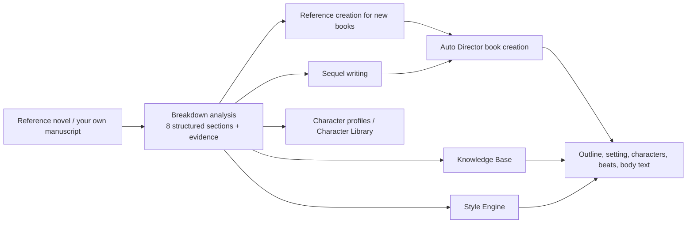

The Book Breakdown workbench is used to analyze reference works or your own manuscripts. It does not simply generate a book report. Instead, it breaks a work down into **structured fields backed by original text evidence that subsequent workflows can read directly**.

Breakdown conclusions are not just reports for human reading: book creation, sequel writing, planning, characters, style, and body text generation all read them on demand. A solid breakdown determines how stable the starting point is for everything that follows.

<CardGroup cols={3}>
  <Card title="Reference Creation for New Books" icon="seedling" href="#reference-creation-for-new-books">
    Learn a book's structure, pacing, hooks, and style, then generate entirely new characters, worlds, and plots.
  </Card>

  <Card title="Sequel Writing" icon="book-bookmark" href="#sequel-writing">
    Pick up character states, world rules, and unresolved threads from the original ending, and continue writing from there.
  </Card>

  <Card title="Diagnosis and Accumulation" icon="stethoscope" href="#diagnosing-your-own-manuscript">
    Diagnose your own manuscript and commit conclusions to the Knowledge Base, Style Engine, and Character Library.
  </Card>
</CardGroup>

## Where Breakdown Fits in the Creative Workflow

## What Breakdown Can Do for You

- Learn a reference work's genre positioning, main plot progression, character system, worldbuilding, thematic expression, stylistic techniques, and commercial appeal.
- From a successful breakdown, directly choose "Sequel Writing" or "Reference Creation for New Books" to turn the breakdown into a book creation basis.
- Diagnose your own manuscript, checking pacing, characters, foreshadowing, themes, and whether reader expectations are clear.
- Publish breakdown conclusions to the Knowledge Base so subsequent planning, sequel writing, and body text generation can continue using them.
- Generate style assets from the "Style and Techniques" analysis, accumulating a reusable narrative style.
- Deeply study characters, generate character profiles, image evolution, reference images, and promote them to the base Character Library when needed.

## When to Use It

- You see a reference work you want to learn from and want to understand why its structure, payoff points, and characters work.
- You want to continue writing based on an existing work and need to first clarify the characters, world, and unresolved threads from the previous work.
- Before starting a new book, you want to break down several works of the same type to accumulate genre, character, and style references.
- After finishing a section of your own manuscript, you want the system to run a structured diagnosis for you.
- You want to turn materials from "having read them" into Knowledge Base content that can be retrieved and cited in subsequent creation.
- You want to study a specific character's appearance, personality, arc, relationships, and chapter-by-chapter performance in isolation.

## Preparation Before Starting

Breakdown requires a source text that can be analyzed. Common sources fall into two categories:

- **Knowledge Base documents**: suitable for analyzing reference works, reference texts, or organized novel source text.
- **Your novel body text**: suitable for using "Diagnose Manuscript" to check your own manuscript.

The longer the text, the higher the analysis time and token consumption usually are. For first-time use, it is recommended to first select a small chapter range or use "Quick Breakdown" to confirm the results meet expectations before doing a full breakdown.

If you want to use capabilities such as publishing to the Knowledge Base, evidence jumping, and character image evolution, ensure the Knowledge Base and model configuration are available first.

## Creating a Breakdown Analysis

Click "New Breakdown" in the breakdown page on the left, then select in the following order:

<Steps>
  <Step title="Select Source">
    Choose the document to analyze or enter "Diagnose Manuscript".
  </Step>
  <Step title="Select Range">
    Choose the analysis range: full text, chapter range, or word-count equivalent range.
  </Step>
  <Step title="Select Breakdown Type">
    Choose Quick Breakdown, Standard Breakdown, or Full Breakdown.
  </Step>
  <Step title="Fill in Focus Areas">
    For example, "focus on ensemble characters," "focus on opening hooks," or "focus on paid payoff points."
  </Step>
  <Step title="Set Budget Cap">
    Avoid long texts consuming model quota without your knowledge. The default budget is 200,000 tokens.
  </Step>
  <Step title="Submit Task">
    Submit and wait for the task to complete. During the process, you can check status in the Run History.
  </Step>
</Steps>

Focus areas affect which content the system prioritizes for analysis, but do not change the evidence source. That is, breakdown conclusions should still come from the original text as much as possible, rather than being freely generated based on the focus areas.

## How to Choose Among the Three Breakdown Types

<Tabs>
  <Tab title="Quick Breakdown">
    Prioritize understanding the work's positioning, main structure, character system, and stylistic features. Suitable for a low-cost initial judgment of whether a work is worth deep analysis.

    Includes: Breakdown Overview, Plot Structure, Character System, Style and Techniques.
  </Tab>
  <Tab title="Standard Breakdown">
    Covers most information needed for creative reuse. Does not generate a timeline by default. Suitable for most web novel reference analysis, and is the recommended choice for "Reference Creation for New Books."

    Includes: Breakdown Overview, Plot Structure, Character System, Worldbuilding and Setting, Thematic Expression, Style and Techniques, Commercial Appeal.
  </Tab>
  <Tab title="Full Breakdown">
    Generates all analysis sections, including the story timeline. Suitable for long-form sequel writing, imitation writing, or deep review. **Recommended for preparing to write a sequel to an original work.**

    Includes: All sections from Standard Breakdown, plus Story Timeline.
  </Tab>
</Tabs>

| Your Goal | Recommended Type | Reason |
| --- | --- | --- |
| Judge whether a book is worth studying | Quick Breakdown | Lowest cost; first look at positioning, structure, characters, and style |
| Reference creation for new books | Standard Breakdown | Covers plot structure, style and techniques, commercial appeal, and other sections essential for book creation |
| Sequel writing | Full Breakdown | The timeline is prioritized for continuing the predecessor's event order and final state |
| Deep review or imitation study | Full Breakdown | All sections available; most complete information |

## Eight Analysis Sections

Each section simultaneously generates readable body text and structured fields. Structured fields are what subsequent book creation, sequel writing, and planning actually read, so breakdown quality directly affects later creative results.

| Section | Structured Fields | Main Uses |
| --- | --- | --- |
| Breakdown Overview | One-sentence positioning, genre tags, appeal tags, target readers, overall strengths, overall weaknesses | Quickly judge work positioning; serves as overall reference for book creation and adaptation |
| Plot Structure | Main plot summary, stage progression, conflict escalation, highlight design, pacing risks, structural highlights, reusable patterns | Learn how the main plot progresses; essential section for sequel and reference creation |
| Story Timeline | Key time nodes, event sequence, main plot stage division, state change nodes, timeline risks | Prioritized for reading during sequel writing; used to pick up the predecessor's event order and ending |
| Character System | Protagonist positioning, supporting character functions, antagonist functions, relationship network, growth arcs, character highlights, distinctiveness risks | Understand character division of labor; used to pick up character states during sequel writing |
| Worldbuilding and Setting | World framework, rule systems, setting highlights, plot support, setting risks | Learn how settings serve the plot; preserve world rules during sequel writing |
| Thematic Expression | Core theme, symbolic motifs, emotional tone, presentation method, theme risks | Grasp the work's emotional and expressive direction |
| Style and Techniques | Narrative perspective, language style, description method, dialogue characteristics, pacing control, hook design, reusable style | Generate style assets; learn style during reference creation |
| Commercial Appeal | Reader payoff points, click drivers, character appeal, genre appeal, reader match, commercial risks | Learn payoff points and reward pacing; convert into your own appeal during reference creation |

## Reading Breakdown Results

The breakdown detail page is mainly divided into "Section Analysis" and "Character Profiles" views.

In "Section Analysis," prioritize reading the key conclusions of each section. Key conclusions are suitable for quickly judging whether this breakdown is valuable; expand to read the full text when you need more complete explanations.

If you want to check the source of a conclusion, you can view "Section Evidence." Evidence is bound to corresponding conclusions as much as possible; clicking it shows excerpts. Evidence with chapter positioning can be used with "Dual Pane" to view the original chapter and highlighted position.

"Dual Pane" is suitable for use on wide screens: the original text on the left, breakdown conclusions on the right. This mode is clearer when reading reference works, checking key evidence, or diagnosing your own manuscript.

<Tip>
  Breakdown conclusions are read directly by subsequent workflows. When you find a conclusion inaccurate, fixing or redoing that section before using it for book creation or sequel writing is much less effort than correcting course after starting the book.
</Tip>

## Starting a Book from Breakdown Results

Successful breakdown results provide a "Write Like This Book" entry at the top. This turns the breakdown from a reading report into a basis for a new project.

<Steps>
  <Step title="Open Breakdown Results">
    Open a breakdown with a success status. You can also initiate "Write Like a Book" from the novel list, then select a completed breakdown.
  </Step>
  <Step title="Select Work Scale">
    Choose "Long Novel" or "Short Story (3,000 to 30,000 words)."
  </Step>
  <Step title="Select Creation Mode">
    Choose "Sequel Writing" or "Reference Creation for New Books." Short stories only support "Reference Creation for New Short Story."
  </Step>
  <Step title="Confirm Creative Continuation Plan">
    The system will organize a "Creative Continuation Plan" based on the breakdown conclusions. Review the first three chapters' story direction before deciding whether to adopt it.
  </Step>
  <Step title="Enter Auto Director Book Creation">
    After adopting the plan, continue filling in book creation settings, generate direction candidates, and confirm the project.
  </Step>
</Steps>

| Mode | Applicable Scenario | Data Boundaries |
| --- | --- | --- |
| Sequel Writing | Continue from the original work's ending | Preserve original characters, world rules, timeline, and unresolved threads |
| Reference Creation for New Books | Learn structure, pacing, and style | Regenerate characters, world, and plot; avoid copying original facts |

### Pre-Book Breakdown Check

The two modes have different minimum requirements for breakdown sections. When required sections are missing, the continuation plan page will prompt "Breakdown is missing: ..." and provide a "Go Complete Breakdown" entry.

| Mode | Required Sections | Optional but Recommended Sections |
| --- | --- | --- |
| Sequel Writing | Character System, Plot Structure | Story Timeline, Breakdown Overview, Worldbuilding and Setting, Thematic Expression, Style and Techniques, Commercial Appeal |
| Reference Creation for New Books | Plot Structure, Style and Techniques, Commercial Appeal | Remaining sections |

### Creative Continuation Plan

The Creative Continuation Plan is the bridge between the breakdown and the new project. It translates breakdown conclusions into "how exactly should this new book be written," including:

- **How to write the first three chapters**: Opening direction, handed to AI for continued planning after adoption.
- **This book's creative direction**: Translating reference work characteristics into your story.
- **What the original book's characteristics are**: Reference features the plan is based on, which you can expand to verify.
- **What the sequel needs to pick up** (Sequel Writing): Character states at the original ending, unresolved storylines.
- **How to turn it into an independent new book** (Reference Creation for New Books): Hooks that attract readers, conflicts that continuously drive the story, payoff points and reward pacing.

The plan footer indicates the original text version it is based on. When dissatisfied with the plan, you can retry generation. During new plan generation, the current plan is retained for comparison.

### Sequel Writing

Sequel mode requires the project to have exactly one upstream source: an in-site novel or a Knowledge Base novel. Once enabled, the system will continuously bring in predecessor context during subsequent planning and body text generation:

- **Predecessor core character states**: From the Character System.
- **Predecessor final chapter summary**: From the Story Timeline, prioritized for placement in context during planning.
- **Predecessor key facts**: From the Breakdown Overview, Worldbuilding and Setting, and Thematic Expression, used to maintain causality.
- **Predecessor unresolved threads**: From Plot Structure, Timeline, and Commercial Appeal, which can be advanced but whose scenes must not be copied.

The core rule for sequel writing is: **must continue the predecessor's causality and character arcs, but prohibits replicating the order of key scenes, iconic lines, and phrasing from the original work.**

<Note>
  During sequel writing, the system compares newly generated body text with the predecessor's original text for similarity. When similarity is too high, it automatically rewrites the passage to reduce overlap with the original work.
</Note>

### Reference Creation for New Books

Reference creation learns the reference work's structure, pacing, and style, but characters, world, and plot are all regenerated.

The reference breakdown is read on demand at different creative stages, with each stage only taking relevant sections to avoid irrelevant information interference:

| Creative Stage | Breakdown Sections Read |
| --- | --- |
| Story Outline | Plot Structure, Story Timeline, Worldbuilding and Setting, Breakdown Overview |
| Structured Outline | Plot Structure, Story Timeline, Character System |
| Work Setting | Character System, Worldbuilding and Setting, Thematic Expression |
| Chapter Beats | Plot Structure, Story Timeline, Commercial Appeal |
| Characters | Character System |

You can also specify which breakdown sections to bring in through project settings.

<Tip>
  Style preparation does not block book creation. Reference style is prepared together with breakdown context. When style cannot be created temporarily, you can still enter the book creation page to continue confirming direction; you can supplement or rebind in the Style Engine later.
</Tip>

## Character Profiles

"Character Profiles" are used to study characters in a work. They are not the same thing as the "Character System" section:

- **Character System section**: Helps you quickly understand the book's character division of labor and relationship tension.
- **Character Profiles**: Used for deep study of a single character's appearance, personality, goals, abilities, relationships, arc, and key scenes.

Character profiles usually first identify candidate characters, then let you decide whether to generate a full profile. This way, you can first see which characters are worth studying, then spend budget on the ones that truly matter.

Character profiles support four depths: Brief, Standard, Deep, and Full. Brief and Standard are suitable for quick character understanding; Deep and Full place more emphasis on original text evidence, suitable for studying protagonists, antagonists, important supporting characters, or character designs you plan to borrow.

When creating a new character, you can also select one or more completed breakdown analyses as references.

### Image Evolution

Within character profiles, you can continue to view "Image Evolution." It is suitable for studying a character's appearance, clothing, accessories, physical state, mental state, and scene state across different chapters.

When using it, you can select target coverage, such as 25%, 50%, 75%, or 100%. The system scans incrementally by chapter; completed snapshots are not repeatedly rerun.

Image evolution also accumulates "Pending Appearance Entries." These entries are newly discovered appearance information from chapters, such as hair color, clothing, scars, accessories, or temperament. They are not automatically written back to character appearance; only when you check and select merge do they enter the stable appearance description in the character profile.

If generating chapter images, the system prioritizes referencing the character's existing base image. When a character has multiple base images, you can select which reference image to use for this session, making the same character more consistent across different scenes.

## Publishing and Reuse

In addition to direct book creation, breakdown conclusions can also be committed as long-term materials:

- **Publish to the Knowledge Base**, so subsequent planning, sequel writing, and body text generation can retrieve these conclusions.
- **Click "Generate Style"** to turn the breakdown's "Style and Techniques" into a style asset.
- **Generate reference images in character profiles, set as main image**, or promote the character to the base Character Library.
- **Export or copy** breakdown content as external organization and review materials.

The same breakdown can be published to the Knowledge Base multiple times. Subsequent publications preserve the source relationship, making it easy to return to the original breakdown for continued viewing.

## Diagnosing Your Own Manuscript

"Diagnose Manuscript" is suitable for checking your own novel body text. It uses the breakdown method to check pacing, characters, themes, foreshadowing, and commercial appeal, using the current novel body text as the analysis source.

Diagnosis results do not automatically modify the original novel, nor do they directly write back to chapter body text. They only help you discover problems and organize suggestions. When actually revising, you still need to return to chapter execution, body text editing, quality repair, or other creative entries to explicitly operate.

## Budget and Recovery

Breakdown is a long task, especially full-text long novels, full breakdowns, deep character profiles, and image evolution, all of which increase model calls.

If the budget is exhausted, the task stops at the current boundary and preserves already completed sections. You can:

- View budget usage and stop reason.
- Adjust the breakdown budget.
- Use "Expand Budget and Continue" to proceed with unfinished sections.
- Go to the Run History to view failed, canceled, or running tasks.

When regenerating or continuing, successfully completed sections are usually not arbitrarily overwritten. When encountering problems, it is not recommended to immediately rebuild the entire analysis; first check whether you can continue or only redo a local section.

## Recommended Usage Paths

<Tabs>
  <Tab title="Reference Creation for New Books">
    <Steps>
      <Step title="Upload Reference Work">
        Upload a reference novel of the same type in the Knowledge Base.
      </Step>
      <Step title="Standard Breakdown">
        Create a new breakdown, select "Standard Breakdown," and in focus areas write "focus on opening hooks and payoff pacing."
      </Step>
      <Step title="Check Key Sections">
        Focus on checking the conclusions and evidence of Plot Structure, Style and Techniques, and Commercial Appeal.
      </Step>
      <Step title="Write Like This Book">
        Click "Write Like This Book," and select "Reference Creation for New Books."
      </Step>
      <Step title="Adopt Continuation Plan">
        Read "How to Turn It into an Independent New Book" and the first three chapters' direction; adopt and create the book when satisfied.
      </Step>
    </Steps>
  </Tab>
  <Tab title="Sequel Writing">
    <Steps>
      <Step title="Upload Original Work">
        Upload the full original work in the Knowledge Base, or use an existing in-site novel.
      </Step>
      <Step title="Full Breakdown">
        Create a new breakdown, select "Full Breakdown," and ensure the story timeline is generated.
      </Step>
      <Step title="Check Final State">
        Focus on checking Character System, Plot Structure, and Story Timeline, and confirm that the original ending's character states and unresolved threads are correct.
      </Step>
      <Step title="Write Like This Book">
        Click "Write Like This Book," select "Long Novel," and "Sequel Writing."
      </Step>
      <Step title="Adopt Continuation Plan">
        Expand "What the Sequel Needs to Pick Up," verify character states and unresolved storylines, and adopt and create the book when satisfied.
      </Step>
    </Steps>
  </Tab>
  <Tab title="First-Time Trial">
    <Steps>
      <Step title="Upload Materials">
        Upload a reference work or reference text in the Knowledge Base.
      </Step>
      <Step title="Narrow Range">
        Create a new breakdown, first select a partial chapter range or shorter range.
      </Step>
      <Step title="Quick Breakdown">
        Select "Quick Breakdown," fill in a clear focus area such as "focus on opening appeal."
      </Step>
      <Step title="Read Conclusions">
        Read the key conclusions and evidence in "Section Analysis."
      </Step>
      <Step title="Decide Next">
        If it is worth going deeper, upgrade to Standard or Full Breakdown, then use it for book creation or publish to the Knowledge Base.
      </Step>
    </Steps>
  </Tab>
</Tabs>

## Frequently Asked Questions

<AccordionGroup>
  <Accordion title="Should I choose Sequel Writing or Reference Creation for New Books?">
    Choose "Sequel Writing" if you want the original work's characters and story to continue developing. Choose "Reference Creation for New Books" if you just like the book's structure, pacing, and style and want to write a completely new story. Short stories only support reference creation.
  </Accordion>

  <Accordion title="What should I do when the continuation plan says 'Breakdown is missing'?">
    This means the breakdown lacks sections required by the current mode. Click "Go Complete Breakdown" and rerun the missing sections; you do not need to rebuild the entire analysis. Sequel writing requires Character System and Plot Structure; reference creation requires Plot Structure, Style and Techniques, and Commercial Appeal.
  </Accordion>

  <Accordion title="Will sequel writing copy the original work?">
    Sequel rules require continuing the predecessor's causality and character arcs, but prohibit replicating the order of key scenes, iconic lines, and phrasing. Generated body text is also compared for similarity, and automatically rewritten when too high.
  </Accordion>

  <Accordion title="What if the task is very slow?">
    First confirm text length, breakdown type, and whether Full Breakdown is enabled. Full-text long novels, full breakdowns, deep character profiles, and image evolution all require more time. You can first narrow the chapter range, or start with Quick Breakdown to see the direction.
  </Accordion>

  <Accordion title="What if the budget runs out?">
    Budget exhaustion does not mean completed content is lost. First view budget usage, then use "Expand Budget and Continue" to proceed with unfinished sections.
  </Accordion>

  <Accordion title="What if evidence cannot find the original text?">
    Some historical evidence or special texts may not have jumpable chapter positioning, but evidence excerpts are still displayed. New breakdowns will try to bind evidence to specific conclusions, and support dual-pane highlighted viewing when positioning is available.
  </Accordion>

  <Accordion title="What if character profiles are not accurate enough?">
    First confirm whether the character is in candidate status. If it is only a candidate, you can generate a more complete profile; if already generated, you can try a higher depth. Deep and Full profiles are more suitable for studying protagonists, antagonists, and key supporting characters.
  </Accordion>

  <Accordion title="What if images are inconsistent?">
    First prepare a base image for the character, and confirm the reference image before generating chapter images. When multiple base images exist, select the one or ones that best match the current character setting as references.
  </Accordion>
</AccordionGroup>

<CardGroup cols={3}>
  <Card title="Auto Director" icon="clapperboard" href="/en/features/auto-director">
    After starting a book from breakdown results, let Auto Director continue advancing the entire book.
  </Card>

  <Card title="Knowledge Base" icon="database" href="/en/features/knowledge-base">
    Publish breakdown conclusions to the Knowledge Base for continued use in subsequent creation.
  </Card>

  <Card title="Style Engine" icon="pen-nib" href="/en/features/style-engine">
    Generate style assets from breakdowns, accumulating reusable narrative styles.
  </Card>
</CardGroup>
