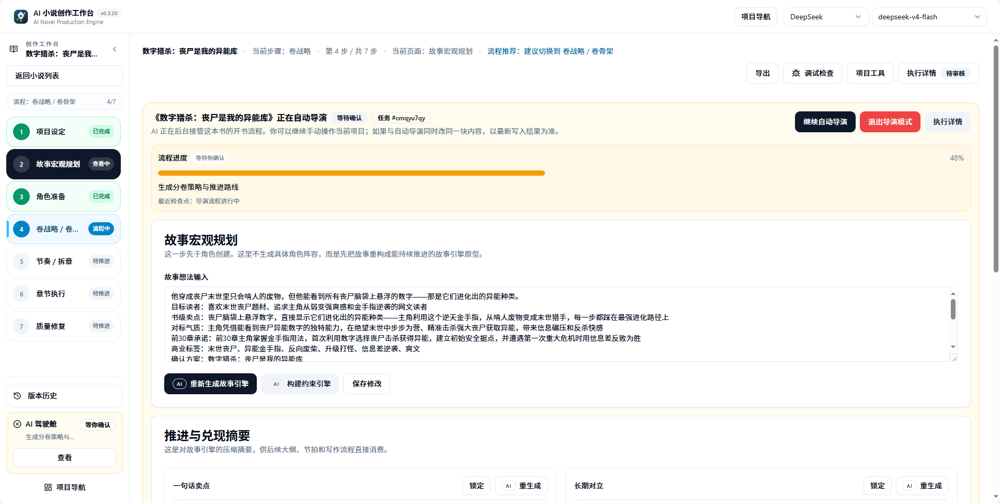
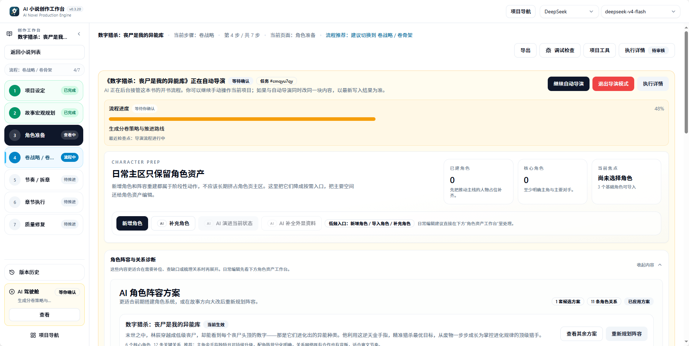
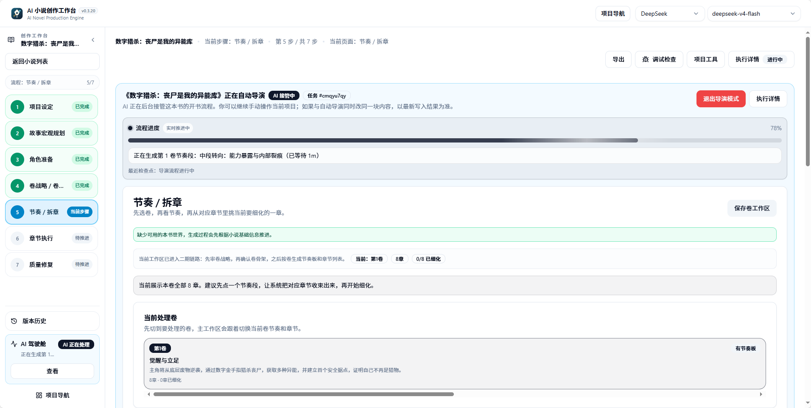

Director Follow-up is used to view the Auto Director's execution progress, pause reasons, recovery entry points, and next-step recommendations. It helps you understand where a book's main chain has stopped and provides clear actions to continue.

<CardGroup cols={2}>
  <Card title="View Pause Reasons" icon="circle-pause" href="#common-pause-reasons">
    Distinguish between waiting for confirmation, local quality issues, and issues that require stopping the main chain.
  </Card>

  <Card title="Continue Auto Director" icon="play" href="#how-to-read-recovery-entries">
    Resume from checkpoints, retry failed tasks, or continue after accepting warnings.
  </Card>

  <Card title="Switch Run Strategy" icon="sliders" href="#book-issue-handling-preferences">
    Choose a completion-first or quality-first approach for a single book.
  </Card>

  <Card title="Take Over Existing Projects" icon="hand" href="#takeover-actions">
    When novel assets already exist, derive the resumable stage from the current state.
  </Card>
</CardGroup>

## When to Open Director Follow-up

- The Auto Director prompts you to wait for confirmation
- You want to continue after a book-start flow was interrupted
- Chapter preparation or execution has no continue entry
- Run History shows director-related tasks failed or waiting to resume
- You want to know what the system recommends as the next step

If you only want to check whether background tasks are complete, look at Run History first. If you want to know why the Auto Director stopped, open Director Follow-up.

## Common Pause Reasons

An Auto Director pause is usually not a failure, but rather a wait for a specific action:

| Pause Reason | Description | Next Step |
| --- | --- | --- |
| Direction candidates awaiting selection | Candidate directions or title sets have been generated | Enter the direction selection page, choose a direction, or redo the title |
| World, character, or volume planning needs confirmation | The asset preparation phase is complete and requires authorization to continue | Open the corresponding asset page, review, and confirm |
| Chapter plan missing required information | Beat board, checklist, or refinement stage data is incomplete | Supplement novel basic information or retry that stage |
| Background task failed | A stage command execution error occurred | View the Run History error, then return to Director Follow-up to retry |
| Quality review produced local debt | The chapter has available body text but has fixable issues | Choose to fix, record quality debt, or continue |
| System determined re-planning is needed | Structural conflict between upstream planning and downstream execution | Review the reason, then decide to re-plan or apply local corrections |
| Book issue handling rules require pause | Rules set to quality-first, stopping at safe chapter boundaries | Confirm, then continue |
| Model balance, quota, or connection issues | Model service returned a clear error | Replenish balance or switch models, then resume |

When reading pause reasons, distinguish between "local quality issues" and "issues that must stop the main chain." Fixable chapter issues should usually be recorded as quality debt or local fix recommendations, rather than blocking the entire book.

<Frame caption="AI cockpit running state: current stage shown at the top, step progress displayed on the left">
  
</Frame>

## How to Read Recovery Entries

Director Follow-up tries to map recovery actions to specific entry points:

| Recovery Action | Applicable Situation | Entry Point |
| --- | --- | --- |
| Return to direction selection | Candidate directions or titles pending confirmation | Direction selection page |
| Supplement novel basic information | Book contract, world, or character data missing | Novel basic information page |
| Continue character or world preparation | Asset preparation paused at confirmation point | Character page, world asset page |
| Enter chapter tasks | Chapter batch is ready | Chapter execution entry |
| Retry failed task | A background command execution failed | Retry button within Director Follow-up |
| Accept warning and continue | Low-risk quality fix has been handled | "Continue Auto Director" in Director Follow-up |

If multiple entries exist, prioritize the one marked as recommended by the system. Do not repeatedly trigger the same stage task from multiple pages at the same time.

<Steps>
  <Step title="Open Director Follow-up">
    Open "Director Follow-up" in the left sidebar, read the current pause reason and recommended action.
  </Step>
  <Step title="Check Run History">
    Switch to Run History to confirm the latest task status and error details.
  </Step>
  <Step title="Select Recovery Entry">
    Follow the recommended entry in Director Follow-up: confirm, retry, continue, or take over.
  </Step>
  <Step title="Continue Auto Director">
    After resolving the issue, click "Continue Auto Director" to resume from the original checkpoint.
  </Step>
</Steps>

## Continue Auto Director

"Continue Auto Director" (继续自动导演) is the core action in Director Follow-up. After clicking, the system resumes execution from the most recent checkpoint, using the run mode and issue handling rules saved for this book.

Before continuing, confirm:

- The pause reason has been resolved (balance replenished, model switched, candidates confirmed)
- No high-memory task in the same scope is currently running
- You are not repeatedly launching multiple commands for the same stage

<Warning>
  Do not directly exit director mode or delete the project. Most pauses can be resolved through confirmation, retry, or a continue entry.
</Warning>

## Takeover Actions

Takeover is used when novel assets already exist but the director main chain was interrupted. The system derives the resumable stage from existing assets, rather than rebuilding from scratch.

| Scenario | What to Do After Takeover |
| --- | --- |
| Characters and world exist, but volume planning has not started | Derive entry into the volume strategy stage |
| Volume planning exists, but chapter refinement was interrupted | Resume from the beat board or chapter checklist |
| Some chapter body text already exists | Continue from the chapter execution chain; saved body text will not be regenerated |

Takeover will not overwrite existing assets. It only rebuilds the director task state and locates the most recent checkpoint.

<Frame caption="AI cockpit character preparation page: when paused at the character stage, the background may have already advanced to subsequent steps">
  
</Frame>

## Book Issue Handling Preferences

A novel project can inherit global issue handling rules, or have its own selection for this book:

| Strategy | Suitable For | When a chapter has available body text but still has local issues |
| --- | --- | --- |
| Prioritize completing the book | More emphasis on finishing the whole book first | Save body text, record quality debt, and continue |
| Quality-first | More emphasis on chapter-by-chapter confirmation | Pause processing, wait for your confirmation before continuing |

Both strategies auto-process at most once. You can also set each item to "auto-retry, remind then continue, pause processing, or end task," or click "restore global inheritance" to return to unified rules.

Book rules are saved with the project at task start. Subsequent resumes will continue using this book's own choice, and will not silently change processing tasks due to global setting changes.

## Model Balance and Quota Pauses

When model services return balance insufficient, quota insufficient, or explicit rate-limit errors, Director Follow-up and execution details will prioritize showing the real model reason and recovery entry.

Processing order:

1. Record the first unfinished chapter and current saved boundary
2. Go to model settings to replenish balance, fix connection, or switch models
3. Return to Director Follow-up and confirm the pause reason has been resolved
4. Use the recovery entry to continue; do not re-initiate already completed chapter ranges

Saved body text will not be regenerated due to this type of pause. If this book's rules require manual processing, background resume will also retain the paused state, waiting for your explicit continue.

## Switching Run Strategy

Run mode can be adjusted in Director Follow-up's "Continue Auto Director" or takeover actions:

| Strategy | When to Switch | Impact |
| --- | --- | --- |
| Fully automatic to stage-by-stage confirmation | When you want to add manual review nodes | Subsequent stages pause at confirmation points |
| Stage-by-stage confirmation to fully automatic | When you are confident in planning quality | Low-risk points auto-continue |
| Enable or disable quality fix toggle | Adjust body text output standards | Whether chapters enter review and fix after completion |

Switching will not lose completed stage outputs; it only changes the auto-approval boundaries for subsequent stages.

<Frame caption="Beat board stage: volume planning split into executable chapter tasks">
  
</Frame>

## Checkpoint Types

The most important role of Director Follow-up is to translate the Auto Director's current checkpoint into user-executable actions.

| Checkpoint | Page Meaning | Common Stage | User Action |
| --- | --- | --- | --- |
| Waiting for direction selection | Waiting to confirm book-level direction | Candidate directions, candidate titles | Choose a direction, revise candidates, or redo the title |
| Book contract ready | Book-level planning ready | Book contract | View book-level commitments, continue subsequent asset preparation |
| Waiting for character confirmation | Character preparation pending confirmation | Character generation, character lineup application | Confirm, merge, redo, or supplement characters |
| Volume strategy ready | Volume strategy ready | Volume strategy, volume skeleton | Confirm, then enter beat chapter splitting |
| Chapter batch ready | Chapter batch executable | Beat board, chapter checklist, chapter refinement | Enter chapter execution or authorize auto chapter writing |
| Needs re-planning | Needs quality fix or re-planning | Review fix, quality loop | View reason, decide to fix, continue, or re-plan |
| Flow complete | Director main flow complete | Global or batch end | View results and subsequent recommendations |
| Rewrite snapshot established | Pre-rewrite backup complete | Rewrite/regeneration | Confirm cleanup, then continue |

<Info>
  When the status is "waiting for confirmation," the system is usually waiting for you to confirm direction, characters, volume planning, chapter execution, or fix strategy. Check Director Follow-up first; do not delete or recreate the project.
</Info>

## Pause Reason to Recovery Entry

| Pause Reason | Description | Recommended Entry |
| --- | --- | --- |
| Candidate directions pending confirmation | Candidate directions or title sets complete | Direction selection page |
| Character preparation pending confirmation | Character lineup may need manual confirmation | Character candidate page, Director Follow-up |
| Volume strategy pending confirmation | Volume-level route and skeleton complete | Volume planning entry |
| Chapter batch ready | Beat board, checklist, and refinement complete | Director Follow-up, chapter execution entry |
| Low-risk quality fix | Chapter is fixable but needs authorization to continue | Chapter page, Director Follow-up |
| Needs re-planning | Subsequent plan may need changes | Director Follow-up, stage-by-stage recovery guide |
| Worker interrupted | Background lease expired or service restarted | Confirm status in Run History, then return to source page to resume |
| High-memory task conflict | Same book, same scope already has beat board or chapter splitting task running | Run History to view currently running tasks |

## Auto-Approval Configuration

Auto-approval allows the system to automatically continue at designated low-risk confirmation points. Common points include:

| Approval Point | Corresponding Action | Risk |
| --- | --- | --- |
| Direction confirmed | Confirm candidate direction, then continue building the book | Low |
| Characters ready | After character lineup passes, continue volume strategy | Low |
| Volume strategy ready | After volume strategy passes, continue beat chapter splitting | Low |
| Structured outline ready | After chapter tasks are prepared, continue writing | Low |
| Continue chapter execution | After one chapter batch completes, continue remaining chapters | Medium |
| Continue after low-risk quality fix | After low-risk quality fix, continue | Medium |
| Continue after re-planning | After re-planning processing, continue | High |
| Rewrite cleanup confirmed | After rewrite cleanup confirmation, continue | High |

By default, it is more suitable to auto-pass low-risk planning points. When re-planning, rewrite cleanup, or large-scale body text changes are involved, manual confirmation is recommended.

## Relationship with Run History

Run History answers "what happened to background tasks"; Director Follow-up answers "what should the whole book do next."

Recommended workflow:

1. See task pause in Director Follow-up
2. Go to Run History to view latest task status and error information
3. Return to Director Follow-up to select recovery action
4. Continue Auto Director or chapter execution

If Run History shows running, Director Follow-up may not present new confirmation items for the time being.

## Recommended Handling Strategy

When encountering a pause, judge in this order:

1. Is it just waiting for you to choose candidates
2. Is there a retryable background task
3. Is there already available chapter content
4. Is local fix needed
5. Is explicit re-planning required

Only explicit re-planning, unrecoverable generation failure, data integrity risk, or system security issues should stop the global chain.

## Beginner Tips

If you don't understand the pause message, don't manually clear data. Do two things first:

- Check the latest status in Run History
- Return to the novel page to confirm basic information and candidates

Most pauses can be resolved through confirmation, retry, or a continue entry.

## Frequently Asked Questions

<AccordionGroup>
  <Accordion title="Director Follow-up shows paused, but Run History shows the task is complete?">
    "Complete" in Run History only means that background command has ended. Director Follow-up showing paused means the current checkpoint requires your confirmation to continue to the next stage. Click the recommended entry in Director Follow-up to handle it.
  </Accordion>

  <Accordion title="Nothing happens after clicking continue?">
    First refresh the page to view the latest status. If Run History shows the task is queuing or running, the background has received the command and is waiting for execution to complete. Do not repeatedly click "Continue Auto Director."
  </Accordion>

  <Accordion title="Will switching this book's issue handling rules affect already generated chapters?">
    No. Rules are saved with the project at task start; subsequent resumes continue using this book's own choice. Saved chapter body text will not be regenerated.
  </Accordion>

  <Accordion title="Why are there multiple recovery entries?">
    Different pause reasons correspond to different creative contexts. The system will mark the recommended entry; prioritize selecting that entry. If unsure, follow the "check Run History -> return to Director Follow-up and select recommended entry" sequence.
  </Accordion>

  <Accordion title="What is the difference between takeover and continue?">
    "Continue" is used when the director main chain exists but is paused, resuming from the most recent checkpoint. "Takeover" is used when the director task state is lost or needs rebuilding, deriving the resumable stage from existing assets.
  </Accordion>

  <Accordion title="Can I skip a checkpoint?">
    Not recommended. Each checkpoint corresponds to a quality gate, especially character confirmation and volume strategy confirmation. Skipping may lead to decreased quality in subsequent chapters. If auto-approval is enabled, low-risk points will auto-pass.
  </Accordion>

  <Accordion title="Will re-planning delete existing content?">
    It will not auto-delete. The system will create a snapshot before re-planning; you can confirm cleanup before continuing. Saved body text, characters, and world assets are retained by default.
  </Accordion>

  <Accordion title="What is the relationship between Director Follow-up and notifications?">
    Notifications are responsible for reminding: task paused, waiting for confirmation, resumable, quality issues need handling. Director Follow-up is responsible for explaining: why paused, which checkpoint it stopped at, and what the next entry is. When you see a notification, enter Director Follow-up first to view details.
  </Accordion>
</AccordionGroup>

<CardGroup cols={3}>
  <Card title="Auto Director" icon="wand-magic-sparkles" href="/en/features/auto-director">
    Learn about director versions, run modes, and stage flows
  </Card>

  <Card title="Run History" icon="list-check" href="/en/features/task-center">
    View background task status and error details
  </Card>

  <Card title="Chapter Execution" icon="pen-nib" href="/en/guides/chapter-execution">
    From chapter batch ready to body text generation
  </Card>
</CardGroup>
