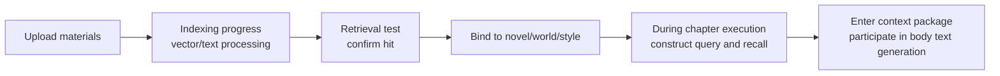
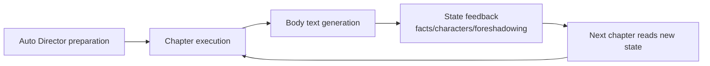

The Knowledge Base is used to save materials that affect creation over the long term, such as setting documents, reference works, breakdown conclusions, character materials, world rules, and style samples. Its purpose is to let materials continue being used in subsequent planning, sequel writing, and body text generation, rather than relying on you to copy and paste them every time.

RAG (Retrieval-Augmented Generation) is the Knowledge Base's core mechanism: during chapter execution, the system constructs queries based on the current chapter task, recalls the most relevant material fragments from the Knowledge Base, and assembles them into a context package together with book facts and planning assets, for AI to reference during body text generation.

## What the Knowledge Base Can Do for You

- Upload and manage creative materials.
- Save breakdown publication results, letting breakdown experience enter subsequent writing.
- View material indexing progress, confirming whether documents can be retrieved for use.
- Test whether a specific material can be recalled.
- Archive infrequently used materials, and restore them when needed.
- Provide long-term references for novel, world, style, and chapter generation.

## When to Use It

- You have settings, materials, reference texts, or breakdown conclusions that you want subsequent writing to continue using.
- When writing long-form works, you often worry that AI will forget earlier world rules or material backgrounds.
- You want to unify and organize multiple reference sources, rather than having them scattered across local files and chat logs.
- You want to check whether a specific material can really be used by subsequent generation.
- You want breakdown results, style samples, and world materials to become reusable assets.

## Preparation Before Starting

The Knowledge Base is an enhancement capability, not a prerequisite for starting to write a novel. You can create a novel and generate chapters first without configuring the Knowledge Base; enable it when you begin needing long-term materials, reference works, or complex settings.

To fully use material retrieval capabilities, you usually need to configure an available Embedding model and vector database connection. Regular users can first complete the basic configuration according to the settings page prompts, then return to the Knowledge Base to upload materials.

Before uploading, it is recommended to organize text first:

- One document should contain only one type of material as much as possible.
- Write clear titles indicating material purpose.
- Reference works, world settings, and style samples are best saved separately.
- Materials no longer in use can be archived to avoid interfering with subsequent retrieval.

## Recommended Usage Path

<Steps>
  <Step title="Open Knowledge Base">
    Enter the "Knowledge Base" page.
  </Step>
  <Step title="Upload Materials">
    Upload settings, reference texts, or organized materials.
  </Step>
  <Step title="Confirm Indexing Complete">
    View indexing status and wait for material processing to complete.
  </Step>
  <Step title="Retrieval Test">
    Use the retrieval test to confirm materials can be found.
  </Step>
  <Step title="Bind for Use">
    Select or bind this material in the novel, world, breakdown, or style workflow.
  </Step>
  <Step title="Archive and Restore">
    Archive when no longer in use; restore and rebuild index when needed again.
  </Step>
</Steps>

If you publish results from the breakdown module, the Knowledge Base saves them as breakdown publication materials, making it easy to return to the source breakdown for continued viewing.

## Material Ingestion and Usage Flow

## How Materials Enter Chapter Context

<ChapterContextAssembler />

This is the most critical step in Biz Novel Studio chapter generation. The system does not simply search the Knowledge Base using chapter titles. Instead, it assembles queries based on the complete chapter task, then recalls materials most relevant to the current goal.

### Query Construction Content

Chapter RAG queries contain the following information, all from the chapter brief and context package:

- Novel title
- Chapter title
- Chapter goal
- Chapter expectations
- Content that must be advanced this chapter
- Target conflict
- Appearing characters
- Structured outline

The closer the query is to this chapter's goal, the easier it is to hit truly useful materials.

### Material Source Layers

RAG is not a single material pool. Different materials have different credibility and purposes:

| Layer | Examples | Usage Principles |
| --- | --- | --- |
| Book Facts | Written chapters, fact ledger, character states, world states | Highest priority; cannot be overwritten by external materials |
| Book Planning | Book contract, macro story, volume strategy, chapter tasks | Guide the next writing goal |
| User Materials | Uploaded Knowledge Base, world samples, dedicated setting documents | Used to supplement facts and settings |
| Breakdown Conclusions | Reference work structure, appeal, character, and style analysis | Migrate methods, do not copy plots |
| Style Assets | Style rules, Anti-AI Rules, sample text features | Control expression methods |
| Temporary Dialogue | Creative Hub current round input | Can only affect the current task; to take effect long-term, commit to the library |

<Note>
  Book facts take priority: if external Knowledge Base materials conflict with facts already established in the book, chapter execution should prioritize following book facts. Reference materials are for supplementation, not for overturning content already written into novel state.
</Note>

### Retrieval Methods

The system uses vector retrieval, text retrieval, or hybrid recall to hit materials:

| Retrieval Method | Suitable Content | Common Issues |
| --- | --- | --- |
| Vector Retrieval | Semantically similar but differently worded materials, long documents, breakdown conclusions | Cannot hit when documents are not indexed or vector database is unavailable |
| Text Retrieval | Person names, place names, proper nouns, fixed terms | May miss when users do not write clear keywords |
| Hybrid Recall | Needs both semantics and keywords simultaneously | Needs reasonable document titles, chunking, and metadata |

### Why Chunking and Metadata Matter

The Knowledge Base does not guarantee retrieval just because a file is uploaded. Chunking, titles, summaries, and metadata affect hits:

| Information | Impact |
| --- | --- |
| Document Title | Helps identify material theme and source |
| Chunk Text | Determines vector semantics and text retrieval hits |
| Facets | Makes filtering by genre, appeal, character name, chapter anchor, etc. more precise |
| Source Type | Distinguishes uploaded documents, breakdown publications, world samples, etc. |
| Document Version | Avoids mixing materials with the same name |

The longer the material, the more it needs clear titles and stable chunking. A million-word original text without reliable indexing will only show limited fragments during chapter execution.

## Where RAG Is Used

| Stage | Uses RAG? | Explanation |
| --- | --- | --- |
| Direction Candidates | May use breakdown/material summaries | For understanding genre, reader expectations, and reference directions |
| Book Contract | Mainly uses candidates and macro story | Key goals come from user selection; should not be overwritten by external materials |
| World Building | May reference world samples and Knowledge Base | Helps generate rules, factions, and locations |
| Character Generation | May reference world, genre, and character assets | Characters must obey the book's direction |
| Volume Strategy | Uses book contract, macro story, character roster | RAG serves only as auxiliary, not replacing main plot planning |
| Beat Board / Chapter List | Uses volume strategy and chapter task materials | Focus is structural consistency |
| Chapter Execution | Explicitly uses task-driven RAG | GenerationContextAssembler constructs queries and recalls materials based on chapter goals |
| Review / Repair | Uses chapter runtime package | The repairer reads writing context, review issues, and RAG fragments |

## How to Enter Subsequent Creative Chains

Knowledge Base materials play a role in multiple places:

- **During book creation and planning**, providing genre, setting, and reference work information.
- **During world and character generation**, providing background rules and character materials.
- **During chapter writing**, providing material references relevant to the current task.
- **After breakdown publication**, letting work analysis conclusions continue to be recalled by subsequent creation.
- **In the Style Engine**, style assets can be extracted from Knowledge Base original text.

The Knowledge Base is not a body text editor. It is more like a long-term material warehouse: put important materials in, and let the creative chain use them when needed.

## Asset Loop

After chapter execution completes, the system feeds back new facts, character changes, foreshadowing states, and quality issues. When subsequent chapters assemble context, they read these states.

The loop path is:

<Steps>
  <Step title="Auto Director Preparation">
    Prepare book-level, world, character, and chapter tasks.
  </Step>
  <Step title="Chapter Execution">
    Read these assets and RAG materials.
  </Step>
  <Step title="Body Text Generation">
    Extract facts, character resources, and foreshadowing changes.
  </Step>
  <Step title="State Feedback">
    State submission and ledger synchronization write back to the project.
  </Step>
  <Step title="Continue Generation">
    The next chapter reads the new state and continues generating.
  </Step>
</Steps>

This is the core difference between long-form production chains and one-shot text generation.

## Frequently Asked Questions

<AccordionGroup>
  <Accordion title="Can I start writing a novel without configuring the Knowledge Base?">
    Yes. The Knowledge Base is an enhancement capability, not a prerequisite for book creation. First get the creative workflow running, then gradually add materials; this is usually more suitable for beginners.
  </Accordion>

  <Accordion title="Why can't I use materials after uploading?">
    Uploading only saves materials. Materials also need to complete indexing before they can be stably used in retrieval tests and creative chains. First check indexing status and recent tasks.
  </Accordion>

  <Accordion title="What materials are suitable for the Knowledge Base?">
    Suitable for content that will be reused long-term, such as world rules, faction materials, reference work analysis, breakdown conclusions, character backgrounds, style samples. Temporary ideas can be placed in the novel project first.
  </Accordion>

  <Accordion title="Will too many documents interfere with generation?">
    It is possible. It is recommended to use clear titles, archive materials no longer in use, and select truly relevant materials within specific novels or tasks.
  </Accordion>

  <Accordion title="Does archiving delete materials?">
    Archiving is not deletion. Archived materials exit the default usage scope and can be restored when needed. After restoration, indexing usually needs to be reprocessed before stable recall is possible again.
  </Accordion>

  <Accordion title="Do I need to understand Qdrant and RAG?">
    No. You only need to know: after configuration is complete, the Knowledge Base can better find materials according to the current task. Technical details are handled by the system and settings page.
  </Accordion>

  <Accordion title="How do I check if the Knowledge Base is not working?">
    Check in order: 1) Does the document exist 2) Is indexing complete 3) Can single-document retrieval test hit 4) Does the current chapter task really need this material 5) Is there an RAG fragment in the context package 6) Did the review report suppress materials due to conflict.
  </Accordion>

  <Accordion title="What if too much is recalled?">
    If the chapter deviates toward a reference work, strengthen the chapter task and book facts, and reduce reference recall. If the model paraphrases material summaries, narrow the query and retain fragments related to this chapter's conflict. If proper nouns leak into body text, review and Anti-AI Rules should intercept proper noun leakage.
  </Accordion>
</AccordionGroup>

<CardGroup cols={2}>
  <Card title="Book Breakdown Workbench" icon="book-open" href="/en/features/book-analysis">
    Publish work analysis to the Knowledge Base, turning conclusions into reusable assets.
  </Card>

  <Card title="Style Engine" icon="pen-nib" href="/en/features/style-engine">
    Extract style assets from Knowledge Base original text to control expression methods.
  </Card>
</CardGroup>

export const ChapterContextAssembler = () => {
  const [phase, setPhase] = useState(0);
  const [playing, setPlaying] = useState(false);
  const [selected, setSelected] = useState(null);

  const items = [
    { id: "book-facts", label: "Book Facts", color: "#16A34A", desc: "Written chapters, fact ledger, character states, world states. Highest priority; cannot be overwritten by external materials." },
    { id: "book-plan", label: "Book Planning", color: "#16A34A", desc: "Book contract, macro story, volume strategy, chapter tasks. Guide the next writing goal." },
    { id: "rag-docs", label: "Knowledge Base Recall", color: "#2563EB", desc: "Construct queries based on chapter tasks, and recall the most relevant material fragments from the Knowledge Base." },
    { id: "world-assets", label: "World Samples", color: "#9333EA", desc: "World rules, factions, locations, boundaries. Used for world building and chapter context supplementation." },
    { id: "character-assets", label: "Character Library", color: "#9333EA", desc: "Character base information, image assets, relationships. Used for character generation and chapter context." },
    { id: "style-assets", label: "Style Assets", color: "#EA580C", desc: "Narrative style, language rules, anti-template expressions. Enter context through style binding." },
    { id: "anti-ai", label: "Anti-AI Rules", color: "#EA580C", desc: "Global Anti-AI baseline and style-specific rules, merged into generation contract and injected into body text writing prompts." },
  ];

  const totalPhases = items.length + 2;

  useEffect(() => {
    if (!playing) return;
    const timer = setInterval(() => {
      setPhase((p) => {
        if (p >= totalPhases - 1) {
          setPlaying(false);
          return p;
        }
        return p + 1;
      });
    }, 900);
    return () => clearInterval(timer);
  }, [playing, totalPhases]);

  const isInPackage = (index) => phase >= index + 2;
  const isAssembled = phase >= totalPhases - 1;

  return (
    

      

      

        <button type="button" className="kbc-btn" onClick={() => { setPhase(0); setPlaying(true); }} disabled={playing}>
          {playing ? "Playing..." : "Play Assembly Process"}
        </button>
        <button type="button" className="kbc-btn" onClick={() => { setPlaying(false); setPhase(0); setSelected(null); }} disabled={!phase && !playing}>
          Reset
        </button>
        
          {isAssembled ? "Chapter context assembly complete" : phase === 0 ? "Click play to view assembly flow" : `Step ${phase}/${totalPhases - 1}`}
        
      

      {items.map((item, i) => (
        

          {item.label}
          <button
            type="button"
            className="kbc-chip"
            style={{
              borderColor: selected === item.id ? item.color : undefined,
              background: selected === item.id ? `${item.color}18` : undefined,
              transform: isInPackage(i) ? "scale(0.95)" : "scale(1)",
              opacity: isInPackage(i) ? 0.45 : 1,
            }}
            onClick={() => setSelected(selected === item.id ? null : item.id)}
          >
            {item.desc.slice(0, 20)}...
          </button>
        

      ))}

      

        Chapter Context Package
        {items.map((item, i) =>
          isInPackage(i) ? (
            
              {item.label}
            
          ) : null
        )}
        {isAssembled && (
          
            Assembled
          
        )}
      

      {selected && (
        

          <strong>{items.find((i) => i.id === selected).label}</strong>: {items.find((i) => i.id === selected).desc}
        

      )}

      {!selected && (
        

          {phase === 0 && "Click the Play Assembly Process button above. Materials will enter the chapter context package in priority order. You can also click individual material blocks to view their descriptions."}
          {phase === 1 && "Starting: Book Facts and Book Planning enter the context first. They are the highest priority content."}
          {phase >= 2 && phase < totalPhases - 1 && `${items[phase - 2].label} is being recalled and placed into the context package...`}
          {isAssembled && "Assembly complete: The chapter context package now contains Book Facts, Planning, Knowledge Base recall, World Samples, Character Library, Style Assets, and Anti-AI Rules. GenerationContextAssembler will hand this package to body text generation."}
        

      )}
    

  );
};
