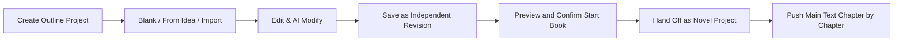

The Outline Workbench is a new independent creation tool added in v0.8.0. It turns scattered ideas into an executable novel structure. It is independent of the Auto Director's novel production chain: you first build an outline here, edit content, view revision history, and when satisfied hand it off as a real novel, preserving characters and existing volumes/chapters.

<Info>
  The fully automatic writing path without a bound outline remains unchanged. You can still use the Auto Director to start a book directly without going through the Outline Workbench.
</Info>

## Full Process Overview

## When to Use It

- You have an idea but have not yet figured out the structure for the whole book, and want to first organize the general outline, volumes/chapters, character drafts, foreshadowing, and fixed settings.
- You already have a complete outline in Markdown or TXT format and want to import it as an editable structured outline.
- You want AI to help you modify the direction, pacing, or character arrangement of an existing outline, and you want to review the suggestions before deciding whether to adopt them.
- You want to keep multiple outline revision versions and compare or revert to any version at any time.
- You do not want to trigger novel production and chapter generation before the idea is mature.

## Creating an Outline Project

After entering the Outline Workbench, you can create a new outline in three ways:

| Creation method | Suitable situation | Description |
| --- | --- | --- |
| **Blank outline** | Want to build the structure completely from scratch | Start from an empty table and gradually add the general outline, volumes/chapters, and beats |
| **Create from idea** | Only have a one-sentence inspiration | AI generates an initial outline based on the genre, selling points, and character direction you provide |
| **Import Markdown/TXT** | Already have a text outline | After parsing, enter preview, verify original text fragments and coverage gaps, then confirm creation |

After creation is complete, you can enter the corresponding workbench to continue editing.

## Editing and AI Modification Suggestions

The Outline Workbench supports both manual editing and AI-assisted modification. Neither method directly overwrites current content, creates a novel, or triggers chapter generation:

### How AI Modification Suggestions Work

- AI's initial generation and subsequent modification suggestions are presented as **proposals** first. You must review the content, rationale, and scope of impact, then **select and confirm** before they become an official revision.
- Each modification suggestion includes a before-and-after comparison, modification rationale, scope of impact, and operation dependency hints. Combinations missing prerequisite operations are explicitly blocked by the system.
- If the outline content has already been updated, old AI proposals will prompt you to regenerate, preventing mistakenly adopting outdated suggestions that no longer match the new outline.

<Tip>
  AI proposals are not mandatory instructions. You can adopt only a few suggestions, reject all of them, or ask AI to generate a new version.
</Tip>

## Revision History

Every manual save or adopted AI suggestion creates an **independent and non-overwritable revision**. In revision history you can:

- View differences between any two revisions, including node additions, deletions, field modifications, and moves.
- Restore old revision content to a new version, fully preserving intermediate history without deleting any existing version.
- Export the current revision as JSON or Markdown for external backup or sharing.

<Note>
  Restoring an old version does not directly replace current content; it creates a new revision based on the old version. This way all intermediate versions remain traceable.
</Note>

## Importing Markdown or TXT

If you already have an outline text, you can import it directly. Import follows a "preview first, confirm second" principle:

### Import Preview Flow

<Steps>
  <Step title="Upload text">
    Upload a Markdown or TXT file. The system parses the text into structured nodes.
  </Step>
  <Step title="Verify original text fragments">
    View the original text fragments extracted by the system for each node, confirming whether the parsing corresponds to the correct position.
  </Step>
  <Step title="Check coverage gaps">
    View unclassified content and uncovered original text areas, confirming whether anything is missing.
  </Step>
  <Step title="Adjust node information">
    Before confirming, you can also adjust outline and node titles, chapter volume assignments, character appearance positions, foreshadowing placement and recovery chapters, and fixed setting scopes and associated references.
  </Step>
  <Step title="Confirm creation">
    After verification is complete, confirm creation of the outline project. The system assigns stable identities to nodes.
  </Step>
</Steps>

The system calculates coverage by interval union, avoiding overlapping fragments being counted twice. Fragments that cannot be matched enter an explicit unmatched list and are not counted as covered content. After confirmation, the volume/chapter list is re-derived based on chapter volume assignments.

## Starting a Book from an Outline

After saving a satisfactory outline revision, you can hand it off as a novel. Preview and creation themselves **do not consume model calls**; creation only begins pushing forward based on the outline after you confirm.

### Start Book Steps

<Steps>
  <Step title="Select revision">
    In the Outline Workbench, select a saved revision with no unsaved local edits.
  </Step>
  <Step title="Preview start book">
    Confirm expected chapter counts by volume, full-book chapter order, and field-by-field retention details volume by volume. Length summary and retention details can be scrolled independently.
  </Step>
  <Step title="Confirm creation">
    After confirmation, the system binds the outline source and creates the project. One outline binds to only one book.
  </Step>
  <Step title="Enter novel creation page">
    On the creation page you can see the adopted outline revision, independent foreshadowing plan, and new-version difference hints.
  </Step>
</Steps>

### Key Rules After Starting a Book

- **One outline binds to only one book**: Repeated confirmation continues the original book and does not create a duplicate project.
- **Unexpanded chapters keep only budget, not empty chapters**: Formal chapter identities are created only where there is corresponding source content; other positions keep only budget and slots.
- **Preserve characters and existing volumes/chapters**: Characters and existing volume structures from the original outline are preserved in the novel during handoff.
- **New-version differences are only hints**: Manually adjusted book planning retains the source version. When the outline later produces a new revision, the system only shows differences and does not automatically replace the bound source.
- **Foreshadowing exists as plans**: Foreshadowing in the outline first exists as plans. After evidence appears in the main text, the system associates it with the actual ledger. Planned recovery chapters are not treated as already fulfilled.

## Writing Chapter by Chapter After Starting a Book

A novel bound to an outline uses an independent creation plan. When filling in the preparation needed for the current chapter, the system preserves the original story, volumes/chapters, and fixed settings, and adopts staged confirmation and chapter-by-chapter pushing:

- Preparation steps for Chapter N explicitly exclude production of subsequent chapters, avoiding accidentally triggering follow-up chapter organization and interrupting current-chapter preparation.
- Chapter refinement and chapter briefs preserve confirmed writing purposes and foreshadowing arrangements.
- After completing a single chapter, you can directly locate the confirmation entry for the next chapter.
- If the material index is abnormal, you can recover within this book without rebuilding the book or restarting the main text.

## Mobile Limitations

Complex editing, AI proposal adoption, and import confirmation in the Outline Workbench **are not suitable for mobile use**. The mobile side provides computer-side usage hints or read-only summaries. For full operations, please open on a computer.

## Frequently Asked Questions

<AccordionGroup>
  <Accordion title="What is the difference between the Outline Workbench and the Auto Director outline?">
    The Outline Workbench is an independent planning asset that does not depend on a novel ID. You first organize and confirm the structure here, then hand it off as a formal novel project when satisfied. The Auto Director outline is a running plan generated inside an existing novel. They belong to different creation stages.
  </Accordion>

  <Accordion title="Will AI modification suggestions directly change my outline?">
    No. AI's initial generation and all modification suggestions are presented as proposals first. They must be selected and confirmed by you before becoming a new revision. Old revisions are not overwritten or deleted.
  </Accordion>

  <Accordion title="What if imported original text fragments do not match nodes?">
    On the import confirmation page, verify the original text fragment corresponding to each node. If the system's extracted position is inaccurate, you can adjust node titles, chapter volume assignments, and reference ranges before confirming. Fragments that truly cannot be matched remain in the unmatched list.
  </Accordion>

  <Accordion title="Does starting a book from an outline immediately consume model quota?">
    Preview and creation themselves do not call models. After confirming creation, the system begins pushing subsequent planning and main text writing based on the outline. Only then does it consume model calls through the normal creation flow.
  </Accordion>

  <Accordion title="Will repeated confirmation create a second book?">
    No. The same outline binds to only one novel. Repeated confirmation continues the original book, and returning or re-entering will always go back to the bound project.
  </Accordion>

  <Accordion title="Will the bound novel automatically update when the outline is modified?">
    It will not automatically replace. New outline revisions only show difference hints on the novel creation page; the bound source revisionId remains unchanged. If you want the novel to use the new outline, you need to choose re-handoff or manually adjust planning at some node.
  </Accordion>

  <Accordion title="Why are some chapters in the outline not yet created?">
    Starting a book from an outline follows a "content exists before chapter creation" principle. Only where you have already expanded and confirmed will the system create formal chapters. Unexpanded positions keep only budget slots, do not occupy actual chapter counts, and do not generate blank content.
  </Accordion>

  <Accordion title="Why does foreshadowing in the outline show as a plan?">
    Foreshadowing in the outline is a planned arrangement, belonging to "prepare to plant" and "plan to recover". After the main text actually writes the corresponding content and produces evidence, the system associates this foreshadowing with the actual ledger. This avoids the information mismatch of "written in outline but not yet fulfilled in main text".
  </Accordion>

  <Accordion title="Can old versions in revision history be deleted?">
    No. Revision history is append-only. You can only create a new revision by restoring an old version, but no existing version will be deleted. Exporting JSON or Markdown can serve as an external backup method.
  </Accordion>

  <Accordion title="Can the outline be viewed on mobile?">
    The mobile side can view outline summaries and simple information, but complex editing, AI proposal adoption, and import confirmation need to be completed on a computer.
  </Accordion>
</AccordionGroup>

<CardGroup cols={2}>
  <Card title={"Novels & Starting a Book"} icon="book-open" href="/en/features/novels">
    Continue pushing the novel project after handoff from the outline
  </Card>

  <Card title="Auto Director" icon="wand-magic-sparkles" href="/en/features/auto-director">
    Choose director version and push method, and continue writing subsequent chapters
  </Card>
</CardGroup>
