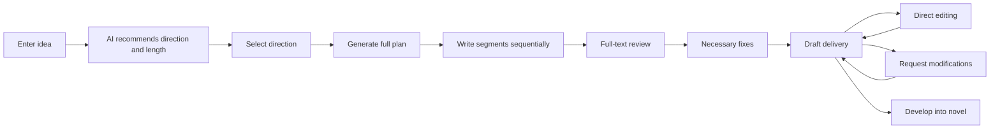
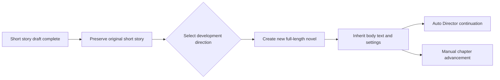

Short Story Creation is a dedicated production flow designed for short stories that can be read in one sitting and have a complete ending. It does not participate in director version selection, nor does it require you to maintain long-term novel assets. From inspiration direction to complete draft, everything is completed within a single coherent interface.

<Info>
  Short stories are generated in internal segments, with continuous body text for reading and export. After completion, a full-text review and at most one necessary fix are performed. You can also develop a short story into a full-length novel.
</Info>

## When to Use

- You want to quickly see a complete story, rather than advancing chapter by chapter.
- You want to first verify whether a direction is worth expanding into a full book.
- You need a finished draft that can be read, revised, and exported.
- You want to familiarize yourself with the workbench creation flow before entering long-form writing.

## When to Start

After configuring the model, open **Create Short Story** (创作短篇), enter an idea, and let AI recommend a direction and length. You can start generating after selecting a direction.

## Flow Overview

<Steps>
  <Step title="Open Create Short Story">
    Enter the "Create Short Story" (创作短篇) entry from the novel list or home page.
  </Step>
  <Step title="Enter an idea">
    Write a sentence of inspiration or a general direction, and let the system help organize it.
  </Step>
  <Step title="Select direction and length">
    AI will recommend a direction and length (3,000 to 30,000 words). You can also request adjustments.
  </Step>
  <Step title="Confirm and start generating">
    Review the direction, then start production. Short stories are generated in internal segments, with continuous body text for reading and export.
  </Step>
  <Step title="Review and revise after completion">
    After the draft is complete, perform a full-text review and at most one necessary fix. You can edit directly or request modifications.
  </Step>
  <Step title="Export or extend">
    Export the short story body text, or select "Develop into Novel" (发展成长篇) to create a new work.
  </Step>
</Steps>

## Length and Adjustments

The supported length range for short stories is **3,000 to 30,000 words**. When adjusting length or creative direction, first let AI re-adapt the plan, then confirm production. This allows the body text structure and pacing to match the target length, rather than simply truncating or拼接拼接.

## Revisions and Continuation

- **Direct editing**: Modify the body text directly in the draft interface.
- **Request modifications**: Let AI adjust according to your requirements, review the modification scope, then confirm.
- **Continue modifying**: If rewriting is interrupted, you can "Continue Modifying" (继续修改) at any time.
- **Adjust structure**: When structural adjustment is needed, first "View Adjustment Plan" (查看调整方案), review it, then "Confirm and Continue" (确认并继续).

## Develop into Novel

A short story can be extended into a full-length work. Selecting "Develop into Novel" (发展成长篇) creates a new novel, preserving the original short story's body text, direction, and settings. You can then use Auto Director or manual methods to continue advancing subsequent chapters.

## Differences from Long-form

|  | Short Story Creation | Long-form Creation |
| --- | --- | --- |
| Goal | A complete story read in one sitting | A multi-chapter work advanced continuously |
| Flow | Standalone interface, coherent generation | Auto Director advances in stages |
| Assets | Does not maintain long-term world and characters | Book-level world, characters, and foreshadowing are continuously fed back |
| Review | One full-text check and fix | Chapter-by-chapter check, quality debt, and state feedback |
| Export | Complete short story body text | Export by chapter or full book download |

## Frequently Asked Questions

<AccordionGroup>
  <Accordion title="Can short stories be used to test models?">
    Yes. The short story flow is complete but relatively short, making it well suited for verifying model performance and writing style.
  </Accordion>

  <Accordion title="Can the modification scope of a short story be controlled?">
    Yes. When requesting modifications, AI will provide a modification scope preview for your review before confirmation.
  </Accordion>

  <Accordion title="Will developing a short story into a novel overwrite the original short story?">
    No. The original short story will be preserved; the novel is a newly created independent project.
  </Accordion>

  <Accordion title="Do short stories support Knowledge Base and Style Engine?">
    Knowledge Base and Style Engine are primarily oriented toward long-form asset accumulation. The short story flow is relatively independent, but uses similar direction selection and style expression logic.
  </Accordion>

  <Accordion title="Why do short stories also need review and fixes?">
    Full-text review is used to discover coherence issues, expression flaws, and structural gaps. This is similar in purpose to long-form chapter-by-chapter review, but performed only once.
  </Accordion>
</AccordionGroup>

<CardGroup cols={2}>
  <Card title="Novels and Starting a Book" icon="book-open" href="/en/features/novels">
    Create a long-form project from inspiration
  </Card>

  <Card title="Auto Director" icon="wand-magic-sparkles" href="/en/features/auto-director">
    Learn about the continuous advancement method for long-form works
  </Card>
</CardGroup>
