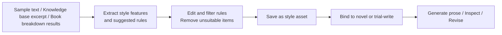
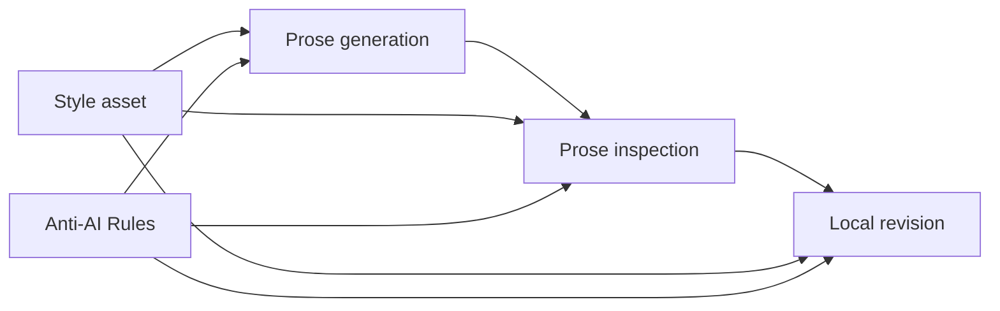

The Style Engine is used to save, edit, and reuse narrative styles. It can organize sample texts, knowledge base excerpts, or book breakdown results into style assets, making it easier for subsequent chapters to maintain the same language flavor, rhythm, and expression boundaries.

<Note>
  The Style Engine is not a one-shot prompt. It works better as a long-term asset that you continue to refine as the work progresses.
</Note>

## What the Style Engine Can Do for You

- Extract narrative style, linguistic features, and rhythmic habits from sample texts.
- Create style assets from knowledge base excerpts or book breakdown results.
- Edit style rules to decide which rules enter subsequent generation.
- Bind a style to a novel so that chapter generation, inspection, and revision use the same set of style constraints.
- Work with Anti-AI Rules to reduce templated phrasing, empty expressions, and unnatural dialogue.

## When to Use It

- You already have a satisfactory sample text and want subsequent chapters to approach that flavor.
- Chapter generation advances the plot, but the language style is unstable.
- You want to learn writing techniques from reference works or book breakdown results.
- You want the prose to read more like a novel and less like a plot summary.
- You want to save different style assets for different works.

## Before You Start

The Style Engine needs a style source. There are three common sources:

- **Paste sample text directly**: suitable when you already have a passage you like.
- **Knowledge base excerpt**: suitable when extracting style from long-form materials or reference works.
- **Book breakdown results**: suitable when creating a style from the "style and technique" analysis in a book breakdown.

<Tip>
  The sample text does not need to be very long, but it should represent the style you want. Do not mix texts with very different styles, or the extracted rules may be unstable.
</Tip>

## Recommended Workflow

<Steps>
  <Step title="Open the Style Engine">
    Find the "Style Engine" (写法引擎) entry in the workbench navigation.
  </Step>
  <Step title="Create a style asset">
    Choose a source: paste text, select a knowledge base excerpt, or generate from book breakdown results.
  </Step>
  <Step title="Review extraction results">
    Review the stylistic features and suggested rules extracted by the system.
  </Step>
  <Step title="Edit rules">
    Remove content unsuitable for the current work, and keep only directions that can truly guide subsequent writing.
  </Step>
  <Step title="Bind to a novel or trial-write">
    Bind the style to a novel, or first trial-write a passage with this style to observe the effect.
  </Step>
  <Step title="Iterate continuously">
    After chapter generation, continue adjusting the style asset based on results.
  </Step>
</Steps>

## Process Overview

From source to effect, a style asset goes through the following flow.

## Viewing and Selecting Existing Styles

In the style list, search by name, description, or tag. Click a style name to expand or collapse details. "Reading feel positioning" shows the reading experience this style aims to create; plot advancement, character expression, language texture, and rhythm control can each be expanded for review, with original samples and extracted information viewed on demand.

- **Edit settings**: Maintain style description, generation rules, and Anti-AI constraints.
- **Apply and test**: Select a binding target, or first trial-write a passage with this style.
- **De-AI**: Inspect existing prose and compare local revision previews.

Collapsing details or searching for other styles only changes list display and does not clear the current style's test input. The number of extracted features is for reference verification and does not represent style quality; the book-level default style is set from the novel's basic information.

## Inspecting Prose and Comparing Revisions

After selecting a style, open **De-AI** (去 AI 味). Paste a complete scene, then run inspection or generate a local revision preview. The report is divided into sentence expression, paragraph transitions, and narrative suggestions, listing original-text basis and revision direction; the reference score indicates expression risk, not AI-writing probability.

Local preview only processes approved expression issues. For narrative suggestions that require adjusting character motivation or plot outcome, first let the AI draft a plan, then confirm the scope of modification. When the revision scope is too large or the protection check fails, the original draft is preserved with an explanation. Pasted draft previews need to be checked against the book's characters and settings; confirm before using for formal prose. After modifying input or inspection configuration, re-run the check.

## How Style and Anti-AI Rules Work Together

Style assets and Anti-AI Rules participate together in prose generation, inspection, and local revision. Style focuses on "how this book should be written," while Anti-AI Rules focus on "which expressions should be avoided." Using them together usually produces more stable results.

<StyleFlow />

## How to Enter the Subsequent Creative Chain

Style assets affect prose generation, inspection, and correction. After binding to a novel, it can help the system maintain in subsequent chapters:

- Narrative perspective and sentence rhythm.
- Character dialogue style.
- Description density and emotional expression.
- Anti-AI expression constraints.
- Self-inspection and correction direction.

## FAQ

<AccordionGroup>
  <Accordion title="Do I need to configure a style before writing my first book?">
    Not necessarily. First-time users can run through chapter generation first, then decide whether to create a style asset based on results. The Style Engine is an enhancement for improving stability.
  </Accordion>

  <Accordion title="Is longer sample text always better?">
    Not necessarily. Representativeness matters more than length. Overly long texts increase processing cost and may mix in unrelated styles. We recommend starting with a passage that demonstrates the target style.
  </Accordion>

  <Accordion title="What scenarios suit generating a style from book breakdown?">
    This suits when you have already broken down a reference work and want to learn its style and techniques. After generation, we still recommend inspecting and editing; do not apply all rules directly to your own work.
  </Accordion>

  <Accordion title="What is the difference between style and Anti-AI Rules?">
    Style focuses on "how this book should be written," while Anti-AI Rules focus on "which expressions should be avoided." Using them together usually produces more stable results.
  </Accordion>

  <Accordion title="What if the style effect is not good?">
    First check whether the sample text represents the target style, then delete overly specific or unsuitable rules. If necessary, re-extract from a more focused sample.
  </Accordion>
</AccordionGroup>

<CardGroup cols={2}>
  <Card title="Anti-AI Rules" icon="ban" href="/en/features/anti-ai-rules">
    Organize unwanted expression issues into inspectable, reusable rules
  </Card>

  <Card title="Character Library" icon="users" href="/en/features/character-library">
    Save reusable character assets to keep character settings consistent
  </Card>
</CardGroup>

export const StyleFlow = () => {
  const [active, setActive] = useState(0);
  const steps = [
    {
      label: "Prose generation",
      detail: "Style assets provide narrative perspective, sentence rhythm, character dialogue style, and description density; Anti-AI Rules provide expression boundaries, suppressing empty summaries, over-explanation, and templated phrasing.",
    },
    {
      label: "Prose inspection",
      detail: "Style assets serve as the inspection baseline, checking whether prose maintains the target language texture; Anti-AI Rules scan item by item, marking unnatural dialogue, repetitive phrasing, and direct emotional telling.",
    },
    {
      label: "Local revision",
      detail: "Style assets guide revision direction, bringing revised text back to the target style; Anti-AI Rules ensure revision does not reintroduce prohibited expressions.",
    },
  ];

  const navButton = {
    padding: "6px 14px",
    borderRadius: 8,
    border: "1px solid rgba(127,127,127,.35)",
    background: "transparent",
    color: "inherit",
    font: "inherit",
    cursor: "pointer",
  };

  return (
    

      
      

        {steps.map((step, i) => (
          <button
            key={i}
            type="button"
            onClick={() => setActive(i)}
            className="sf-step"
            style={{
              textAlign: "left",
              padding: 14,
              borderRadius: 10,
              font: "inherit",
              color: "inherit",
              cursor: "pointer",
              border: i === active ? "2px solid #16A34A" : "1px solid rgba(127,127,127,.3)",
              background: i === active ? "rgba(22,163,74,.12)" : "transparent",
              opacity: i > active ? 0.6 : 1,
            }}
          >
            
Stage {i + 1}

            
{step.label}

          </button>
        ))}
      

      

        
{steps[active].label}

        
{steps[active].detail}

      

      

        <button type="button" style={navButton} disabled={active === 0} onClick={() => setActive(active - 1)}>
          Previous
        </button>
        <button type="button" style={navButton} disabled={active === steps.length - 1} onClick={() => setActive(active + 1)}>
          Next
        </button>
      

    

  );
};
