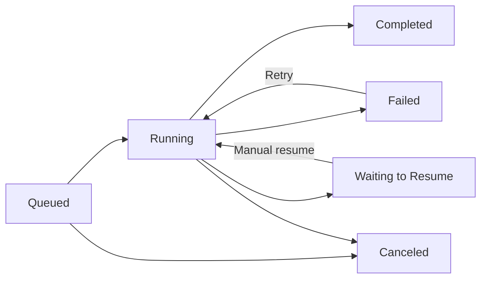
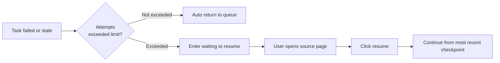

Run History (运行记录) on the left is used to view the queuing, running, failed, completed, and recovery positions of background tasks. References to "Task Center" (任务中心) in older docs or prompts point to the same entry. This is a read-only list: it helps you confirm real progress, error reasons, and task sources. The actual operations must be completed in the source workbench.

<CardGroup cols={3}>
  <Card title="Confirm Task Status" icon="gauge-high" href="#common-task-statuses">
    View whether tasks are queued, running, complete, failed, or waiting to resume.
  </Card>

  <Card title="Failure Diagnosis" icon="triangle-exclamation" href="#failure-diagnosis">
    Determine whether the issue is model, network, data, or configuration related.
  </Card>

  <Card title="Open Source Page" icon="arrow-up-right-from-square" href="#where-to-perform-operations">
    Run History only shows status; continue, resume, and retry are handled in the workbench.
  </Card>
</CardGroup>

## Common Task Statuses

Run History displays the following common statuses:

### Status Change Overview

| Status | Meaning | Common Causes |
| --- | --- | --- |
| Queued | Task created, waiting for execution resources | Concurrency limit or model busy |
| Running | Background is calling the model, processing materials, or writing results | Long tasks such as book breakdown, chapter generation |
| Completed | Task results have been saved | Return to the corresponding module to view outputs |
| Failed | An error occurred during execution | Model, network, data, or structured output issues |
| Waiting to Resume | Task chain requires you to confirm the next step or continue from a recovery entry | Pause in Director Follow-up or quality check |
| Canceled | Task stopped by user or system | Manual cancel or cleanup when switching versions |

<Info>
  Run History status does not auto-refresh continuously. When it seems like "nothing is happening," first refresh the page, then check the associated module to confirm whether results have already been written.
</Info>

## Failure Diagnosis

When a failure occurs, first look at three types of information:

1. **Task type**: Book start, chapter, book breakdown, knowledge base, or image generation
2. **Error source**: Model, network, data, structured output, or runtime exception
3. **Available results**: Whether body text, analysis results, or partial assets were generated

Execution details prioritize showing model service returns for balance, quota, rate-limit, or connection errors. When you see such errors, first handle model connection and balance, then open the source page to continue. Do not treat "chapter step incomplete" as lost body text, and do not re-initiate already completed chapter ranges.

| Error Type | Handling Direction |
| --- | --- |
| Model or network temporary error | First handle connection or balance, then return to source page to retry |
| Structured output failure | Go to model settings to adjust model routing, then return to source page to retry |
| Missing basic data | Return to novel page to supplement information |
| Available body text but review not perfect | Record quality debt, continue subsequent chapters |
| Explicit re-planning required | Return to Director Follow-up to handle |

## Stopping Running Tasks

Running or queued tasks can be stopped directly. After stopping, associated records remain viewable, and saved outputs (novels, chapters, analysis content, source materials) are unaffected.

<Tip>
  Director advancement, book breakdown analysis, writing style extraction, cover and character image generation all support directly stopping running tasks. Stopping interrupts model requests currently in waiting, avoiding continued generation of subsequent content or automatic retries.
</Tip>

## Deleting Completed Records

Completed (completed, failed, canceled, or waiting to resume) records support confirmation-based deletion one by one. Deleting a run record **does not** delete saved novels, chapters, analysis content, or source materials; it only cleans up the record list itself.

<Warning>
  Queued or running records will prompt you to stop first before deletion, to avoid accidentally deleting records of tasks currently in execution.
</Warning>

## How to Distinguish Pause and Failure

| Status | Meaning | Recommended Action |
| --- | --- | --- |
| Waiting for confirmation / Paused processing | Book rules or checkpoints waiting for user decision | Open source page to view reason and explicitly resume |
| Failed | Current command did not complete | View real error, then return to source page to decide retry or model switch |
| Waiting to resume | Background interrupted but retains recoverable position | Open source page, continue from first unfinished step |
| Completed but with reminder | Output available, still has quality debt or follow-up items | Open source page to verify, do not rerun |

Pauses caused by "quality-first" (质量优先) strategy will not be auto-cleared by background polling or Worker. After handling the issue, you need to explicitly resume from Director Follow-up.

## Where to Perform Operations

Run History only displays factual status and "open source page." The actual operations belong in pages that can display creative context, saved outputs, and impact scope:

| Task Type | Return to Where to Handle |
| --- | --- |
| Auto Director candidate or planning failure | Retry or resume on the AI Auto Director page |
| Chapter generation or fix failure | Handle on the chapter page |
| Book breakdown, knowledge base, or image task failure | Handle in the corresponding workbench |
| Model, balance, or connection issues | Fix in model settings, then return to original task page |

Before operating, confirm current task status in Run History. Repeatedly triggering the same stage multiple times may cause status to become difficult to judge.

## Auto Director Task Queue Model

Auto Director background actions are written into a command queue, then executed by the director worker. Common status mappings are as follows:

| Stage | What the User Sees |
| --- | --- |
| Queued | Task queued or waiting to execute |
| Running | Background is executing; system periodically renews lease to avoid misjudging long tasks |
| Completed | Task results are viewable |
| Failed | Run History shows error and source page |
| Waiting to Resume | Manually resume from source page |
| Canceled | User or system canceled |

This means you can leave the current page and the background will continue running; but it also means repeatedly clicking the same entry may queue multiple commands.

### Stale Task Recovery

Stale means the worker lease expired. Common causes include application or service restart, background process exit, long task runtime exceeding lease and renewal failure, local machine sleep, or network interruption. The system distinguishes between auto-recovery and manual recovery:

#### Failure Recovery Flow

- Full book auto-execution, continue execution, or resume from checkpoint, and attempts not exceeded: auto return to queue, continue execution
- Attempts exceeded or command not suitable for auto-recovery: mark stale, enter waiting to resume
- User clicks resume on source page: continue from most recent checkpoint or command payload

### Risk of Repeatedly Starting Same-Scope Tasks

If prompted that an Auto Director task is already processing the same scope, first open Run History to view progress. Repeated starts may make it difficult to judge which task wrote the final result.

## Working with Director Follow-up

Recommended troubleshooting order:

<Steps>
  <Step title="Confirm Run History">
    Confirm whether the current command is still running, and view error details.
  </Step>
  <Step title="Determine Status Type">
    If waiting for confirmation, enter Director Follow-up to handle the checkpoint; if failed, read the error message first.
  </Step>
  <Step title="Open Source Page">
    From Run History, open the corresponding workbench to decide retry, resume, or re-plan.
  </Step>
</Steps>

Run History provides facts and source locations; the corresponding workbench provides and executes the next step.

## Usage Recommendations

Develop two habits:

- After initiating a long task and encountering a wait, first check Run History
- After a failure, first read the error message, then decide retry, resume, or re-plan from the source page

Run History reduces repeated clicks and blind reruns, serving as a read-only entry point for troubleshooting long chain issues.

## Frequently Asked Questions

<AccordionGroup>
  <Accordion title="Why didn't the task status refresh in time?">
    Run History status requires manually refreshing the page to update. Long-running tasks (such as book breakdown, whole-volume chapter splitting) may last from minutes to hours; refresh to view the latest status.
  </Accordion>

  <Accordion title="Will deleting a run record delete my novel?">
    No. Deletion only clears the entry in the record list; saved novels, chapters, and materials are unaffected.
  </Accordion>

  <Accordion title="Can a deleted record be recovered?">
    Deleted run records cannot be recovered. If the associated task is still executing, stopping and re-triggering will produce a new record.
  </Accordion>

  <Accordion title="Run History shows completed, but I don't see content in the novel?">
    First confirm whether you opened the source page corresponding to that task. Some tasks (such as material organization, material sync) update backend data upon completion and may not display directly in the body text area.
  </Accordion>

  <Accordion title="Why are there multiple records for the same task?">
    Repeatedly clicking the start entry, resume, retry, or re-plan may produce multiple records. When troubleshooting, use the latest record as the reference, and avoid operating on already completed records again.
  </Accordion>

  <Accordion title="After a director task pauses, should I click continue or retry?">
    First view the pause reason. For minor issues or waiting for confirmation, usually choose "continue" to advance from the checkpoint; for explicit failures or model unavailability, first resolve external issues, then "resume" or "retry."
  </Accordion>
</AccordionGroup>

<CardGroup cols={3}>
  <Card title="Director Follow-up" icon="compass" href="/en/features/director-follow-up">
    View pause reasons and continue creation in Director Follow-up.
  </Card>

  <Card title="Book Breakdown Workbench" icon="book-open" href="/en/features/book-analysis">
    Return to the corresponding workbench after book breakdown, knowledge base, or other task failures.
  </Card>

  <Card title="Model Configuration" icon="sliders" href="/en/model-configuration">
    Fix model or connection issues in settings first.
  </Card>
</CardGroup>
