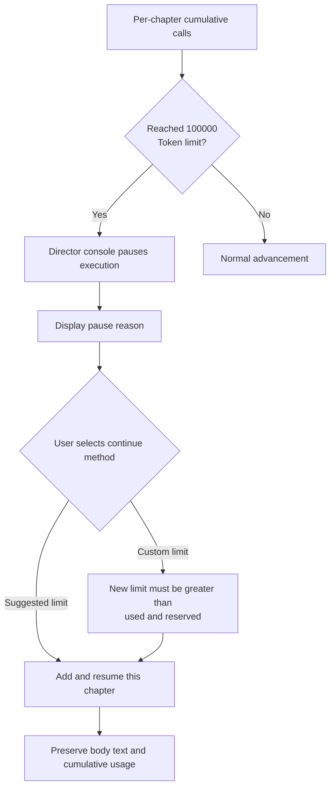
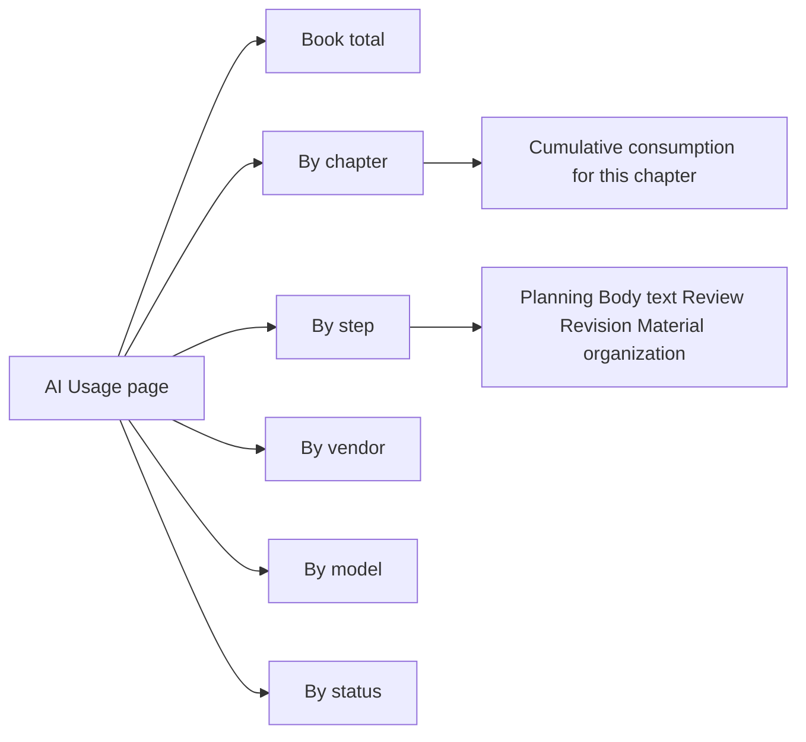

AI Usage and Token Caching is an important module for understanding creative costs and optimizing call efficiency. The workbench records every AI call in detail during the writing process, and reduces repeated costs through caching mechanisms.

<Info>
  The usage page covers recorded calls only; unrecorded old history will not be estimated or backfilled. Actual costs are subject to the vendor bill.
</Info>

## How to View AI Usage

In V2, open **"AI Usage"** (AI 用量) at the top of the book or in the bookshelf to view and filter call records.

### View Dimensions

| Filter Dimension | Description |
| --- | --- |
| Book total | Recorded input and output Tokens for the entire novel |
| Chapter | View cumulative consumption by chapter |
| Step | Consumption by different stages such as planning, body text, review, and revision |
| Vendor | Grouped by supplier, useful for checking with multiple vendor configurations |
| Model | Consumption comparison of different models at each step |
| Status | Call statistics for success, failure, or retry |

### Understanding Total Tokens

**Total Tokens = Input Tokens + Output Tokens.** Cache hits and misses both belong to input; do not add them again.

Planning, body text, review, and revision can all generate consumption; costs cannot be judged solely by the final body text length.

## Token Caching and Call Optimization

Long-form creation repeatedly uses the book's conventions, writing style, and world rules. The workbench places reusable rules and book-level and volume-level materials at the front of the input, followed by the chapter task, current status, and body text, providing conditions for model vendors to reuse the same prefix.

### What Is Optimized

- **Stable materials front-loaded**: Expression rules, work conventions, and applicable world rules are organized by reuse scope; each call reads current materials, and subsequent calls use new content after settings are modified.
- **Same-chapter revision reuses prefix**: Local revision places the current fix focus after same-chapter materials and body text; when materials and body text are unchanged, the prefix is more easily reused.
- **Valid review results reused**: When body text, creative conventions, check rules, model, and parameters are consistent, valid review results are reused to reduce repeated calls.
- **Reducing invalid revisions and re-verification**: Checks distinguish between gaps that must be fixed and ordinary expression suggestions; residual local issues are retained as quality reminders to avoid repeatedly revising the entire chapter.

### Reuse Space by Step

| Step | Main Materials That Can Be Reused | Content That Must Be Updated with Creation |
| --- | --- | --- |
| Chapter planning | Book-level positioning, work conventions, applicable volume-level goals | Chapter task, recent results, character status |
| Body text generation | Writing style and expression rules, work conventions, applicable world rules | Previous chapter continuation, current chapter events, scenes, and character status |
| Chapter review | Review standards, same-chapter task and conventions | Current body text to be reviewed and revision results |
| Local revision | Book writing style, same-chapter materials, unchanged body text | Current issue evidence, fix focus, and additional requirements |
| Post-writing material organization | Extraction rules, confirmed unchanged relevant materials | New body text, character changes, resource and foreshadowing status |

Body text needs to input new plot and status; misses on this part are normal costs. First-time calls, model or channel switches, and book-level material modifications may also cause hit volumes to change.

### Viewing Actual Effects

In the book's "AI Usage" (AI 用量), filter by the same chapter, step, and model, and compare input, output, hit, and miss Tokens across consecutive calls. You can also view currently executing calls in **AI Live View** (AI 实况).

Cache statistics are based on actual vendor returns; fields not provided show "Unknown." Actual costs are subject to the vendor bill.

## Per-Chapter Usage Protection

The default per-chapter usage protection limit for V2 is **100,000 Tokens**, cumulatively including the chapter's generation, review, revision, and material organization calls.

### Calculation Method

- **New chapters**: Counted as input minus vendor-reported cache hits, plus output.
- **Historical chapters**: Original measurement method is retained.

When the limit is reached, the system pauses in the book's director console and displays the reason. You can continue this chapter at the suggested limit or a custom limit; body text, cumulative usage, and recovery position are all retained.

### Post-Limit Handling Flow

### Usage Filter Paths

You can drill down into call records from the following dimensions:

### Usage Calculator

The calculator below helps you understand the relationship between per-chapter usage composition and the protection limit. After entering parameters, it calculates chargeable Tokens and the percentage of the default limit.

<TokenUsageCalculator />

<Note>
  This calculator is a demonstration tool for understanding usage composition rules. Actual usage and costs are subject to workbench AI Usage page records and vendor bills.
</Note>

## Frequently Asked Questions

<AccordionGroup>
  <Accordion title="Why does cache hit reduce cost?">
    Vendors typically charge a lower unit price for cache hit portions. Cache reuses already-processed input prefixes, so new calls only pay for new content and output.
  </Accordion>

  <Accordion title="What to do if hit rate is low?">
    First check whether you are frequently switching models or modifying book-level materials, and whether chapter tasks are changing too much. Stable materials front-loading and fixed writing style rules help improve hits.
  </Accordion>

  <Accordion title="Can the per-chapter limit be adjusted?">
    When the limit is reached, you can continue at the suggested or custom limit in the book's director console. The system preserves existing body text and cumulative usage.
  </Accordion>

  <Accordion title="Why does actual cost differ from the usage page?">
    Tokens are call counts; different vendors have different pricing for input, output, and cache. Actual costs are subject to the vendor bill.
  </Accordion>

  <Accordion title="What does 'Unknown' mean on the usage page?">
    Cache statistics depend on vendor returns. If the vendor does not provide hit/miss data, it shows "Unknown" and should not be treated as zero.
  </Accordion>
</AccordionGroup>

<CardGroup cols={2}>
  <Card title="Auto Director" icon="wand-magic-sparkles" href="/en/features/auto-director">
    Learn about call sources at each stage of long-form advancement
  </Card>

  <Card title="Model Configuration" icon="route" href="/en/model-configuration">
    Configure vendors, model routing, and output limits
  </Card>
</CardGroup>

export const TokenUsageCalculator = () => {
  const LIMIT = 100000;
  const [inputTokens, setInputTokens] = useState(40000);
  const [cacheHitTokens, setCacheHitTokens] = useState(20000);
  const [outputTokens, setOutputTokens] = useState(15000);

  const effectiveInput = Math.max(0, inputTokens - cacheHitTokens);
  const totalCharge = effectiveInput + outputTokens;
  const ratio = Math.min(totalCharge / LIMIT, 1);
  const overLimit = totalCharge > LIMIT;

  return (
    

      

      

        Input Tokens
        <input
          type="range"
          min={0}
          max={120000}
          step={1000}
          value={inputTokens}
          onChange={(e) => setInputTokens(Number(e.target.value))}
          className="tu-slider"
        />
        {inputTokens.toLocaleString()}
      

      

        Includes all input, both cache hits and misses
      

      

        Cache Hit Tokens
        <input
          type="range"
          min={0}
          max={inputTokens}
          step={1000}
          value={cacheHitTokens}
          onChange={(e) => setCacheHitTokens(Number(e.target.value))}
          className="tu-slider"
        />
        {cacheHitTokens.toLocaleString()}
      

      

        Vendor-reported cache hit portion
      

      

        Output Tokens
        <input
          type="range"
          min={0}
          max={60000}
          step={1000}
          value={outputTokens}
          onChange={(e) => setOutputTokens(Number(e.target.value))}
          className="tu-slider"
        />
        {outputTokens.toLocaleString()}
      

      

        

          
Chargeable Tokens (input minus hits + output)

          

            {totalCharge.toLocaleString()}
          

        

        

          
Of default limit ({LIMIT.toLocaleString()})

          

            {(ratio * 100).toFixed(1)}%
          

        

      

      

        

          

        

      

      {overLimit && (
        

          Exceeded default limit of {LIMIT.toLocaleString()} Tokens. When the limit is reached, the system pauses in the book's director console; you can continue at suggested or custom limits.
        

      )}

      

        Rule: new chapters count as input minus vendor-reported cache hits plus output; historical chapters retain original measurement.
      

    

  );
};
