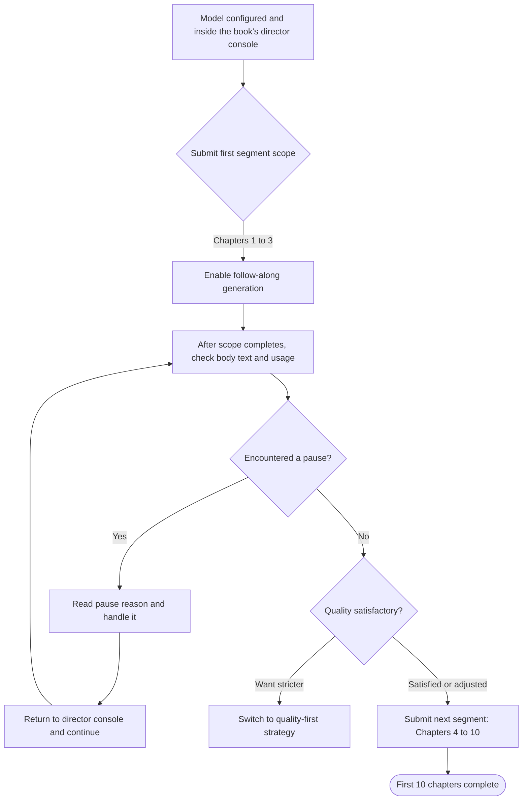
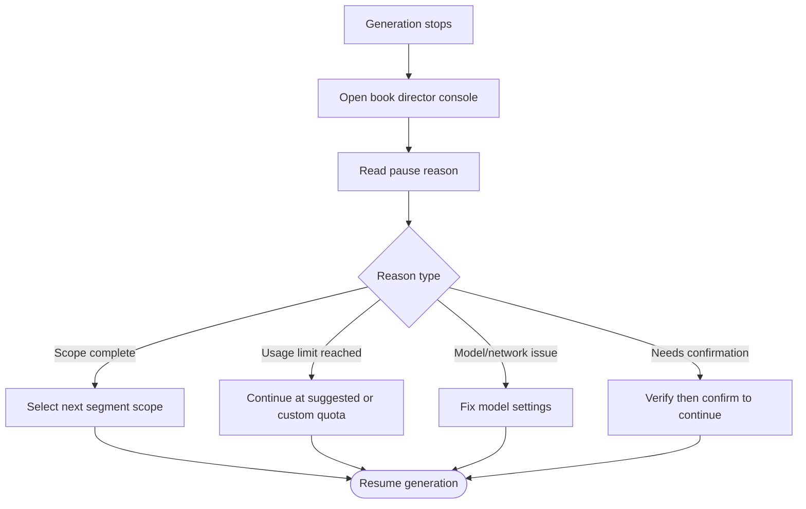

This hands-on guide assumes you have already completed Chapter 1 by following the [Creation Wizard](/en/onboarding). Next, you will use segmented authorization in Auto Director V2 to steadily write from Chapter 1 to Chapter 10. Throughout the process, you only need to do three things: submit a scope, observe generation, and check before continuing.

## Before Starting: Confirm Two Things

Before submitting the next segment, please confirm:

1. **At least one text model is available.** The model has passed detection and is running without errors. If unsure, return to [Model Configuration](/en/model-configuration) first.
2. **You are already in this book's director console.** The interface you see is the V2 book director console, with an "AI Usage" entry at the top and the chapter directory and director operation area below.

If the above two conditions are not yet met, it is recommended to first complete the [Creation Wizard](/en/onboarding) until Chapter 1 is drafted, then return to this page to continue.

## Step 1: Write a Small Segment First to Verify Results

Do not submit Chapters 1 to 10 all at once. Choose a small scope first to observe body text quality and call rhythm.

<Steps>
  <Step title="Submit Chapters 1 to 3">
    In the book director console, select a推进方式 (advancement mode, either fully automatic or phase-by-phase confirmation), then submit Chapters 1 to 3 in the scope selector. This scope is large enough to verify body text style, character appearances, and plot pacing, without being so large that backtracking becomes difficult.
  </Step>
  <Step title="Enable 「跟随生成」 (Follow-Along Generation)">
    When follow-along is enabled, the director console will automatically switch to the current phase as backend progress advances: opening the corresponding chapter during body text generation, and opening story, world, or character materials during the materials phase. You can watch content stream out in real time without manually refreshing the page.

    If follow-along is turned off, generation still runs in the background; you can manually open chapters from the directory to read them after completion.
  </Step>
  <Step title="Wait for the scope to complete">
    Fully automatic mode will continuously plan, write body text, check, and save within the authorized scope, then automatically stop when done. Phase-by-phase confirmation will pause when verification is needed, waiting for your confirmation before continuing. Neither mode will write content beyond the authorized scope on its own.
  </Step>
</Steps>

<Tip>
  If this is your first time using Auto Director V2, it is recommended to use "fully automatic" advancement for the first run to complete a full closed loop, then switch to phase-by-phase confirmation as needed.
</Tip>

## Step 2: After the Scope Ends, Check Three Things

After Chapters 1 to 3 are complete, do not immediately submit the next segment. Spend a few minutes confirming the following:

| Check Item | How | Why It Matters |
| --- | --- | --- |
| Is the body text readable | Open saved chapters and quickly skim the body text, confirming whether character names, locations, and basic dialogue have obvious confusion | Discovering issues early means subsequent chapters won't need large-scale corrections |
| Quality reminders | In the director console, view reminder tags for each chapter to see if there are expression suggestions or foreshadowing reminders | The default strategy records reminders and continues, but you can decide whether to switch to a stricter strategy |
| AI usage | Click "AI Usage" at the top of the book to view cumulative calls by chapter | Understanding current consumption distribution provides a reference for choosing the next segment's scope |

### About Quality Reminders and Creation Strategy

The default "prioritize completing the whole book" strategy records ordinary local issues as chapter reminders and continues. If you find many issues in Chapters 1 to 3 that require manual confirmation, consider switching to "quality first" in **Settings → Auto Director** (设置 → 自动导演).

| Strategy | Behavior | Suitable For |
| --- | --- | --- |
| Prioritize completing the whole book (default) | Records ordinary issues as reminders and continues advancing | Want to see a complete draft first |
| Quality first | May pause after body text is saved, waiting for manual handling | Higher detail requirements, willing to spend more time polishing |

<Tip>
  The strategy can be adjusted at any time; switching will not cause saved chapters to be lost.
</Tip>

## Step 3: Submit Chapters 4 to 10

After confirming that the direction and quality of the first 3 chapters are acceptable, you can expand the authorization scope:

1. In the book director console, select the next segment scope, for example Chapters 4 to 10.
2. Keep or adjust the advancement mode, then submit.
3. Enable 「跟随生成」 (Follow-Along Generation) again, letting the director console automatically navigate to current progress.

This segment will be longer than the first. If a pause occurs midway, first read the reason given by the director console, then decide whether to continue, adjust, or handle external issues. Do not rely on repeatedly clicking generate to resume.

## What to Do When You Encounter a Pause

When writing stops, do not panic. In the vast majority of cases, progress and saved body text are preserved. The handling order is as follows:

| Common Cause | Where to View | How to Handle |
| --- | --- | --- |
| Scope completed | Director console prompts "scope complete" | Normal state, select the next segment to continue |
| Reached single-chapter usage limit | Director console displays pause reason | Continue this chapter at the suggested quota or a custom quota; V2 single-chapter default limit is 100,000 Tokens |
| Model unavailable or quota exhausted | Director console + Run History | Replenish quota, switch models, or check network, then return to the director console to continue |
| Need to confirm phase results | Director console prompts "waiting for confirmation" | After verifying phase results, click confirm in the director console to continue |
| Need to re-plan | Director console | Handle according to prompt, resume from director console; do not delete the project |

<Warning>
  Run History is only for viewing status and error sources; you cannot continue, retry, or resume tasks from within it. All resume operations must be completed from the book director console.
</Warning>

### Pause-to-Resume Flow

If you are unsure which category a reason belongs to, you can open "Run History" to view the latest status of backend tasks, then return to the director console to handle it accordingly.

## After Writing 10 Chapters

Completing the first 10 chapters is an important milestone. Next, you can:

- Continue using the same segmented authorization method to advance subsequent chapters.
- Open [AI Usage](/en/features/token-usage) to deeply understand call distribution and Token cache effects.
- When there are unhandled quality reminders in Run History, go to the corresponding chapter page to verify them one by one.
- When you want to adjust writing style or global expression rules, enter the [Style Engine](/en/features/style-engine) and [Anti-AI Rules](/en/features/anti-ai-rules).
- When preparing long-term materials to participate in subsequent creation, configure the [Knowledge Base](/en/features/knowledge-base).

<CardGroup cols={2}>
  <Card title="Auto Director V1/V2" icon="wand-magic-sparkles" href="/en/features/auto-director">
    Understand the full features and operating modes of director versions
  </Card>

  <Card title="AI Usage and Token Cache" icon="chart-bar" href="/en/features/token-usage">
    View consumption distribution and single-chapter usage protection mechanisms
  </Card>

  <Card title="Run History" icon="list-check" href="/en/features/task-center">
    View backend task status and error sources
  </Card>

  <Card title="Creation Flow Overview" icon="diagram-project" href="/en/creation-flow">
    Understand the long-form creation chain from a global perspective
  </Card>
</CardGroup>
