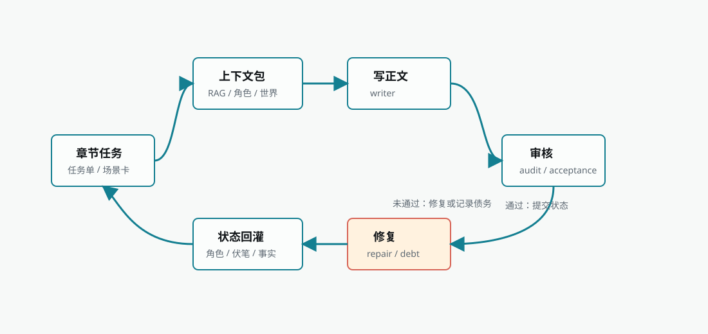

Biz Novel Studio's chapter execution is not "give the model a title and let it write." It is a closed-loop chain from brief to body text, to audit repair and state backfill. Understanding this chain can help you locate the truly problematic link when encountering quality issues, rather than blindly clicking regenerate.

<Frame caption="Chapter execution loop">
  
</Frame>

## What Is a Chapter Brief

A chapter brief is the contract for body-text generation, not a simple title. It comes from Auto Director's **Chapter Detailing** (章节细化) phase, and usually contains:

| Content | Role |
| --- | --- |
| Chapter goal | Explains what this chapter must advance |
| Carry over from previous chapter | Prevents the opening from detaching from existing facts |
| Lead to next chapter | Lets this chapter's ending serve subsequent pacing |
| Scene cards | Specifies location, conflict, character actions, and scene order |
| Appearing characters | Limits this chapter's figures, relationships, and available resources |
| Must payoff/setup | Manages reader promises and the foreshadowing ledger |
| Taboos and hard constraints | Prevents violating the book contract, world rules, and character states |

If the brief is missing or too vague, body-text generation quality will usually be unstable. In this case, prioritize returning to chapter detailing, rather than temporarily adding a sentence of "write better" in the body-text input box.

## Execution Entry Points

Chapter execution usually enters from two entry points:

| Entry | Trigger Condition | Description |
| --- | --- | --- |
| Auto Director **Chapter Batch Ready** (章节批次就绪) | Beat board, chapter list, and chapter detailing completed | User confirms or auto-approval enters chapter execution |
| Manual chapter execution | User initiates on the chapter page | Suitable for single-chapter rerun, model testing, or handling local chapters |

Before execution, a chapter task must exist. The task comes from **Chapter Detailing** (章节细化), containing chapter goals, carry-over relationships, scene cards, characters, conflicts, and taboos.

## Context Assembly: What Materials Are Prepared for the Model

Before body-text generation, the system aggregates multiple materials into a context package. This package determines what the model knows and does not know, directly affecting body-text quality.

<Steps>
  <Step title="This book's facts and planning">
    Book contract, macro story, volume window, fact ledger, foreshadowing ledger. These are the highest priority and cannot be overridden by external materials.
  </Step>
  <Step title="Character and world states">
    Current character goals, locations, relationships, abilities, available resources; this chapter's related world rules, locations, and faction boundaries.
  </Step>
  <Step title="Style assets and Anti-AI Rules">
    Bound style profile, style rules, anti-template expression constraints. Control how body text is written and what not to write.
  </Step>
  <Step title="RAG recall materials">
    Construct queries based on the chapter task, and recall the most relevant material fragments from the knowledge base.
  </Step>
</Steps>

### Why Chapters Cannot Rely Only on Prompts

Long-form novel subsequent chapters depend on already-occurred facts, character resources, reader promises, and world constraints. The chapter execution chain assembles these into a context package, avoiding reliance on temporary input for every chapter. Without this package, the model easily forgets previously planted foreshadowing, abilities the character just obtained, or world rule limitations.

## Body-Text Generation and Audit

After the context package is prepared, the system enters body-text generation. After generation, it immediately enters audit, judging whether body text satisfies the chapter task.

| Step | Input | Artifact | How to Handle Failure |
| --- | --- | --- | --- |
| Context assembly | Chapter task, book contract, characters, world, RAG, style, fact ledger | Context package | When key assets are missing, return to Director Follow-up or the novel page to supplement materials |
| Body-text generation | Context package, model routing, chapter goal | Body-text draft | Empty body text retries once; consecutive failures check model and task input |
| Audit | Draft, chapter task, context package | Audit report, pending issues, pass status | When acceptance judgment is unavailable, quality debt can be recorded |

### Quality Judgment Layers

Audit results are divided into multiple layers, with different impacts on the global chain:

| Judgment Result | Meaning | Impact on Global Chain |
| --- | --- | --- |
| accepted | Body text satisfies current task | Can continue to next chapter |
| continue_with_warning | Has issues but body text is usable | Record quality debt, continue subsequent chapters |
| local_patch_plan | Can be locally repaired | Attempt repair, then continue or record debt |
| patchable_obligation_gap | Local promise gap can be filled | Low-risk repair or record debt |
| defer_and_continue | Issue can be handled later | Explicitly record debt and continue |
| replan_required | Subsequent structure needs adjustment | Enter checkpoint, confirmed by user |
| stop_for_replan | Must stop and replan | Stop global chain, return to planning entry |

<Info>
  Local quality debt does not equal global failure. As long as the chapter has usable body text, and the system does not explicitly require replanning, prioritize saving body text, recording debt, and allowing subsequent chapters to continue. This avoids a book repeatedly getting stuck because of a single chapter's minor issue.
</Info>

## Repair and Quality Debt

Issues found by audit enter the repair chain. Repair is not an infinite loop; the current chain limits retry counts and records quality debt.

| Situation | Recommended Handling |
| --- | --- |
| Minor logic or pacing issues | Allow light repair or record quality debt |
| Readable after repair but still has local issues | Record quality debt and continue subsequent chapters |
| Body text unavailable or empty | Retry generation, switch model if necessary |
| Chapter goal conflicts with outline | Return to chapter task or beat board to replan |
| Repair request would change subsequent structure | Enter **Waiting for Replanning** (等待重新规划), confirmed by user |

### What Is Quality Debt

Quality debt indicates the chapter has visible issues, but does not necessarily need to stop the whole book. Typical examples:

- Local pacing is not strong enough
- Individual foreshadowing hints are insufficient
- A certain passage's character tone needs later revision
- The repair tool cannot stably anchor a certain paragraph

Quality debt is recorded, displayed, and followed up later, rather than default-blocking the global Auto Director. Only explicit replanning, unrecoverable generation failure, data risk, or security risk should stop the global chain.

## State Backfill: Letting the Next Chapter Base on Latest Facts

After chapter execution completes, the system backfills new states into novel assets. This is the core mechanism that lets long-form writing continue.

| Backfill Object | Content | Impact |
| --- | --- | --- |
| Character state | Location, goal, relationship, ability, resource changes | Subsequent chapters' character behavior boundaries |
| Fact ledger | Already-occurred events, irreversible results | Prevent subsequent repetition or violation of facts |
| Foreshadowing/promises | New setup, payoff, deferral, risk | Help subsequent chapters manage reader expectations |
| World state | Location, rule, faction changes | Affect scene and conflict reasonableness |
| Audit issues | Pending issues, quality debt | Enter subsequent repair and task prompts |

### How to Judge When Backfill Fails

| Phenomenon | Possible Meaning | Recommended Action |
| --- | --- | --- |
| Body text saved, but character state not updated | Character resource sync failed | Retry character resource sync, do not rewrite body text |
| Foreshadowing ledger not refreshed | Payoff ledger sync failed | Retry ledger sync, preserve body text |
| Chapter status still shows running | Backend task status not closed | Check whether Task Center is stale or failed |
| Next chapter context does not carry previous chapter facts | State submission not completed | First fix state submission, then execute next chapter |
| Audit report missing | Audit service failed or interrupted | Can preserve body text, re-audit later |

Chapter body-text generation and state backfill are two different problems. When body text is already usable, prioritize fixing the backfill chain. Directly rewriting may create new factual forks.

## How RAG and Knowledge Base Participate in Chapter Execution

Chapter execution recalls the knowledge base, book breakdown, style, and this book's assets during context assembly. RAG materials are only part of the context and should not override the chapter brief.

### Material Source Layers

| Layer | Examples | Usage Principle |
| --- | --- | --- |
| This book's facts | Already-written chapters, fact ledger, character states, world states | Highest priority, cannot be overridden by external materials |
| This book's planning | Book contract, macro story, volume strategy, chapter tasks | Guide next writing goals |
| User materials | Uploaded knowledge base, world samples, dedicated setting documents | Used to supplement facts and settings |
| Book breakdown conclusions | Reference work structure, selling points, character and style analysis | Migrate methods, do not copy plot |
| Style assets | Style rules, Anti-AI Rules, sample text features | Control expression methods |
| Temporary conversation | Creative Hub current round input | Can only affect current task; for long-term effect, must be persisted |

### How Chapter RAG Queries Are Constructed

The system does not directly search materials using chapter titles. It assembles queries based on the chapter task, containing novel title, chapter title, chapter goal, chapter expectation, this chapter's must-advance content, target conflict, appearing characters, and structured outline. The closer the query is to this chapter's goal, the easier the recall is to hit truly useful materials.

### Retrieval Methods

| Retrieval Method | Suitable Content | Common Issues |
| --- | --- | --- |
| Vector retrieval | Semantically similar but differently worded materials, long documents, book breakdown conclusions | Cannot hit when documents are not indexed or vector library is unavailable |
| Text retrieval | Person names, place names, proper nouns, fixed terms | May miss when users do not write clear keywords |
| Hybrid recall | Needs both semantics and keywords | Needs reasonable document titles, chunking, and metadata |

<Warning>
  More recall is not always better. Stuffing irrelevant materials into context increases model noise. For long-form novels, accurately hitting the current chapter's task is more important than recalling a large volume of materials at once.
</Warning>

### Priority When Conflicts Occur

| Conflict Scenario | Priority |
| --- | --- |
| RAG materials conflict with already-written chapters | Already-written chapters and fact ledger take priority |
| Style rules conflict with chapter task | Chapter task takes priority; style rules adjust expression methods |
| Book breakdown conclusions conflict with this book's characters | This book's character states take priority |
| World samples conflict with this book's world | This book's world takes priority |
| User's current explicit instruction conflicts with old materials | Current instruction can trigger revision, but needs to be persisted before long-term effect |

RAG's goal is to let the system know more, not to give external materials the highest decision-making power.

## How Batch Execution Advances

Chapter batches usually do not write only one chapter at a time. Batch execution saves state between each chapter and decides whether to continue to the next chapter.

| Batch Node | System Action | User May See |
| --- | --- | --- |
| Batch start | Read the chapter range from **Chapter Batch Ready** (章节批次就绪) | Chapter tasks enter queue or run |
| Single-chapter generation | Assemble context, generate body text, audit repair | Current chapter status changes |
| Single-chapter close | Save body text, backfill facts, characters, foreshadowing, and quality info | Chapter completes or completes with warning |
| Next-chapter preparation | Read previous chapter's backfilled state | Next chapter's context updates |
| Batch pause | Encounter checkpoint, failure, or need manual handling | Director Follow-up or chapter source page shows operation entry |
| Batch completion | All target chapters processed | Can continue next batch or view quality debt |

If auto-approval is not authorized, the batch may pause at certain nodes waiting for confirmation. This is to let the user see risks, rather than the backend "not responding."

## This Book's Issue Handling Rules

Each book can inherit global rules, or choose a set of issue handling plans in this book:

| Plan | Auto-Processing Opportunity | When Local Issue Remains Unresolved After Handling |
| --- | --- | --- |
| Prioritize completing the whole book | Up to 1 time | Preserve usable body text, record quality debt, and continue |
| Quality priority | Up to 1 time | Stop at a saved chapter boundary, waiting for explicit resume |

Item-by-item rules can also choose auto-retry, remind then continue, pause processing, or end task. Save failure, data integrity risk, protected content, and other runtime safety issues will still prioritize protecting the work.

<Warning>
  Manual pauses will not be automatically cleared by backend polling. When "quality priority" explicitly requests pause processing, the task retains a pending manual resume status. Backend polling, service restart, and worker recovery cannot confirm on behalf of the user; only after an explicit resume action is executed will the chapter chain continue.
</Warning>

## Failure Modes and Recovery

| Failure Mode | Symptom | Check First | Recommended Recovery |
| --- | --- | --- | --- |
| Context assembly failure | Error before chapter execution | Run History error, novel assets, chapter page | Supplement characters/world/chapter tasks, then return to chapter page and retry |
| Empty body text | Model returns empty content | Run History, model routing, chapter page | System retries once; consecutive failures switch model, then return to chapter page |
| Audit unavailable | acceptance gate unavailable | Chapter page, Task Center | Preserve body text, re-audit later |
| Repair failure | repair ticket failed | Task Center, chapter page | Attempt re-repair; if usable body text already exists, record quality debt |
| Replanning risk | **Waiting for Replanning** (等待重新规划) | Director Follow-up | Manually confirm replanning or accept risk and continue |
| State sync failure | Body text exists but state not backfilled | Run History, chapter page | Return to chapter page and retry sync; do not prioritize rewriting body text |
| Model balance or quota insufficient | Execution details show model-returned balance, quota, or rate-limit errors | Current execution page, Run History, model settings | Top up quota or switch model, then return to current execution page and resume from the first unfinished chapter |

## Manual Intervention Entry Points

| What the User Wants to Do | Recommended Entry | Reason |
| --- | --- | --- |
| Check whether body text is saved | Chapter page | Body-text facts are based on the chapter page |
| See why the backend stopped | Task Center | Failure, stale, queued, running are all here |
| Approve continue or replan | Director Follow-up | The next entry for checkpoints is here |
| Adjust chapter goals | Chapter task / chapter planning | Body-text generation reads the brief |
| Modify character states | Character page | Subsequent chapters read formal character assets |
| Check whether materials hit | Knowledge base recall test | Judge whether RAG can truly hit |
| Adjust style | Style Engine | Language style should enter context through style assets |

Do not throw all problems at body-text rewriting. Body-text rewriting is suitable when body text is unavailable; task, asset, recall, and sync problems should return to the corresponding entry.

## FAQ

<AccordionGroup>
  <Accordion title="Why can't a chapter just be given a title and let the model write?">
    Long-form novel subsequent chapters depend on already-occurred facts, character resources, reader promises, and world constraints. Without a brief and context package, the model easily forgets previous settings, violates character states, or misses foreshadowing. The chapter brief provides clear advancement goals, scene cards, and constraint boundaries, and is the contract for body-text quality.
  </Accordion>

  <Accordion title="Will quality debt affect subsequent chapters?">
    It will not directly block. Quality debt is recorded and then continues to advance subsequent chapters, but debt content will be referenced in subsequent audits and planning. If the debt involves structural issues, it may trigger a replanning suggestion later.
  </Accordion>

  <Accordion title="Will RAG recalled materials override this book's already-written content?">
    No. This book's facts and the fact ledger are the highest priority. RAG materials are used to supplement settings and references, and cannot overturn content already written into the novel state. If recalled materials conflict with this book's facts, the system will prioritize following this book's facts.
  </Accordion>

  <Accordion title="When state sync fails, will the next chapter write based on old states?">
    If state is not backfilled, the next chapter's context may lack this chapter's latest facts. In this case, first fix the sync, then execute the next chapter, to avoid factual forks. When body text is already usable, there is no need to rewrite; only supplement the sync.
  </Accordion>

  <Accordion title="Is there a limit on single-chapter repair retries?">
    Yes, there is a limit. The current chain limits repair retry counts to avoid infinite loops. If low-risk repair cannot resolve, it records quality debt and continues; if it involves structural issues, it enters a checkpoint waiting for user confirmation.
  </Accordion>

  <Accordion title="Can I manually modify body text and then let the system continue?">
    Yes. You can manually modify body text on the chapter page. Modified content will become the fact source for subsequent chapters, but the system will not automatically reverse-sync to character states or the foreshadowing ledger. If the modification involves important fact changes, it is recommended to simultaneously check related assets.
  </Accordion>
</AccordionGroup>

<CardGroup cols={3}>
  <Card title={"Knowledge Base & RAG"} icon="database" href="/en/features/knowledge-base">
    Learn how materials are ingested, recalled, and participate in context assembly
  </Card>

  <Card title="Creative Production Pipeline" icon="diagram-project" href="/en/guides/production-pipeline">
    The complete three-layer chain from Idea Layer to Chapter Execution Layer
  </Card>

  <Card title="Auto Director" icon="wand-magic-sparkles" href="/en/features/auto-director">
    Learn about director phases, run modes, and checkpoint mechanisms
  </Card>
</CardGroup>
