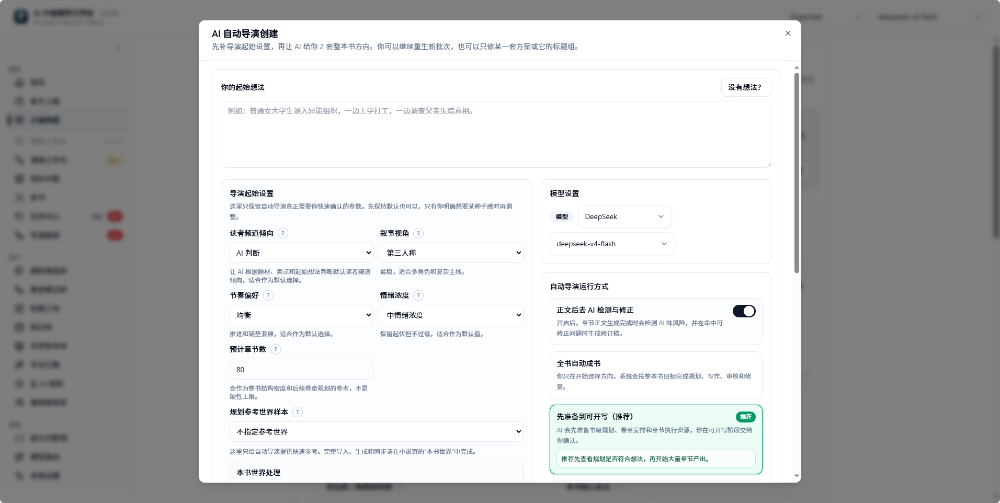
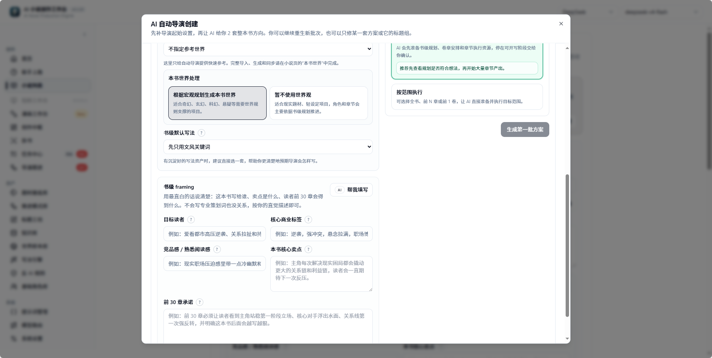
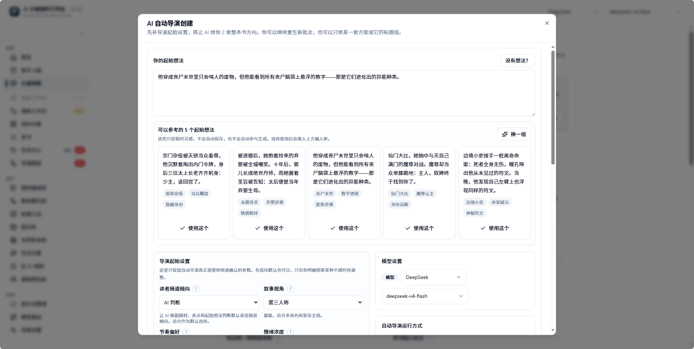
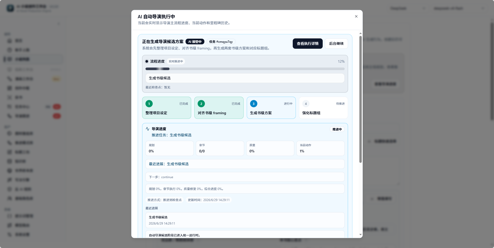
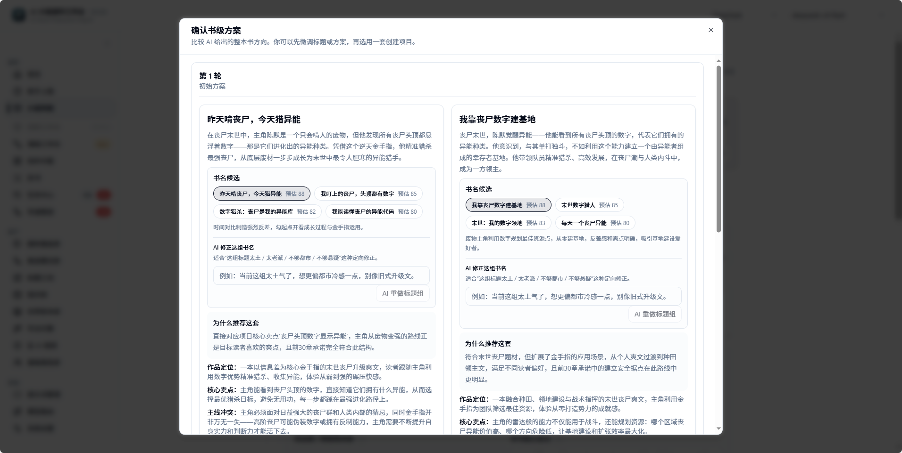
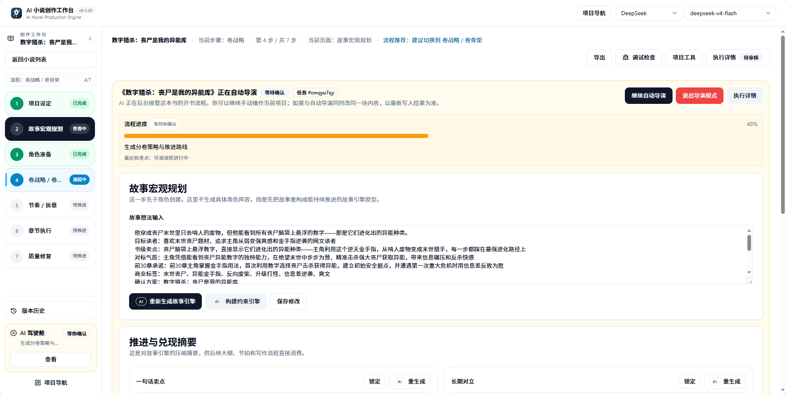
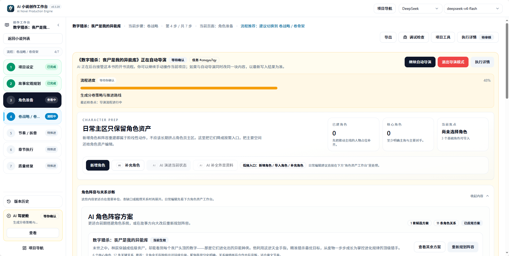
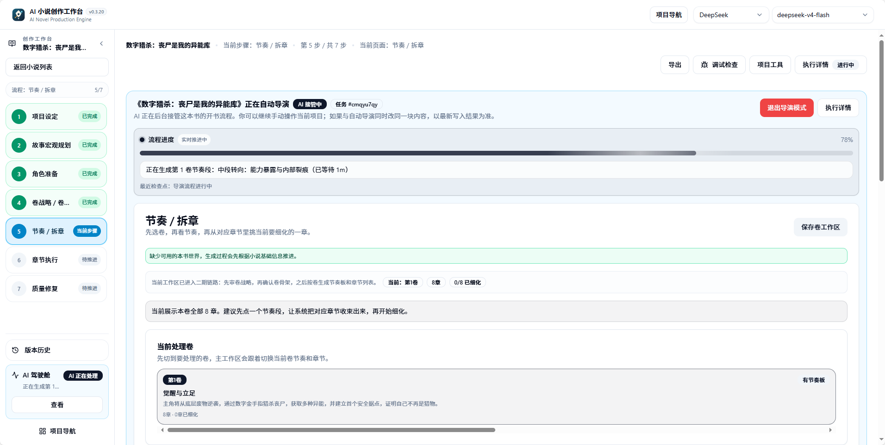

This page is an end-to-end case study: from an empty project to confirming a plan, then letting AI automatically produce novel content. Each step is labeled with its corresponding Auto Director phase, where the artifact is saved, and where to pause for review.

If you just want to quickly run through the first body-text segment, see [Quick Start](/en/quickstart). For detailed operations for the first 10 chapters, see [First Ten Chapters](/en/first-ten-chapters).

## Path Overview

| Step | User Action | Corresponding Phase | Artifact Saved To | Pause and Review |
| --- | --- | --- | --- | --- |
| 1 | Configure model | System config | System settings, model routing | System settings |
| 2 | Enter an idea or select an idea card | "Idea Alignment" | Auto Director task | Run History |
| 3 | Generate and select a whole-book direction | "Direction Candidate Batch" | Candidate direction batch | Creation Wizard, direction selection page |
| 4 | Click confirm plan/title | "Title Candidate Group" | Candidate direction, title group | Direction selection page |
| 5 | Create novel | "Create Novel" | Novel project | Novel list |
| 6 | AI auto-generates planning assets | "Story Macro" / "Book Contract" / "World Building" / "Character Generation" | Story macro, book contract, world, characters | AI Cockpit, Director Follow-up |
| 7 | AI auto-generates volume and chapter tasks | "Volume Strategy" / "Beat Board" / "Chapter Detailing" | Volume strategy, beat board, chapter brief | AI Cockpit, Run History |
| 8 | Select production mode and start body text | "Production Handoff" / "Chapter Execution" | Production experience, body draft, audit and repair results | Creation Wizard, chapter bookshelf or workbench |
| 9 | View novel output | Completion or partial completion | Chapter body text, quality debt, export entry | Chapter page, export |

## Choosing a Starting Point

The main flow supports three starting points. After entering Auto Director, they share the same planning and chapter chain:

| Starting Point | Best For | Read This First |
| --- | --- | --- |
| A single idea or idea card | Starting from your own concept | Continue below on this page |
| Trending genre signal | Referencing current public rankings | [Trending Genre Radar](/en/features/market-radar) |
| Completed book breakdown | Continuing an original work or learning structure, pacing, and style | [Book Breakdown Workbench](/en/features/book-analysis) |

When starting from the market radar, the initial idea, core advantage, core selling point, first-30-chapters promise, genre, and progression mode are carried into the book-starting page. When starting from a book breakdown, you first choose whether to "continue the original work" or "reference to create a new book."

## Step 1: Configure the Model

Open system settings and configure the default model. For first-time use, you only need to ensure one text model is available. Specific models depend on the vendor's current available list and your quota.

Confirm:

- API Key is valid.
- Base URL is correct.
- Default model can return Chinese.
- Run History has no old failed tasks interfering.

If model connection fails, first check [FAQ](/en/faq) and [Troubleshooting](/en/troubleshooting).

## Step 1.5: Complete Quick Setup

When entering the product for the first time and no model is available, complete quick setup first. Choose a vendor, fill in the API Key/API address and text model. The system will detect plain text and structured output, and automatically prepare all core creative tasks.

You do not need to select a body-text execution range when starting Auto Director. Auto Director will always advance to "ready to write," then let you choose Easy Mode or Professional Mode.

<Frame caption="Top half of the Auto Director creation dialog: starting idea, model, and run mode">
  
</Frame>

<Frame caption="Bottom half of the Auto Director creation dialog: world handling, book-level framing, and generate button">
  
</Frame>

## Step 2: Enter an Idea

Go to **Getting Started** (新手上路) or the **Creative Hub** (创作中枢), and enter a single idea. Do not hand-write a full outline; let Auto Director generate directions first.

Example:

> A novice author enters the idea market, searching for forgotten stories.

Corresponding phases: "Idea Alignment," "Project Positioning."

Artifacts: Auto Director task and candidate generation input.

<Frame caption="When you have no idea, you can choose a starting point from idea cards">
  
</Frame>

## Step 3: Generate Direction Batch

After clicking **Generate First Batch of Plans** (生成第一批方案), the system enters the **Direction Candidate Batch** (方向候选批次) phase and generates candidate directions. You will see different positioning, selling points, protagonist paths, conflicts, and progression loops.

When choosing, look at:

- Which direction is easiest to sustain across many chapters.
- Whether the protagonist's goal is clear.
- Whether the selling point fits the target readers.
- Whether the conflict can keep escalating.

If none satisfy you, you can generate the next batch or revise candidates.

<Frame caption="Execution progress for generating the first batch of plans">
  
</Frame>

## Step 4: Confirm Direction and Title

The title group belongs to the **Title Candidate Group** (书名候选组). The title does not need to be final, but it should represent the current direction. This is the last creative choice the user must make: **confirm which book-level plan to use to create the novel**.

Optional actions:

- Click **Use This** (使用这个) for a given plan.
- Redo only the title group.
- Enter feedback to let AI revise a given plan.
- Switch to another batch of candidate directions.

After confirmation, the system enters **Create Novel** (创建小说) and continues to complete planning, characters, and volume/chapter preparation. Body text will not start early.

<Frame caption="Confirming the book-level plan and title group">
  
</Frame>

## Step 5: Create the Novel

After confirming the candidate, the system creates the novel project and continues to show the book-starting preparation progress in the current Auto Director session.

From this point, the user does not need to manually generate story macro, characters, volume strategy, beat board, and chapter body text in sequence. The AI Cockpit will queue these backend commands, and display the current step, task number, progress bar, and most recent checkpoint at the top.

If creation fails:

1. Open Run History.
2. Check the **Candidate Confirmation** (候选确认) command error.
3. If it is a temporary error, retry.
4. If it is a data error, preserve the error information before reporting.

<Frame caption="After confirming the plan, enter the AI Cockpit for automatic advancement">
  
</Frame>

## Step 6: AI Auto-Generates Story Macro and Book Contract

Auto Director will generate **Story Macro** (故事宏观) and **Book Contract** (书契约).

Artifacts include:

- Whole-book story positioning.
- Core conflict.
- Progression loop.
- Target readers.
- First 30 chapters promise.
- Narrative boundaries and hard constraints.

View locations: novel basic info, story macro, Director Follow-up.

## Step 7: AI Auto-Prepares World and Characters

**World Building** (世界搭建) prepares the book's world; **Character Generation** (角色生成) generates character candidates.

The full-auto chain will prioritize generating a usable cast based on the plan and book contract. The page may stay on character preparation, but if the top task status shows that volume strategy or chapter splitting is advancing, the backend has already continued to subsequent phases.

Characters should only trigger **Waiting for Character Confirmation** (等待角色确认) when quality is clearly unstable and requires user adjudication. This is not a failure, but a request for you to confirm the character cast.

Handling methods:

- Confirm suitable characters.
- Merge duplicate candidates.
- Return and redo the character cast.
- Adjust character identity anchors.

Do not force entry into volume planning when characters are clearly unqualified.

<Frame caption="During Auto Director advancement, you can view the character preparation page">
  
</Frame>

## Step 8: AI Auto-Applies Character Cast

After character confirmation, **Apply Character Cast** (应用角色阵容) writes characters into formal assets. From this point, chapter execution will read these character states.

View locations: basic character library, this book's character page, Director Follow-up.

## Step 9: AI Auto-Generates Volume Strategy and Volume Skeleton

**Volume Strategy** (卷战略) generates the volume-level route; **Volume Skeleton** (卷骨架) generates the volume skeleton.

Volume strategy is a book-starting preparation resource and does not need item-by-item confirmation. You can observe progress, or let the task continue in the background. Only runtime safety or data risks will require intervention.

When reviewing, focus on:

- Whether the first volume's goal is clear.
- Whether each volume's promise is different.
- Whether the protagonist's growth has steps.
- Whether foreshadowing and reader expectations can be sustained.

If volume planning is wrong, prioritize fixing the volume strategy rather than directly changing the later chapter list.

## Step 10: AI Auto-Generates Beat Board, Chapter List, and Chapter Detailing

Structured chapter splitting includes:

- **Beat Board** (节奏板): generates beat nodes within a volume.
- **Chapter List** (章节清单): splits out the chapter list.
- **Chapter Sync** (章节同步): syncs the chapter execution contract.
- **Chapter Detailing** (章节细化): details the chapter brief and execution resources.

These phases are high-memory tasks. You should not usually start multiple tasks for the same book and same range simultaneously. When you see "An Auto Director task is already processing the same range," first go to Run History to check the running task.

<Frame caption="Beat splitting phase advancing automatically">
  
</Frame>

## Step 11: Select Body-Text Production Mode

**Chapter Batch Ready** (章节批次就绪) means the chapter batch is prepared.

The system will stop before body text starts, letting you choose:

- **Easy Mode** (简易创作): enter a read-only chapter bookshelf, and AI continues to complete the whole book.
- **Professional Mode** (专业创作): enter the full workbench, and manually check and arrange chapter production.

After choosing Easy Mode, the system will continue to:

1. Generate body text by chapter task.
2. Perform body-text audit.
3. Repair fixable issues.
4. Record quality debt.
5. Backfill character states, facts, and foreshadowing.
6. Continue to the next chapter until the target range is completed or a high-risk interruption is hit.

After the first chapter is generated, review the body text, audit issues, repair results, and quality debt. When body text is usable but has local issues, you can continue to subsequent chapters first and handle quality debt later.

## What Users Only Need to Handle in the Full-Auto Chain

| Situation | Intervene? | Recommended Action |
| --- | --- | --- |
| AI Cockpit shows "AI is processing" | No | You can stay on the page to observe, or let it run in the background. |
| Page shows on character page, but top shows generating volume strategy | No | Trust the top task status; do not repeatedly click generate. |
| Model unavailable, quota exhausted, service anomaly | Yes | Confirm the cause in Run History, fix the model/quota, then return to the current Auto Director or chapter page to resume. |
| System requests replanning | Yes | Go to Director Follow-up to view the reason, then decide to replan or continue. |
| Chapter body text is usable but has quality debt | Usually no need to stop immediately | Allow continued output, then handle quality debt in batch later. |
| Want to switch to manual mode | Yes | Before clicking exit director mode, confirm that the current background task has stopped or completed. |

## Common Pause Points

| Pause Position | Description | Next Step |
| --- | --- | --- |
| **Waiting for Direction Selection** (等待方向选择) | Waiting for you to choose a direction | Select, revise, or redo candidates. |
| **Waiting for Character Confirmation** (等待角色确认) | Waiting for you to confirm characters | Confirm, merge, or redo characters. |
| **Volume Strategy Ready** (卷战略就绪) | Volume strategy completed | Confirm and enter chapter splitting. |
| **Chapter Batch Ready** (章节批次就绪) | Chapter preparation completed | Enter chapter execution. |
| **Waiting for Replanning** (等待重新规划) | Quality repair may affect subsequent chapters | View the reason, then decide to replan or continue. |

## Completion Criteria

Signs that the first round of hands-on practice is complete:

- Novel project exists.
- Book contract and macro story exist.
- World and character assets are viewable.
- Volume strategy, beat board, and chapter list exist.
- At least Chapter 1 has a chapter brief.
- Chapter 1 body text is generated and enters audit/repair results.

When choosing "Easy Mode," subsequent completion criteria also include:

- Body text for chapters within the target range is continuously produced.
- Each chapter has audit, repair, or quality debt records.
- After state backfill, the next chapter can read new facts from the previous chapter.
- Run History shows target range completion, or the AI Cockpit enters full-flow completion status.

## FAQ

<AccordionGroup>
  <Accordion title="Why does the page stay on character preparation, but the top shows advancing volume strategy?">
    In the full-auto chain, character preparation and subsequent phases may advance in parallel. Trust the task status in the top AI Cockpit; do not repeatedly click generate.
  </Accordion>

  <Accordion title="How long after confirming the plan can I see body text?">
    It depends on model speed and chapter range. Usually story macro, world, characters, volume strategy, and chapter splitting execute in sequence, and only after all are completed does body-text production begin. You can observe the current step and progress bar in the AI Cockpit.
  </Accordion>

  <Accordion title="Can I skip character confirmation and go straight to body text?">
    Not recommended. The character cast directly affects the chapter execution contract and body-text quality. Forcing advancement when characters are clearly unqualified will cause massive repairs in subsequent chapters.
  </Accordion>

  <Accordion title="Can Easy Mode and Professional Mode be switched at any time?">
    You can switch before selecting the production mode. After entering body-text production, exiting director mode requires first confirming that the background task has stopped or completed, to avoid interrupting a running chapter.
  </Accordion>

  <Accordion title="Chapter 1 body text has quality debt; do I need to fix it immediately?">
    Usually not. Allow continued output of subsequent chapters, then handle quality debt in batch. Only stop when Director Follow-up explicitly requests "Waiting for Replanning."
  </Accordion>
</AccordionGroup>

<CardGroup cols={3}>
  <Card title="First Ten Chapters" icon="list-ol" href="/en/first-ten-chapters">
    Detailed operation steps and checklists for Chapters 1-10.
  </Card>

  <Card title="Recovery by Phase" icon="life-ring" href="/en/guides/recovery-by-phase">
    Symptoms, view locations, and recovery entries for getting stuck at each phase.
  </Card>

  <Card title="Auto Director" icon="wand-magic-sparkles" href="/en/features/auto-director">
    Differences between Director V1 and V2, advancement modes, and range control.
  </Card>
</CardGroup>
