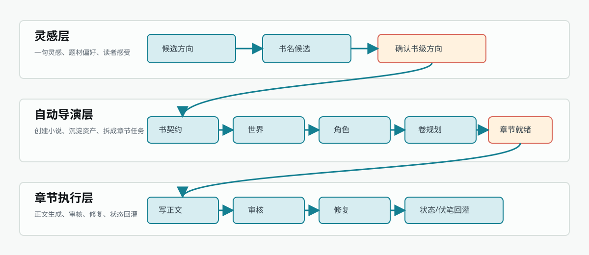
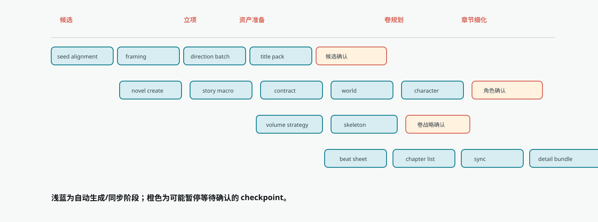
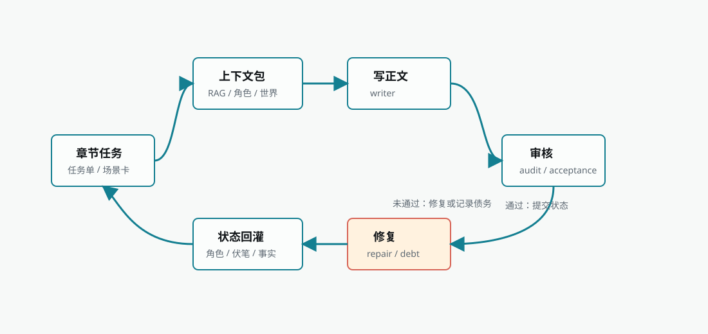

Biz Novel Studio splits "from a single idea to a complete chapter" into a three-layer collaborative production chain. Each layer is responsible for only one thing, and layers hand off through clear artifacts and checkpoints. This design lets long-form creation be confirmed segment by segment, recovered segment by segment, and also avoids the common problem where the next chapter forgets earlier settings after one chapter is finished.

<Frame caption="End-to-end three-layer production chain">
  
</Frame>

## Three-Layer Division of Labor

| Layer | Goal | Input | Main Artifacts | Common View Entry |
| --- | --- | --- | --- | --- |
| Idea Layer | Turn fuzzy ideas into selectable book-level directions | One-sentence idea, genre preference, reader feeling, model settings | Candidate directions, title candidates, book-starting positioning | Getting Started, Creative Hub, Auto Director direction selection |
| Auto Director Layer | Turn book-level directions into executable novel assets | Confirmed candidate, run mode, auto-approval config | Novel project, book contract, macro story, world, character cast, volume strategy, beat board, chapter list, chapter brief | Director Follow-up, novel page, Task Center |
| Chapter Execution Layer | Generate body text from chapter tasks and backfill state | Chapter task, context package, knowledge base recall, style assets, character states | Body draft, audit report, repair results, quality debt, character/fact/foreshadowing backfill | Chapter page, Task Center, Director Follow-up |

## Why Three Layers

The boundaries between layers are not arbitrary. Each layer only does what it should do, without overstepping, to ensure long-form creation controllability.

| Boundary | Can Do | Should Not Do |
| --- | --- | --- |
| Idea Layer to Auto Director Layer | Create novel project through candidate confirmation | Treat a chat message of "I like this" as a persisted novel asset |
| Auto Director Layer to Chapter Execution Layer | Hand off chapter tasks through **Chapter Batch Ready** (章节批次就绪) | Let the model write body text without a chapter brief |
| Chapter Execution Layer to subsequent planning | Influence next chapters and trigger replanning when necessary through state backfill | Rely on the user to manually recap previous chapter facts every chapter |

If a piece of information needs to long-term influence subsequent chapters, it must cross the boundary and land in an asset or task record. Content that only exists in conversation context cannot guarantee stable reading by subsequent Auto Director and chapter execution.

## Idea Layer: From Fuzzy Idea to Selectable Direction

The Idea Layer solves "what exactly is this book about." It does not directly write chapters, but organizes user ideas into multiple selectable directions, avoiding the beginner's burden of manually writing worldviews, characters, and outlines from the start.

<Steps>
  <Step title="Idea Alignment">
    The system understands the input idea, genre, reader feeling, and default parameters, and organizes them into candidate generation input.
  </Step>
  <Step title="Project Positioning">
    The system forms a book-level positioning, selling point, and target reader judgment.
  </Step>
  <Step title="Direction Candidate Batch">
    A batch of selectable book-starting directions appears on the page. Each direction includes genre, core selling point, protagonist starting point, and progression mode.
  </Step>
  <Step title="Title Candidate Group">
    After selecting a direction, a title group and recommended titles appear. If unsatisfied, you can redo only the title group.
  </Step>
</Steps>

The core checkpoint of this phase is **Waiting for Direction Selection** (等待方向选择). You can choose a direction, generate the next batch, revise the whole batch, revise a single item, or redo only the title. Only after a candidate is confirmed does the system enter book creation.

<Tip>
  When there is no clear idea, you can start directly from idea cards. Idea cards only provide a seed for candidate generation and do not require a full outline first.
</Tip>

## Auto Director Layer: From Direction to Executable Assets

After confirming the direction, the Auto Director Layer turns "what I want to write" into "materials that every subsequent chapter can read." This layer contains the complete planning chain from creating the novel to splitting into chapter briefs.

<Frame caption="Auto Director phase Gantt chart">
  
</Frame>

### Asset Preparation Phase

| Phase | Problem Solved | View/Revise Entry |
| --- | --- | --- |
| Story macro | Whole-book long-term conflict, progression loop, main-line structure | Novel planning, story macro |
| Book contract | Target readers, selling point, first 30 chapters promise, hard constraints | Novel basic info, book-level default style |
| World building | This book's world rules, locations, factions, stage boundaries | World assets, novel materials |
| Character generation | Generate character candidates and cast draft | Character candidates, Director Follow-up |
| Apply character cast | Write approved character cast into formal assets | Character page, character relationships |

The character phase is an important quality gate. If character names still feel like functional slots such as "mentor-type heroine" or "villain boss," or lack identity anchors, the system will stop at **Waiting for Character Confirmation** (等待角色确认) rather than bringing a low-quality cast into volume planning.

### Volume Planning Phase

The volume planning phase solves "how to advance the whole book by volumes." It does not directly write chapter body text, but first determines each volume's reader promise, main conflict, stage goal, and structural load.

| Phase | Artifact | Risk Point |
| --- | --- | --- |
| Volume strategy | Volume-level strategy, volume goals, progression route | Scattered volume goals will cause subsequent chapters to lack a main line |
| Volume skeleton | Volume list, each volume's task, key promises | Volume skeleton errors will amplify to beat board and chapter list |

If volume strategy is wrong, handle it in the volume planning entry first. Do not only change chapter titles. Chapter titles are downstream results and cannot correct upstream volume mission.

### Chapter Detailing Phase

The chapter detailing phase splits volume planning into executable chapter tasks. It is the handoff layer between Auto Director and body-text execution.

| Phase | Artifact | Condition to Enter Next Step |
| --- | --- | --- |
| Beat board | Beat nodes, chapter span, conflict advancement | Beat covers target chapter range |
| Chapter list | Chapter titles, order, basic goals | Chapter count aligns with volume goals |
| Chapter sync | Chapter execution contract synced to chapter records | Chapter data readable by chapter page |
| Chapter detailing | Chapter brief, scene cards, goals, and execution resources | **Chapter Batch Ready** (章节批次就绪) checkpoint |

## Chapter Execution Layer: From Brief to Body Text and State Backfill

The chapter execution layer is responsible for turning prepared chapter tasks into body text, and feeding the new states produced by body text back into subsequent chapters. It is not as simple as "write one chapter," but a closed loop composed of body-text generation, audit, repair, quality debt, and state sync.

<Frame caption="Chapter execution loop">
  
</Frame>

Execution steps are as follows:

<Steps>
  <Step title="Context Assembly">
    Aggregate book contract, character states, world rules, fact ledger, foreshadowing ledger, style assets, and RAG recall materials into a context package.
  </Step>
  <Step title="Body Text Generation">
    Generate body-text draft based on the context package and chapter brief.
  </Step>
  <Step title="Audit">
    Judge whether body text satisfies chapter tasks, continuity, character behavior, pacing, and style requirements.
  </Step>
  <Step title="Repair">
    Low-risk issues are auto-repaired; structural issues enter checkpoint waiting for confirmation.
  </Step>
  <Step title="State Backfill">
    Save body text, sync character states, fact ledger, foreshadowing ledger, and world changes.
  </Step>
</Steps>

State backfill is the key to continuous long-form creation. After each chapter is saved, the system organizes the factual changes that occurred in this chapter and writes them back into this book's character states, resource ledger, and foreshadowing plan, so that the next chapter's context is based on the latest story facts. This state backflow ensures that character relationships, abilities, and goal changes are inherited by subsequent chapters, and newly planted foreshadowing is marked as pending recovery in subsequent planning.

## Production Mode: How Far Auto-Runs After Confirming the Plan

When starting Auto Director, you must select a run mode. The mode determines how far the system will auto-advance after confirming the plan.

| Mode | Chinese Name | Stops At | Best For |
| --- | --- | --- | --- |
| Prepare to ready first (recommended) | Auto to ready | Auto-completes novel creation, book contract, characters, volume planning, beat board, and chapter tasks, stopping at ready-to-write status | First-time book starters, those who want to review planning first |
| Full-book auto-completion | Full-book autopilot | Continuously advances planning, writing, audit, and repair until target chapters are completed or an interruption condition is hit | Those who want the system to run from plan directly to novel output |
| Execute by range | Range auto-execution | Only auto-executes a specified range, such as first N chapters or Volume 1 | Those who want to validate a segment first |
| AI detection and correction after body text | Quality repair switch | After each chapter's body text is completed, enters detection, audit, and fixable issue handling | Those who want a more complete auto closed loop |

If unsure, beginners should prioritize **Prepare to ready first**. If the goal is to get chapter body text directly from confirmed plan, choose **Full-book auto-completion**, and keep the model, quota, and network stable.

## Shortest Unattended Path

From the user's perspective, the shortest unattended path is:

<Steps>
  <Step title="Enter starting idea">
    When there is no idea, select an idea card provided by the system.
  </Step>
  <Step title="Select run mode">
    Keep default parameters, choose **Full-book auto-completion** or **Prepare to ready first**.
  </Step>
  <Step title="Generate first batch of plans">
    Click **Generate First Batch of Plans** (生成第一批方案).
  </Step>
  <Step title="Confirm book-level plan">
    On the **Confirm Book-Level Plan** (确认书级方案) page, select a plan; if unsatisfied with the title, you can redo only the title group.
  </Step>
  <Step title="System auto-advances">
    After confirmation, the system creates the novel and enters the AI Cockpit, automatically running through planning, characters, volume strategy, beat splitting, chapter execution, quality repair, and state backfill.
  </Step>
</Steps>

After confirming the plan, the user mainly observes and handles exceptions, and no longer needs to manually generate story macro, characters, volume strategy, beat board, and chapter body text in sequence.

## Key Observation Points

From empty project to chapter batch completion, these are the nodes most worth observing:

| Observation Point | What It Means | When Abnormal |
| --- | --- | --- |
| Candidate directions appear | Idea has been turned into selectable book-level plans | Return to direction selection page to revise or generate next batch |
| Novel appears in list | **Create Novel** is completed | If nothing moves afterward, check whether Task Center is still running |
| Book contract viewable | Book-level goals have been persisted | When unsatisfied, first modify book contract, then continue subsequent phases |
| Character candidate pause | System believes characters need confirmation | Do not skip; first confirm identity anchors and cast quality |
| Volume strategy ready | Whole-book progression route has formed | When volume goals are inaccurate, first modify volume strategy |
| Chapter list appears | Beat board has been turned into chapter list | When count or order is wrong, return to beat board |
| Chapter brief completed | Chapter execution has input | Can enter body-text generation |
| Body text and backfill completed | Chapter closed loop ends | Next chapter can read new facts and character states |

These observation points are more important than "progress bar percentage." The key in a long chain is not reaching 100%, but whether each handoff point truly saved a usable artifact.

## State Persistence and Recovery

Auto Director does not just run a string of calls in memory. Key states are saved to the database and task records, supporting recovery after page refresh, service restart, or worker interruption.

| State | Saved Content | Role |
| --- | --- | --- |
| Director run commands | Command type, task, lease, status, payload, error | Supports queuing, worker execution, retry, and stale recovery |
| Novel workflow tasks | Current phase, current item, checkpoint, progress, error | Lets Task Center and Director Follow-up display the same factual status |
| Director runtime snapshot | Completed steps, artifacts, strategy, events | Supports recovery, takeover, runtime projection, and follow-up |
| Novel asset tables | Book contract, macro story, world, characters, volumes, chapter tasks | Lets subsequent chapters and UI read, modify, and continue |
| Chapter runtime package | Writing context, audit results, repair basis, quality info | Supports chapter repair, quality debt, and state backfill |

<Info>
  Frontend state is not the final truth. If the page display and Task Center are inconsistent, prioritize the backend task status in Task Center and Director Follow-up. Page refresh, lost route parameters, or notification delays do not mean the backend task has stopped.
</Info>

## Asset Closed Loop: Why Long-Form Can Keep Writing

The end-to-end production chain's goal is not generating one chapter at a time, but letting each chapter's results continue to serve subsequent production.

| Backfilled Asset | Source | Subsequent Use |
| --- | --- | --- |
| New facts | Chapter body text, state submission | Prevent subsequent chapters from violating already-occurred events |
| Character changes | Body text, character resource sync | Constrain character location, ability, relationship, and available resources |
| World changes | Body text, world state sync | Affect location, factions, and rules |
| Foreshadowing status | Audit, payoff ledger | Manage setup, payoff, deferral, and risk |
| Quality debt | Audit, repair | Provide basis for subsequent revision and replanning |

The asset closed loop is also the foundation for RAG and style assets. The knowledge base provides external materials; chapter execution produces this book's internal facts. Both enter the next chapter's context together.

## FAQ

<AccordionGroup>
  <Accordion title="Why do layers need clear checkpoints?">
    Checkpoints are boundaries where the system "can pause for user confirmation," not failures. They let the user decide to continue, adjust, retry, or replan before direction, characters, volume planning, chapter batch, or quality repair. Without checkpoints, the system might bring low-quality artifacts downstream without the user's knowledge.
  </Accordion>

  <Accordion title="Why does it still stop after choosing full-book auto-completion?">
    **Full-book auto-completion** will proactively stop and wait for user handling when encountering model unavailability, quota exhaustion, quality audit requesting replanning, repair chain consecutive failures, or detected structural data problems, rather than retrying infinitely. After interruption, status is saved to Director Follow-up, and can be resumed from the original checkpoint after the issue is resolved.
  </Accordion>

  <Accordion title="Will modifying upstream artifacts affect downstream?">
    Yes. Modifying the book contract may require rerunning volume planning; modifying the character cast may require rerunning the beat board; modifying only chapter body text usually does not require rerunning candidate directions. Before modifying, you can evaluate the impact scope to avoid unnecessary repeated consumption.
  </Accordion>

  <Accordion title="The page stays on a module; is the system stuck?">
    Not necessarily. The status bar at the top of the AI Cockpit and the steps on the left are the Auto Director factual status. The page staying on "character preparation" but the top showing volume strategy generation means the backend has already passed the character phase; the page is just the currently viewed module.
  </Accordion>

  <Accordion title="Does state sync failure require rewriting body text?">
    No. When body text is already usable, prioritize fixing the backfill chain. Rewriting body text may create new factual forks. If character state is not updated, retry character resource sync; if the foreshadowing ledger is not refreshed, retry ledger sync.
  </Accordion>

  <Accordion title="Does local quality debt require replanning the whole book?">
    No. Usable body text plus local issues should record debt and continue, unless explicitly requesting **Waiting for Replanning**. Not all problems should be escalated into a global interruption.
  </Accordion>
</AccordionGroup>

<CardGroup cols={3}>
  <Card title="Auto Director" icon="wand-magic-sparkles" href="/en/features/auto-director">
    Learn about director versions, run modes, and phase details
  </Card>

  <Card title="Chapter Execution" icon="arrows-spin" href="/en/guides/chapter-execution">
    Dive into body-text generation, audit, repair, and state backfill closed-loop mechanisms
  </Card>

  <Card title="Creation Flow Overview" icon="diagram-project" href="/en/creation-flow">
    Four creation entry points and the complete chain overview diagram
  </Card>
</CardGroup>
