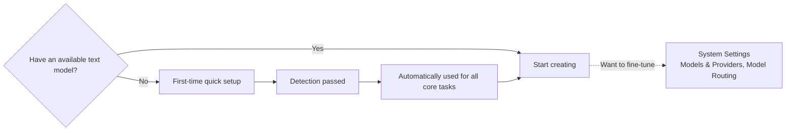
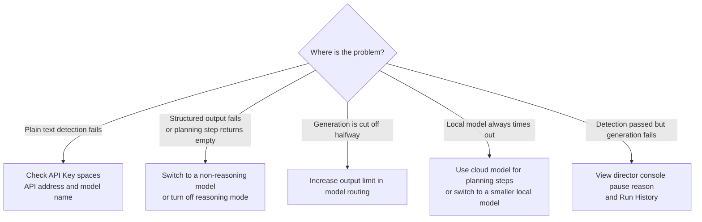

Before you start writing, you must configure at least one available text model. The workbench does not include built-in model quotas; it uses your own API configuration.

There are two configuration entry points:

- **First-time quick setup**: Automatically pops up when no text model is available; a model can be made to run all core tasks in three steps. New users only need this step.
- **System Settings → Models & Providers**: Used afterward to maintain multiple providers, adjust model routing, and set output limits.

## First-Time Quick Setup

Both the web and desktop versions will open the quick setup when no text model is available. You can close the popup first to browse existing content, but you need to complete the configuration before starting Auto Director, chapter generation, or other AI creation tasks.

<Steps>
  <Step title="Select a provider">
    Choose a built-in provider for which you already have an account. **DeepSeek Flash** is recommended, balancing Chinese long-form quality and response speed; to use a local model, select the local provider, which does not require an API Key.

    When using a relay service or other OpenAI-compatible interface, click **Add Third-Party Provider**.
  </Step>
  <Step title="Connect the model">
    Fill in the API Key and API address, then select a model from the list, or directly enter the model name.
  </Step>
  <Step title="Detection">
    The system separately detects **plain text** and **structured output** capabilities. After passing, the selected model will be used for core tasks such as planning, body text, review, repair, re-planning, and summarization, without needing to configure routing item by item.

    When detection fails, what you entered is retained, and the page will separately explain which item did not pass; fix it and retry directly.
  </Step>
</Steps>

Image models, Knowledge Base, Style Engine, concurrency limits, and fine-grained model routing are all optional enhancements that can be configured later.

## Third-Party Providers

Third-party compatible interfaces are saved as independent providers, separately storing API Key, API address, and models, without overwriting configurations for built-in providers such as DeepSeek and OpenAI. When you need to keep multiple connections simultaneously, create providers separately, then select among them in model routing. You can maintain them separately in **Models & Providers** afterward.

## Three Common Connection Methods

| Connection Method | What to Fill in API Address | Notes |
| --- | --- | --- |
| Official API | Supplier's official address | Such as official platforms like DeepSeek and OpenAI; stable and clear billing |
| Relay / compatible service | Address provided by the relay service | Connect using "Add Third-Party Provider"; as long as it is compatible with the OpenAI interface format; fill in the model name according to what the relay service provides |
| Local model | Local address | Ollama default `http://localhost:11434`, LM Studio default `http://localhost:1234`; start the local service before detection |

## Notes When Filling In

- **API Key**: Do not copy extra spaces; confirm that the Key's corresponding supplier and API address are consistent, and that the account has quota and model permissions. When connection fails, first confirm in the supplier console that the Key is valid, then return to the app to test.
- **API Address**: Must be consistent with the supplier's documentation. Common errors include writing too much or too little of the path, or filling in a web address instead of an API address. Proxies or network restrictions can also prevent requests from arriving.
- **Model Name**: Copy from the supplier's documentation; do not guess.

## Model Routing: Different Tasks Use Different Models

Quick setup makes one model responsible for all core tasks. When you want different tasks to use different models, go to model routing to specify them separately:

- **Planning steps** (world generation, outline, chapter breakdown list): Recommended to use a capable, stable-output model; overly slow local large models are prone to timing out on long outputs
- **Body text generation**: Recommended to use a model with suitable writing style and context length
- **Review / text repair**: A more cost-effective model can be used

<Note>
  A model's single maximum output (maxTokens) and Auto Director's single-chapter usage limit are two different things. For the single-chapter limit, see [AI Usage](/en/features/token-usage).
</Note>

## Common Issues

**Generation is cut off halfway / output length insufficient** In model routing, explicitly set a sufficient output limit (maxTokens) for that model. Your explicit setting takes precedence over the system default; setting it too small will cause long chapters or structured results to be truncated.

**Structured steps report errors or return empty content** Planning steps require the model to return strict structured results. Reasoning (thinking) models may consume the output quota in the thinking process at this step, leaving the body text empty; you can switch to a non-reasoning model for planning steps, or turn off that model's reasoning mode when the supplier supports it, without affecting body text steps. Newer versions have a built-in model compatibility layer that automatically detects and degrades incompatible structured output methods; when encountering such issues, first upgrade to the latest version and retry.

**Local model always times out** Local large-parameter models have limited generation speed, and planning steps with long outputs are more prone to timing out. First route planning steps to a cloud model and only use the local model for body text, or switch to a smaller local model, and confirm that the local service remains running throughout.

**Connection test passed but generation still fails** Detection only verifies address, key, and model reachability; for generation failures, see the pause reason given by the director console and [Run History](/en/features/task-center). Most cases are insufficient quota, model routing not configured for the corresponding step, or output limit too small. When reporting issues, include the version number, model used, and original error text for fastest localization.

## Shortest Verification After Configuration

1. Complete model detection.
2. Create a test novel.
3. Let Auto Director generate direction candidates.
4. Generate Chapter 1.
5. View status in Run History.

This path can simultaneously verify the model, database, task queue, and creation main chain. For more issues, see [Troubleshooting](/en/troubleshooting).
