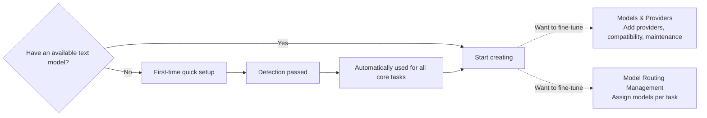
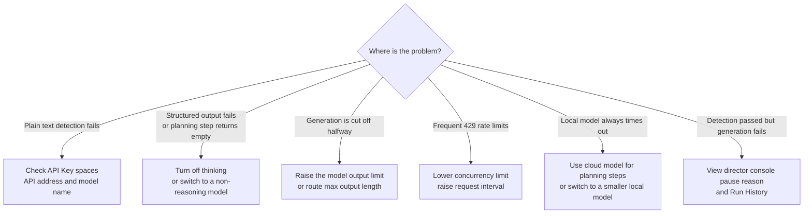

Before you start writing, you must configure at least one available text model. The workbench does not include built-in model quotas; it uses your own API configuration.

Model-related settings live in these places:

| Entry point | Where to open it | What it is for |
| --- | --- | --- |
| [First-time quick setup](#first-time-quick-setup) | Pops up automatically when no text model is available | Get one model working in three steps; it is then used for all core tasks. New users only need this step |
| [Models & Providers](#models-and-providers-page) | **System Settings → Models & Providers**, or the **Model Settings** button in the top bar (opens the same settings as a dialog) | Add, edit, and test providers; model compatibility; advanced maintenance such as thinking, request limits, and balance |
| [Model Routing Management](#model-routing-management) | **System Settings → Model Routing Management** | Assign a model, temperature, output length, and protocol to each of 11 creation tasks, and test them in bulk |
| Top bar model selector | Provider and model dropdowns and **Temperature** on the right of the top bar | Your current default selection. It is saved and used in places that do not specify a model, such as starting a new book |

## First-Time Quick Setup

Both the web and desktop versions open the quick setup when no text model is available. You can close the popup first to browse existing content, but you need to complete the configuration before starting Auto Director, chapter generation, or other AI creation tasks.

<Steps>
  <Step title="Select a provider">
    Choose a built-in provider for which you already have an account. **DeepSeek Flash** is recommended, balancing Chinese long-form quality and response speed; to use a local model, select the local provider, which does not require an API Key.

    When using a relay service or other OpenAI-compatible interface, click **Add Third-Party Provider**.
  </Step>
  <Step title="Connect the model">
    Fill in the API Key and API address, then select a model from the list, or directly enter the model name.
  </Step>
  <Step title="Detection">
    The system separately detects **plain text** and **structured output** capabilities. After passing, the selected model will be used for core tasks such as planning, body text, review, repair, re-planning, and summarization, without needing to configure routing item by item.

    When detection fails, what you entered is retained, and the page will separately explain which item did not pass; fix it and retry directly.
  </Step>
</Steps>

Image models, Knowledge Base, Style Engine, concurrency limits, and fine-grained model routing are all optional enhancements that can be configured later.

## Models and Providers Page

Open **System Settings → Models & Providers**. The page has three blocks from top to bottom:

- **Model Providers**: a card for each added provider, plus the **Add Provider** button. The badge next to the title shows how many connections are available.
- **Maximum Wait per Generation**: see [Other Model-Related Settings](#other-model-related-settings).
- **AI Prompt and Response History**: see [Other Model-Related Settings](#other-model-related-settings).

<Frame caption={"The Models & Providers page: one card per added provider, with the Add Provider button at the top right"}>
  
</Frame>

Only configured and enabled providers are shown as cards. When no provider has been added yet, the page shows "No available model connections yet".

## Add a Provider

Click **Add Provider** at the top right to open the "Add Model Provider" dialog. It offers two kinds of options:

- **Built-in provider templates**: lists the built-in providers you have not added yet, each showing its recommended model.
- **Custom provider**: connects any OpenAI-compatible service, such as a relay, a model gateway, or LM Studio.

Once all built-in providers have been added, the dialog says so; you can still add custom providers.

### Add a Built-in Provider

<Steps>
  <Step title="Choose a template">
    In the "Add Model Provider" dialog, click the built-in provider you want. The "Configure Model Provider" dialog opens.
  </Step>
  <Step title="Enter the API Key">
    Paste the API Key you created in the provider's console. Ollama runs locally and does not need a Key.
  </Step>
  <Step title="Confirm the API address">
    Usually leave this blank; a blank value uses the default address in the table below. Change it only when you use a proxy or the provider gave you a dedicated address.
  </Step>
  <Step title="Choose a model">
    In **Model Name**, select or type a model name. If unsure, use the template's recommended model.
  </Step>
  <Step title="Test and save">
    Click **Test Connection** to confirm that both plain connectivity and structured output work, then click **Save**.
  </Step>
</Steps>

### Built-in Providers

| Provider | Default API address | Recommended model | API Key required |
| --- | --- | --- | --- |
| DeepSeek | `https://api.deepseek.com/v1` | `deepseek-flash` | Yes |
| SiliconFlow | `https://api.siliconflow.cn/v1` | `Qwen/Qwen2.5-7B-Instruct` | Yes |
| OpenAI | `https://api.openai.com/v1` | `gpt-5` | Yes |
| Anthropic | `https://api.anthropic.com/v1` | `claude-3-5-sonnet-20241022` | Yes |
| Grok | `https://api.x.ai/v1` | `grok-4` | Yes |
| Kimi | `https://api.moonshot.cn/v1` | `moonshot-v1-32k` | Yes |
| MiniMax | `https://api.minimax.io/v1` | `MiniMax-M2.7` | Yes |
| GLM (Zhipu) | `https://open.bigmodel.cn/api/paas/v4` | `glm-4.5-air` | Yes |
| Qwen (Tongyi Qianwen) | `https://dashscope.aliyuncs.com/compatible-mode/v1` | `qwen-plus` | Yes |
| Gemini | `https://generativelanguage.googleapis.com/v1beta/openai` | `gemini-2.5-flash` | Yes |
| Ollama (local) | `http://127.0.0.1:11434/v1` | `llama3.2` | No |

<Tip>
  For DeepSeek, the Flash model is recommended for its balance of speed and Chinese long-form quality.
</Tip>

### Add a Custom Provider (OpenAI-Compatible)

Relay services, self-hosted gateways, LM Studio, and any service compatible with the OpenAI interface format are connected as custom providers. **Add Third-Party Provider** in quick setup is the same feature.

<Steps>
  <Step title="Choose Custom Provider">
    In the "Add Model Provider" dialog, click **Custom Provider**. The "New Custom Provider" dialog opens.
  </Step>
  <Step title="Enter a provider name">
    Give it a recognizable name, such as "My Model Gateway". The name is required; you pick the provider by this name in routing later.
  </Step>
  <Step title="Enter the API Key and authentication method">
    The API Key can be left blank (for example, for a local service). **Authentication Method** decides which request header carries the Key:

    - **Authorization: Bearer**: used by most OpenAI-compatible services
    - **x-api-key**: choose this when the service requires an `x-api-key` header
    - **No Authentication**: for local or intranet services
  </Step>
  <Step title="Enter the API address">
    Enter the OpenAI-compatible API address, which usually ends with `/v1`, for example `https://your-relay-domain/v1`. The API address is required when creating a provider.
  </Step>
  <Step title="Fetch the model list and choose a default model">
    Click **Fetch Model List**. The system reads the available models from the service and selects the first one automatically. You can search and switch in **Available Models**, or type a model name directly. The default model is optional when creating; the system picks one for you.
  </Step>
  <Step title="Test and create">
    Click **Test Connection**, and once it passes, click **Create Provider**.
  </Step>
</Steps>

A custom provider is saved as its own connection, with its own API Key, API address, and models. It does not overwrite the configuration of built-in providers such as DeepSeek and OpenAI. To keep several connections at once, create separate providers and choose between them in model routing.

### Three Common Connection Methods

| Connection method | How to add it | What to fill in API Address | Notes |
| --- | --- | --- | --- |
| Official API | Built-in provider template | Leave blank to use the default address | Official platforms such as DeepSeek and OpenAI; stable, with clear billing |
| Relay / compatible service | Custom provider | The address from the relay service, usually ending with `/v1` | Works as long as it is compatible with the OpenAI interface format; use the model names the relay service provides |
| Local model | Ollama uses the built-in template; LM Studio and others use a custom provider | Ollama default `http://127.0.0.1:11434/v1`; LM Studio commonly `http://localhost:1234/v1` | Start the local service before testing; set the authentication method to **No Authentication** |

### Configuration Dialog Fields

Clicking a built-in provider template, **Configure Connection** on a card, or **Manage Connection** on a custom provider card opens the configuration dialog.

| Field | Applies to | Description |
| --- | --- | --- |
| Provider Name | Custom providers | Required; identifies the provider on cards and in routing |
| API Key | All | Entered as a password. If a Key was saved before, leaving it blank keeps the saved Key |
| Authentication Method | Custom providers | Authorization: Bearer / x-api-key / No Authentication |
| API Address | All | Built-in providers use the default address when blank; custom providers need an OpenAI-compatible address |
| Fetch Model List | New custom providers | Available once the API address is filled; reads the service's models and selects the first one |
| Available Models | When a model list has been fetched | Searchable dropdown for picking a model |
| Model Name / Default Model | All | The provider's default text model; can be typed manually |
| Image Model (optional) | All | When set, it can be used for character portrait generation through the provider's OpenAI-compatible image API. If blank, the card shows "Image generation not supported" |
| Concurrency Limit per Model | All | How many requests can run at once for the same model. `0` means unlimited; extra requests wait in a queue |
| Request Interval per Model (ms) | All | The minimum gap between two requests to the same model. `0` means unlimited |

Buttons at the bottom of the dialog: **Save** (**Create Provider** when creating a custom provider) and **Test Connection**; custom providers also have **Delete**.

<Note>
  If the save button is grayed out, a required item is usually missing: no model, no name for a custom provider, no API address when creating, or a built-in provider that needs a Key but has never had one saved.
</Note>

### Notes When Filling In

- **API Key**: Do not copy extra spaces; confirm that the Key's corresponding supplier and API address are consistent, and that the account has quota and model permissions. When connection fails, first confirm in the supplier console that the Key is valid, then return to the app to test.
- **API Address**: Must be consistent with the supplier's documentation. Common errors include writing too much or too little of the path (for example, missing `/v1`), or filling in a web address instead of an API address. Proxies or network restrictions can also prevent requests from arriving.
- **Model Name**: Copy from the supplier's documentation or the model list; do not guess.

## Test Connection

Both the configuration dialog and the provider card have **Test Connection**. The API address and model must be filled in first. The test checks two things at once:

- **Plain connectivity**: whether the model returns text normally
- **Structured output**: whether the model can return structured results as required, and which output strategy the system will use

On success, the result looks like "Connected, total 1200ms · plain connectivity OK (500ms) · structured OK, strategy json_schema". If the system had to turn off thinking to get structured results, the result notes that thinking was forcibly disabled. On failure, it shows the failure category and the original error; see [Common Issues](#common-issues).

## Provider Cards

Each added provider gets one card. From top to bottom:

| Area | Description |
| --- | --- |
| Name and status | Custom providers carry a "Custom" tag. The status at the top right is **Available**, **Configured**, or **Not Configured**; "Available" means it can be used for creation tasks right away |
| Text Model / Image Model | The text model and image model currently in use |
| Balance | Providers that support balance queries show their balance; others show that balance queries are not supported |
| Configure Connection / Manage Connection | Opens the configuration dialog to change the Key, address, model, image model, and request limits |
| Test Connection | Runs a test with the currently saved configuration |
| Model Compatibility | Output limit and compatibility probing; see [Model Compatibility](#model-compatibility) |
| Advanced Details and Maintenance | Collapsible area; see [Advanced Details and Maintenance](#advanced-details-and-maintenance) |

### Switch a Provider's Default Model

Click **Configure Connection** (**Manage Connection** for custom providers), select a new model in **Available Models** or type one in the model name field, and save. If the model list is empty or outdated, first click **Refresh Models** in [Advanced Details and Maintenance](#advanced-details-and-maintenance).

## Model Compatibility

Providers and models differ widely in how they support structured output and thinking controls. The **Model Compatibility** area on the card sets the output limit and probes which output method suits the current model.

### Current Model Output Limit

Sets the single-request output allowance for the current model, for both body text and structured generation. The range is 1 to 1048576 tokens; enter a value and click **Save Output Limit**.

- Leave it blank to "use the task budget", which is then decided by model routing or the system default.
- The value is saved per model, so you can set it separately after switching models.
- Once set, it takes priority over "Max Output Length" in model routing. See [How Output Limits Take Effect](#how-output-limits-take-effect).

### Compatibility Probing

- **Auto-probe when saving or switching models**: when on, the system probes every time you save or switch a model. Off by default.
- **Re-probe**: runs a probe manually right away.

<Warning>
  Probing sends a small number of paid requests to the provider.
</Warning>

The results appear below:

- **Output method**: the structured output methods available for the current model, in priority order, for example "JSON → Tool Calling → Prompt-Constrained JSON". From strictest to loosest, the four methods are **Strict JSON**, **JSON**, **Tool Calling**, and **Prompt-Constrained JSON**. The system tries them in order and falls back to the next one when one fails.
- **Disable thinking**: shows "Supported" or "Not confirmed".
- The time of the last probe; if never probed, it shows that default capabilities are in use.

### Specify Custom Service Capabilities

Only custom providers have this option, which expands at the bottom of the compatibility area. Use it when the probe result is inaccurate or you know exactly what the service supports:

| Option | Values | Description |
| --- | --- | --- |
| Preferred Output Method | Strict JSON / JSON / Tool Calling / Prompt-Constrained JSON | The method structured tasks try first |
| Thinking Control Parameter | Not specified / `thinking` / `thinking_boolean` / `enable_thinking` / `reasoning_effort` | Which parameter is sent to turn off or adjust thinking; choose according to the service's documentation |

After you click **Save Specified Capabilities**, the specified capabilities override the probe results.

## Advanced Details and Maintenance

**Advanced Details and Maintenance** at the bottom of the card is collapsed by default. Expanded, it contains the following actions and information.

### Refresh Models

**Refresh Models** reads the provider's available model list again. Use it when the provider adds new models, or when you cannot find a model in the configuration dialog.

Models are shown as tags, with the model in use highlighted. The first 8 are shown by default; click **Show all N models** to see the rest.

### Hide and Restore Models

When a provider returns many models, click the **×** on a model tag to hide models you do not use, which keeps dropdowns tidy. The model currently in use cannot be hidden.

Hidden models are listed under **Hidden Models**, where you can restore them one by one or click **Restore All**.

### Balance

DeepSeek, SiliconFlow, and Kimi support balance queries. Click **Refresh Balance** to get the latest balance. Expanded, you can see details such as cash balance, voucher balance, top-up balance, total top-ups, and granted credit (the exact items depend on what the provider returns). Custom providers do not support balance queries.

### Thinking

The **Thinking** switch controls whether creation requests enable model thinking (reasoning). It is on by default:

- **On**: creation requests enable model thinking, and the thinking content returned by the provider is shown in **AI Live View**.
- **Off**: requests ask the provider to turn thinking off.

DeepSeek thinking-mode models also offer **Thinking Depth**: Off, Low, High, or Max.

<Tip>
  In structured steps, thinking models can spend their output allowance on the thinking process and return an empty result. If planning steps fail often, first try turning thinking off or lowering the thinking depth.
</Tip>

### Request Limits

Shows the current "Concurrency N · Interval Nms". If a relay service rate-limits you or you often see rate-limit errors such as 429, lower **Concurrency Limit per Model** or raise **Request Interval per Model** in the configuration dialog.

### API Address

Shows the API address the provider is actually using, so you can verify it.

### Remove or Delete a Provider

- Built-in providers: **Remove from List** removes the card from the page. You can add it back later through **Add Provider**.
- Custom providers: **Delete** deletes the connection.

<Warning>
  Before removing or deleting, make sure no task in model routing still uses this provider; otherwise those tasks may fail to call a model.
</Warning>

## Model Routing Management

Quick setup makes one model handle all core tasks. To have different tasks use different models, or to adjust the temperature and output length of a single task, open **System Settings → Model Routing Management**.

<Frame caption="Model Routing Management page: assign models to different creation tasks and check output stability">
  
</Frame>

### Route Detection

The top of the page shows the detection result (how many routes in total, how many healthy, how many failing) and when detection ran. **Re-detect** tests plain text and structured output for every route.

Each task card shows its own status: **Compatible**, **Has Issues**, **Detecting**, or **Not Detected**. Cards with unsaved changes are marked **Unsaved** and must be saved before they can be tested.

### Quick Apply Model

When you do not want to set each task one by one, use the **Quick Apply Model** card for bulk changes:

1. Choose a **Provider** and **Model**, and optionally fill in **Temperature** and **Max Output Length**.
2. Choose where to apply it:
   - **Apply to All Tasks**: switches every task to this model
   - **Apply to Failing Tasks**: replaces only tasks that failed detection
   - **Fill Empty Tasks**: fills only tasks that are not configured yet
3. The applied changes are drafts. The card shows the number of unsaved, failing, and empty routes. When everything looks right, click **Save All Changes**.

<Note>
  Tasks with no saved route use the system's built-in default route (the DeepSeek default model). If you have not configured DeepSeek, use **Fill Empty Tasks** to point all empty tasks at a model you have configured.
</Note>

### Task Routes

| Task | Purpose |
| --- | --- |
| Outline Planning | Understands the creative goal first, then plans how this stretch of writing should proceed |
| Lead Writing | Generates chapter body text and writes out the full chapter |
| General Review | Checks plot, pacing, and style to find quality issues in drafts |
| Quick Review | Quickly judges whether a chapter can move forward; a light quality check after body text |
| Strict Review | Handles quality checks that affect whole-book continuity; suited to high-risk reviews and re-checks |
| Chapter Repair | Fixes drafts based on review issues so the chapter can move forward again |
| Window Re-planning | When local repair cannot converge, re-plans the goals and transitions of affected chapters |
| State Resolution | Judges whether chapter state proposals are trustworthy, helping Auto Director reduce manual confirmation |
| Plot Summary | Turns long chapters into recaps, summaries, and key changes |
| Setting Fact-Check | Organizes settings, timelines, and key facts to reduce contradictions |
| Inspiration Chat | Handles everyday conversation and turns the results into content that is easy to use while writing |

### Route Fields

| Field | Description |
| --- | --- |
| Provider | Any added provider, including custom providers |
| Model | Select from the list, or type it manually |
| Temperature | 0 to 2, default 0.7. Higher is more divergent; 0.3 to 0.7 is recommended for structural planning |
| Max Output Length | The token limit for a single output of this task, default 8192 |
| Request Protocol | Auto / OpenAI-compatible / Anthropic. With Anthropic, the structured format is fixed to prompt-constrained JSON |
| Structured Format | Auto / `json_schema` / `json_object` / Tool Calling / `prompt_json`. Usually keep Auto; set it manually only when a model is consistently incompatible with a method |

Below the fields, the card shows the request protocol, structured strategy, and thinking status actually in use, and whether a fallback model is available. Click **Save Route** when done. If auto-probe is on in model compatibility, saving also runs a probe.

### Structured Call Fault Tolerance

Planning, review, and similar steps need the model to return structured results. The **Structured Call Fault Tolerance** card controls what happens on failure:

- **Retries on Server Errors**: 0 to 3, default 1.
- **Enable Fallback Model**: after retries still fail, tries once more with the fallback provider and model set here. Useful when the main model is occasionally unstable.

Click **Save Fault Tolerance Settings** when done.

### Model Selection Tips

- **Outline Planning, Window Re-planning**: use a capable model with stable output. Slow local large models are prone to timing out on long outputs.
- **Lead Writing**: use a model with suitable writing style and context length.
- **Reviews, Plot Summary, Setting Fact-Check**: a more cost-effective model works; **Strict Review** affects whole-book continuity, so avoid models that are too weak.

## How Output Limits Take Effect

How many tokens a request can output is decided in this order:

1. **Model Compatibility → Current Model Output Limit**: used first if set for the model.
2. **Model Routing → Max Output Length**: the route setting for the task.
3. The system default when neither is set.

When long chapters or structured results get truncated, first check whether these two values are too small.

<Note>
  A model's single maximum output and Auto Director's single-chapter usage limit are two different things. For the single-chapter limit, see [AI Usage](/en/features/token-usage).
</Note>

## Other Model-Related Settings

The **Models & Providers** page has two more settings below the provider cards:

- **Maximum Wait per Generation**: how long a single world generation request may wait, in minutes; the page shows the allowed range. Two minutes is enough for cloud models; raise it if your local model is slow. It applies from the next world generation, and the system may retry once automatically after a failure.
- **AI Prompt and Response History**: when **Save prompts and responses** is checked, creation messages and model responses are saved and can be viewed in the novel's "AI Usage and Call Logs". You can set **Retention Days** (1 to 365) and **Compressed Storage Limit (MB)** (1 to 4096). Every 15 minutes, the system cleans up expired or over-limit content, removing the oldest records first. The content may include full body text, so turn it on only if you need it. Turning it off stops saving new content; duration and usage statistics are not affected.

## Common Issues

**Cannot find the model you want** Click **Refresh Models** in the card's **Advanced Details and Maintenance**; check whether the model is under **Hidden Models**. If it is still not in the list, type the model name directly in the configuration dialog.

**Generation is cut off halfway / output length insufficient** Raise the output limit in [Model Compatibility](#model-compatibility) or [model routing](#route-fields). Your explicit setting takes precedence over the system default; setting it too small will cause long chapters or structured results to be truncated.

**Structured steps report errors or return empty content** Planning steps require the model to return strict structured results. Reasoning (thinking) models may consume the output quota in the thinking process at this step, leaving the result empty. Turn thinking off in [Thinking](#thinking), or switch planning steps to a non-reasoning model; body text steps are not affected. You can also click **Re-probe** to let the system choose the output method again; for custom providers, you can [specify custom service capabilities](#specify-custom-service-capabilities). If it still fails, enable the fallback model in [Structured Call Fault Tolerance](#structured-call-fault-tolerance).

**Relay service rate-limits frequently** In the configuration dialog, lower **Concurrency Limit per Model** (for example, to 1 or 2) or raise **Request Interval per Model**.

**Local model always times out** Local large-parameter models have limited generation speed, and planning steps with long outputs are more prone to timing out. First route planning steps to a cloud model and only use the local model for body text, or switch to a smaller local model, and confirm that the local service remains running throughout. For world generation timeouts, raise **Maximum Wait per Generation**.

**Connection test passed but generation still fails** Detection only verifies address, key, and model reachability; for generation failures, see the pause reason given by the director console and [Run History](/en/features/task-center). Most cases are insufficient quota, model routing not configured for the corresponding step, or output limit too small. When reporting issues, include the version number, model used, and original error text for fastest localization.

## Shortest Verification After Configuration

1. Complete model detection.
2. Create a test novel.
3. Let Auto Director generate direction candidates.
4. Generate Chapter 1.
5. View status in Run History.

This path can simultaneously verify the model, database, task queue, and creation main chain. For more issues, see [Troubleshooting](/en/troubleshooting).
