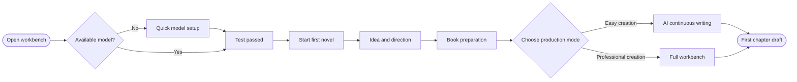
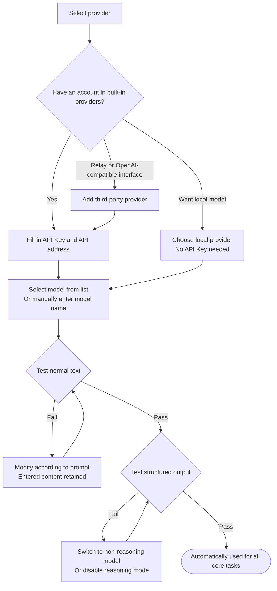
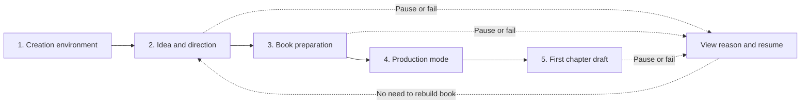
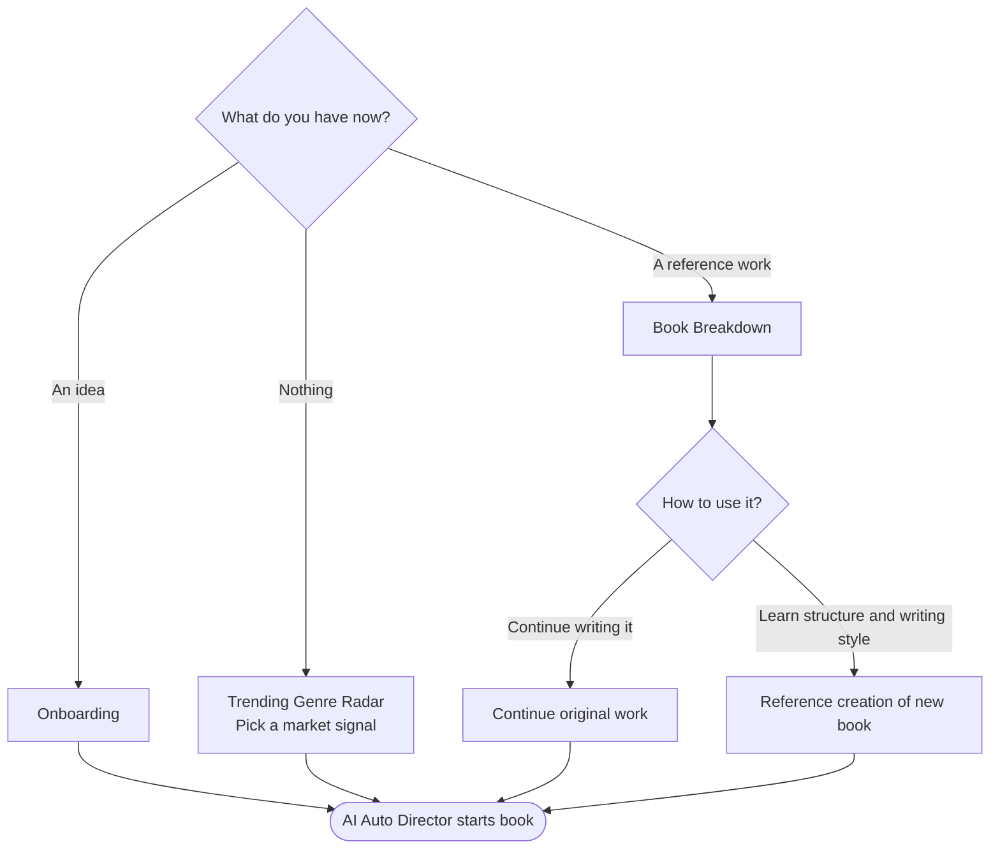
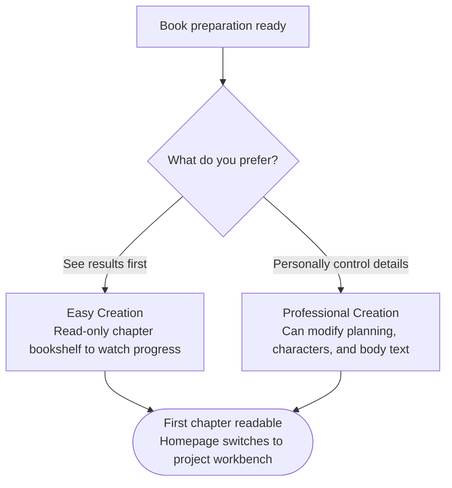
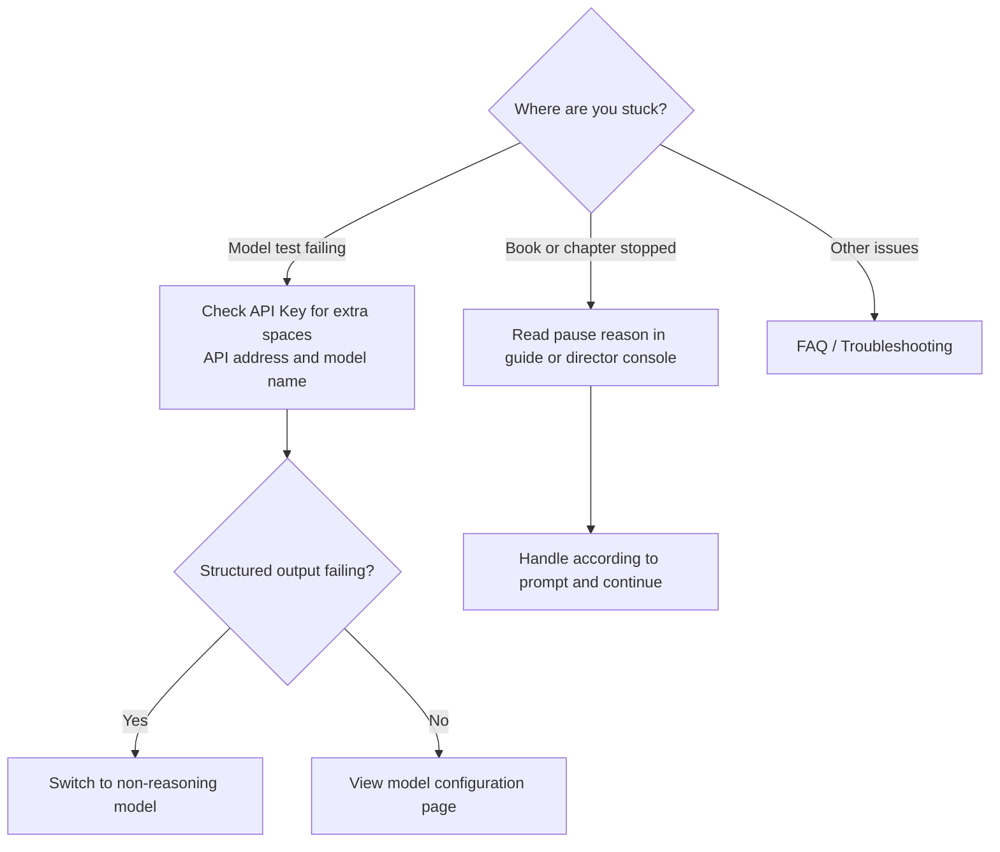

The first time you open the workbench, you only need to do two things: **make a model available**, and then **follow the guide to write the first chapter**. World, characters, volume strategy, and common quality issues will be continuously handled by AI in the main chain; you do not need to learn all features first.

## Full Journey Overview

Not sure where to start? Answer the three questions below to generate your personalized route:

<StartRoute />

<Note>
  Pages mentioned in the route: [Model Configuration](/en/model-configuration), [Book Breakdown Workbench](/en/features/book-analysis), [Trending Genre Radar](/en/features/market-radar), [Outline Workbench](/en/features/outline-workbench), [Short Story Creation](/en/features/short-story), [Auto Director](/en/features/auto-director).
</Note>

## Step 1: Quick Model Setup

When no text model is available, both the web and desktop versions will automatically pop up Quick Setup. You can close it to browse the interface, but configuration must be completed before starting any AI creation.

<Steps>
  <Step title="Select provider">
    Choose a built-in provider where you already have an account. **DeepSeek Flash** is recommended, balancing Chinese long-form quality and response speed; for local models, choose a local provider, no API Key needed.

    When using a relay service or other OpenAI-compatible interface, click **Add third-party provider**. It will be saved separately and will not overwrite the built-in provider configuration.
  </Step>
  <Step title="Connect model">
    Fill in the API Key and API address, then select a model from the list, or directly enter the model name. If the interface does not return a model list, fill in manually according to the provider documentation.
  </Step>
  <Step title="Test">
    The system will test **normal text** and **structured output** capabilities separately. After passing, this model will be automatically used for core tasks such as planning, body text, proofreading, fixing, replanning, and summarization, without needing to configure routing item by item.

    When the test fails, what you entered will be retained, and the page will explain which item did not pass; correct it and retry directly.
  </Step>
</Steps>

<Tip>
  Structured output failing is mostly due to using a reasoning (thinking) model. Switch to a non-reasoning model, or disable reasoning mode when the provider supports it. More cases at [Model Configuration](/en/model-configuration).
</Tip>

## Step 2: Follow the First Book Route

After configuration is complete, click **Start first novel**, or open **Onboarding** from the sidebar. The guide displays five milestones fixed in place; progress comes from real model, director task, and chapter states, no manual checkmarks needed:

| Milestone | Completion Flag |
| --- | --- |
| 1. Creation environment | At least one text model and core task routing available |
| 2. Idea and direction | Enter a spark of inspiration (or start from trending genre or book breakdown), and select one of two full-book directions given by AI |
| 3. Book preparation | AI prepares story, world, characters, volume strategy, pacing, and chapter execution resources |
| 4. Production mode | Choose Easy Creation or Professional Creation |
| 5. First chapter draft | First chapter completes writing, proofreading, and necessary fixes; can be opened for reading |

The page always highlights **one recommended action**, and explains why this step should be done now. When a task pauses or fails, the recommended action becomes "View reason and resume"; no need to rebuild the book.

## No Inspiration, or Already Have a Reference Book

| Your situation | Where to start |
| --- | --- |
| Have your own idea | Enter AI Auto Director from the Onboarding guide |
| No clear idea | Open Trending Genre Radar, pick a market signal to start a book |
| Have a work you want to continue | First complete [Book Breakdown](/en/features/book-analysis), then select "Continue original work" |
| Just want to learn structure and writing style | After completing book breakdown, select "Reference creation of new book" |

All these paths eventually enter the same Auto Director book-starting flow; world, characters, volume planning, and chapter production do not need to be learned separately.

## Easy Creation or Professional Creation

You only choose after book preparation resources are ready:

- **Easy Creation**: AI continuously writes the entire book; you watch progress and drafts in a read-only chapter bookshelf. Suitable for those who want to see results first.
- **Professional Creation**: Enter the full workbench; you can view and modify planning, characters, and chapter body text. Suitable for those who want to personally control details.

Both modes can complete the guide. After the first chapter is readable, the homepage switches back to the normal project workbench; the Onboarding guide retains completion records and body text entry.

## Can Configure Later

The following capabilities will not block the first chapter; enable them after getting things running:

- [Knowledge Base](/en/features/knowledge-base): Use when you need reference materials, research content, or long-term settings
- [Style Engine](/en/features/style-engine): Extract and bind after you have clear writing style samples
- Image model: Configure when you need covers, character art, or illustrations
- [Model Routing](/en/model-configuration): Adjust when you want different tasks to use different models

## Stuck?

- Model test keeps failing: Check whether the API Key has extra spaces, whether the address is the API address rather than the web page address, and whether the model name matches the provider documentation.
- Book starting or chapter writing stopped: Read the pause reason given by the guide or this book's director console, handle according to the prompt, then continue.
- Other issues see [FAQ](/en/faq).

export const StartRoute = () => {
  const Q = [
    {
      title: "Do you already have a usable text model?",
      options: [
        { id: "no", label: "Not yet" },
        { id: "yes", label: "Already configured and passed test" },
      ],
    },
    {
      title: "What do you have now?",
      options: [
        { id: "idea", label: "An idea of my own" },
        { id: "none", label: "No clear idea yet" },
        { id: "continue", label: "A work I want to continue" },
        { id: "learn", label: "A book I want to learn structure and writing style from" },
        { id: "outline", label: "Want to organize the outline first" },
        { id: "short", label: "Want to write a complete short story" },
      ],
    },
    {
      title: "How do you prefer to proceed?",
      options: [
        { id: "easy", label: "See results first" },
        { id: "pro", label: "Personally control details" },
      ],
    },
  ];
  const [step, setStep] = useState(0);
  const [ans, setAns] = useState({});
  const skipThird = ans[1] === "short";
  const total = skipThird ? 2 : 3;
  const done = step >= total;

  const pick = (id) => {
    const next = { ...ans, [step]: id };
    setAns(next);
    setStep(step + 1);
  };
  const reset = () => { setAns({}); setStep(0); };

  const route = [];
  if (done) {
    if (ans[0] === "no") {
      route.push({ t: "Quick model setup", d: "Select provider, fill in API Key, API address, and model, pass normal text and structured output tests. DeepSeek Flash recommended." });
    }
    const start = {
      idea: { t: "Enter AI Auto Director from Onboarding", d: "Enter a spark of inspiration, select one of two full-book directions given by AI." },
      none: { t: "Open Trending Genre Radar", d: "Pick a market signal to start a book, then select the full-book direction." },
      continue: { t: "First complete book breakdown, then select 'Continue original work'", d: "After book breakdown is complete, enter book starting from the breakdown results." },
      learn: { t: "First complete book breakdown, then select 'Reference creation of new book'", d: "Learn the original work's structure and writing style, then write a new book." },
      outline: { t: "Build outline in Outline Workbench", d: "Create blank, generate from idea, or import Markdown/TXT, edit and save revisions, confirm and start book from outline." },
      short: { t: "Open 'Create Short Story'", d: "Enter idea, let AI recommend direction and length, select direction and start generating." },
    }[ans[1]];
    route.push(start);
    if (ans[1] === "short") {
      route.push({ t: "Full review and modification", d: "After draft completion, full review and at most one necessary fix; can edit directly or request modifications. To continue writing, 'Develop into long novel', original short story retained." });
    } else {
      if (ans[1] !== "outline") {
        route.push({ t: "Wait for book preparation", d: "AI prepares story, world, characters, volume strategy, pacing, and chapter execution resources." });
      }
      route.push(ans[2] === "easy"
        ? { t: "Choose Easy Creation", d: "AI continuously writes the entire book; you watch progress and drafts in a read-only chapter bookshelf." }
        : { t: "Choose Professional Creation", d: "Enter the full workbench; view and modify planning, characters, and chapter body text." });
      route.push({ t: "First chapter draft", d: "First chapter completes writing, proofreading, and necessary fixes, then can be read. When paused, view reason and resume; no need to rebuild the book." });
    }
  }

  const btn = {
    textAlign: "left", padding: "10px 12px", borderRadius: 8, font: "inherit", color: "inherit",
    cursor: "pointer", border: "1px solid rgba(127,127,127,.3)", background: "transparent",
  };
  const small = { ...btn, padding: "6px 12px", fontSize: 13 };

  return (
    

      

        {Array.from({ length: total }).map((_, i) => (
          

        ))}
      

      {!done && (
        <>
          
Question {step + 1} / {total}

          
{Q[step].title}

          

            {Q[step].options.map((o) => (
              <button key={o.id} type="button" style={btn} onClick={() => pick(o.id)}>{o.label}</button>
            ))}
          

          {step > 0 && (
            
<button type="button" style={small} onClick={() => setStep(step - 1)}>Previous step</button>

          )}
        </>
      )}
      {done && (
        <>
          
Your route

          <ol style={{ margin: 0, padding: 0, listStyle: "none", display: "grid", gap: 8 }}>
            {route.map((r, i) => (
              <li key={i} style={{ display: "flex", gap: 10, alignItems: "flex-start" }}>
                {i + 1}
                

                  
{r.t}

                  
{r.d}

                

              </li>
            ))}
          </ol>
          
<button type="button" style={small} onClick={reset}>Reselect</button>

        </>
      )}
    

  );
};
