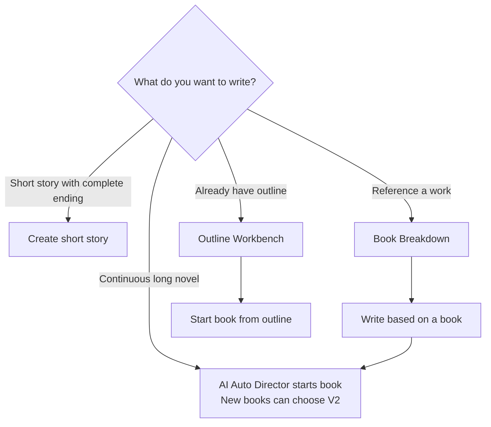
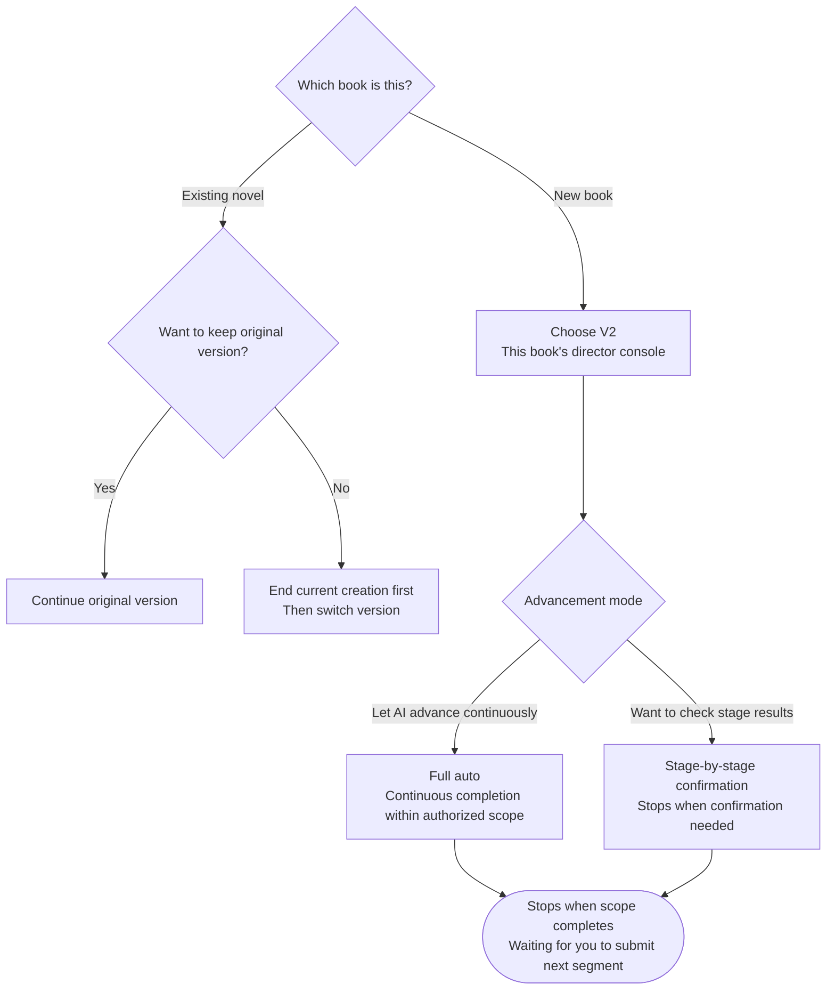
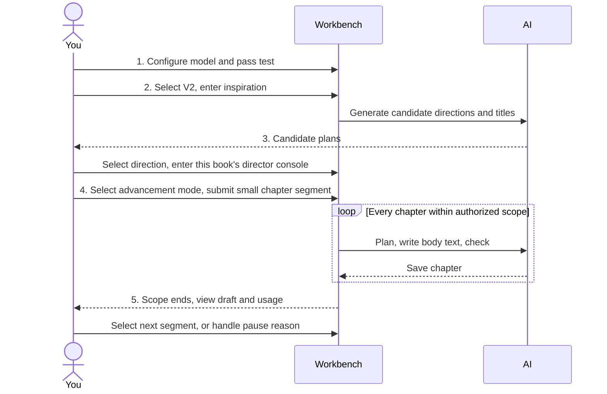
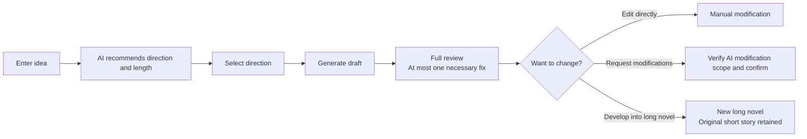
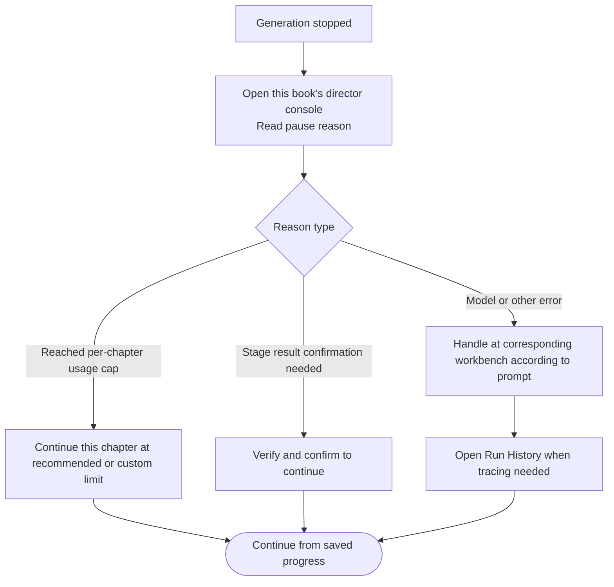

## Choose Your Creation Entry

| What you want to write | Where to enter |
| --- | --- |
| Continuously advancing long novel | "AI Auto Director starts book" in the novel list or homepage; new books can choose V2 |
| Short story with a complete ending | "Create short story" in the novel list or homepage; AI organizes direction and length |
| Start a new book referencing a work | First complete book breakdown, then enter from "Write based on a book" |
| Organize outline first, then write | Build outline in [Outline Workbench](/en/features/outline-workbench), confirm and start book from outline |

## Director V1 vs V2: How to Choose

|  | Director V1 | Director V2 |
| --- | --- | --- |
| Entry point | Original director and novel workbench, retains staged creation entry | This book's director console, centralized reading of directory, body text, and materials |
| Suitable for | Continuing existing novels, or following original workbench operations | Starting new books, continuous planning and generation within authorized scope |
| Tasks and recovery | Uses its own tasks, checkpoints, and recovery flow | Uses its own runs, stage results, and save progress |

New books default to V2 when available. Switching versions for an existing novel requires ending current creation first; saved body text and history are retained, the switch only saves the selection and does not automatically start generation.

**Advancement mode**: Full auto will continuously plan, write body text, check, and save within the current authorized scope; stage-by-stage confirmation (semi-auto) will stop at stages requiring confirmation for you to verify. Full auto also stops when the authorized scope is complete, for example, if you submit chapters 1 to 3, it will not write chapter 4 without authorization.

## Write Your First Paragraph with V2

1. **Configure model.** First launch will pop up Quick Setup; fill in provider, API Key, API address, and text model, and pass the test; first-time use should ensure one model is available (see [Onboarding](/en/onboarding) and [Model Configuration](/en/model-configuration)).
2. **Enter inspiration.** From the novel book-starting entry, select V2 and enter your story idea. When you have no idea, check trending genres first; when you have a reference work, enter from completed book breakdown.
3. **Select direction.** View candidate plans and titles, select what you want this book to become, then enter this book's director console.
4. **Select advancement mode and scope.** Choose full auto if you want AI to advance continuously, or stage-by-stage confirmation if you want to verify stage results; submit a small segment of chapters first to observe body text effects and usage.
5. **View and continue.** Check "Follow generation" to watch body text stream output. After scope ends, check saved chapters and select the next segment; when pauses occur, read the reason and handle from this book's director console.

Style Engine, Knowledge Base, and advanced model routing can be configured step by step after getting the first paragraph of body text running.

## Write a Complete Short Story

After configuring the model, open "Create short story", enter your idea, let AI recommend direction and length; select direction and start generating. After draft completion, full review and at most one necessary fix are performed; you can edit directly, or request modifications, verify AI's modification scope, and confirm. "Develop into long novel" will create a new work, retaining the original short story.

## How to View AI Usage

In V2, open "AI Usage" at the top of this book or in the bookshelf; you can filter calls by chapter, step, provider, model, or status. Planning, body text, review, and rewriting may all consume usage; you cannot judge solely by final body text length. Total Tokens = input + output; Tokens are call counts, actual cost is subject to provider billing.

V2's default usage protection cap per chapter is 100,000 Tokens (accumulated for this chapter's generation, checking, rewriting, and material organization calls). When the cap is reached, you can view the reason in this book's director console, and continue this chapter at the recommended or custom limit; body text, accumulated usage, and recovery position are all retained.

## Encountering Pauses or Errors

First check this book's director console for the pause reason, then handle at the corresponding workbench; open "Run History" to view status and source when tracing is needed. Saved body text and task progress have independent boundaries; repeatedly clicking generate cannot replace recovery. More issues at [FAQ](/en/faq), or feedback at [Issues](https://github.com/ExplosiveCoderflome/AI-Novel-Writing-Assistant/issues).
