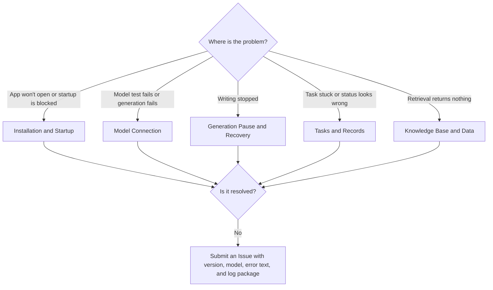

When you encounter an issue, first categorize it under installation and startup, model connection, generation pause and recovery, task records, or other types, then follow the corresponding entry to troubleshoot step by step. Before performing any operation that might affect data, back up first.

<Note>
  This page covers "what to do when something goes wrong." For usage questions such as "what is this," "how do I choose," or "can I do X" (for example, why Auto Director stops, how to choose between Director V1 and V2, or whether Qdrant is required), see [FAQ](/en/faq).
</Note>



## Installation and Startup

<AccordionGroup>
  <Accordion title="Mac shows Cannot open or Damaged">
    The current Mac package is not signed or notarized by Apple. Go to **System Settings → Privacy & Security** (系统设置 → 隐私与安全性) and click "Open Anyway." If you see "Damaged," run this in Terminal:

    ```bash
    xattr -dr com.apple.quarantine "/Applications/Biz Novel Studio.app"
    ```
  </Accordion>

  <Accordion title="Startup page stays at Startup Blocked">
    1. Fully quit the app, then reopen it.
    2. Check whether antivirus or security software is blocking local services.
    3. If it still fails, open the log from the startup page, or save the log package under **Version & Updates** (版本与更新) and attach it to a GitHub Issue.
  </Accordion>

  <Accordion title="Source build install hangs or desktop runtime is not ready">
    First check Node version and package manager configuration:

    ```bash
    node -v
    pnpm -v
    pnpm config get script-shell
    npm config get script-shell
    ```

    If `script-shell` is set to `cmd.exe /k`, install scripts may hang at an interactive prompt. Remove that custom setting, reopen the terminal, and install again. Desktop development requires downloading the Electron runtime on first setup; if the network is unavailable, handle proxy or mirror settings first, or run `pnpm run prepare:desktop-runtime` separately.
  </Accordion>
</AccordionGroup>

## Model Connection

<AccordionGroup>
  <Accordion title="Connection test fails">
    Check in order:

    1. Is the API Key complete, without extra spaces?
    2. Is the API address the actual endpoint, not the vendor's web page; is the path correct?
    3. Does the model name exactly match the vendor's documentation?
    4. Can the network reach the vendor's endpoint, and does the account still have quota?

    Do not start a book until the connection test passes.
  </Accordion>

  <Accordion title="Plain text passes, structured output fails">
    Planning steps require the model to return strict structured results. Reasoning models tend to consume the output quota in their thinking process. Switch to a non-reasoning model, or disable thinking mode if the vendor supports it. Newer versions include a built-in compatibility layer; upgrade to the latest version and try again.
  </Accordion>

  <Accordion title="Connection test passes, but generation still fails">
    The connection test only verifies that the address, key, and model are reachable. Generation failures are usually caused by: insufficient quota, a step routing to an unavailable model, or the output limit (maxTokens) set too small causing truncation. Check the pause reason on this book's director console, then adjust the corresponding step in [Model Configuration](/en/model-configuration).
  </Accordion>

  <Accordion title="Local model always times out">
    Large-parameter local models generate slowly, and planning steps with long outputs are the most likely to time out. Route planning steps to a cloud model, use the local model only for body text, or switch to a smaller local model, and make sure the local service stays running.
  </Accordion>
</AccordionGroup>

## Generation Pause and Recovery

<AccordionGroup>
  <Accordion title="How to continue after a pause">
    A pause is not a failure; progress and already saved body text are preserved. For why pauses happen, see [FAQ](/en/faq) and [Auto Director](/en/features/auto-director).

    1. Open this book's director console and read the pause reason.
    2. Resolve external issues: top up quota, switch models, check the network.
    3. Continue from this book's director console as prompted.

    To trace history, open **Run History** (运行记录) to view status and source. Do not repeatedly click Generate to replace recovery, and do not delete the novel and start over.

    When a specific stage is stuck, refer to [Recovery by Phase](/en/guides/recovery-by-phase) to find the recovery entry; for continue and takeover operations, see [Director Follow-up](/en/features/director-follow-up).
  </Accordion>

  <Accordion title="Prompt says single-chapter usage limit reached">
    V2's default per-chapter limit is 100,000 Tokens, covering generation, checking, revision, and knowledge collation calls for that chapter. You can continue this chapter from this book's director console with the suggested or a custom quota. To change the global default, go to **Settings → Auto Director** (设置 → 自动导演). See [AI Token Usage](/en/features/token-usage) for details.
  </Accordion>
</AccordionGroup>

## Tasks and Records

<AccordionGroup>
  <Accordion title="Task stuck or failed, unsure where to resume">
    For long tasks, check **Run History** (运行记录 / 任务中心) first. It shows queued, running, completed, failed, and waiting-for-recovery statuses. Recommended records: task name, associated novel, most recent status, error message, and whether there is a retry or resume button.

    If a task is still running, do not repeatedly click multiple entries to launch similar tasks; first confirm whether it is being processed in the background. For detailed usage, see [Run History](/en/features/task-center).
  </Accordion>

  <Accordion title="Director Follow-up display is inconsistent">
    Do not judge task failure from a single page alone. Background tasks, Director Follow-up, and the novel page may show different sides of the same workflow. Prioritize the pause reason in Director Follow-up, then the background status in Run History; in many cases it is simply waiting for confirmation rather than failing.
  </Accordion>

  <Accordion title="Page state looks wrong">
    1. Refresh the page.
    2. Return to the home page or novel list and re-enter.
    3. Check whether a background task is still running in Run History.
    4. Check whether Director Follow-up shows a waiting-for-confirmation state.
    5. Record the entry, operation steps, and error screenshot.
  </Accordion>

  <Accordion title="How to read status and source in Run History">
    **Run History** (运行记录) is for viewing status and opening the source page; continue, resume, and cancel operations are handled on the source workbench. V1 and V2 use separate run records, phase results, and save progress; switching versions does not automatically resume the other version's old tasks.
  </Accordion>
</AccordionGroup>

## Knowledge Base and Data

<AccordionGroup>
  <Accordion title="Knowledge base retrieval returns nothing">
    Qdrant is not a prerequisite for starting a book; only troubleshoot it when you are using knowledge base retrieval. Check in order: whether documents were uploaded successfully, whether indexing completed, whether Qdrant is connectable, and whether retrieval settings are too narrow. For very long documents, include setting names, character names, and location names in titles or key paragraphs to improve recall. See [Knowledge Base](/en/features/knowledge-base) for details.
  </Accordion>

  <Accordion title="Where is data stored, and how to back up">
    See [Installation & Download](/en/installation) under "Where is data stored." Back up only after fully quitting the app, by copying the entire data directory. Before data cleanup, migration, database reset, or manual deletion, you must back up: copy the database file to a clear path, verify the backup file exists and its size looks normal, and record the backup time and source directory.
  </Accordion>
</AccordionGroup>

## Reporting Issues

When submitting to [GitHub Issues](https://github.com/ExplosiveCoderflome/AI-Novel-Writing-Assistant/issues), include as much as possible:

- App version (version number in the top bar) and operating system
- Operation entry and steps
- Model vendor and model name used
- Pause reason or error text, screenshots
- Desktop log package (saved under "Version & Updates")

The more complete the information, the easier it is to determine whether the issue is with the model, task, knowledge base, data, or UI.
