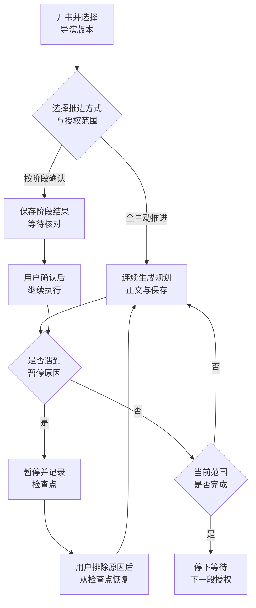
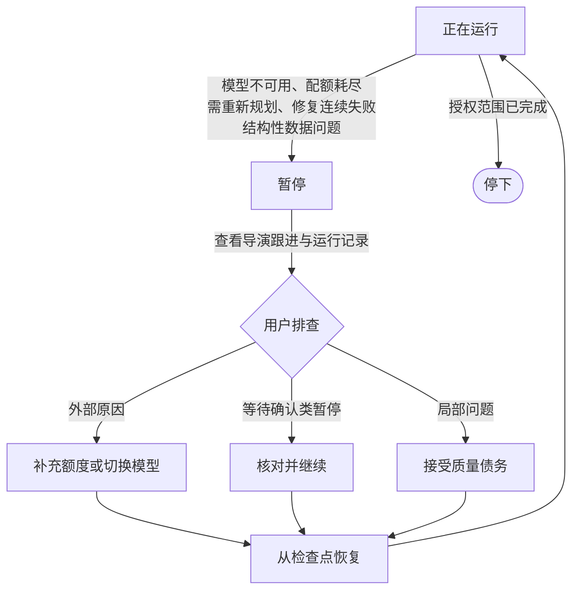

自动导演负责把模糊的想法变成可执行的小说项目，并持续推进世界、角色、卷规划和章节生产。长篇创作需要先从 V1 与 V2 中选定导演版本，再在每次推进时选择运行方式。

<Info>
  短篇创作有独立的完整成稿流程，不经过自动导演。
</Info>

## V1 与 V2 怎么选

|  | 导演 V1 | 导演 V2 |
| --- | --- | --- |
| 使用入口 | 原导演与小说工作台，保留分阶段创作入口 | 本书导演台，集中阅读目录、正文和资料，并推进下一段创作 |
| 适合情况 | 继续原有小说，或希望沿用原工作台操作 | 从新书开始，按授权范围连续规划和生成 |
| 任务与恢复 | 使用自己的任务、检查点与恢复流程 | 使用自己的运行、阶段结果与保存进度 |
| 默认选择 | 历史小说保留所属版本 | V2 可用时，新书默认优先选择 V2 |

开书页可以选择可用的导演版本。已有小说需要先结束当前创作，再在本书设置切换；已保存正文与历史记录会保留。**切换版本只保存选择，不会自动开始生成，也不会恢复另一个版本的旧任务。**

如需暂时关闭 V2，可显式设置 `DIRECTOR_NEXT_ENABLED=false`。

## V2 运行模式：全自动与按阶段确认

下面的流程图展示了 V2 本书导演台的核心运行链路：开书后先选择推进方式与授权范围，随后进入连续生成循环；只有在范围完成、遇到暂停原因或用户主动干预时才会停下。

| 创作方式 | AI 怎样推进 | 你需要做什么 |
| --- | --- | --- |
| **全自动推进** | 在本次授权范围内补齐所需规划，写正文、检查和保存，普通阶段结果自动继续 | 先选择方向和范围；遇到明确暂停事项时处理，再从本书导演台继续 |
| **按阶段确认（半自动）** | 在需要确认的阶段保存结果，等待你核对后继续；正文在批次收尾确认 | 打开本阶段结果，核对后点击确认；无需逐章手动触发整条链 |

书名旁与导演台顶部会显示当前方式，后续正文批次沿用所选模式。

## 全自动为什么也可能停下

全自动会继续执行你授权的范围，**范围完成后需要你选择下一段**。例如提交第 1 至 3 章，完成后不会擅自写第 4 章。

遇到以下情况系统也会暂停：

- 模型不可用或配额耗尽
- 需要重新规划
- 触发单章用量保护
- 数据完整性问题

普通局部质量问题默认记录为章节提醒并继续；若选择「质量优先」策略，则可能在正文保存后等待人工处理。

## 导演推进流程

下面的流程步进器展示了从「确认方案」到「章节执行」的真实阶段顺序。在自动导演中，用户最关键的创作选择是确认方向；确认之后，系统会把后续步骤写入任务队列，持续推进。

<DirectorFlowWidget />

### 流程说明

| 阶段 | 说明 | 是否需要确认 |
| --- | --- | --- |
| 灵感对齐 | 系统理解输入、题材偏好、目标章节数 | 否 |
| 立项定位 | 形成书级定位、卖点和目标读者 | 否 |
| 方向候选批次 | 生成可选开书方向 | 是 |
| 书名候选组 | 为选中方向生成标题 | 是 |
| 创建小说 | 将确认方向变成真实项目 | 否 |
| 故事宏观 | 生成整本书长期冲突与推进循环 | 随策略 |
| 书契约 | 写入目标读者、卖点、承诺与硬约束 | 随策略 |
| 世界搭建 | 生成本书世界骨架、规则与势力 | 随策略 |
| 角色生成 | 生成角色候选与阵容草案 | 是（质量不过时停下） |
| 应用角色阵容 | 把通过的角色写入正式资产 | 随策略 |
| 卷战略 | 生成分卷策略、目标与推进路线 | 是 |
| 卷骨架 | 生成卷列表与每卷任务 | 随策略 |
| 节奏板 | 将卷规划拆成可执行的节奏节点 | 随策略 |
| 章节清单 | 生成章节标题、顺序与基础目标 | 随策略 |
| 章节同步 | 将任务数据同步到章节记录 | 随策略 |
| 章节细化 | 生成章节任务单与执行资源 | 随策略 |
| 章节批次就绪 | 可以开始写这一批章节 | 是 |
| 章节执行 | 生成正文、审核、修复与状态回灌 | 随策略 |

<Tip>
  用户侧常把流程简化为「方向、世界、角色、拆章、执行」，但真实后台至少覆盖 17 个阶段。阶段之间可以暂停、恢复和重试。
</Tip>

## 运行模式与适用范围

| 模式 | 自动跑到哪里 | 适合谁 |
| --- | --- | --- |
| 先准备到可开写（推荐新手） | 确认方案后自动完成规划、角色、卷和章节任务，停在可开写状态 | 第一次开书、想先看规划是否靠谱 |
| 全书自动成书 | 确认方案后持续推进规划、写作、审核和修复 | 希望从方案直接跑到小说产出 |
| 按范围执行 | 只自动执行前 N 章或第 1 卷等指定范围 | 想先验证一段，再扩大范围 |
| 质量修复开关（叠加） | 章节正文完成后进入去 AI 检测、审核和可修复问题处理 | 想要更完整的自动闭环 |

### 中断后会怎样

「全书自动成书」遇到模型不可用、配额耗尽、连续修复失败、要求重新规划或结构性数据问题时，会**主动停下**等用户处理，而不是无限重试。

下面这张图展示了暂停到恢复的完整处理流程。

处理步骤：

1. 打开导演跟进，看暂停原因
2. 打开任务中心，确认最新失败任务和错误信息
3. 排除外部原因（补充配额、切换模型、修复网络）
4. 在导演跟进点「继续自动导演」，从原检查点恢复

不要直接退出导演模式或删除项目。

## 恢复与重新规划

遇到暂停时按顺序判断：

1. 是否只是等待选择候选、角色或卷规划
2. 是否有可重试的后台任务
3. 是否已有可用章节内容
4. 是否需要局部修复或接受质量债务
5. 是否明确要求重新规划

只有明确重新规划、不可恢复生成失败、数据完整性风险或系统安全问题，才应停止全局链路。局部质量债务不等于全局失败。

<Tip>
  暂停原因、继续入口和接管动作的完整说明见 [导演跟进](/features/director-follow-up)；按阶段对照症状和恢复入口见 [按阶段恢复](/guides/recovery-by-phase)。
</Tip>

## 常见问题

<AccordionGroup>
  <Accordion title="V1 和 V2 能用同一本小说吗">
    不能同时运行两个版本的导演。切换前需要先结束当前创作；已保存正文与历史记录会保留。
  </Accordion>

  <Accordion title="按阶段确认会不会很麻烦">
    不会。系统只会在关键节点停下，例如方向候选、角色确认、卷战略和章节批次就绪。不需要逐章手动确认。
  </Accordion>

  <Accordion title="为什么有时候卡住不动了">
    先看导演跟进的暂停原因，再看任务中心的后台状态。很多情况下只是 waiting approval，而不是失败。
  </Accordion>

  <Accordion title="中途能改模型吗">
    可以。在系统设置修正或切换模型后，回到导演跟进继续。已保存正文不会重新生成。
  </Accordion>

  <Accordion title="运行模式可以随时改吗">
    可以在导演跟进的「继续自动导演」或接管动作里调整；切换不会丢失已完成的阶段产物。
  </Accordion>
</AccordionGroup>

<CardGroup cols={2}>
  <Card title="小说与开书" icon="book-open" href="/features/novels">
    创建项目并选择初始方向
  </Card>

  <Card title="导演跟进" icon="compass" href="/features/director-follow-up">
    查看暂停原因、继续或接管自动导演
  </Card>

  <Card title="第一本小说实战" icon="route" href="/guides/first-novel-walkthrough">
    跟着完整案例从灵感走到成卷
  </Card>

  <Card title="创作生产链原理" icon="diagram-project" href="/guides/production-pipeline">
    了解自动导演每一层在做什么
  </Card>
</CardGroup>

export const DirectorFlowWidget = () => {
  const [active, setActive] = useState(0);
  const [mode, setMode] = useState("auto");
  const [playing, setPlaying] = useState(false);

  const steps = [
    { label: "方向候选", detail: "从灵感生成可选书级方向和标题组。", confirm: true },
    { label: "立项创建", detail: "将确认的方向变成小说项目，写入候选方向、标题和运行参数。", confirm: false },
    { label: "故事宏观", detail: "生成整本书长期冲突、推进循环和主线结构。", confirm: false },
    { label: "世界搭建", detail: "生成本书世界骨架、规则、势力和地点。", confirm: false },
    { label: "角色生成", detail: "生成角色候选和阵容草案。", confirm: true },
    { label: "卷战略", detail: "生成分卷策略、推进路线和卷目标。", confirm: true },
    { label: "节奏板", detail: "把卷规划拆成可执行章节任务。", confirm: false },
    { label: "章节细化", detail: "生成章节任务单、场景卡和目标。", confirm: false },
    { label: "章节批次就绪", detail: "可以开始写这一批章节。", confirm: true },
    { label: "正文生成", detail: "按章节任务生成正文草稿。", confirm: false },
    { label: "质量审核", detail: "检查正文是否满足任务与写法要求。", confirm: false },
    { label: "修复与回灌", detail: "局部修文、保存正文并同步角色与伏笔状态。", confirm: false },
  ];

  useEffect(() => {
    if (!playing) return;
    const timer = setInterval(() => {
      setActive((a) => {
        if (a >= steps.length - 1) {
          setPlaying(false);
          return a;
        }
        return a + 1;
      });
    }, 1000);
    return () => clearInterval(timer);
  }, [playing]);

  const navButton = {
    padding: "6px 14px",
    borderRadius: 8,
    border: "1px solid rgba(127,127,127,.35)",
    background: "transparent",
    color: "inherit",
    font: "inherit",
    cursor: "pointer",
  };

  return (
    

      

      

        <strong style={{ fontSize: 14 }}>运行模式：</strong>
        <label style={{ display: "flex", alignItems: "center", gap: 6, fontSize: 14, cursor: "pointer" }}>
          <input type="radio" checked={mode === "auto"} onChange={() => setMode("auto")} />
          全自动推进
        </label>
        <label style={{ display: "flex", alignItems: "center", gap: 6, fontSize: 14, cursor: "pointer" }}>
          <input type="radio" checked={mode === "confirm"} onChange={() => setMode("confirm")} />
          按阶段确认
        </label>
      

      

        <button type="button" style={navButton} onClick={() => { setActive(0); setPlaying(false); }}>
          重置
        </button>
        <button type="button" style={navButton} onClick={() => setPlaying((p) => !p)}>
          {playing ? "暂停播放" : "自动播放"}
        </button>
        
          {active + 1} / {steps.length}
        
      

      

        {steps.map((step, i) => {
          const isActive = i === active;
          const isPast = i < active;
          const isFuture = i > active;
          const showWait = mode === "confirm" && step.confirm && isActive;
          return (
            <button
              key={i}
              type="button"
              onClick={() => { setActive(i); setPlaying(false); }}
              className="df-step"
              style={{
                textAlign: "left",
                padding: 12,
                borderRadius: 10,
                font: "inherit",
                color: "inherit",
                cursor: "pointer",
                border: isActive ? "2px solid #16A34A" : "1px solid rgba(127,127,127,.3)",
                background: isActive ? "rgba(22,163,74,.12)" : isPast ? "rgba(22,163,74,.06)" : "transparent",
                opacity: isFuture ? 0.55 : 1,
              }}
            >
              

                步骤 {i + 1}
                {showWait && 等待确认}
              

              
{step.label}

            </button>
          );
        })}
      

      

        
{steps[active].label}

        

          {steps[active].detail}
          {mode === "confirm" && steps[active].confirm && (
            
              按阶段确认模式下，本阶段完成后会暂停，等待你核对后继续。
            
          )}
        

      

      

        <button type="button" style={navButton} disabled={active === 0} onClick={() => { setActive(active - 1); setPlaying(false); }}>
          上一步
        </button>
        <button type="button" style={navButton} disabled={active === steps.length - 1} onClick={() => { setActive(active + 1); setPlaying(false); }}>
          下一步
        </button>
      

    

  );
};
