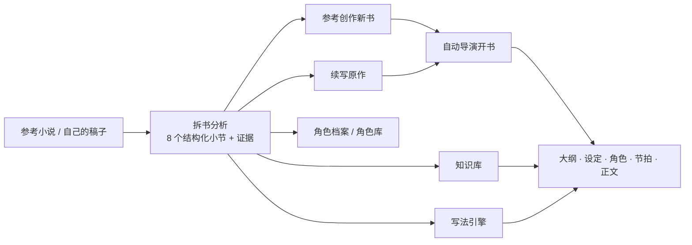

拆书工作台用于分析参考作品或自己的稿子。它不是简单生成一篇读后感，而是把作品拆成**有原文证据、按字段结构化、能被后续流程直接读取**的创作资料。

拆书结论不只是给人看的报告：开书、续写、规划、角色、写法和正文生成都会按需读取它。一份扎实的拆书，决定了后面整本书的起点有多稳。

<CardGroup cols={3}>
  <Card title="参考创作新书" icon="seedling" href="#参考创作新书">
    学习一本书的结构、节奏、钩子和写法，生成全新的角色、世界与剧情。
  </Card>

  <Card title="续写原作" icon="book-bookmark" href="#续写原作">
    接住原作结尾的人物状态、世界规则和未完线索，从结尾继续写。
  </Card>

  <Card title="诊断与沉淀" icon="stethoscope" href="#诊断自己的稿子">
    诊断自己的稿子，把结论沉淀到知识库、写法和角色库。
  </Card>
</CardGroup>

## 拆书在整个创作流程中的位置

## 拆书能帮你做什么

- 学习参考作品的题材定位、主线推进、人物系统、世界设定、主题表达、写法技巧和商业卖点。
- 从成功的拆书结果直接选择“续写原作”或“参考创作新书”，让拆书结论成为开书依据。
- 诊断自己的稿子，检查节奏、人物、伏笔、主题和读者期待是否清楚。
- 把拆书结论发布到知识库，让后续规划、续写和正文生成可以继续使用这些资料。
- 从“文风与技法”分析生成写法资产，沉淀一套可复用的叙事风格。
- 深入研究角色，生成角色档案、形象演变、参考图，并在需要时升格到基础角色库。

## 适合什么时候用

- 看到一本想学习的参考作品，想知道它的结构、爽点和人物为什么有效。
- 想基于一本已有作品继续写下去，需要先把前作的人物、世界和未完线索理清楚。
- 准备新书前，想先拆几本同类型作品，积累题材、角色和写法参考。
- 写完一段自己的稿子后，想让系统帮你做一次结构化诊断。
- 想把资料从“看过”变成后续创作能检索、能引用的知识库内容。
- 想单独研究某个角色的外貌、性格、弧线、关系和章节表现。

## 开始前准备

拆书需要一个可分析的文本来源。常见来源有两种：

- **知识库文档**：适合分析参考作品、资料文本或整理好的小说原文。
- **你的小说正文**：适合使用“诊断稿子”检查自己的稿件。

文本越长，分析时间和 token 消耗通常越高。第一次使用时，建议先选择一小段章节范围或使用“快速拆书”，确认结果符合预期后再做完整拆书。

如果要使用发布到知识库、证据跳转、角色形象演变等能力，建议先确保知识库和模型配置可用。

## 创建拆书分析

点击左侧拆书页里的“新建拆书”，按下面顺序选择：

<Steps>
  <Step title="选择来源">
    选择要分析的文档或进入“诊断稿子”。
  </Step>
  <Step title="选择范围">
    选择分析范围：全文、章节范围，或按字数换算范围。
  </Step>
  <Step title="选择拆书类型">
    选择快速拆书、标准拆书或完整拆书。
  </Step>
  <Step title="填写关注点">
    例如“重点看群像人物”“重点看开篇钩子”“重点看付费爽点”。
  </Step>
  <Step title="设置预算上限">
    避免长文本在不知情的情况下持续消耗模型额度。默认预算为 200,000 tokens。
  </Step>
  <Step title="提交任务">
    提交后等待任务完成，过程中可以到任务中心查看状态。
  </Step>
</Steps>

关注点会影响系统优先分析哪些内容，但不会改变证据来源。也就是说，拆书结论仍应尽量来自原文，而不是根据关注点随意发挥。

## 三种拆书怎么选

<Tabs>
  <Tab title="快速拆书">
    优先看清作品定位、主线结构、人物系统和写法特征，适合先低成本判断一本作品是否值得深拆。

    包含：拆书总览、剧情结构、人物系统、文风与技法。
  </Tab>
  <Tab title="标准拆书">
    覆盖多数创作复用所需信息，默认不生成时间线，适合大多数网文参考分析，是“参考创作新书”的推荐选择。

    包含：拆书总览、剧情结构、人物系统、世界观与设定、主题表达、文风与技法、商业化卖点。
  </Tab>
  <Tab title="完整拆书">
    生成全部分析小节，包含故事时间线，适合长篇续写、仿写或深度复盘。**准备续写原作时，推荐使用完整拆书。**

    包含：标准拆书的全部小节，加上故事时间线。
  </Tab>
</Tabs>

| 你的目的 | 推荐类型 | 原因 |
| --- | --- | --- |
| 判断一本书值不值得研究 | 快速拆书 | 成本最低，先看定位、结构、人物和写法 |
| 参考创作新书 | 标准拆书 | 覆盖剧情结构、文风与技法、商业化卖点等开书必需小节 |
| 续写原作 | 完整拆书 | 时间线会被优先用于承接前作的事件顺序和终局状态 |
| 深度复盘或仿写研究 | 完整拆书 | 全部小节都有，信息最完整 |

## 八个分析小节

每个小节都会同时生成可阅读的正文和结构化字段。结构化字段是后续开书、续写和规划真正读取的内容，所以拆书质量会直接影响后面的创作结果。

| 小节 | 结构化字段 | 主要用途 |
| --- | --- | --- |
| 拆书总览 | 一句话定位、题材标签、卖点标签、目标读者、整体优势、整体短板 | 快速判断作品定位，作为开书和改编的整体参照 |
| 剧情结构 | 主线梗概、阶段推进、冲突升级、高光设计、节奏风险、结构亮点、可复用套路 | 学习主线怎么推进，是续写和参考创作的必需小节 |
| 故事时间线 | 关键时间节点、事件先后关系、主线阶段划分、状态变化节点、时间线风险 | 续写时优先读取，用来接住前作的事件顺序和终局 |
| 人物系统 | 主角定位、配角功能、反派功能、关系网络、成长弧线、人物高光、辨识度风险 | 理解人物分工，续写时用来承接人物状态 |
| 世界观与设定 | 世界框架、规则系统、设定亮点、剧情支撑、设定风险 | 学习设定如何服务剧情，续写时保留世界规则 |
| 主题表达 | 核心主题、象征母题、情绪基调、呈现方式、主题风险 | 把握作品的情绪和表达方向 |
| 文风与技法 | 叙事视角、语言风格、描写方式、对话特征、节奏控制、钩子设计、可复用写法 | 生成写法资产，参考创作时学习写法 |
| 商业化卖点 | 读者爽点、点击驱动、人物卖点、题材卖点、读者匹配、商业化风险 | 学习爽点和回报节奏，参考创作时转成自己的卖点 |

## 阅读拆书结果

拆书详情页主要分为“小节分析”和“角色档案”两个视图。

在“小节分析”里，优先阅读每个小节的关键结论。关键结论适合快速判断这份拆书有没有价值；需要更完整解释时，再展开阅读正文。

如果你想核对结论来源，可以查看“本节证据”。证据会尽量绑定到对应结论，点击后可以看到摘录；带章节定位的证据可以配合“双栏”查看原文章节和高亮位置。

“双栏”适合在宽屏下使用：左侧看原文，右侧看拆书结论。阅读参考作品、核对关键证据或诊断自己的稿子时，这个模式会更清楚。

<Tip>
  拆书结论会被后续流程直接读取。发现某个结论不准确时，先修正或重做这个小节，再用它开书或续写，比开书后再纠偏省力得多。
</Tip>

## 用拆书结果开书

成功的拆书结果顶部会提供“照着这本书写”。这个入口把拆书从阅读报告变成新项目的开书依据。

<Steps>
  <Step title="打开拆书结果">
    打开状态为成功的拆书结果。也可以从小说列表发起“照着一本书写”，再选择一份已完成的拆书。
  </Step>
  <Step title="选择作品规模">
    选择“长篇小说”或“短篇（3,000 到 30,000 字）”。
  </Step>
  <Step title="选择创作方式">
    选择“续写原作”或“参考创作新书”。短篇只支持“参考创作新短篇”。
  </Step>
  <Step title="确认创作承接方案">
    系统会根据拆书结论整理一份“创作承接方案”，先看前三章的故事走向，再决定是否采用。
  </Step>
  <Step title="进入自动导演开书">
    采用方案后继续填写开书设置，生成方向候选并确认项目。
  </Step>
</Steps>

| 模式 | 适用场景 | 数据边界 |
| --- | --- | --- |
| 续写原作 | 要从原作结尾继续 | 保留原作角色、世界规则、时间线和未完线索 |
| 参考创作新书 | 要学习结构、节奏和写法 | 重新生成角色、世界和剧情，避免复制原作事实 |

### 开书前的拆书检查

两种模式对拆书小节有不同的最低要求。缺少必需小节时，承接方案页会提示“拆书还缺少：……”，并提供“去补做拆书”入口。

| 模式 | 必需小节 | 可选但推荐的小节 |
| --- | --- | --- |
| 续写原作 | 人物系统、剧情结构 | 故事时间线、拆书总览、世界观与设定、主题表达、文风与技法、商业化卖点 |
| 参考创作新书 | 剧情结构、文风与技法、商业化卖点 | 其余小节 |

### 创作承接方案

创作承接方案是拆书和新项目之间的桥梁。它把拆书结论翻译成“这本新书具体要怎么写”，包括：

- **前三章怎么写**：开篇方向，采用后交给 AI 继续规划。
- **本书的创作方向**：把参考作品的特点落实到你的故事。
- **原书有哪些特点**：方案依据的参考特征，可以展开核对。
- **续写需要接住什么**（续写原作）：原作结尾的人物状态、还没结束的故事线。
- **如何转成独立新书**（参考创作新书）：吸引读者的钩子、持续推动故事的冲突、爽点与回报节奏。

方案底部会标明所依据的原文版本。对方案不满意时可以重试生成，新方案生成期间会保留当前方案供你对照。

### 续写原作

续写模式要求项目有且只有一个上游来源：站内小说或知识库小说。开启后，系统会在后续规划和正文生成时持续带入前作上下文：

- **前作核心角色状态**：来自人物系统。
- **前作终局章节摘要**：来自故事时间线，规划时会被优先放入上下文。
- **前作关键事实**：来自拆书总览、世界观与设定、主题表达，用于承接因果。
- **前作未完线索**：来自剧情结构、时间线和商业化卖点，可以推进，但不能照抄桥段。

续写的核心规则是：**必须承接前作的因果和角色弧线，但禁止复刻前作关键桥段的顺序、标志性台词和句式。**

<Note>
  续写时，系统会把新生成的正文和前作原文做相似度比对。相似度过高时会自动改写这一段，降低与原作的重复度。
</Note>

### 参考创作新书

参考创作会学习参考作品的结构、节奏和写法，但角色、世界和剧情都会重新生成。

参考拆书在不同创作阶段会被按需读取，每个阶段只取相关小节，避免无关信息干扰：

| 创作阶段 | 读取的拆书小节 |
| --- | --- |
| 故事大纲 | 剧情结构、故事时间线、世界观与设定、拆书总览 |
| 结构化大纲 | 剧情结构、故事时间线、人物系统 |
| 作品设定 | 人物系统、世界观与设定、主题表达 |
| 章节节拍 | 剧情结构、故事时间线、商业化卖点 |
| 角色 | 人物系统 |

你也可以在项目设置里指定只带入哪些拆书小节。

<Tip>
  写法准备不会阻塞开书。参考写法会与拆书上下文一起准备。写法暂时无法创建时，仍可以进入开书页继续确认方向；后续可以在写法引擎中补充或重新绑定。
</Tip>

## 角色档案

“角色档案”用于研究作品中的人物。它和“人物系统”小节不是一回事：

- **人物系统小节**：帮助你快速理解整本书的人物分工和关系张力。
- **角色档案**：用于深入研究单个角色的外貌、性格、目标、能力、关系、弧线和关键场景。

角色档案通常先识别候选角色，再由你决定是否生成完整档案。这样可以先看哪些人物值得研究，再把预算用在真正重要的角色上。

角色档案支持简要、标准、深入和完整四种深度。简要和标准适合快速了解角色；深入和完整会更重视原文证据，适合研究主角、反派、重要配角或你准备借鉴的人物设计。

新建角色时，也可以选择一份或多份已完成的拆书分析作为参考。

### 形象演变

角色档案里可以继续查看“形象演变”。它适合研究一个角色在不同章节里的外貌、服装、配饰、身体状态、精神面貌和场景状态。

使用时可以选择目标覆盖率，例如 25%、50%、75% 或 100%。系统会按章节增量扫描，已经完成的快照不会反复重跑。

形象演变还会沉淀“待确认外貌词条”。这些词条是章节中新发现的外貌信息，例如发色、衣着、伤痕、配饰或气质。它们不会自动写回角色外貌，只有你勾选并选择融合后，才会进入角色档案的稳定外貌描述。

如果要生成章节形象图，系统会优先参考这个角色已有的基础形象图。角色有多张基础形象图时，可以选择本次要使用的参考图，让不同场景里的同一角色更一致。

## 发布和复用

除了直接开书，拆书结论还可以沉淀成长期资料：

- **发布到知识库**，让后续规划、续写和正文生成能够检索这些结论。
- **点击“生成写法”**，把拆书里的“文风与技法”转成写法资产。
- **在角色档案中生成参考图、设为主图**，或把角色升格到基础角色库。
- **导出或复制**拆书内容，作为外部整理和复盘资料。

同一份拆书可以重复发布到知识库。后续发布会保留来源关系，便于回到原拆书继续查看。

## 诊断自己的稿子

“诊断稿子”适合检查自己的小说正文。它会把当前小说正文作为分析来源，使用拆书的方式检查节奏、人物、主题、伏笔和商业卖点。

诊断结果不会自动修改原小说，也不会直接写回章节正文。它只是帮你发现问题和整理建议。真正改稿时，仍需要你回到章节执行、正文修改、质量修复或其他创作入口中显式操作。

## 预算与恢复

拆书是长任务，尤其是长篇全文、完整拆书、深度角色档案和形象演变，都会增加模型调用。

如果预算用尽，任务会停止在当前边界，并保留已经完成的小节。你可以：

- 查看预算用量和停止原因。
- 调整拆书预算。
- 使用“扩容预算并续跑”，继续处理未完成的小节。
- 到任务中心查看失败、取消或运行中的任务。

重新生成或续跑时，已经成功的小节通常不会被无故覆盖。遇到问题时，不建议马上重建整份分析，先看是否可以续跑或只重做局部小节。

## 推荐使用路径

<Tabs>
  <Tab title="参考创作新书">
    <Steps>
      <Step title="上传参考作品">
        在知识库上传一本同类型的参考小说。
      </Step>
      <Step title="标准拆书">
        新建拆书，选择“标准拆书”，关注点可以填“重点看开篇钩子和爽点节奏”。
      </Step>
      <Step title="核对关键小节">
        重点检查剧情结构、文风与技法、商业化卖点三个小节的结论和证据。
      </Step>
      <Step title="照着这本书写">
        点击“照着这本书写”，选择“参考创作新书”。
      </Step>
      <Step title="采用承接方案">
        阅读“如何转成独立新书”和前三章方向，满意后采用并开书。
      </Step>
    </Steps>
  </Tab>
  <Tab title="续写原作">
    <Steps>
      <Step title="上传原作">
        在知识库上传原作全文，或使用站内已有的小说。
      </Step>
      <Step title="完整拆书">
        新建拆书，选择“完整拆书”，确保生成故事时间线。
      </Step>
      <Step title="核对终局状态">
        重点检查人物系统、剧情结构和故事时间线，确认原作结尾的人物状态和未完线索是对的。
      </Step>
      <Step title="照着这本书写">
        点击“照着这本书写”，选择“长篇小说”和“续写原作”。
      </Step>
      <Step title="采用承接方案">
        展开“续写需要接住什么”，核对人物状态和未完故事线，满意后采用并开书。
      </Step>
    </Steps>
  </Tab>
  <Tab title="第一次试用">
    <Steps>
      <Step title="上传资料">
        在知识库上传一份参考作品或资料文本。
      </Step>
      <Step title="缩小范围">
        新建拆书，先选择部分章节或较短范围。
      </Step>
      <Step title="快速拆书">
        选择“快速拆书”，填写一个明确关注点，例如“重点看开篇吸引力”。
      </Step>
      <Step title="阅读结论">
        阅读“小节分析”里的关键结论和证据。
      </Step>
      <Step title="再决定">
        值得深入就升级为标准或完整拆书，再用于开书或发布到知识库。
      </Step>
    </Steps>
  </Tab>
</Tabs>

## 常见问题

<AccordionGroup>
  <Accordion title="续写和参考创作该选哪个？">
    想让原作的人物和故事接着发展，选“续写原作”。只是喜欢这本书的结构、节奏和写法，想写一个全新的故事，选“参考创作新书”。短篇只支持参考创作。
  </Accordion>

  <Accordion title="承接方案提示“拆书还缺少”怎么办？">
    说明这份拆书没有当前模式需要的小节。点击“去补做拆书”，补跑缺少的小节即可，不需要重建整份分析。续写需要人物系统和剧情结构；参考创作需要剧情结构、文风与技法和商业化卖点。
  </Accordion>

  <Accordion title="续写会不会照抄原作？">
    续写规则要求承接前作的因果和角色弧线，但禁止复刻关键桥段顺序、标志性台词和句式。生成正文后还会做相似度比对，过高时自动改写。
  </Accordion>

  <Accordion title="任务很慢怎么办？">
    先确认文本长度、拆书类型和是否启用了完整拆书。长篇全文、完整拆书、深度角色档案和形象演变都需要更多时间。可以先缩小章节范围，或先用快速拆书看方向。
  </Accordion>

  <Accordion title="预算用尽怎么办？">
    预算用尽不代表已经完成的内容丢失。先查看预算用量，再使用“扩容预算并续跑”继续未完成的小节。
  </Accordion>

  <Accordion title="证据找不到原文怎么办？">
    有些历史证据或特殊文本可能没有可跳转章节定位，但证据摘录仍会展示。新生成的拆书会尽量把证据绑定到具体结论，并在可定位时支持双栏高亮查看。
  </Accordion>

  <Accordion title="角色档案不够准怎么办？">
    先确认角色是否是候选状态。如果只是候选，可以生成更完整的档案；如果已经生成，可以尝试更高深度。深入和完整档案会更适合研究主角、反派和关键配角。
  </Accordion>

  <Accordion title="形象图不一致怎么办？">
    先为角色准备基础形象图，并在生成章节形象图前确认参考图。存在多张基础图时，选择最符合当前角色设定的一张或几张作为参考。
  </Accordion>
</AccordionGroup>

<CardGroup cols={3}>
  <Card title="自动导演" icon="clapperboard" href="/features/auto-director">
    用拆书结果开书后，由自动导演继续推进整本书。
  </Card>

  <Card title="知识库" icon="database" href="/features/knowledge-base">
    把拆书结论发布到知识库，让后续创作继续使用。
  </Card>

  <Card title="写法引擎" icon="pen-nib" href="/features/style-engine">
    从拆书生成写法资产，沉淀可复用的叙事风格。
  </Card>
</CardGroup>
