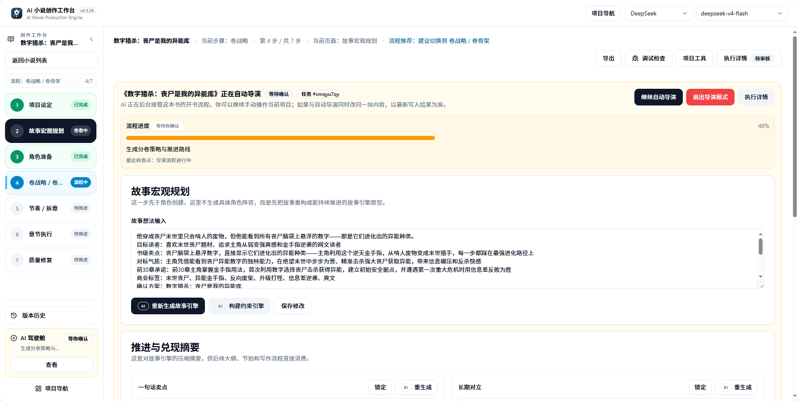
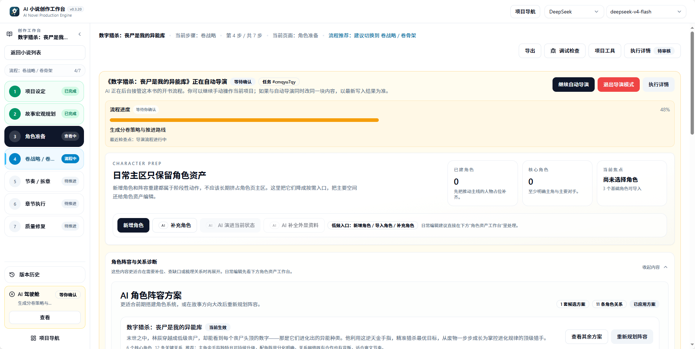
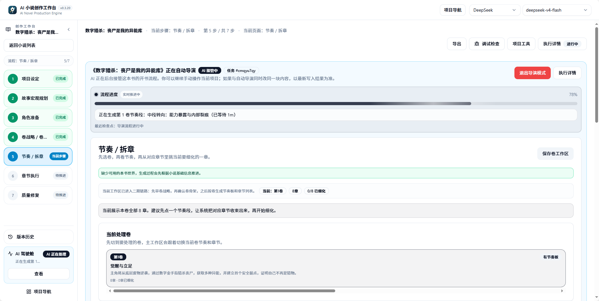

导演跟进用于查看自动导演的执行进度、暂停原因、恢复入口和下一步建议。它帮助你理解一本书的主链停在什么位置，并给出明确的继续动作。

<CardGroup cols={2}>
  <Card title="查看暂停原因" icon="circle-pause" href="#常见暂停原因">
    区分等待确认、局部质量问题和必须停止主链的问题。
  </Card>

  <Card title="继续自动导演" icon="play" href="#恢复入口怎么看">
    从检查点恢复、重试失败任务或接受警告后继续。
  </Card>

  <Card title="切换运行策略" icon="sliders" href="#本书问题处理偏好">
    为单本书选择优先完成或质量优先的处理方案。
  </Card>

  <Card title="接管已有项目" icon="hand" href="#接管动作">
    已有小说资产时，从当前状态推导可继续阶段。
  </Card>
</CardGroup>

## 什么时候打开导演跟进

- 自动导演提示等待确认
- 开书流程中断后想继续
- 章节准备或执行没有继续入口
- 运行记录显示导演相关任务失败或等待恢复
- 想知道系统建议下一步做什么

如果你只想看后台任务是否完成，先看运行记录；如果你想知道自动导演为什么停下，打开导演跟进。

## 常见暂停原因

自动导演暂停通常不是失败，而是等待某个明确动作：

| 暂停原因 | 说明 | 下一步 |
| --- | --- | --- |
| 方向候选等待选择 | 候选方向或书名组已生成 | 进入方向选择页，选一个方向或重做标题 |
| 世界、角色或卷规划需要确认 | 资产准备阶段完成，需要授权继续 | 打开对应资产页核对后确认 |
| 章节计划缺少必要信息 | 节奏板、清单或细化阶段数据不完整 | 补充小说基础信息或重试该阶段 |
| 后台任务失败 | 某个阶段命令执行出错 | 查看运行记录错误，再回导演跟进重试 |
| 质量审核产生局部债务 | 章节有可用正文但存在可修复问题 | 选择修复、记录质量债或继续 |
| 系统判断需要重新规划 | 上游规划与下游执行出现结构性冲突 | 查看原因后决定重规划或局部修正 |
| 本书问题处理规则要求暂停 | 规则设为质量优先，停在安全章节边界 | 确认后继续 |
| 模型余额、配额或连接问题 | 模型服务返回明确错误 | 补充额度或切换模型后恢复 |

阅读暂停原因时，要区分"局部质量问题"和"必须停止主链的问题"。可修复的章节问题通常应记录为质量债务或局部修复建议，而不是阻断整本书。

<Frame caption="AI 驾驶舱运行状态：顶部显示当前阶段，左侧展示步骤进度">
  
</Frame>

## 恢复入口怎么看

导演跟进会尽量把恢复动作落到具体入口：

| 恢复动作 | 适用情况 | 入口位置 |
| --- | --- | --- |
| 回到方向选择 | 候选方向或书名待确认 | 方向选择页 |
| 补充小说基础信息 | 书契约、世界或角色数据缺失 | 小说基础信息页 |
| 继续角色或世界准备 | 资产准备阶段停在确认点 | 角色页、世界资产页 |
| 进入章节任务 | 章节批次已就绪 | 章节执行入口 |
| 重试失败任务 | 某个后台命令执行失败 | 导演跟进内的重试按钮 |
| 接受警告并继续 | 低风险质量修复已处理 | 导演跟进的"继续自动导演" |

如果有多个入口，优先选择系统标记为推荐的入口。不要同时从多个页面重复触发同一阶段任务。

<Steps>
  <Step title="查看导演跟进">
    打开左侧导航的"导演跟进"，阅读当前暂停原因和推荐动作。
  </Step>
  <Step title="核对运行记录">
    切换到运行记录，确认最新任务状态和错误详情。
  </Step>
  <Step title="选择恢复入口">
    按导演跟进的推荐入口操作：确认、重试、继续或接管。
  </Step>
  <Step title="继续自动导演">
    排除问题后，点击"继续自动导演"从原检查点恢复。
  </Step>
</Steps>

## 继续自动导演

"继续自动导演"是导演跟进的核心动作。点击后，系统会从最近的检查点恢复执行，沿用本书保存的运行模式和问题处理规则。

继续前需要确认：

- 暂停原因已排除（额度已补充、模型已切换、候选已确认）
- 没有同范围的高内存任务正在运行
- 不重复启动同一阶段的多个命令

<Warning>
  不要直接退出导演模式或删除项目。大多数暂停都可以通过确认、重试或继续入口恢复。
</Warning>

## 接管动作

接管用于已有小说资产但导演主链中断的情况。系统会从已存在的资产推导可继续阶段，而不是从头重建。

| 场景 | 接管后做什么 |
| --- | --- |
| 已有角色和世界，但卷规划未开始 | 推导进入卷战略阶段 |
| 已有卷规划，但章节细化中断 | 从节奏板或章节清单恢复 |
| 已有部分章节正文 | 从章节执行链继续，已保存正文不重新生成 |

接管不会覆盖已有资产，只重建导演任务状态并定位到最近的检查点。

<Frame caption="AI 驾驶舱角色准备页：停在角色阶段时，后台可能已推进到后续步骤">
  
</Frame>

## 本书问题处理偏好

小说项目可以继承全局问题处理规则，也可以为本书单独选择：

| 方案 | 适合情况 | 章节有可用正文但仍有局部问题时 |
| --- | --- | --- |
| 优先完成整本书 | 更重视先完成全书 | 保存正文、记录质量债并继续 |
| 质量优先 | 更重视逐章确认 | 暂停处理，等待你确认后继续 |

两套方案都最多自动处理一次。你也可以逐项设置"自动重试、提醒后继续、暂停处理、结束任务"，或点击"恢复继承全局"回到统一规则。

本书规则在任务开始时随项目保存，后续恢复会继续使用这本书自己的选择，不会因为全局设置变化而悄悄改变处理中任务。

## 模型余额和配额暂停

模型服务返回余额不足、配额不足或明确限流错误时，导演跟进与执行详情会优先展示真实模型原因和恢复入口。

处理顺序：

1. 记录首个未完成章节和当前保存边界
2. 到模型设置补充额度、修正连接或切换模型
3. 回到导演跟进，确认暂停原因处理完成
4. 使用恢复入口继续，不要重新发起已完成章节范围

已保存正文不会因为这类暂停被重新生成。若本书规则要求人工处理，后台恢复也会保留暂停状态，等待你明确继续。

## 切换运行策略

运行模式可以在导演跟进的"继续自动导演"或接管动作里调整：

| 策略 | 切换时机 | 影响 |
| --- | --- | --- |
| 全自动推进改为按阶段确认 | 想增加人工核对节点 | 后续阶段在确认点暂停 |
| 按阶段确认改为全自动推进 | 对规划质量有信心 | 低风险点自动继续 |
| 开启或关闭质量修复开关 | 调整正文产出标准 | 章节完成后是否进入审核修复 |

切换不会丢失已完成的阶段产物，只改变后续阶段的自动审批边界。

<Frame caption="节奏板阶段：卷规划拆分为可执行的章节任务">
  
</Frame>

## 检查点类型

导演跟进最重要的作用，是把自动导演当前检查点翻译成用户能执行的动作。

| 检查点 | 页面含义 | 常见阶段 | 用户动作 |
| --- | --- | --- | --- |
| 等待方向选择 | 等待确认书级方向 | 候选方向、书名候选 | 选一个方向、修订候选、重做标题 |
| 书契约就绪 | 书级规划就绪 | 书契约 | 查看书级承诺、继续后续资产准备 |
| 等待角色确认 | 角色准备待确认 | 角色生成、角色阵容应用 | 确认、合并、重做或补充角色 |
| 卷战略就绪 | 卷战略就绪 | 卷战略、卷骨架 | 确认后进入节奏拆章 |
| 章节批次就绪 | 章节批次可执行 | 节奏板、章节清单、章节细化 | 进入章节执行或授权自动写章 |
| 需要重规划 | 需要处理质量修复或重规划 | 审核修复、质量循环 | 查看原因，决定修复、继续或重规划 |
| 流程完成 | 导演主流程完成 | 全局或批次结束 | 查看结果和后续建议 |
| 重写快照已建立 | 重写前备份完成 | 重写/重新生成 | 确认清理后继续 |

<Info>
  当状态是"等待确认"时，系统通常在等你确认方向、角色、卷规划、章节执行或修复策略。先看导演跟进，不要把项目删除或重复创建。
</Info>

## 暂停原因到恢复入口

| 暂停原因 | 说明 | 推荐入口 |
| --- | --- | --- |
| 候选方向待确认 | 候选方向或书名组完成 | 方向选择页 |
| 角色准备待确认 | 角色阵容可能需要人工确认 | 角色候选页、导演跟进 |
| 卷战略待确认 | 卷级路线和骨架完成 | 卷规划入口 |
| 章节批次就绪 | 节奏板、清单、细化完成 | 导演跟进、章节执行入口 |
| 低风险质量修复 | 章节可修复但需要授权继续 | 章节页、导演跟进 |
| 需要重规划 | 后续计划可能要变 | 导演跟进、按阶段恢复手册 |
| Worker 中断 | 后台租约过期或服务重启 | 运行记录确认状态，再回来源页面恢复 |
| 高内存任务冲突 | 同一本书同范围已有节奏板/拆章任务 | 运行记录查看正在运行的任务 |

## 自动审批配置

自动审批允许系统在指定低风险确认点自动继续。常见点位包括：

| 审批点 | 对应动作 | 风险 |
| --- | --- | --- |
| 方向已确认 | 确认候选方向后继续建书 | 低 |
| 角色就绪 | 角色阵容通过后继续卷战略 | 低 |
| 卷战略就绪 | 卷战略通过后继续节奏拆章 | 低 |
| 结构化大纲就绪 | 章节任务准备好后继续写作 | 低 |
| 继续章节执行 | 一个章节批次完成后继续剩余章节 | 中 |
| 低风险质量修复后继续 | 低风险质量修复后继续 | 中 |
| 重规划后继续 | 重规划处理后继续 | 高 |
| 重写清理已确认 | 重写清理确认后继续 | 高 |

默认更适合自动通过低风险规划点；涉及重规划、重写清理或大范围正文改动时，建议保留人工确认。

## 与运行记录的关系

运行记录回答"后台任务发生了什么"；导演跟进回答"整本书下一步该做什么"。

推荐配合顺序：

1. 在导演跟进看到任务暂停
2. 到运行记录查看最新任务状态和错误信息
3. 回到导演跟进选择恢复动作
4. 继续自动导演或章节执行

如果运行记录显示运行中，导演跟进可能暂时不会给出新的确认项。

## 推荐处理策略

遇到暂停时按顺序判断：

1. 是否只是等待你选择候选
2. 是否有可重试的后台任务
3. 是否已有可用章节内容
4. 是否需要局部修复
5. 是否明确要求重新规划

只有明确的重新规划、不可恢复生成失败、数据完整性风险或系统安全问题，才应停止全局链路。

## 新手建议

如果你不理解暂停文案，不要手动清理数据。先做两件事：

- 查看运行记录最新状态
- 回到小说页确认基础信息和候选项

大多数暂停都可以通过确认、重试或继续入口恢复。

## 常见问题

<AccordionGroup>
  <Accordion title="导演跟进显示暂停，但运行记录显示任务已完成？">
    运行记录中的"完成"只表示该后台命令已结束。导演跟进显示暂停，说明当前检查点需要你的确认才能继续下一阶段。点击导演跟进的推荐入口处理即可。
  </Accordion>

  <Accordion title="可以继续后没有反应？">
    先刷新页面查看最新状态。如果运行记录显示任务正在排队或运行中，说明后台已接收命令，等待执行完成。不要重复点击"继续自动导演"。
  </Accordion>

  <Accordion title="切换本书问题处理规则会影响已生成的章节吗？">
    不会。规则只在任务开始时随项目保存，后续恢复继续使用这本书自己的选择。已保存的章节正文不会重新生成。
  </Accordion>

  <Accordion title="为什么有多个恢复入口？">
    不同暂停原因对应不同的创作上下文。系统会标记推荐入口，优先选择该入口。如果不确定，按"查看运行记录 -> 回导演跟进选推荐入口"的顺序处理。
  </Accordion>

  <Accordion title="接管和继续有什么区别？">
    "继续"用于导演主链已存在但暂停的情况，从最近检查点恢复。"接管"用于导演任务状态丢失或需要重建时，从已有资产推导可继续阶段。
  </Accordion>

  <Accordion title="可以跳过某个检查点吗？">
    不建议。每个检查点都对应质量闸口，尤其是角色确认和卷战略确认。跳过可能导致后续章节质量下降。如果开启了自动审批，低风险点会自动通过。
  </Accordion>

  <Accordion title="重规划会删除已有内容吗？">
    不会自动删除。重规划前系统会建立快照，你可以确认清理后再继续。已保存的正文、角色和世界资产默认保留。
  </Accordion>

  <Accordion title="导演跟进和通知的关系？">
    通知负责提醒：任务暂停、等待确认、可恢复、需要处理质量问题。导演跟进负责解释：为什么暂停、停在哪个检查点、下一步入口是什么。看到通知时，先进入导演跟进查看详情。
  </Accordion>
</AccordionGroup>

<CardGroup cols={3}>
  <Card title="自动导演" icon="wand-magic-sparkles" href="/features/auto-director">
    了解导演版本、运行模式和阶段流程
  </Card>

  <Card title="运行记录" icon="list-check" href="/features/task-center">
    查看后台任务状态和错误详情
  </Card>

  <Card title="章节执行" icon="pen-nib" href="/guides/chapter-execution">
    从章节批次就绪到正文生成
  </Card>
</CardGroup>
