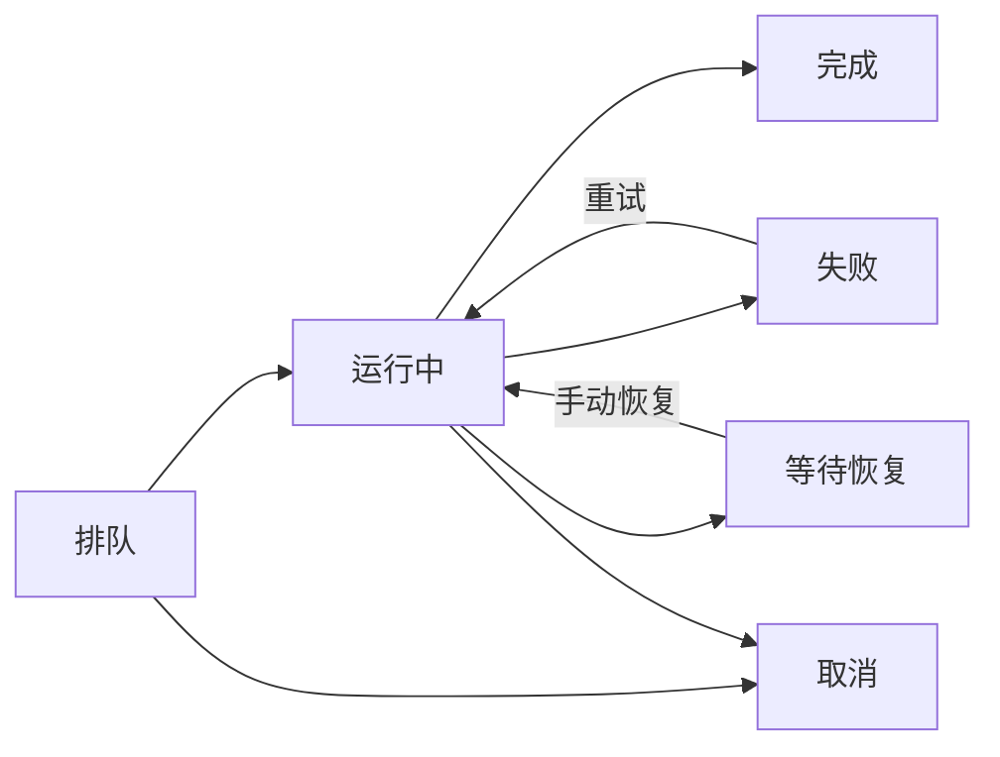
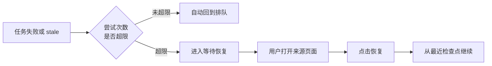

左侧"运行记录"用于查看后台任务的排队、运行、失败、完成和恢复位置。旧文档或提示中的"任务中心"指向同一入口。这里是只读列表：帮助你确认真实进度、错误原因和任务来源，真正的操作要到来源工作台完成。

<CardGroup cols={3}>
  <Card title="确认任务状态" icon="gauge-high" href="#常见任务状态">
    查看任务是排队、运行中、完成、失败还是等待恢复。
  </Card>

  <Card title="失败诊断" icon="triangle-exclamation" href="#失败诊断">
    从错误信息判断是模型、网络、数据还是配置问题。
  </Card>

  <Card title="打开来源页面" icon="arrow-up-right-from-square" href="#操作应该在哪里完成">
    运行记录只展示状态，继续、恢复和重试在工作台处理。
  </Card>
</CardGroup>

## 常见任务状态

运行记录会展示以下常见状态：

### 状态变化一览

| 状态 | 含义 | 常见原因 |
| --- | --- | --- |
| 排队 | 任务已创建，等待执行资源 | 并发上限或模型繁忙 |
| 运行中 | 后台正在调用模型、处理资料或写入结果 | 长时间任务如拆书、章节生成 |
| 完成 | 任务结果已保存 | 可回到对应模块查看产物 |
| 失败 | 执行过程中出现错误 | 模型、网络、数据或结构化输出问题 |
| 等待恢复 | 任务链需要你确认下一步或从恢复入口继续 | 导演跟进中的暂停或质量检查 |
| 取消 | 任务被用户或系统停止 | 手动取消或切换版本时清理 |

<Info>
  运行记录状态不会自动持续刷新。遇到"好像没反应"时，先刷新页面，再查看关联模块确认是否已有结果写入。
</Info>

## 失败诊断

失败后先看三类信息：

1. **任务类型**：开书、章节、拆书、知识库还是图片生成
2. **错误来源**：模型、网络、数据、结构化输出还是运行时异常
3. **可用结果**：是否生成了正文、分析结果或部分资产

执行详情会优先展示模型服务返回的余额、配额、限流或连接错误。看到这类错误时，先处理模型连接和额度，再打开来源页面继续；不要把"章节步骤未完成"当成正文丢失，也不要重新发起已完成章节范围。

| 错误类型 | 处理方向 |
| --- | --- |
| 模型或网络临时错误 | 先处理连接或额度，再回到来源页面重试 |
| 结构化输出失败 | 到模型设置调整模型路由，再回到来源页面重试 |
| 缺少基础数据 | 回到小说页补信息 |
| 已有可用正文但审核不完美 | 记录质量债务，继续后续章节 |
| 明确要求重新规划 | 回到导演跟进处理 |

## 停止运行中任务

运行中或排队的任务可以直接停止。停止后，关联记录仍可查看，已保存的产物（小说、章节、分析内容、来源资料）不受影响。

<Tip>
  导演推进、拆书分析、写法提取、封面和角色图片生成，都支持直接停止运行中的任务。停止时会中断正在等待的模型请求，避免继续生成后续内容或自动重试。
</Tip>

## 删除已结束记录

已结束（完成、失败、取消或等待恢复）的记录支持逐条确认删除。删除运行记录**不会**删除已保存的小说、章节、分析内容或来源资料，只清理记录列表本身。

<Warning>
  排队或运行中的记录会提示先停止，再执行删除，避免误删正在执行的任务记录。
</Warning>

## 暂停和失败怎么区分

| 状态 | 含义 | 推荐动作 |
| --- | --- | --- |
| 等待确认 / 暂停处理 | 本书规则或检查点在等用户决定 | 打开来源页面查看原因并显式恢复 |
| 失败 | 当前命令没有完成 | 查看真实错误，再回来源页面决定重试或换模型 |
| 等待恢复 | 后台中断后仍保留可恢复位置 | 打开来源页面，从首个未完成步骤继续 |
| 已完成但有提醒 | 产物可用，仍有质量债或后续事项 | 打开来源页核对，不要重复运行 |

"质量优先"策略造成的人工暂停不会被后台轮询或 Worker 自动清除。完成问题处理后，需要从导演跟进明确恢复。

## 操作应该在哪里完成

运行记录只展示事实状态和"打开来源页面"。真正的操作要放在能够展示创作上下文、已保存产物和影响范围的页面：

| 任务类型 | 回到哪里处理 |
| --- | --- |
| 自动导演候选或规划失败 | AI 自动导演页面重试或恢复 |
| 章节生成或修复失败 | 章节页面处理 |
| 拆书、知识库或图片任务失败 | 对应工作台处理 |
| 模型、额度或连接问题 | 模型设置修正后返回原任务页面 |

操作前先在运行记录确认当前任务状态。对同一个阶段重复触发多次，可能造成状态难以判断。

## 自动导演任务的队列模型

自动导演的后台动作会写入命令队列，再由导演工作器执行。常见状态映射如下：

| 阶段 | 用户看到什么 |
| --- | --- |
| 排队 | 任务排队或等待执行 |
| 运行中 | 后台正在执行，系统会定期续租避免长任务被误判 |
| 完成 | 任务结果可查看 |
| 失败 | 运行记录显示错误和来源页面 |
| 等待恢复 | 打开来源页面手动恢复 |
| 取消 | 用户或系统取消 |

这意味着你可以离开当前页面，后台仍会继续运行；但也意味着重复点击同一个入口可能排出多个命令。

### stale 任务恢复

stale 表示工作器租约过期。常见原因包括应用或服务重启、后台进程退出、长任务运行时间超过租约且续租失败、本机休眠或网络中断。系统会区分自动恢复和手动恢复：

#### 失败恢复流程

- 全书自动执行、继续执行或从检查点恢复，且尝试次数未超限：自动回到排队，继续执行
- 尝试次数超限或命令不适合自动恢复：标记 stale，进入等待恢复
- 用户在来源页面点击恢复：从最近检查点或命令负载继续

### 重复启动同范围任务的风险

如果提示已有自动导演任务正在处理同一范围，先打开运行记录查看进度。重复启动可能让你难以判断哪个任务写入了最终结果。

## 与导演跟进协作

推荐按这个顺序排查：

<Steps>
  <Step title="确认运行记录">
    确认当前命令是否还在运行，查看错误详情。
  </Step>
  <Step title="判断状态类型">
    如果是等待确认，进入导演跟进处理检查点；如果是失败，先读错误信息。
  </Step>
  <Step title="打开来源页面">
    从运行记录打开对应工作台，决定重试、恢复或重新规划。
  </Step>
</Steps>

运行记录给出事实和来源位置；对应工作台给出并执行下一步。

## 使用建议

养成两个习惯：

- 发起长任务后遇到等待，先看运行记录
- 失败后先读错误信息，再从来源页面决定重试、恢复或重新规划

运行记录能减少重复点击和盲目重跑，是排查长链路问题的只读入口。

## 常见问题

<AccordionGroup>
  <Accordion title="为什么任务状态没及时刷新？">
    运行记录状态需要手动刷新页面更新。长期运行的任务（如拆书、整卷拆章）可能持续数分钟到数小时，刷新后查看最新状态。
  </Accordion>

  <Accordion title="删除运行记录会删除我的小说吗？">
    不会。删除只清除记录列表中的条目，已保存的小说、章节和资料不受影响。
  </Accordion>

  <Accordion title="可以恢复已经删除的记录吗？">
    已删除的运行记录无法恢复。如果关联任务仍在执行，停止后重新触发会产生新记录。
  </Accordion>

  <Accordion title="运行记录显示完成，但小说里看不到内容？">
    先确认是否打开了对应该任务的来源页面。部分任务（如资料整理、资料同步）完成后更新后台数据，不一定在正文区直接展示。
  </Accordion>

  <Accordion title="为什么同一个任务出现了多条记录？">
    重复点击启动入口、恢复、重试或重新规划时，可能产生多条记录。排查时以最新的记录为准，避免对已完成的记录再次操作。
  </Accordion>

  <Accordion title="导演任务暂停后，我应该点继续还是重试？">
    先查看暂停原因。轻微问题或等待确认时，通常选择"继续"从检查点推进；明确失败或模型不可用时，先排除外部原因再"恢复"或"重试"。
  </Accordion>
</AccordionGroup>

<CardGroup cols={3}>
  <Card title="自动导演" icon="wand-magic-sparkles" href="/features/auto-director">
    在导演台查看暂停原因并继续创作。
  </Card>

  <Card title="拆书工作台" icon="book-open" href="/features/book-analysis">
    拆书、知识库等任务失败后回到对应工作台处理。
  </Card>

  <Card title="模型配置" icon="sliders" href="/model-configuration">
    模型或连接问题先到设置修正。
  </Card>
</CardGroup>
