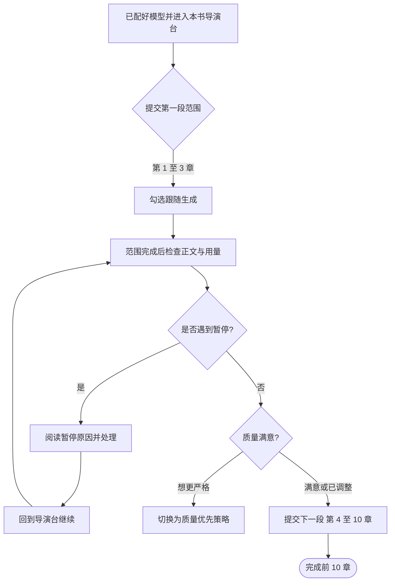
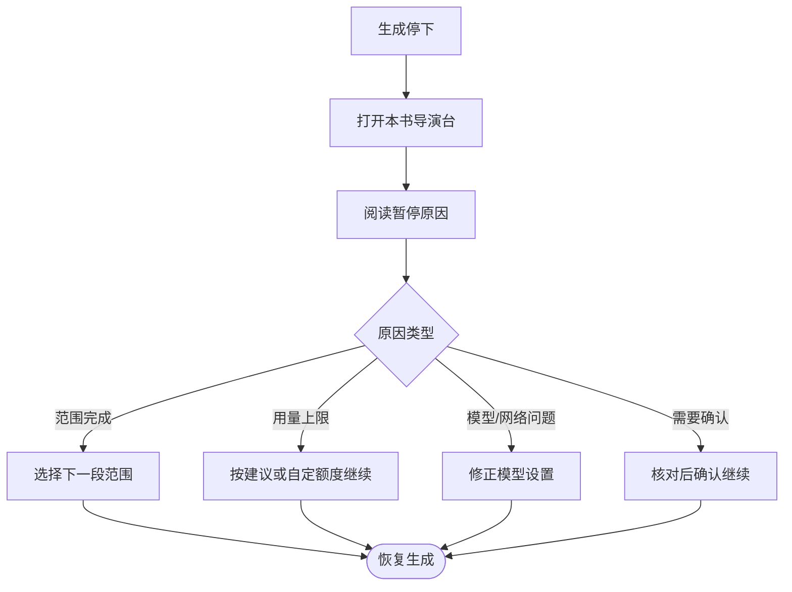

这篇实战指南假设你已经跟着 [创作向导](/onboarding) 完成了第一章。接下来，你将在导演 V2 中使用分段授权的方式，稳扎稳打地把第 1 章写到第 10 章。全程只需要做三件事：提交范围、观察生成、检查后继续。

## 开始前：确认两点

在提交下一段之前，请确认：

1. **至少一个文本模型可用。** 模型已经通过检测，并在运行中没有报错。如果还不确定，先回到 [模型配置](/model-configuration)。
2. **已经在本书导演台。** 你看到的界面是 V2 的本书导演台，顶部有「AI 用量」入口，下方是章节目录与导演操作区。

如果上面两点还没满足，建议先完成 [创作向导](/onboarding) 走到第一章成稿，再回到本页继续。

## 第一步：先写一小段，验证效果

不要一上来就提交第 1 至 10 章。先选一个小范围，观察正文质量和调用节奏。

<Steps>
  <Step title="提交第 1 至 3 章">
    在本书导演台选择推进方式（全自动或按阶段确认），然后在范围选择里提交第 1 至 3 章。这个范围足够验证正文风格、角色出场和剧情节奏，又不会因范围太大而难以回溯。
  </Step>
  <Step title="勾选「跟随生成」">
    开启跟随后，导演台会随着后台进度自动切换到当前阶段：正文生成时打开对应章节，资料阶段打开故事、世界或角色资料。你可以实时看到内容流式输出，不需要手动刷新页面。

    如果关闭跟随，生成仍在后台运行，你可以在完成后手动打开目录里的章节阅读。
  </Step>
  <Step title="等待范围完成">
    全自动会在授权范围内连续规划、写正文、检查和保存，完成后自动停下。按阶段确认会在需要核对时暂停，等你确认后继续。两种方式都不会擅自写超出授权范围的内容。
  </Step>
</Steps>

<Tip>
  如果这是你第一次使用导演 V2，建议第一次用「全自动」推进，先完整跑通一次闭环，再根据需要切换到按阶段确认。
</Tip>

## 第二步：范围结束后检查三件事

第 1 至 3 章完成后，不要立刻提交下一段。先花几分钟确认以下内容：

| 检查项 | 怎么做 | 为什么重要 |
| --- | --- | --- |
| 正文是否可读 | 打开已保存章节，快速浏览正文，确认角色名、地点和基本对话有没有明显混乱 | 早期发现问题，后续章节才不用大面积修正 |
| 质量提醒 | 在导演台查看各章节的提醒标签，看是否有表达建议或伏笔提醒 | 默认策略会记录提醒并继续，但你可以决定要不要切换为更严格的策略 |
| AI 用量 | 点击本书顶部的「AI 用量」，按章节查看累计调用 | 了解当前消耗分布，为下一段范围的选择提供参考 |

### 关于质量提醒与创作策略

默认的「优先完成整本书」策略会把普通局部问题记录为章节提醒并继续。如果你在第 1 至 3 章里发现较多需要人工确认的问题，可以考虑到 **设置 → 自动导演** 切换为「质量优先」策略。

| 策略 | 行为 | 适合情况 |
| --- | --- | --- |
| 优先完成整本书（默认） | 普通问题记录为提醒，继续推进 | 想先看到完整草稿 |
| 质量优先 | 正文保存后可能等待人工处理 | 对细节要求更高，愿意花更多时间打磨 |

<Tip>
  策略可以随时调整，切换不会丢失已保存的章节。
</Tip>

## 第三步：提交第 4 至 10 章

确认前 3 章的方向和品质可以接受后，就可以扩大授权范围：

1. 在本书导演台选择下一段范围，例如第 4 至 10 章。
2. 保持或调整推进方式，然后提交。
3. 再次勾选「跟随生成」，让导演台自动导航到当前进度。

这一段会比第一段更长。如果中途出现暂停，先阅读导演台给出的原因，再决定是继续、调整还是处理外部问题。不要靠重复点击生成来代替恢复。

## 遇到暂停怎么办

写作停下时，先不要慌张。绝大多数情况下，进度和已保存正文都会保留。处理顺序如下：

| 常见原因 | 从哪里查看 | 怎么处理 |
| --- | --- | --- |
| 范围已完成 | 导演台提示「范围完成」 | 正常状态，选择下一段继续 |
| 达到单章用量上限 | 导演台展示暂停原因 | 按建议额度或自定额度继续本章；V2 单章默认上限为 100,000 Tokens |
| 模型不可用或配额耗尽 | 导演台 + 运行记录 | 补充额度、切换模型或检查网络，然后回到导演台继续 |
| 需要确认阶段结果 | 导演台提示「等待确认」 | 核对阶段结果后，在导演台点击确认继续 |
| 需要重新规划 | 导演台 | 按提示处理，从导演台恢复，不要删除项目 |

<Warning>
  运行记录只用来查看状态和错误来源，不能在里面继续、重试或恢复任务。所有恢复操作都要回到本书导演台完成。
</Warning>

### 暂停到恢复的流程

如果你不确定原因属于哪一类，可以同时打开「运行记录」查看后台任务的最新状态，再回到导演台对照处理。

## 写完 10 章之后

前 10 章完成是一个重要的里程碑。接下来你可以：

- 继续用同样的分段授权方式推进后续章节。
- 打开 [AI 用量](/features/token-usage) 深入了解调用分布和 Token 缓存效果。
- 运行记录中有未处理的质量提醒时，到对应章节页面逐条核对。
- 想要调整文风或全局表达规则时，进入 [写法引擎](/features/style-engine) 和 [反 AI 规则](/features/anti-ai-rules)。
- 准备长期资料参与后续创作时，配置 [知识库](/features/knowledge-base)。

<CardGroup cols={2}>
  <Card title="自动导演 V1/V2" icon="wand-magic-sparkles" href="/features/auto-director">
    了解导演版本的完整功能与运行模式
  </Card>

  <Card title="AI 用量与 Token 缓存" icon="chart-bar" href="/features/token-usage">
    查看消耗分布与单章用量保护机制
  </Card>

  <Card title="运行记录" icon="list-check" href="/features/task-center">
    查看后台任务状态与错误来源
  </Card>

  <Card title="创作流程总览" icon="diagram-project" href="/creation-flow">
    从全局视角理解长篇创作链路
  </Card>
</CardGroup>
