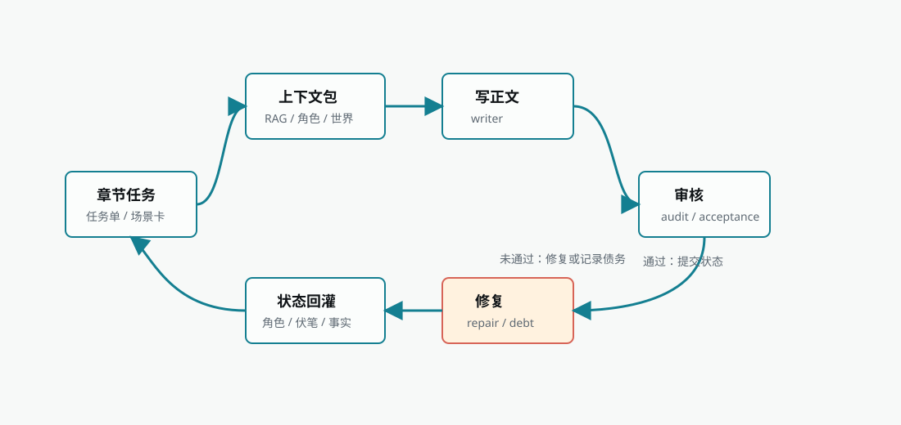

Biz Novel Studio 的章节执行不是"给模型一个标题让它写"。它是一套从任务单到正文、再到审核修复和状态回灌的闭环链路。理解这套链路，可以帮助你在遇到质量问题时定位真正出问题的环节，而不是盲目点击重新生成。

<Frame caption="章节执行环路">
  
</Frame>

## 章节任务单是什么

章节任务单是正文生成的合同，不是简单标题。它来自自动导演的「章节细化」阶段，通常包含：

| 内容 | 作用 |
| --- | --- |
| 章节目标 | 说明本章必须推进什么 |
| 承接上一章 | 防止开头脱离已有事实 |
| 铺向下一章 | 让本章结尾服务后续节奏 |
| 场景卡 | 指定地点、冲突、角色行动和场景顺序 |
| 出场角色 | 限定本章人物、关系和可用资源 |
| 必须兑现/铺垫 | 管理读者承诺和伏笔账本 |
| 禁忌与硬约束 | 防止违背书契约、世界规则和角色状态 |

如果任务单缺失或过于空泛，正文生成质量通常不会稳定。此时优先回到章节细化，而不是在正文输入框里临时补一句"写得更好"。

## 执行入口

章节执行通常从两个入口进入：

| 入口 | 触发条件 | 说明 |
| --- | --- | --- |
| 自动导演「章节批次就绪」 | 节奏板、章节清单、章节细化完成 | 用户确认或 auto-approval 后进入章节执行 |
| 手动章节执行 | 用户在章节页发起 | 适合单章重跑、测试模型或处理局部章节 |

执行前必须有章节任务。任务来自「章节细化」，包含章节目标、承接关系、场景卡、角色、冲突和禁忌。

## 上下文组装：给模型准备什么资料

正文生成前，系统会把多种资料聚合成一个上下文包。这个包决定了模型知道什么、不知道什么，直接影响正文质量。

<Steps>
  <Step title="本书事实与规划">
    书契约、宏观故事、卷窗口、事实账本、伏笔账本。这些是最高优先级，不能被外部资料覆盖。
  </Step>
  <Step title="角色与世界状态">
    当前角色目标、位置、关系、能力、可用资源；本章相关世界规则、地点和势力边界。
  </Step>
  <Step title="写法资产与反 AI 规则">
    绑定的写法档案、风格规则、反模板表达约束。控制正文怎么写，不写什么。
  </Step>
  <Step title="RAG 召回资料">
    根据章节任务构造查询，从知识库召回最相关的资料片段。
  </Step>
</Steps>

### 为什么章节不能只靠提示词

长篇小说的后续章节依赖已发生事实、角色资源、读者承诺和世界约束。章节执行链会把这些内容组装成上下文包，避免每章都只靠临时输入。如果没有这个包，模型很容易忘记前面埋下的伏笔、角色刚获得的能力，或者世界规则的限制。

## 正文生成与审核

<Frame caption="章节编辑器界面，左侧显示章节信息，中间为正文编辑区，右侧为 AI 修改与续写面板">
  
</Frame>

上下文包准备完成后，系统进入正文生成。生成完成后立即进入审核，判断正文是否满足章节任务。

| 步骤 | 输入 | 产物 | 失败后如何处理 |
| --- | --- | --- | --- |
| 上下文组装 | 章节任务、书契约、角色、世界、RAG、写法、事实账本 | 上下文包 | 缺关键资产时回到导演跟进或小说页补资料 |
| 正文生成 | 上下文包、模型路由、章节目标 | 正文草稿 | 空正文会重试一次；连续失败看模型和任务输入 |
| 审核 | 草稿、章节任务、上下文包 | 审核报告、待处理问题、通过状态 | 接收判断不可用时可记录质量债务 |

### 质量判断分层

审核结果分为多个层级，不同层级对全局链路的影响不同：

| 判断结果 | 含义 | 对全局链路的影响 |
| --- | --- | --- |
| accepted | 正文满足当前任务 | 可以继续下一章 |
| continue_with_warning | 有问题但正文可用 | 记录质量债务，继续后续章节 |
| local_patch_plan | 可局部修复 | 尝试修复，修复后继续或记录债务 |
| patchable_obligation_gap | 局部承诺缺口可补 | 低风险修复或记录债务 |
| defer_and_continue | 问题可后续处理 | 明确记录债务并继续 |
| replan_required | 后续结构需要调整 | 进入检查点，由用户确认 |
| stop_for_replan | 必须停下重规划 | 停止全局链，回到规划入口 |

<Info>
  局部质量债务不等于全局失败。只要章节有可用正文，且系统没有明确要求重规划，应优先保存正文、记录债务并允许后续章节继续。这样才能避免一本书因为单章小问题反复卡死。
</Info>

## 修复与质量债务

审核发现的问题会进入修复链路。修复不是无限循环，当前链路会限制重试次数并记录质量债务。

| 情况 | 推荐处理 |
| --- | --- |
| 轻微逻辑或节奏问题 | 允许轻修复或记录质量债务 |
| 修复后可读但仍有局部问题 | 记录质量债务并继续后续章节 |
| 正文不可用或空正文 | 重试生成，必要时换模型 |
| 章节目标与大纲冲突 | 回到章节任务或节奏板重新规划 |
| 修复要求会改变后续结构 | 进入「等待重新规划」，由用户确认 |

### 质量债务是什么

质量债务表示章节有可见问题，但不一定需要停止整本书。典型例子：

- 局部节奏不够强
- 个别伏笔提示不足
- 某段人物语气需要后续再修
- 修复器无法稳定锚定某个段落

质量债务会被记录、展示和后续跟进，而不是默认阻断全局自动导演。只有明确重规划、不可恢复生成失败、数据风险或安全风险才应停止全局链。

## 状态回灌：让下一章基于最新事实

章节执行完成后，系统会把新状态回灌到小说资产中。这是长篇能连续写下去的核心机制。

| 回灌对象 | 内容 | 影响 |
| --- | --- | --- |
| 角色状态 | 位置、目标、关系、能力、资源变化 | 后续章节的角色行为边界 |
| 事实账本 | 已发生事件、不可逆结果 | 防止后续重复或违背事实 |
| 伏笔/承诺 | 新铺垫、兑现、延期、风险 | 帮助后续章节管理读者期待 |
| 世界状态 | 地点、规则、势力变化 | 影响场景和冲突合理性 |
| 审核问题 | 待处理问题、质量债务 | 进入后续修复和任务提示 |

### 回灌失败时怎么判断

| 现象 | 可能含义 | 推荐动作 |
| --- | --- | --- |
| 正文已保存，但角色状态没更新 | 角色资源同步失败 | 重试角色资源同步，不重写正文 |
| 伏笔账本未刷新 | payoff ledger 同步失败 | 重试账本同步，保留正文 |
| 章节状态仍显示运行中 | 后台任务状态未收尾 | 看任务中心是否 stale 或 failed |
| 下一章上下文没带上上一章事实 | 状态提交未完成 | 先修复状态提交，再执行下一章 |
| 审核报告缺失 | 审核服务失败或中断 | 可保留正文，后续重新审校 |

章节正文生成和状态回灌是两个不同问题。正文已经可用时，优先修复回灌链路。直接重写可能制造新的事实分叉。

## RAG 与知识库如何参与章节执行

章节执行会在上下文组装时召回知识库、拆书、写法和本书资产。RAG 资料只是上下文的一部分，不应该覆盖章节任务单。

### 资料来源分层

| 层级 | 示例 | 使用原则 |
| --- | --- | --- |
| 本书事实 | 已写章节、事实账本、角色状态、世界状态 | 最高优先级，不能被外部资料覆盖 |
| 本书规划 | 书契约、宏观故事、卷战略、章节任务 | 指导下一步写作目标 |
| 用户资料 | 上传知识库、世界样本、专门设定文档 | 用于补充事实和设定 |
| 拆书结论 | 参考作品结构、卖点、人物和写法分析 | 迁移方法，不复制情节 |
| 写法资产 | 风格规则、反 AI 规则、样本文本特征 | 控制表达方式 |
| 临时对话 | 创作中枢当前轮输入 | 只能影响当前任务，长期生效需落库 |

### 章节 RAG 查询如何构造

系统不是用章节标题直接搜资料。它会根据章节任务组装查询，包含小说标题、章节标题、章节目标、章节期待、本章必须推进内容、目标冲突、出场角色和结构化大纲。查询越贴近本章目标，召回越容易命中真正有用的资料。

### 检索方式

| 检索方式 | 适合内容 | 常见问题 |
| --- | --- | --- |
| 向量检索 | 语义相近但用词不同的资料、长文档、拆书结论 | 文档未索引或向量库不可用时无法命中 |
| 文本检索 | 人名、地名、专有名词、固定术语 | 用户没有写清关键词时可能漏掉 |
| 混合召回 | 同时需要语义和关键词 | 需要合理的文档标题、分块和元数据 |

<Warning>
  召回不是越多越好。把无关资料塞进上下文会增加模型噪音。对长篇小说来说，准确命中当前章节任务，比一次召回大量资料更重要。
</Warning>

### 冲突时的优先级

| 冲突场景 | 优先级 |
| --- | --- |
| RAG 资料和已写章节冲突 | 已写章节和事实账本优先 |
| 写法规则和章节任务冲突 | 章节任务优先，写法规则调整表达方式 |
| 拆书结论和本书角色冲突 | 本书角色状态优先 |
| 世界样本和本书世界冲突 | 本书世界优先 |
| 用户当前明确指令和旧资料冲突 | 当前指令可触发修订，但需要落库后才长期生效 |

RAG 的目标是让系统知道更多，而不是让外部资料拥有最高决策权。

## 批量执行如何推进

<Frame caption="小说工作台的章节执行页面，左侧章节队列，中间正文区，右侧动态栏与 AI 执行台">
  
</Frame>

章节批次通常不是一次只写一章。批量执行会在每章之间保存状态，并决定是否继续下一章。

| 批量节点 | 系统动作 | 用户可能看到 |
| --- | --- | --- |
| 批次开始 | 读取「章节批次就绪」的章节范围 | 章节任务进入排队或运行 |
| 单章生成 | 组装上下文、生成正文、审核修复 | 当前章节状态变化 |
| 单章收尾 | 保存正文、回灌事实、角色、伏笔和质量信息 | 章节完成或带 warning 完成 |
| 下一章准备 | 读取上一章回灌状态 | 下一章上下文更新 |
| 批次暂停 | 遇到检查点、失败或需要人工处理 | 导演跟进或章节来源页面出现操作入口 |
| 批次完成 | 所有目标章节处理结束 | 可以继续下一批或查看质量债务 |

如果 auto-approval 没有授权，批次可能在某些节点停下等待确认。这是为了让用户看见风险，而不是后台"没反应"。

## 本书问题处理规则

每本书可以继承全局规则，也可以在本书中选择一套问题处理方案：

| 方案 | 自动处理机会 | 局部问题处理后仍未解决 |
| --- | --- | --- |
| 优先完成整本书 | 最多 1 次 | 保留可用正文、记录质量债并继续 |
| 质量优先 | 最多 1 次 | 停在已保存的章节边界，等待明确恢复 |

逐项规则还可以选择自动重试、提醒后继续、暂停处理或结束任务。保存失败、数据完整性风险、受保护内容和其他运行安全问题仍会优先保护作品。

<Warning>
  人工暂停不会被后台自动清除。当"质量优先"明确要求暂停处理时，任务会保留待人工恢复状态。后台轮询、服务重启和 worker 恢复不能替用户确认；只有明确执行恢复动作后，章节链才会继续。
</Warning>

## 失败模式与恢复

| 失败模式 | 表现 | 先看哪里 | 推荐恢复 |
| --- | --- | --- | --- |
| 上下文组装失败 | 章节执行前报错 | 运行记录错误、小说资产、章节页 | 补角色/世界/章节任务后回章节页重试 |
| 空正文 | 模型返回空内容 | 运行记录、模型路由、章节页 | 系统会重试一次；连续失败换模型后回章节页处理 |
| 审核不可用 | acceptance gate unavailable | 章节页、任务中心 | 保留正文，后续重新审校 |
| 修复失败 | repair ticket 失败 | 任务中心、章节页 | 尝试重修；若已有可用正文，记录质量债务 |
| 重规划风险 | 「等待重新规划」 | 导演跟进 | 人工确认重规划或接受风险继续 |
| 状态同步失败 | 正文有了但状态未回灌 | 运行记录、章节页 | 回章节页重试同步，不优先重写正文 |
| 模型余额或配额不足 | 执行详情显示模型返回的余额、配额或限流错误 | 当前执行页、运行记录、模型设置 | 补充额度或换模型，再回当前执行页从首个未完成章节恢复 |

## 人工介入入口

| 用户想做什么 | 推荐入口 | 原因 |
| --- | --- | --- |
| 看正文是否保存 | 章节页 | 正文事实以章节页为准 |
| 看后台为什么停 | 任务中心 | 失败、stale、queued、running 都在这里 |
| 批准继续或重规划 | 导演跟进 | 检查点的下一步入口在这里 |
| 调整章节目标 | 章节任务/章节规划 | 正文生成读取的是任务单 |
| 修改角色状态 | 角色页 | 后续章节读取正式角色资产 |
| 检查资料是否命中 | 知识库召回测试 | 判断 RAG 是否真的能命中 |
| 调整写法 | 写法引擎 | 语言风格应从写法资产进入上下文 |

不要把所有问题都丢给正文重写。正文重写适合正文不可用；任务、资产、召回和同步问题应该回到对应入口。

## 常见问题

<AccordionGroup>
  <Accordion title="为什么章节不能只给一个标题就让模型写？">
    长篇小说后续章节依赖已发生事实、角色资源、读者承诺和世界约束。没有任务单和上下文包，模型容易忘记前面的设定、违背角色状态或遗漏伏笔。章节任务单提供了明确的推进目标、场景卡和约束边界，是正文质量的合同。
  </Accordion>

  <Accordion title="质量债务会影响后续章节吗？">
    不会直接阻断。质量债务被记录后会继续推进后续章节，但债务内容会在后续审核和规划中被参考。如果债务涉及结构性问题，可能在后续触发重规划建议。
  </Accordion>

  <Accordion title="RAG 召回的资料会不会覆盖本书已写内容？">
    不会。本书事实和事实账本是最高优先级。RAG 资料用于补充设定和参考，不能推翻已经写入小说状态的内容。如果召回资料和本书事实冲突，系统会优先遵守本书事实。
  </Accordion>

  <Accordion title="状态同步失败时，下一章会基于旧状态写吗？">
    如果状态未回灌，下一章的上下文可能缺少本章最新事实。此时应先修复同步，再执行下一章，避免事实分叉。正文已经可用时不需要重写，只需补同步。
  </Accordion>

  <Accordion title="单章修复次数有限制吗？">
    有限制。当前链路会限制修复重试次数，避免无限循环。如果低风险修复无法解决，会记录质量债务并继续；如果涉及结构性问题，会进入检查点等待用户确认。
  </Accordion>

  <Accordion title="可以手动修改正文后再让系统继续吗？">
    可以。你可以在章节页手动修改正文。修改后的内容会成为后续章节的事实来源，但系统不会自动反向同步到角色状态或伏笔账本。如果修改涉及重要事实变化，建议同步检查相关资产。
  </Accordion>
</AccordionGroup>

<CardGroup cols={3}>
  <Card title="知识库与 RAG" icon="database" href="/features/knowledge-base">
    了解资料如何入库、召回和参与上下文组装
  </Card>

  <Card title="创作生产链原理" icon="diagram-project" href="/guides/production-pipeline">
    从灵感层到章节执行层的完整三层链路
  </Card>

  <Card title="自动导演" icon="wand-magic-sparkles" href="/features/auto-director">
    了解导演阶段、运行模式和检查点机制
  </Card>
</CardGroup>
