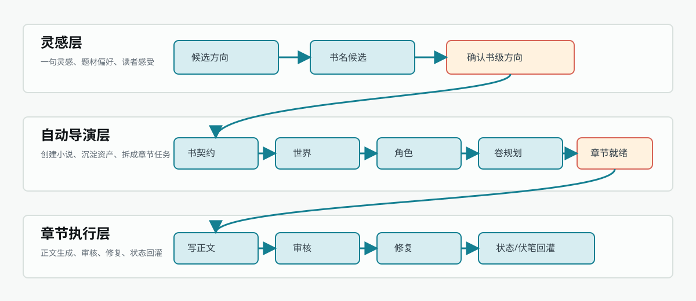
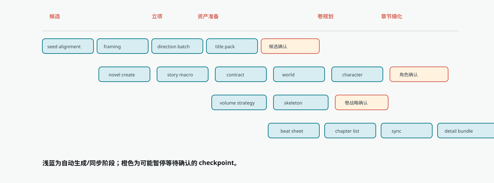
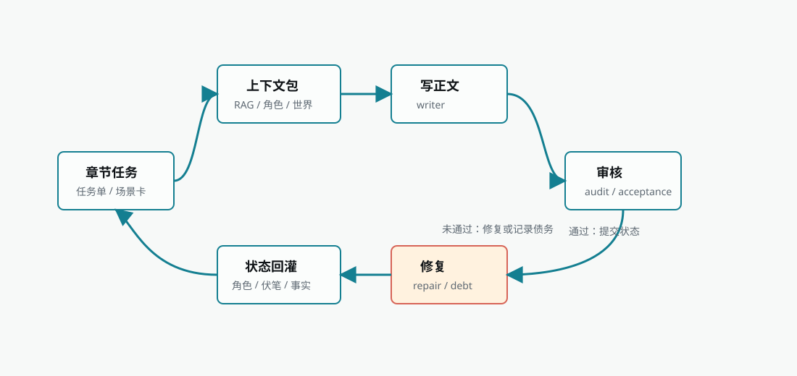

Biz Novel Studio 把「从一句灵感到完整章节」拆成三层协作的生产链。每层只负责一件事，层与层之间通过明确的产物和检查点移交。这种设计让长篇创作可以分段确认、分段恢复，也避免了一章写完后下一章忘记前面设定的常见问题。

<Frame caption="端到端三层生产链">
  
</Frame>

## 三层分工

| 层级 | 目标 | 输入 | 主要产物 | 常见查看入口 |
| --- | --- | --- | --- | --- |
| 灵感层 | 把模糊想法整理成可选择的书级方向 | 一句话灵感、题材偏好、读者感受、模型设置 | 候选方向、书名候选、开书定位 | 新手上路、创作中枢、自动导演方向选择 |
| 自动导演层 | 把书级方向转成可执行的小说资产 | 已确认候选、运行模式、auto-approval 配置 | 小说项目、书契约、宏观故事、世界、角色阵容、卷战略、节奏板、章节清单、章节任务单 | 导演跟进、小说页、任务中心 |
| 章节执行层 | 根据章节任务生成正文并回灌状态 | 章节任务、上下文包、知识库召回、写法资产、角色状态 | 正文草稿、审核报告、修复结果、质量债务、角色/事实/伏笔回灌 | 章节页、任务中心、导演跟进 |

## 为什么分三层

三层之间的边界不是随意划分的。每层只做自己该做的事，不越界，才能保证长篇创作的可控性。

| 边界 | 可以做什么 | 不应该做什么 |
| --- | --- | --- |
| 灵感层到自动导演层 | 通过候选确认创建小说项目 | 把聊天里的"我喜欢这个"当成已落库小说资产 |
| 自动导演层到章节执行层 | 通过「章节批次就绪」移交章节任务 | 没有章节任务单就直接让模型写正文 |
| 章节执行层到后续规划 | 通过状态回灌影响下一章和必要时重规划 | 每章都靠用户手动复述上一章事实 |

如果某个信息需要长期影响后续章节，它必须跨过边界落到资产或任务记录里。只存在于对话上下文的内容，不能保证后续自动导演和章节执行稳定读取。

## 灵感层：从模糊想法到可选方向

灵感层解决"这本书到底写什么"。它不会直接写章节，而是把用户灵感整理成多个可选方向，避免新手一开始就被要求手动写世界观、角色和大纲。

<Steps>
  <Step title="灵感对齐">
    系统理解输入灵感、题材、读者感受和默认参数，整理成候选生成输入。
  </Step>
  <Step title="立项定位">
    系统形成书级定位、卖点和目标读者判断。
  </Step>
  <Step title="方向候选批次">
    页面出现一批可选开书方向，每套方向包含题材、核心卖点、主角起点和推进方式。
  </Step>
  <Step title="书名候选组">
    选中方向后出现标题组和推荐标题，不满意可以只重做标题。
  </Step>
</Steps>

这个阶段的核心检查点是「等待方向选择」。你可以选择方向、生成下一批、整批修订、单项修订或只重做标题。只有候选被确认后，系统才进入建书。

<Tip>
  没有明确灵感时，可以直接从灵感卡开始。灵感卡只负责给候选生成提供 seed，不要求先写完整大纲。
</Tip>

## 自动导演层：从方向到可执行资产

确认方向后，自动导演层把"我想写什么"变成"后续每章都能读取的资料"。这一层包含从创建小说到拆成章节任务单的完整规划链。

<Frame caption="自动导演阶段甘特图">
  
</Frame>

### 资产准备阶段

| 阶段 | 解决的问题 | 可查看/修订入口 |
| --- | --- | --- |
| 故事宏观 | 整本书长期冲突、推进循环、主线结构 | 小说规划、故事宏观 |
| 书契约 | 目标读者、卖点、前 30 章承诺、硬约束 | 小说基础信息、书级默认写法 |
| 世界搭建 | 本书世界规则、地点、势力、舞台边界 | 世界资产、小说资料 |
| 角色生成 | 生成角色候选和阵容草案 | 角色候选、导演跟进 |
| 应用角色阵容 | 把通过的角色阵容写入正式资产 | 角色页、角色关系 |

角色阶段是重要质量闸口。如果角色名仍像"导师型女主""反派老板"这类功能位，或缺少身份锚点，系统会停在「等待角色确认」，而不是把低质量阵容带进卷规划。

### 卷规划阶段

卷规划阶段解决"整本书怎么分卷推进"。它不直接写章节正文，而是先确定每卷读者承诺、主要冲突、阶段目标和结构承载。

| 阶段 | 产物 | 风险点 |
| --- | --- | --- |
| 卷战略 | 分卷策略、卷级目标、推进路线 | 卷目标过散会导致后续章节缺主线 |
| 卷骨架 | 卷列表、每卷任务、关键承诺 | 卷骨架错误会放大到节奏板和章节清单 |

如果卷战略不对，优先在卷规划入口处理，不要只改章节标题。章节标题是下游结果，无法修正上游卷使命。

### 章节细化阶段

章节细化阶段把卷规划拆成可以执行的章节任务。它是自动导演和正文执行之间的移交层。

| 阶段 | 产物 | 进入下一步的条件 |
| --- | --- | --- |
| 节奏板 | 节奏节点、章节跨度、冲突推进 | 节奏覆盖目标章节范围 |
| 章节清单 | 章节标题、顺序、基础目标 | 章节数量和卷目标一致 |
| 章节同步 | 章节执行合同同步到章节记录 | 章节数据可被章节页读取 |
| 章节细化 | 章节任务单、场景卡、目标和执行资源 | 「章节批次就绪」检查点 |

## 章节执行层：从任务单到正文与状态回灌

章节执行层负责把已经准备好的章节任务变成正文，并把正文产生的新状态回灌到后续章节。它不是"写一章"这么简单，而是正文生成、审核、修复、质量债务和状态同步组成的闭环。

<Frame caption="章节执行环路">
  
</Frame>

执行步骤如下：

<Steps>
  <Step title="上下文组装">
    聚合书契约、角色状态、世界规则、事实账本、伏笔账本、写法资产和 RAG 召回资料，组成上下文包。
  </Step>
  <Step title="正文生成">
    根据上下文包和章节任务单生成正文草稿。
  </Step>
  <Step title="审核">
    判断正文是否满足章节任务、连续性、人物行为、节奏和写法要求。
  </Step>
  <Step title="修复">
    低风险问题自动修复；结构性问题进入检查点等待确认。
  </Step>
  <Step title="状态回灌">
    保存正文，同步角色状态、事实账本、伏笔账本和世界变化。
  </Step>
</Steps>

状态回灌是长篇连续创作的关键。每次章节保存后，系统会整理本章发生的事实变化，写回本书的角色状态、资源台账和伏笔计划，使下一章的上下文基于最新的故事事实。这种状态回流保证了角色关系、能力和目标的变化会被后续章节继承，新埋下的伏笔会在后续规划中被标记为待回收。

## 生产模式：确认方案后自动跑到哪里

启动自动导演时必须选择运行模式。模式决定确认方案后系统会自动推进到哪个结果。

| 模式 | 中文名 | 跑到哪里停 | 适合谁 |
| --- | --- | --- | --- |
| 先准备到可开写（推荐） | 自动到就绪 | 自动完成小说创建、书契约、角色、卷规划、节奏板和章节任务，停在可开写状态 | 第一次开书、想先看规划 |
| 全书自动成书 | 全书自动驾驶 | 持续推进规划、写作、审核和修复，直到完成目标章节或命中中断条件 | 想让系统从方案直接跑到小说产出 |
| 按范围执行 | 范围自动执行 | 只自动执行指定范围，例如前 N 章或第 1 卷 | 想先验证一段 |
| 正文后去 AI 检测与修正 | 质量修复开关 | 每章正文完成后进入检测、审核和可修复问题处理 | 想要更完整的自动闭环 |

新手如果不确定，优先选"先准备到可开写"。如果目标是从确认方案直接得到章节正文，选择"全书自动成书"，并保持模型、额度和网络稳定。

## 最短无人值守路径

从用户角度，最短无人值守路径是：

<Steps>
  <Step title="输入起始想法">
    没有想法时选择系统给出的灵感卡。
  </Step>
  <Step title="选择运行模式">
    保留默认参数，选择"全书自动成书"或"先准备到可开写"。
  </Step>
  <Step title="生成第一批方案">
    点击"生成第一批方案"。
  </Step>
  <Step title="确认书级方案">
    在"确认书级方案"页选择一套方案；标题不满意可以只重做标题组。
  </Step>
  <Step title="系统自动推进">
    确认后系统创建小说并进入 AI 驾驶舱，自动跑完规划、角色、卷战略、节奏拆章、章节执行、质量修复和状态回灌。
  </Step>
</Steps>

确认方案之后，用户主要是观察和处理异常，不再需要手动依次生成故事宏观、角色、卷战略、节奏板和章节正文。

## 关键观测点

从空项目到章节批次完成，最应该观察这些节点：

| 观测点 | 表示什么 | 看到异常时 |
| --- | --- | --- |
| 候选方向出现 | 灵感已经转成可选书级方案 | 回到方向选择页修订或生成下一批 |
| 小说出现在列表中 | 「创建小说」已完成 | 如果后续没动，看任务中心是否继续运行 |
| 书契约可查看 | 书级目标已经落库 | 不满意时先改书契约，再继续后续阶段 |
| 角色候选暂停 | 系统认为角色需要确认 | 不要跳过，先确认身份锚点和阵容质量 |
| 卷战略就绪 | 整本推进路线已形成 | 卷目标不准时先改卷战略 |
| 章节列表出现 | 节奏板已转成章节清单 | 数量或顺序不对时回到节奏板 |
| 章节任务单完成 | 章节执行已有输入 | 可以进入正文生成 |
| 正文与回灌完成 | 章节闭环结束 | 下一章可以读取新事实和角色状态 |

这些观测点比"进度条百分比"更重要。长链路的关键不是跑到 100%，而是每个移交点是否真的保存了可用产物。

## 状态持久化与恢复

自动导演不是只在内存里跑一串调用。关键状态会保存到数据库和任务记录里，支持刷新页面、服务重启或 worker 中断后的恢复。

| 状态 | 保存内容 | 作用 |
| --- | --- | --- |
| 导演运行命令 | 命令类型、任务、租约、状态、payload、错误 | 支持排队、worker 执行、重试和 stale 恢复 |
| 小说工作流任务 | 当前阶段、当前 item、检查点、进度、错误 | 让任务中心和导演跟进显示同一事实状态 |
| 导演运行时快照 | 已完成步骤、产物、策略、事件 | 支持恢复、接管、运行时投影和跟进 |
| 小说资产表 | 书契约、宏观故事、世界、角色、卷、章节任务 | 让后续章节和 UI 可以读取、修改、继续 |
| 章节运行时包 | 写作上下文、审核结果、修复依据、质量信息 | 支持章节修复、质量债务和状态回灌 |

<Info>
  前端状态不是最终事实。如果页面显示和任务中心不一致，优先相信任务中心和导演跟进里的后台任务状态。页面刷新、路由参数丢失或通知延迟，不代表后台任务已经停止。
</Info>

## 资产闭环：为什么长篇能连续写下去

端到端生产链的目标不是一次生成一章，而是让每章结果继续服务后续生产。

| 回灌资产 | 来源 | 后续用途 |
| --- | --- | --- |
| 新事实 | 章节正文、状态提交 | 防止后续章节违背已发生事件 |
| 角色变化 | 正文、角色资源同步 | 约束角色位置、能力、关系和可用资源 |
| 世界变化 | 正文、世界状态同步 | 影响地点、势力和规则 |
| 伏笔状态 | 审核、payoff ledger | 管理铺垫、兑现、延期和风险 |
| 质量债务 | 审核、修复 | 给后续修订和重规划提供依据 |

资产闭环也是 RAG 和写法资产的基础。知识库提供外部资料，章节执行产生本书内部事实，两者一起进入下一章上下文。

## 常见问题

<AccordionGroup>
  <Accordion title="为什么三层之间要有明确的检查点？">
    检查点是"可以暂停给用户确认"的边界，不是失败。它让用户在方向、角色、卷规划、章节批次或质量修复前决定继续、调整、重试或重新规划。没有检查点，系统可能在用户不知情的情况下把低质量产物带进下游。
  </Accordion>

  <Accordion title="选择全书自动成书后为什么还会停下来？">
    "全书自动成书"遇到模型不可用、配额耗尽、质量审核要求重新规划、修复链路连续失败或检测到结构性数据问题时，会主动停下等用户处理，而不是无限重试。中断后状态会被保存到导演跟进，可以在排除问题后从原检查点恢复。
  </Accordion>

  <Accordion title="修改上游产物会影响下游吗？">
    会。改书契约可能需要重跑卷规划；改角色阵容可能需要重跑节奏板；只改章节正文通常不需要重跑候选方向。修改前可以先评估影响范围，避免不必要的重复消耗。
  </Accordion>

  <Accordion title="页面停在某个模块，是不是系统卡住了？">
    不一定。AI 驾驶舱顶部的状态条和左侧步骤才是自动导演事实状态。页面停在"角色准备"但顶部显示正在生成卷战略，说明后台已经越过角色阶段，页面只是当前查看模块。
  </Accordion>

  <Accordion title="状态同步失败需要重写正文吗？">
    不需要。正文已经可用时，优先修复回灌链路。重写正文可能制造新的事实分叉。角色状态没更新就重试角色资源同步，伏笔账本没刷新就重试账本同步。
  </Accordion>

  <Accordion title="局部质量债务必须重规划整本书吗？">
    不需要。可用正文加局部问题应记录债务并继续，除非明确要求"等待重新规划"。不是所有问题都应该升级成全局中断。
  </Accordion>
</AccordionGroup>

<CardGroup cols={3}>
  <Card title="自动导演" icon="wand-magic-sparkles" href="/features/auto-director">
    了解导演版本、运行模式和阶段详解
  </Card>

  <Card title="章节执行原理" icon="arrows-spin" href="/guides/chapter-execution">
    深入正文生成、审核、修复和状态回灌的闭环机制
  </Card>

  <Card title="创作流程总览" icon="diagram-project" href="/creation-flow">
    四种创作入口和完整链路总图
  </Card>
</CardGroup>
