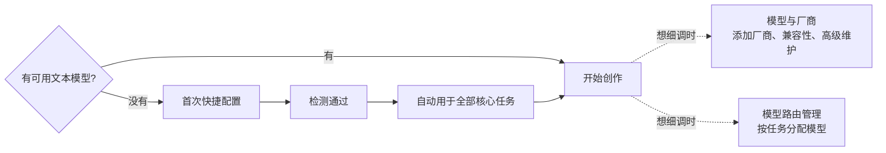
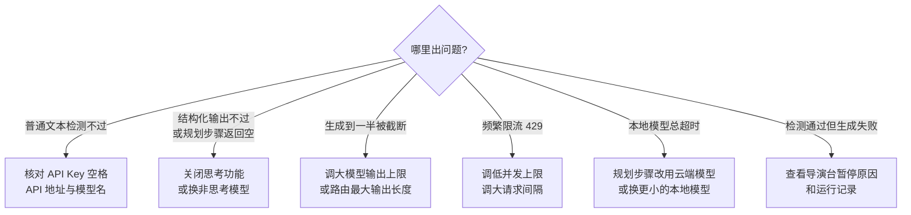

写作开始前，必须先配好至少一个可用的文本模型。工作台不内置模型额度，使用你自己的 API 配置。

模型相关的设置分布在以下几个位置：

| 入口 | 在哪里打开 | 用来做什么 |
| --- | --- | --- |
| [首次快捷配置](#首次快捷配置) | 没有可用文本模型时自动弹出 | 三步跑通一个模型，自动用于全部核心任务。新手只需要这一步 |
| [模型与厂商](#模型与厂商页面) | **系统设置 → 模型与厂商**，或顶栏的 **模型设置** 按钮（以弹窗打开同一套设置） | 添加、编辑、测试厂商；模型兼容性；思考功能、请求限制、余额等高级维护 |
| [模型路由管理](#模型路由管理) | **系统设置 → 模型路由管理** | 为 11 类创作任务分别指定模型、温度、输出长度和协议，并批量检测 |
| 顶栏模型选择器 | 顶栏右侧的厂商、模型下拉框和 **温度** | 当前默认选择，会被保存下来，开书等没有单独指定模型的场景会使用它 |

## 首次快捷配置

网页端和桌面端在没有可用文本模型时都会打开快捷配置。你可以先关掉弹窗浏览已有内容，但启动自动导演、章节生成或其他 AI 创作前需要完成配置。

<Steps>
  <Step title="选择厂商">
    选择已有账号的内置厂商。推荐 **DeepSeek Flash**，兼顾中文长篇质量与响应速度；想用本机模型可以选本地厂商，不需要 API Key。

    使用中转服务或其他 OpenAI 兼容接口时，点 **添加第三方厂商**。
  </Step>
  <Step title="连接模型">
    填写 API Key 和 API 地址，再从列表选择模型，或直接填写模型名称。
  </Step>
  <Step title="检测">
    系统分别检测 **普通文本** 和 **结构化输出** 两项能力。通过后，所选模型会用于规划、正文、审核、修复、重规划和摘要等核心任务，不需要逐项配置路由。

    检测失败时你填的内容会保留，页面会分别说明是哪一项没通过，改好后直接重试。
  </Step>
</Steps>

图像模型、知识库、写法引擎、并发限制和精细模型路由都是可选增强，可以以后再配。

## 模型与厂商页面

打开 **系统设置 → 模型与厂商**。页面从上到下包含三块：

- **模型厂商**：所有已添加厂商的卡片，以及 **添加厂商** 按钮。标题旁的徽标显示当前有几个可用连接。
- **单次生成最长等待**：见 [其他模型相关设置](#其他模型相关设置)。
- **AI 提示词与回答历史**：见 [其他模型相关设置](#其他模型相关设置)。

<Frame caption="模型与厂商页面：每个已添加的厂商一张卡片，右上角是添加厂商按钮">
  
</Frame>

只有已配置并启用的厂商才会显示为卡片。还没有任何厂商时，页面显示「还没有可用的模型连接」。

## 添加厂商

点右上角 **添加厂商**，弹出「添加模型厂商」窗口。窗口里有两类选项：

- **内置厂商模板**：列出还没添加的内置厂商，每个模板会显示推荐模型。
- **自定义厂商**：连接任意 OpenAI 兼容服务，例如中转站、模型网关、LM Studio 等。

内置厂商全部添加后，窗口会提示「所有内置厂商都已添加」，此时仍然可以添加自定义厂商。

### 添加内置厂商

<Steps>
  <Step title="选择模板">
    在「添加模型厂商」窗口中点选要用的内置厂商，打开「配置模型厂商」窗口。
  </Step>
  <Step title="填写 API Key">
    粘贴在厂商控制台申请的 API Key。Ollama 是本地服务，不需要 Key。
  </Step>
  <Step title="确认 API 地址">
    一般留空即可，留空会使用下表中的默认地址。只有走代理或厂商给了专属地址时才需要改。
  </Step>
  <Step title="选择模型">
    在 **模型名称** 中选择或手动输入模型名。不确定时使用模板推荐的模型。
  </Step>
  <Step title="测试并保存">
    点 **测试连接** 确认普通连通和结构化输出都正常，再点 **保存**。
  </Step>
</Steps>

### 内置厂商一览

| 厂商 | 默认 API 地址 | 推荐模型 | 需要 API Key |
| --- | --- | --- | --- |
| DeepSeek | `https://api.deepseek.com/v1` | `deepseek-flash` | 是 |
| SiliconFlow（硅基流动） | `https://api.siliconflow.cn/v1` | `Qwen/Qwen2.5-7B-Instruct` | 是 |
| OpenAI | `https://api.openai.com/v1` | `gpt-5` | 是 |
| Anthropic | `https://api.anthropic.com/v1` | `claude-3-5-sonnet-20241022` | 是 |
| Grok | `https://api.x.ai/v1` | `grok-4` | 是 |
| Kimi | `https://api.moonshot.cn/v1` | `moonshot-v1-32k` | 是 |
| MiniMax | `https://api.minimax.io/v1` | `MiniMax-M2.7` | 是 |
| GLM（智谱） | `https://open.bigmodel.cn/api/paas/v4` | `glm-4.5-air` | 是 |
| Qwen（通义千问） | `https://dashscope.aliyuncs.com/compatible-mode/v1` | `qwen-plus` | 是 |
| Gemini | `https://generativelanguage.googleapis.com/v1beta/openai` | `gemini-2.5-flash` | 是 |
| Ollama（本地） | `http://127.0.0.1:11434/v1` | `llama3.2` | 否 |

<Tip>
  DeepSeek 推荐使用 Flash 模型，速度和中文长篇质量比较均衡。
</Tip>

### 添加自定义厂商（OpenAI 兼容）

中转服务、自建网关、LM Studio 或任何兼容 OpenAI 接口格式的服务，都通过自定义厂商接入。快捷配置里的 **添加第三方厂商** 也是同一功能。

<Steps>
  <Step title="选择「自定义厂商」">
    在「添加模型厂商」窗口中点 **自定义厂商**，打开「新增自定义厂商」窗口。
  </Step>
  <Step title="填写厂商名称">
    起一个便于识别的名字，例如「我的模型网关」。名称必填，之后在路由里按这个名字选择。
  </Step>
  <Step title="填写 API Key 与鉴权方式">
    API Key 可以留空（例如本地服务）。**鉴权方式** 决定 Key 放在哪个请求头里：

    - **Authorization: Bearer**：绝大多数 OpenAI 兼容服务用这个
    - **x-api-key**：服务商要求用 `x-api-key` 头时选择
    - **无需鉴权**：本地或内网服务
  </Step>
  <Step title="填写 API 地址">
    填 OpenAI 兼容的 API 地址，通常以 `/v1` 结尾，例如 `https://你的中转域名/v1`。新建时 API 地址必填。
  </Step>
  <Step title="获取模型列表并选择默认模型">
    点 **获取模型列表**，系统会从服务读取可用模型并自动选中第一个。可以在 **可用模型** 里搜索切换，也可以直接手动输入模型名。新建时默认模型可以不填，系统会自动选择一个。
  </Step>
  <Step title="测试并创建">
    点 **测试连接**，通过后点 **创建厂商**。
  </Step>
</Steps>

自定义厂商会保存为独立的一条连接，单独保存 API Key、API 地址和模型，不会覆盖 DeepSeek、OpenAI 等内置厂商的配置。需要同时保留多套连接时，分别创建厂商，再在模型路由中选择。

### 三种常见接法

| 接法 | 怎么添加 | API 地址填什么 | 说明 |
| --- | --- | --- | --- |
| 官方 API | 内置厂商模板 | 留空使用默认地址 | 如 DeepSeek、OpenAI 等官方平台，稳定、计费清晰 |
| 中转 / 兼容服务 | 自定义厂商 | 中转商提供的地址，通常以 `/v1` 结尾 | 只要兼容 OpenAI 接口格式即可；模型名按中转商给的名称填 |
| 本地模型 | Ollama 用内置模板；LM Studio 等用自定义厂商 | Ollama 默认 `http://127.0.0.1:11434/v1`；LM Studio 常见为 `http://localhost:1234/v1` | 先启动本地服务再测试；鉴权方式选「无需鉴权」 |

### 配置窗口字段说明

点内置厂商模板、卡片上的 **配置连接**，或自定义厂商的 **管理连接**，都会打开配置窗口。

| 字段 | 适用 | 说明 |
| --- | --- | --- |
| 厂商名称 | 自定义厂商 | 必填，用于在卡片和路由中识别 |
| API Key | 全部 | 密码形式输入。已保存过 Key 时留空表示沿用原来的 Key |
| 鉴权方式 | 自定义厂商 | Authorization: Bearer / x-api-key / 无需鉴权 |
| API 地址 | 全部 | 内置厂商留空使用默认地址；自定义厂商填 OpenAI 兼容地址 |
| 获取模型列表 | 新建自定义厂商 | 填好 API 地址后可用，读取服务端模型并自动选中第一个 |
| 可用模型 | 已获取到模型列表时 | 可搜索的下拉框，用来挑选模型 |
| 模型名称 / 默认模型 | 全部 | 该厂商默认使用的文本模型，可以手动输入 |
| 图像模型（可选） | 全部 | 填写后可用于角色形象图生成，调用厂商的 OpenAI 兼容图像接口。不填则卡片显示「不支持图像生成」 |
| 同模型并发上限 | 全部 | 同一模型同时进行的请求数，`0` 表示不限制，超出的请求排队等待 |
| 同模型请求间隔（毫秒） | 全部 | 同一模型两次请求之间的最小间隔，`0` 表示不限制 |

窗口底部按钮：**保存**（新建自定义厂商时为 **创建厂商**）、**测试连接**，自定义厂商另有 **删除**。

<Note>
  保存按钮灰色时，通常是缺了必填项：没有填模型、自定义厂商没有名称、新建时没有填 API 地址，或内置厂商需要 Key 但还没填写过。
</Note>

### 填写时的注意事项

- **API Key**：不要多复制空格；确认 Key 对应的供应商和 API 地址一致，账户有额度和模型权限。连接失败时，先在供应商控制台确认 Key 有效，再回到应用测试。
- **API 地址**：要和供应商文档一致。常见错误是多写或少写路径（例如漏了 `/v1`），或者填了网页地址而不是 API 地址。代理或网络限制也会让请求到不了。
- **模型名称**：从供应商文档或模型列表复制，不要自己猜。

## 测试连接

配置窗口和厂商卡片上都有 **测试连接**。测试需要先填好 API 地址和模型。测试会同时检查两项：

- **普通连通**：模型能否正常返回文本
- **结构化输出**：模型能否按要求返回结构化结果，以及系统会采用哪种输出策略

成功时会显示类似「连接成功，总耗时 1200ms · 普通连通正常 (500ms) · 结构化正常，策略 json_schema」的结果；如果系统为了拿到结构化结果自动关闭了思考，结果里会注明「已强制关闭 thinking」。失败时会显示失败分类和原始错误信息，按 [常见问题](#常见问题) 排查。

## 厂商卡片

每个已添加的厂商一张卡片，内容从上到下：

| 区域 | 说明 |
| --- | --- |
| 名称与状态 | 自定义厂商带「自定义」标记。右上角状态为 **可用**、**已配置** 或 **未配置**，「可用」表示可直接用于创作任务 |
| 文本模型 / 图像模型 | 当前使用的文本模型和图像模型 |
| 余额 | 支持余额查询的厂商显示余额，其他厂商显示暂未接入余额查询 |
| 配置连接 / 管理连接 | 打开配置窗口，修改 Key、地址、模型、图像模型和请求限制 |
| 测试连接 | 用当前保存的配置测试一次 |
| 模型兼容性 | 输出上限和兼容性探测，见 [模型兼容性](#模型兼容性) |
| 高级详情与维护 | 折叠区，见 [高级详情与维护](#高级详情与维护) |

### 切换厂商的默认模型

点 **配置连接**（自定义厂商为 **管理连接**），在 **可用模型** 中选择或在模型名称里手动输入新模型，保存即可。模型列表为空或过期时，先在 [高级详情与维护](#高级详情与维护) 里点 **刷新模型**。

## 模型兼容性

不同厂商、不同模型对结构化输出和思考开关的支持差别很大。卡片上的 **模型兼容性** 区域用来设置输出上限，并探测当前模型适合哪种输出方式。

### 当前模型输出上限（Token）

为当前模型单独设置单次输出额度，适用于正文和结构化生成。范围 1 到 1048576，填写后点 **保存输出上限**。

- 留空表示「使用任务预算」，由模型路由或系统默认值决定。
- 这个值按模型保存，切换模型后可以分别设置。
- 设置后它会优先于模型路由里的「最大输出长度」，详见 [输出上限怎么生效](#输出上限怎么生效)。

### 兼容性探测

- **保存或切换模型时自动探测**：打开后，每次保存或切换模型都会自动探测一次。默认关闭。
- **重新探测**：手动立即探测一次。

<Warning>
  探测会向厂商发送少量付费请求。
</Warning>

探测结果显示在下方：

- **输出方式**：当前模型可用的结构化输出方式，按优先顺序排列，例如「JSON → 工具调用 → 提示约束 JSON」。四种方式由严到宽依次为 **严格 JSON**、**JSON**、**工具调用**、**提示约束 JSON**，系统会按顺序尝试，前一种失败自动降级到下一种。
- **关闭思考**：显示「支持」或「未确认支持」。
- 上次探测时间；从未探测时显示「使用默认能力」。

### 指定自定义服务能力

仅自定义厂商有这一项，在兼容性区域底部展开。当自动探测结果不准，或你明确知道服务支持什么时使用：

| 选项 | 可选值 | 说明 |
| --- | --- | --- |
| 优先输出方式 | 严格 JSON / JSON / 工具调用 / 提示约束 JSON | 结构化任务优先采用的方式 |
| 思考控制参数 | 不指定 / `thinking` / `thinking_boolean` / `enable_thinking` / `reasoning_effort` | 关闭或调节思考时向服务发送哪种参数，按服务文档选择 |

点 **保存指定能力** 后，指定的能力会覆盖探测结果。

## 高级详情与维护

卡片底部的 **高级详情与维护** 默认折叠，展开后包含以下操作和信息。

### 刷新模型

**刷新模型** 会重新从厂商读取可用模型列表。厂商上新模型、或配置窗口里找不到想要的模型时使用。

模型列表以标签形式显示，当前使用的模型会高亮。默认显示前 8 个，点 **展开全部 N 个模型** 查看全部。

### 隐藏和恢复模型

厂商返回的模型很多时，可以点模型标签上的 **×** 把用不到的模型隐藏，让下拉列表更清爽。当前正在使用的模型不能隐藏。

被隐藏的模型会列在 **已隐藏模型** 下，可以逐个恢复，也可以点 **全部恢复**。

### 余额

DeepSeek、SiliconFlow 和 Kimi 支持余额查询。点 **刷新余额** 获取最新余额，展开后可看到现金余额、代金券余额、充值余额、累计充值、赠送额度等明细（具体项目取决于厂商返回的数据）。自定义厂商不接入余额查询。

### 思考功能

**思考功能** 开关控制创作请求是否启用模型思考（推理），默认开启：

- **开启**：创作请求会启用模型思考，厂商返回的思考内容会显示在 **AI 实况** 中。
- **关闭**：请求会要求厂商关闭思考。

DeepSeek 的思考模式模型额外提供 **思考深度**：关闭、低、高、最大。

<Tip>
  思考型模型在结构化步骤里可能把输出额度耗在思考过程上、导致结果为空。规划类步骤频繁报错时，优先尝试关闭思考或降低思考深度。结构化任务（例如规划、任务单、章纲）默认已请求关闭思考；遇到必须思考的模型时，自动分配的输出额度会给思考留出空间。
</Tip>

### 请求限制

显示当前的「并发 N · 间隔 Nms」。中转服务有限流、或频繁遇到 429 等限流错误时，在配置窗口中调低 **同模型并发上限** 或调大 **同模型请求间隔**。

### API 地址

显示该厂商当前实际使用的 API 地址，便于核对。

### 移除或删除厂商

- 内置厂商：**从列表移除**，卡片从页面消失，之后可以通过 **添加厂商** 重新添加。
- 自定义厂商：**删除**，删除该条连接。

<Warning>
  移除或删除前，先确认模型路由里没有任务还在使用这个厂商，否则这些任务可能无法正常调用模型。
</Warning>

## 模型路由管理

快捷配置会让一个模型负责全部核心任务。想让不同任务用不同模型、或单独调整某个任务的温度和输出长度时，打开 **系统设置 → 模型路由管理**。

<Frame caption="模型路由管理页面，为不同创作任务指定模型并检查输出稳定性">
  
</Frame>

### 检测路由

页面顶部显示检测结果（共几条路由、健康几条、异常几条）和检测时间。点 **重新检测** 会对所有路由分别检测普通文本和结构化输出。

每张任务卡片显示自己的状态：**兼容性正常**、**存在异常**、**检测中** 或 **未检测**。修改后还没保存的卡片会标记 **待保存**，需要先保存才能参与检测。

### 快速套用模型

不想逐个任务设置时，用 **快速套用模型** 卡片批量操作：

1. 选择 **服务商** 和 **模型**，按需填写 **温度** 和 **最大输出长度**。
2. 选择套用范围：
   - **套用到全部任务**：所有任务都改成这个模型
   - **套用到异常任务**：只替换检测异常的任务
   - **补齐空白任务**：只填写还没有配置的任务
3. 套用后的改动是草稿，卡片上会显示待保存、检测异常和空白路由的数量。确认无误后点 **保存全部修改**。

<Note>
  没有保存过路由的任务会使用系统内置的默认路由（DeepSeek 默认模型）。没有配置 DeepSeek 时，建议用 **补齐空白任务** 把空白任务都指向你已配置的模型。
</Note>

### 任务路由一览

| 任务 | 用途 |
| --- | --- |
| 大纲策划 | 先理解创作目标，再安排这一段创作该怎样推进 |
| 主笔写作 | 生成章节正文，把章节内容完整写出来 |
| 通用审校 | 检查剧情、节奏和文风，找出草稿里的质量问题 |
| 基础快审 | 快速判断章节是否能继续推进，用于正文后的轻量质量检查 |
| 严格审校 | 处理会影响整本连续性的质量检查，适合高风险审校和复检 |
| 章节修复 | 根据审校问题修正文稿，让章节回到可继续推进的状态 |
| 窗口重规划 | 当局部修复不能收敛时，重新安排受影响章节的目标和衔接 |
| 状态解析 | 判断章节状态提案是否可信，帮助自动导演减少人工确认 |
| 剧情摘要 | 把长章节整理成回顾、摘要和关键变化 |
| 设定考据 | 整理设定、时间线和关键事实，减少前后矛盾 |
| 灵感陪写 | 处理日常对话，并把结果整理成创作时能直接理解的内容 |

### 路由字段说明

| 字段 | 说明 |
| --- | --- |
| 服务商 | 已添加的厂商，包括自定义厂商 |
| 模型 | 从列表选择，也可以手动输入 |
| 温度 | 0 到 2，默认 0.7。越高越发散；结构规划建议 0.3 到 0.7 |
| 最大输出长度 | 该任务单次输出的 Token 上限。留空时自动分配，通常从 16,384 起；书级方案和卷拆章会按任务规模调整；填写后以你的设置为准 |
| 请求协议 | 自动选择 / OpenAI 兼容 / Anthropic。选 Anthropic 时结构化格式固定为提示约束 JSON |
| 结构化格式 | 自动选择 / `json_schema` / `json_object` / 工具调用 / `prompt_json`。一般保持自动选择，只有某个模型固定不兼容某种方式时才手动指定 |

卡片下方会显示实际采用的请求协议、结构化策略、思考状态，以及是否有可用的备用模型。改完点 **保存路由**；如果在模型兼容性中开启了自动探测，保存时会自动探测一次。

### 结构化调用容错

规划、审校等步骤需要模型返回结构化结果。**结构化调用容错** 卡片控制失败后的处理：

- **服务端错误重试次数**：0 到 3 次，默认 1 次。
- **启用备用模型**：重试仍然失败后，改用这里指定的备用服务商和模型再试一次。适合主模型偶尔不稳定的情况。

改完点 **保存容错设置**。

### 选型建议

- **大纲策划、窗口重规划**：建议用能力强、输出稳定的模型，速度太慢的本地大模型容易在长输出时超时。
- **主笔写作**：建议用文笔和上下文长度合适的模型。
- **审校、摘要、设定考据**：可用性价比更高的模型；**严格审校** 关系到整本连续性，不建议用太弱的模型。

## 输出上限怎么生效

一次请求实际能输出多少 Token，按以下顺序决定：

1. **模型兼容性 → 当前模型输出上限**：为该模型设置过时优先使用。
2. **模型路由 → 最大输出长度**：该任务的路由设置。
3. 都没有设置时自动分配，通常从 16,384 Tokens 起。

长章节或结构化结果被截断时，先检查这两处是否设置得太小。

<Note>
  模型的单次最大输出和自动导演的单章用量上限是两回事。单章上限见 [AI 用量](/features/token-usage)。
</Note>

## 其他模型相关设置

**模型与厂商** 页面下方还有两项设置：

- **单次生成最长等待**：世界观生成单次请求最多等多久，单位分钟，页面会提示可设置的范围。云端模型保持 2 分钟即可；本地模型较慢时可以调高。保存后从下一次世界观生成开始生效，失败后系统可能自动再试一次。
- **AI 提示词与回答历史**：勾选 **保存提示词与回答** 后，创作消息和模型回答会被保存，可在小说的「AI 用量与调用日志」中查看。可设置 **保留天数**（1 到 365）和 **压缩后容量上限（MB）**（1 到 4096），系统每 15 分钟清理过期或超出容量的内容，优先移除最早记录。内容可能包含完整正文，请按需开启；关闭后停止保存新内容，耗时和用量统计不受影响。

## 常见问题

**找不到想要的模型** 在卡片的 **高级详情与维护** 中点 **刷新模型**；检查模型是否被隐藏在 **已隐藏模型** 里；列表里仍然没有时，直接在配置窗口手动输入模型名。

**生成到一半被截断 / 输出长度不够** 在 [模型兼容性](#模型兼容性) 或 [模型路由](#路由字段说明) 里调大输出上限。你的显式设置优先于系统默认值，设置太小会让长章节或结构化结果被截断。

**结构化步骤报错或返回空内容** 规划步骤需要模型返回严格的结构化结果。思考型（推理）模型在这一步可能把输出额度耗在思考过程上、正文为空。可以在 [思考功能](#思考功能) 中关闭思考，或为规划步骤换用非思考模型，正文步骤不受影响。报错提示思考内容耗尽了输出额度时，先点 **重新探测** 做一次兼容探测；探测也会让系统重新选择输出方式；自定义厂商还可以 [指定自定义服务能力](#指定自定义服务能力)。仍然失败时，开启 [结构化调用容错](#结构化调用容错) 里的备用模型。

**中转服务频繁限流** 在配置窗口中把 **同模型并发上限** 调小（例如 1 到 2），或把 **同模型请求间隔** 调大。

**本地模型总是超时** 本地大参数模型生成速度有限，规划这种长输出步骤更容易超时。先把规划步骤路由到云端模型、本地模型只跑正文，或换更小的本地模型，并确认本地服务全程开着。世界观生成超时可以调高 **单次生成最长等待**。

**连接测试通过、生成还是失败** 检测只验证地址、密钥和模型可达；生成失败请看导演台给出的暂停原因和 [运行记录](/features/task-center)，多数情况是额度不足、模型路由未配置到对应步骤，或输出上限太小。反馈问题时带上版本号、所用模型和报错原文，定位最快。

## 配置后的最短验证

1. 完成模型检测。
2. 创建一本测试小说。
3. 让自动导演生成方向候选。
4. 生成第一章。
5. 在运行记录里查看状态。

这条路径能同时验证模型、数据库、任务队列和创作主链。更多问题见 [故障排查](/troubleshooting)。
检测。
2. 创建一本测试小说。
3. 让自动导演生成方向候选。
4. 生成第一章。
5. 在运行记录里查看状态。

这条路径能同时验证模型、数据库、任务队列和创作主链。更多问题见 [故障排查](/troubleshooting)。
