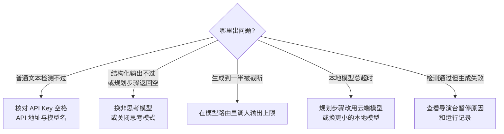

写作开始前，必须先配好至少一个可用的文本模型。工作台不内置模型额度，使用你自己的 API 配置。

配置有两个入口：

- **首次快捷配置**：没有可用文本模型时自动弹出，三步就能让一个模型跑通所有核心任务。新手只需要这一步。
- **系统设置 → 模型与厂商**：之后维护多个厂商、调整模型路由和输出上限时使用。

## 首次快捷配置

网页端和桌面端在没有可用文本模型时都会打开快捷配置。你可以先关掉弹窗浏览已有内容，但启动自动导演、章节生成或其他 AI 创作前需要完成配置。

<Steps>
  <Step title="选择厂商">
    选择已有账号的内置厂商。推荐 **DeepSeek Flash**，兼顾中文长篇质量与响应速度；想用本机模型可以选本地厂商，不需要 API Key。

    使用中转服务或其他 OpenAI 兼容接口时，点 **添加第三方厂商**。
  </Step>
  <Step title="连接模型">
    填写 API Key 和 API 地址，再从列表选择模型，或直接填写模型名称。
  </Step>
  <Step title="检测">
    系统分别检测 **普通文本** 和 **结构化输出** 两项能力。通过后，所选模型会用于规划、正文、审核、修复、重规划和摘要等核心任务，不需要逐项配置路由。

    检测失败时你填的内容会保留，页面会分别说明是哪一项没通过，改好后直接重试。
  </Step>
</Steps>

图像模型、知识库、写法引擎、并发限制和精细模型路由都是可选增强，可以以后再配。

## 第三方厂商

第三方兼容接口会保存为独立厂商，单独保存 API Key、API 地址和模型，不会覆盖 DeepSeek、OpenAI 等内置厂商的配置。需要同时保留多套连接时，分别创建厂商，再在模型路由中选择。后续可以在 **模型与厂商** 中分别维护。

## 三种常见接法

| 接法 | API 地址填什么 | 说明 |
| --- | --- | --- |
| 官方 API | 供应商官方地址 | 如 DeepSeek、OpenAI 等官方平台，稳定、计费清晰 |
| 中转 / 兼容服务 | 中转商提供的地址 | 用「添加第三方厂商」接入，只要兼容 OpenAI 接口格式即可；模型名按中转商给的名称填 |
| 本地模型 | 本机地址 | Ollama 默认 `http://localhost:11434`，LM Studio 默认 `http://localhost:1234`；先启动本地服务再检测 |

## 填写时的注意事项

- **API Key**：不要多复制空格；确认 Key 对应的供应商和 API 地址一致，账户有额度和模型权限。连接失败时，先在供应商控制台确认 Key 有效，再回到应用测试。
- **API 地址**：要和供应商文档一致。常见错误是多写或少写路径，或者填了网页地址而不是 API 地址。代理或网络限制也会让请求到不了。
- **模型名称**：从供应商文档复制，不要自己猜。

<Frame caption="模型路由管理页面，为不同创作任务指定模型并检查输出稳定性">
  
</Frame>

## 模型路由：不同任务用不同模型

快捷配置会让一个模型负责全部核心任务。想让不同任务用不同模型时，再到模型路由里分别指定：

- **规划类步骤**（世界生成、大纲、拆章列表）：建议用能力强、输出稳定的模型，速度太慢的本地大模型容易在长输出时超时
- **正文生成**：建议用文笔和上下文长度合适的模型
- **审阅 / 修文**：可用性价比更高的模型

<Note>
  模型的单次最大输出（maxTokens）和自动导演的单章用量上限是两回事。单章上限见 [AI 用量](/features/token-usage)。
</Note>

## 常见问题

**生成到一半被截断 / 输出长度不够** 在模型路由里为该模型显式设置足够的输出上限（maxTokens）。你的显式设置优先于系统默认值，设置太小会让长章节或结构化结果被截断。

**结构化步骤报错或返回空内容** 规划步骤需要模型返回严格的结构化结果。思考型（推理）模型在这一步可能把输出额度耗在思考过程上、正文为空；可以为规划步骤换用非思考模型，或在供应商支持时关闭该模型的思考模式，正文步骤不受影响。新版已内置模型兼容层，会自动探测并降级不兼容的结构化输出方式，遇到这类问题先升级到最新版本再试。

**本地模型总是超时** 本地大参数模型生成速度有限，规划这种长输出步骤更容易超时。先把规划步骤路由到云端模型、本地模型只跑正文，或换更小的本地模型，并确认本地服务全程开着。

**连接测试通过、生成还是失败** 检测只验证地址、密钥和模型可达；生成失败请看导演台给出的暂停原因和 [运行记录](/features/task-center)，多数情况是额度不足、模型路由未配置到对应步骤，或输出上限太小。反馈问题时带上版本号、所用模型和报错原文，定位最快。

## 配置后的最短验证

1. 完成模型检测。
2. 创建一本测试小说。
3. 让自动导演生成方向候选。
4. 生成第一章。
5. 在运行记录里查看状态。

这条路径能同时验证模型、数据库、任务队列和创作主链。更多问题见 [故障排查](/troubleshooting)。
