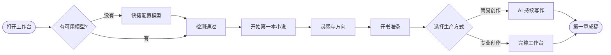
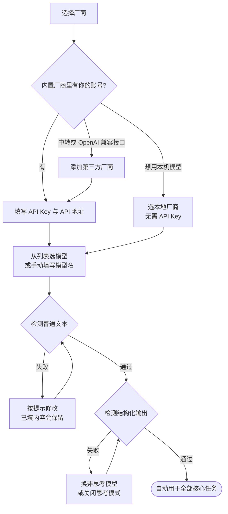
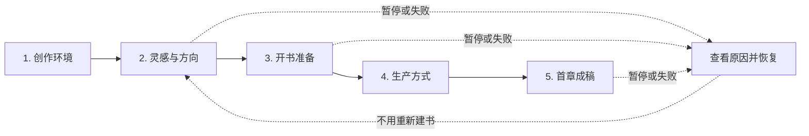
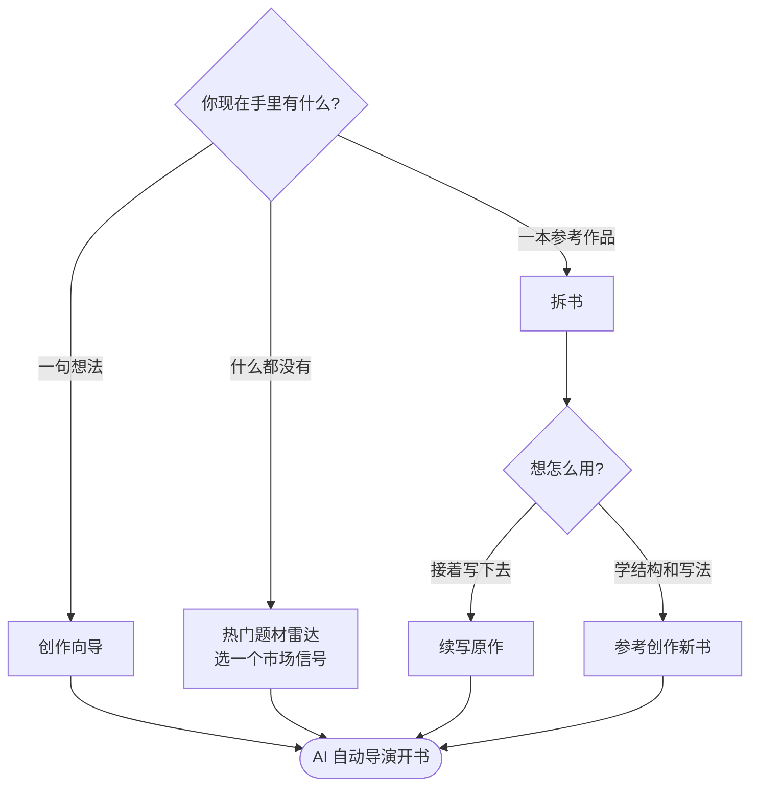
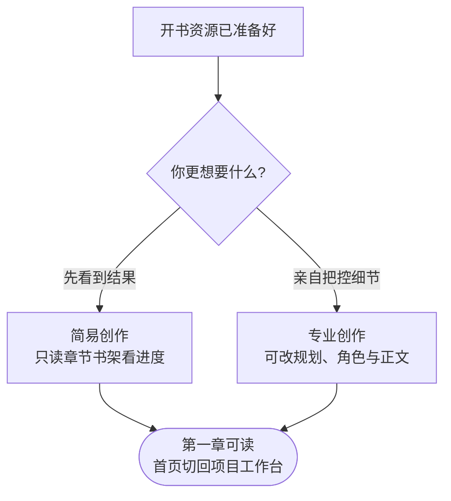
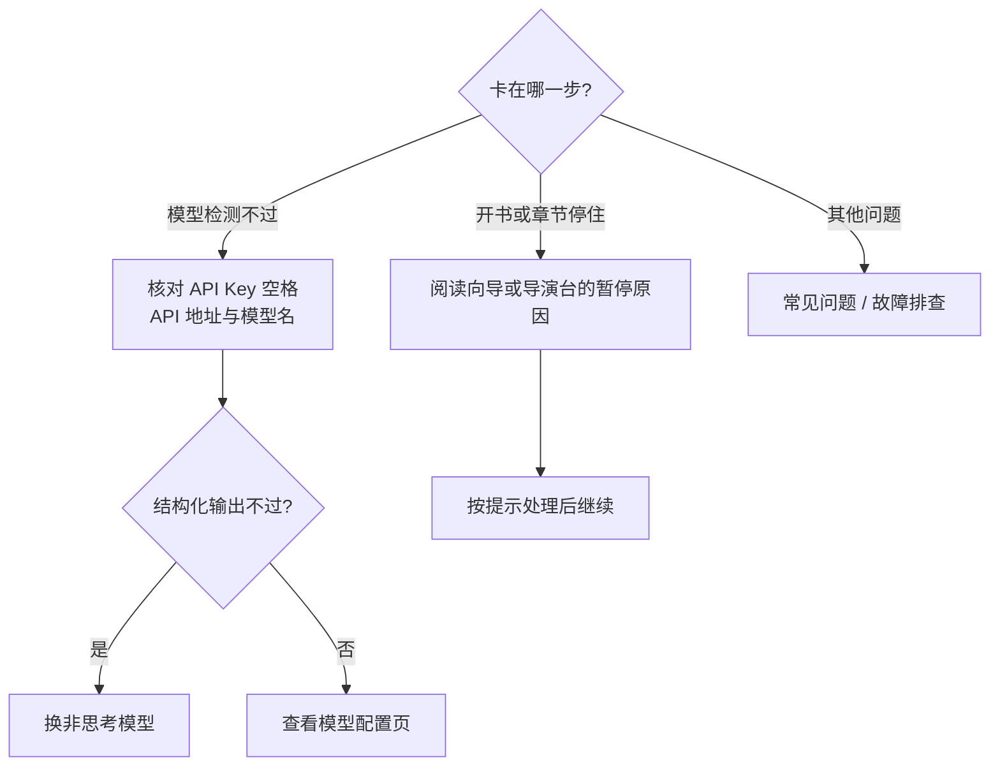

第一次打开工作台，你只需要做两件事：**让一个模型能用**，然后**沿着向导写出第一章**。世界、角色、卷章规划和普通质量问题会由 AI 在主链中持续处理，不需要先学会所有功能。

## 全程一览

## 第一步：快捷配置模型

没有可用文本模型时，网页端和桌面端都会自动弹出快捷配置。你可以先关掉它浏览界面，但开始任何 AI 创作前都需要完成配置。

<Steps>
  <Step title="选择厂商">
    从内置厂商中选一个已经有账号的。推荐 **DeepSeek Flash**，兼顾中文长篇质量与响应速度；想用本机模型可以选本地厂商，不需要 API Key。

    使用中转服务或其他 OpenAI 兼容接口时，点 **添加第三方厂商**。它会单独保存，不会覆盖内置厂商的配置。
  </Step>
  <Step title="连接模型">
    填写 API Key 和 API 地址，然后从列表选择模型，或直接填写模型名称。接口没有返回模型列表时，按供应商文档手动填写。
  </Step>
  <Step title="检测">
    系统会分别检测 **普通文本** 和 **结构化输出** 两项能力。通过后，这个模型会自动用于规划、正文、审校、修复、重规划和摘要等核心任务，不需要逐项配置路由。

    检测失败时你填的内容会保留，页面会说明是哪一项没通过，改好后直接重试。
  </Step>
</Steps>

<Tip>
  结构化输出没通过，多半是用了思考型（推理）模型。换一个非思考模型，或在供应商支持时关闭思考模式。更多情况见 [模型配置](/model-configuration)。
</Tip>

## 第二步：沿着第一本书路线走

配置完成后点 **开始第一本小说**，或从侧边栏打开 **创作向导**。向导固定展示五个里程碑，进度来自真实的模型、导演任务和章节状态，不需要手动打勾：

| 里程碑 | 完成标志 |
| --- | --- |
| 1. 创作环境 | 至少一个文本模型和核心任务路由可用 |
| 2. 灵感与方向 | 输入一句灵感（或从热门题材、拆书开书），在 AI 给出的两套整书方向中选定一套 |
| 3. 开书准备 | AI 准备好故事、世界、角色、卷战略、节奏和章节执行资源 |
| 4. 生产方式 | 选择简易创作或专业创作 |
| 5. 首章成稿 | 第一章完成写作、审校与必要修复，可以打开阅读 |

页面始终只突出 **一个推荐动作**，并说明为什么现在该做这一步。任务暂停或失败时，推荐动作会变成「查看原因并恢复」，不需要重新建书。

## 没有灵感，或者已有参考书

| 你的情况 | 从哪里开始 |
| --- | --- |
| 有一句自己的想法 | 从创作向导进入 AI 自动导演 |
| 没有明确想法 | 打开热门题材雷达，选一个市场信号开书 |
| 有一本想续写的作品 | 先完成 [拆书](/features/book-analysis)，再选「续写原作」 |
| 只想学习结构和写法 | 完成拆书后选「参考创作新书」 |

这几条路最后都会进入同一个自动导演开书流程，后面的世界、角色、卷规划和章节生产不用分别学习。

## 简易创作还是专业创作

开书资源准备好之后才会让你选：

- **简易创作**：AI 持续写完整本书，你在只读章节书架里看进度和成稿。适合想先看到结果的人。
- **专业创作**：进入完整工作台，可以查看和修改规划、角色与章节正文。适合想亲自把控细节的人。

两种方式都可以完成向导。第一章可读之后，首页会切回正常的项目工作台，创作向导里仍保留完成记录和正文入口。

## 可以以后再配的东西

以下能力不会阻塞第一章，跑通之后再按需开启：

- [知识库](/features/knowledge-base)：需要参考资料、研究内容或长期设定时使用
- [写法引擎](/features/style-engine)：有明确的文风样本后再提取和绑定
- 图像模型：需要封面、角色图或插图时配置
- [模型路由](/model-configuration)：想让不同任务使用不同模型时再调整

## 卡住了怎么办

- 模型检测一直不过：核对 API Key 有没有多余空格、地址是不是 API 地址而不是网页地址、模型名是否和供应商文档一致。
- 开书或写章节停住了：看向导或本书导演台给出的暂停原因，按提示处理后继续。
- 其他问题见 [常见问题](/faq)。
