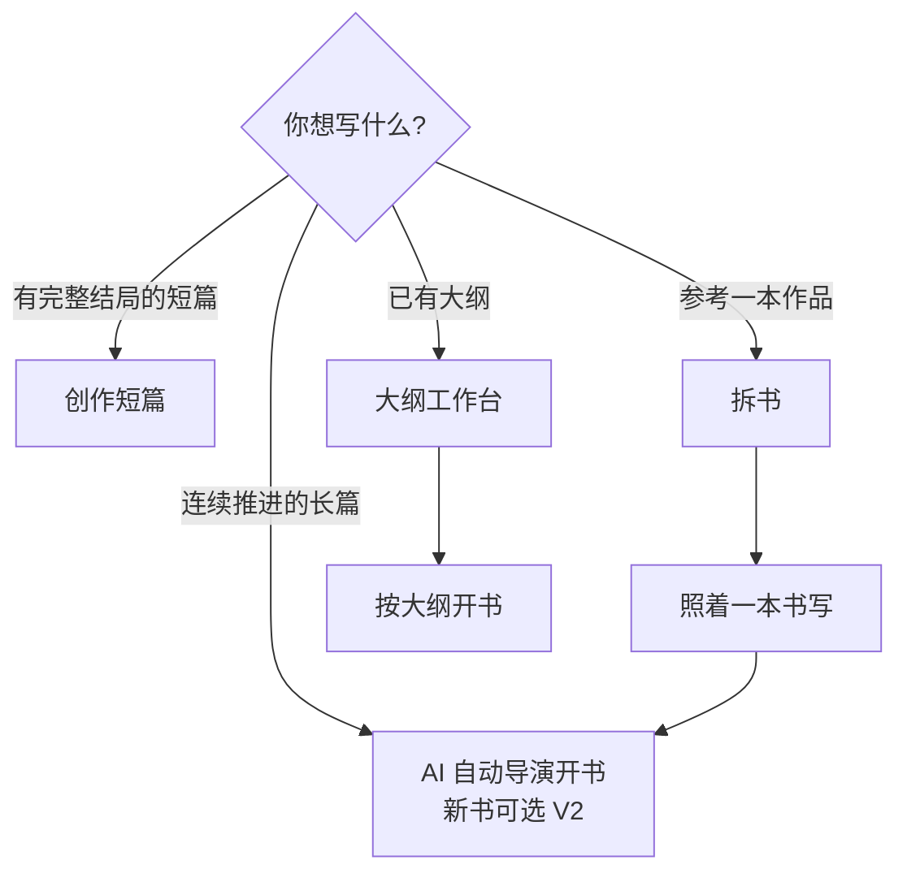
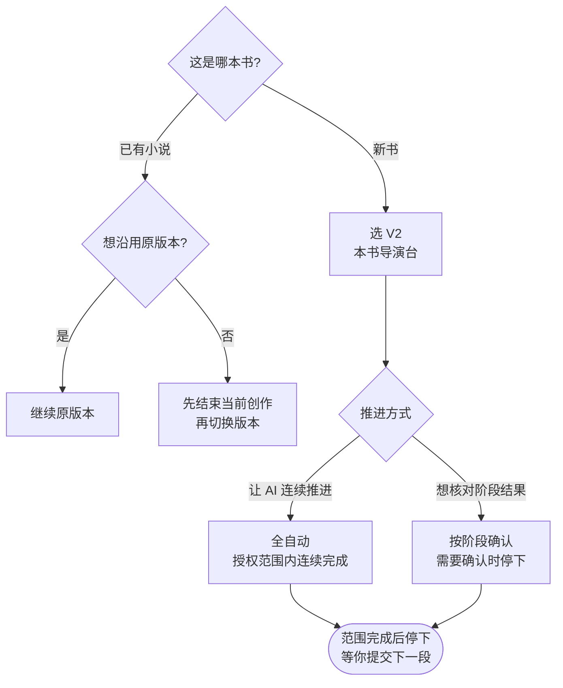
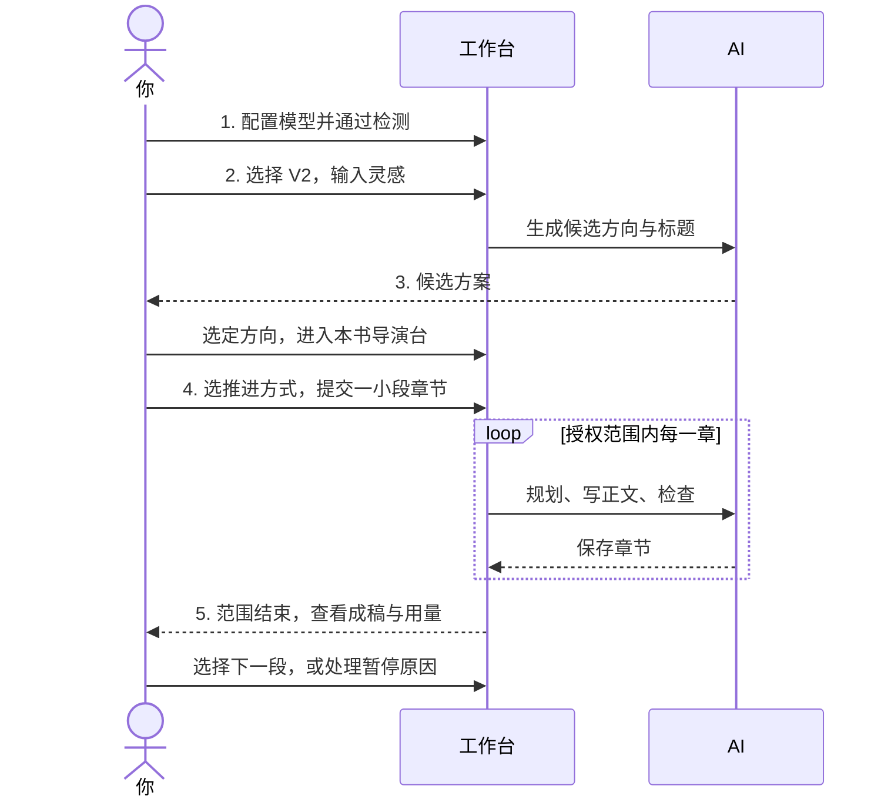
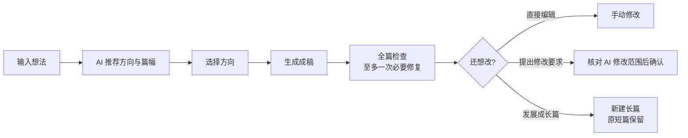
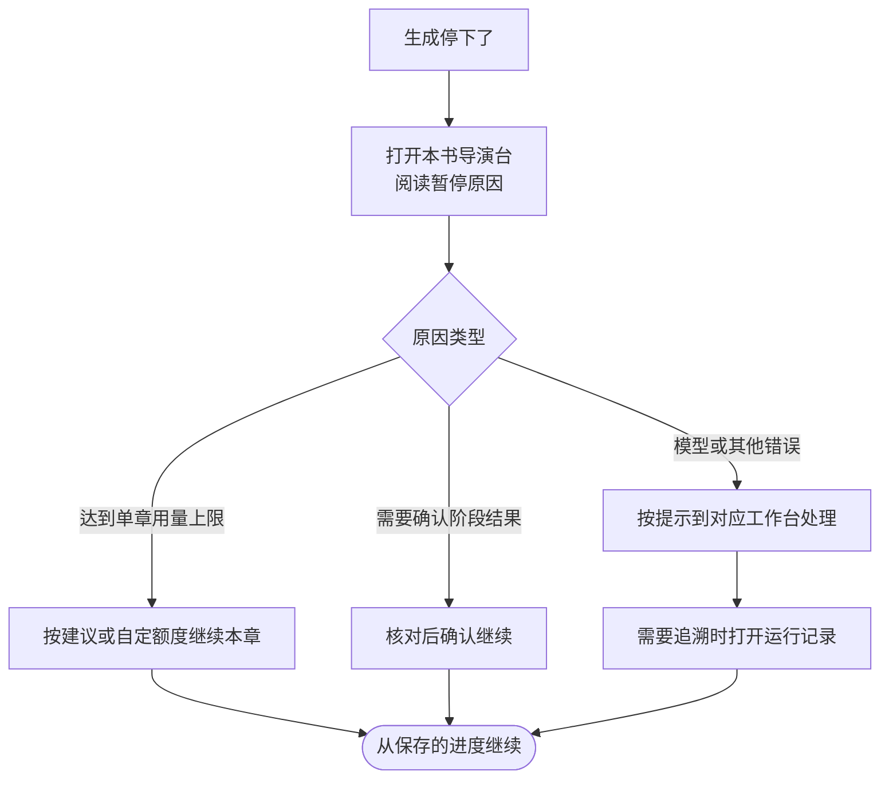

## 选择创作入口

| 想写什么 | 从哪里进入 |
| --- | --- |
| 连续推进的长篇小说 | 小说列表或首页的「AI 自动导演开书」，新书可选择 V2 |
| 一次读完、有完整结局的短篇 | 小说列表或首页的「创作短篇」，由 AI 整理方向与篇幅 |
| 参考一本作品开新书 | 先完成拆书，再从「照着一本书写」进入开书 |
| 先整理好大纲再写 | 在 [大纲工作台](/features/outline-workbench) 建立大纲，确认后按大纲开书 |

## 导演 V1 与 V2 怎么选

|  | 导演 V1 | 导演 V2 |
| --- | --- | --- |
| 使用入口 | 原导演与小说工作台，保留分阶段创作入口 | 本书导演台，集中阅读目录、正文和资料 |
| 适合情况 | 继续原有小说，或沿用原工作台操作 | 从新书开始，按授权范围连续规划和生成 |
| 任务与恢复 | 使用自己的任务、检查点与恢复流程 | 使用自己的运行、阶段结果与保存进度 |

新书在 V2 可用时默认优先选择 V2。已有小说切换版本前需要先结束当前创作；已保存正文与历史记录会保留，切换只保存选择，不会自动开始生成。

**推进方式**：全自动会在本次授权范围内连续规划、写正文、检查和保存；按阶段确认（半自动）会在需要确认的阶段停下来等你核对。全自动在授权范围完成后也会停下，例如提交第 1—3 章，完成后不会擅自写第 4 章。

## 用 V2 写出第一段正文

1. **配置模型。** 首次启动会弹出快捷配置，填写供应商、API Key、API 地址和文本模型并通过检测；首次使用先确保一个模型可用（见 [创作向导](/onboarding) 与 [模型配置](/model-configuration)）。
2. **输入灵感。** 从小说开书入口选择 V2，输入故事想法。没有想法时可先看热门题材，有参考作品时可从完成的拆书进入。
3. **选择方向。** 查看候选方案和标题，选定这本书想写成的样子，再进入本书导演台。
4. **选择推进方式与范围。** 想让 AI 连续推进就选全自动，想核对阶段结果就选按阶段确认；先提交一小段章节，观察正文效果与用量。
5. **查看并继续。** 勾选「跟随生成」观看正文流式输出。范围结束后检查已保存章节，选择下一段；出现暂停时阅读原因，从本书导演台处理。

写法引擎、知识库和高级模型路由可以在跑通第一段正文后逐步配置。

## 写一篇完整短篇

配置好模型后，打开「创作短篇」，输入想法，让 AI 推荐方向与篇幅；选择方向后开始生成。成稿后会进行全篇检查和至多一次必要修复；你可以直接编辑，也可以提出修改要求，核对 AI 的修改范围后确认。「发展成长篇」会创建新作品，保留原短篇。

## AI 用量怎么看

在 V2 本书顶部或书架打开「AI 用量」，可以按章节、步骤、厂商、模型或状态筛选调用。规划、正文、审阅和修文都可能产生消耗，不能只按最终正文长度判断。总 Tokens = 输入 + 输出，Tokens 是调用计数，实际费用以厂商账单为准。

V2 单章默认用量保护上限为 100,000 Tokens（累计该章的生成、检查、修文与资料整理调用）。达到上限时可在本书导演台查看原因，并按建议或自定额度继续本章，正文、累计用量和恢复位置都会保留。

## 遇到暂停或错误

先查看本书导演台的暂停原因，再从对应工作台处理；需要追溯时打开「运行记录」查看状态和来源。保存的正文与任务进度有独立边界，重复点击生成不能代替恢复。更多问题见 [常见问题](/faq)，或到 [Issues](https://github.com/ExplosiveCoderflome/AI-Novel-Writing-Assistant/issues) 反馈。
