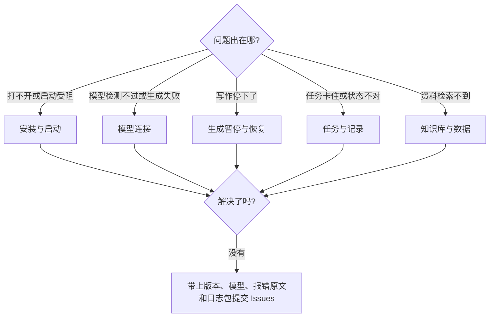

遇到异常时，先把问题归类到安装与启动、模型连接、生成暂停与恢复、任务记录或其他类型，再按对应入口逐项排查。处理任何可能影响数据的操作前，请先备份。

<Note>
  本页处理「出错了怎么办」。「是什么、怎么选、能不能」类的使用疑问，例如全自动为什么会停、导演 V1 和 V2 怎么选、不配 Qdrant 能不能用，见 [常见问题](/faq)。
</Note>



## 安装与启动

<AccordionGroup>
  <Accordion title="Mac 提示「无法打开」或「已损坏」">
    当前 Mac 安装包未做 Apple 签名与公证。到 **系统设置 → 隐私与安全性** 点「仍要打开」；提示「已损坏」时在终端执行：

    ```bash
    xattr -dr com.apple.quarantine "/Applications/Biz Novel Studio.app"
    ```

    不知道怎么打开终端：按 **Command + 空格**，输入「终端」后按回车，粘贴上面的命令再按回车。完整步骤见 [安装下载](/installation#各平台安装步骤) 的 macOS 部分。
  </Accordion>

  <Accordion title="启动页一直停在「启动受阻」">
    1. 完全退出应用，再重新打开。
    2. 检查杀毒软件或安全软件是否拦截了本地服务。
    3. 仍然失败时，从启动页打开日志，或在「版本与更新」里保存日志包，附在 GitHub Issues 中反馈。
  </Accordion>

  <Accordion title="源码运行时安装卡住或桌面运行时未准备">
    先检查 Node 版本与包管理器配置：

    ```bash
    node -v
    pnpm -v
    pnpm config get script-shell
    npm config get script-shell
    ```

    如果 `script-shell` 配置为 `cmd.exe /k`，安装脚本可能停在交互式提示符；移除该自定义设置后重开终端再安装。桌面开发首次需要下载 Electron 运行时，网络不可用时先处理代理或镜像；也可单独执行 `pnpm run prepare:desktop-runtime`。
  </Accordion>
</AccordionGroup>

## 模型连接

<AccordionGroup>
  <Accordion title="连接测试失败">
    依次检查：

    1. API Key 是否完整，有没有多复制空格。
    2. API 地址是否是接口地址，而不是供应商的网页地址；路径有没有多写或少写。
    3. 模型名称是否和供应商文档完全一致。
    4. 网络能否访问供应商接口，账户是否还有额度。

    连接不通时不要继续开书，先让检测通过。
  </Accordion>

  <Accordion title="API Key 粘贴不进去">
    桌面版的输入框没有右键菜单，右键点不出「粘贴」。先点一下输入框，再用快捷键粘贴：Windows 和 Linux 按 `Ctrl + V`，macOS 按 `Cmd + V`。

    API Key 输入框是密码形式，粘贴后只显示圆点，看不到内容是正常的。不确定是否粘贴成功时，清空后重新粘贴一次，再点 **测试连接**。复制 Key 时不要带上前后的空格或换行。
  </Accordion>

  <Accordion title="普通文本通过，结构化输出不通过">
    规划步骤需要模型返回严格的结构化结果。思考型（推理）模型容易把输出额度耗在思考过程上。换一个非思考模型，或在供应商支持时关闭思考模式；新版已内置兼容层，先升级到最新版本再试。
  </Accordion>

  <Accordion title="连接测试通过，生成还是失败">
    连接测试只验证地址、密钥和模型可达。生成失败通常是：额度不足、某个步骤路由到了不可用的模型、或输出上限（maxTokens）设得太小导致截断。到本书导演台看暂停原因，再到 [模型配置](/model-configuration) 调整对应步骤。
  </Accordion>

  <Accordion title="开书时候选方案生成失败，提示输出额度耗尽">
    生成开书方向候选时，系统固定关闭深度思考，输出上限会随候选数量自动调高；如果你在 **大纲策划** 路由里设了更高的上限，以你的设置为准。

    模型仍把输出额度用完时，系统会自动把上限翻倍再试一次，最高 32768 Token。其他原因导致的失败不会自动重试。

    重试后还是失败，会出现「候选方案生成失败」卡片，上面有两个按钮：

    - **关闭深度思考并重试**：关闭本次任务所用厂商的 [思考功能](/model-configuration#思考功能)，然后原地重新生成。
    - **提高输出上限并重试**：把 **大纲策划** 路由的 [最大输出长度](/model-configuration#路由字段说明) 改为 32768，厂商和模型保持不变，然后原地重新生成。上限已经是 32768 时不显示这个按钮。

    这两个按钮只修改设置，不会改动你已有的内容。都试过仍然失败时，换一个模型再生成。
  </Accordion>

  <Accordion title="短篇规划失败，提示计划被截断">
    短篇首次规划和完整重规划会按作品规模自动分配输出额度，并关闭深度思考。模型把自动额度用完、模型上限还有余量时，系统会提高额度自动重试一次。

    仍然失败时，短篇页面会显示本次请求的输出上限，并告诉你该去哪里调整：

    - 提示已达到模型设置中的上限，或模型服务报告的输出少于请求上限：到 **设置 → 模型与厂商** 的 [模型兼容性](/model-configuration#模型兼容性) 核对当前模型和接口实际支持的输出上限，或更换模型。
    - 其他情况：到 **设置 → 模型路由管理 → 大纲策划** 把 [最大输出长度](/model-configuration#路由字段说明) 调到所用模型支持的额度，或给大纲策划换一个模型。

    重规划只有拿到完整、通过校验的计划后才会保存预览。
  </Accordion>

  <Accordion title="大纲建议生成失败，提示超出单次输出上限">
    在大纲工作台一次要求生成或修改的内容太多时，模型输出可能被截断。**大纲策划** 路由的最大输出长度留空时，系统会关闭深度思考、把额度翻倍自动重试一次，最高 32768 Token；你手动填写过上限时不会自动重试。

    仍然失败时会提示「这次要生成的内容较多，超出了单次输出上限」。可以分批提出修改（例如先改前几卷），或先生成部分内容（例如先定卷和前几章）；也可以调高 **大纲策划** 路由的 [最大输出长度](/model-configuration#路由字段说明) 后重新生成提案。
  </Accordion>

  <Accordion title="提示 [STRUCTURED_OUTPUT:transport_error] 连接模型服务时发生网络错误">
    完整报错类似：

    ```text
    [STRUCTURED_OUTPUT:transport_error] [novel.create.resource_recommendation@v3] 连接模型服务时发生网络错误，请检查网络、渠道地址和服务状态后重试。
    ```

    第二个方括号里是出错的步骤（上例是开书时的资料推荐），不同步骤会显示不同名称。超时的情况会显示「模型请求超时，请检查服务状态或稍后重试。」

    **含义**：请求发出后没有拿到模型服务的响应，常见原因是网络波动、代理或 VPN 中断、连接被重置，或供应商服务临时不稳定。它和 API Key、模型名填错不是一回事，所以**连接测试通过时也可能出现**：测试只发一次很短的请求，正式生成的请求更长、更多，更容易碰上断线。

    系统会先按设置自动重试；开启了备用模型时，重试仍失败会改用备用模型再试一次。都失败才会显示这条报错。处理方法：

    1. 稍等片刻，从本书导演台继续或重新生成这一步。已保存的内容不会丢。
    2. 检查网络、代理和 VPN 是否稳定；用了代理时，确认桌面应用的请求也能走通。
    3. 到 **设置 → 模型路由管理** 的 [结构化调用容错](/model-configuration#结构化调用容错)，把「服务端错误重试次数」调到 2 或 3，并开启「启用备用模型」，选一个其他厂商的模型，点 **保存容错设置**。
    4. 反复出现在同一步骤时，到 [模型路由管理](/model-configuration#模型路由管理) 给这一步换一个更稳定的模型。
  </Accordion>

  <Accordion title="生成本书世界失败，提示输出额度耗尽、超时或限流">
    生成本书世界时，系统固定关闭深度思考，输出额度默认从 12,000 Token 起步，生成整书世界设定时会分配更多额度。如果你在 **大纲策划** 路由里设了不低于 12,000 的 [最大输出长度](/model-configuration#路由字段说明)，额度不会超过这个值。

    遇到下面两种情况，系统会自动再试一次：

    - **输出额度耗尽**：把额度翻倍后重试，最高 49,152 Token，同时不超过模型支持的上限。
    - **等待超时**：按原额度重试。

    如果你在 [结构化调用容错](/model-configuration#结构化调用容错) 里配置了备用模型，失败后由备用模型接手，不再重试原模型。

    仍然失败时，提示会写出所用模型和本次实际申请的输出上限，并给出处理方向：

    - **额度耗尽**：按提示到「设置 → 模型路由管理 → 大纲策划」核对最大输出长度，或到「设置 → 模型与厂商 → 模型兼容性」核对 [模型输出上限](/model-configuration#模型兼容性)。提示上的 **打开模型设置** 按钮会直接打开对应页面。也可以换一个模型再生成。
    - **超时**：到 **模型与厂商** 页面调高 [单次生成最长等待](/model-configuration#其他模型相关设置)，或换一个模型再生成。
    - **限流（429）**：系统不会自动重试。稍后再生成，或换用配额足够支撑本次请求的模型。
  </Accordion>

  <Accordion title="本地模型总是超时">
    本地大参数模型生成慢，规划这类长输出步骤最容易超时。把规划步骤路由到云端模型、本地模型只跑正文，或换更小的本地模型，并确认本地服务全程开着。
  </Accordion>

  <Accordion title="提示 Invalid max_tokens value, the valid range of max_tokens is [1, 393216]">
    完整报错类似：

    ```text
    400 Invalid max_tokens value, the valid range of max_tokens is [1, 393216]
    ```

    **含义**：这是模型厂商返回的错误。本次请求的输出上限超过了这个模型允许的最大值，方括号里的第二个数字就是厂商允许的上限，不同模型数字不同。应用里的输出上限最大可以填 1048576，高于很多模型的实际上限，填得太大就会被厂商拒绝。

    处理方法：

    1. 到 **设置 → 模型与厂商**，在对应厂商卡片的 [模型兼容性](/model-configuration#模型兼容性) 里查看「当前模型输出上限」。超过报错里的数字时，改成不超过它的值，点 **保存输出上限**；不确定时直接清空，改回「使用任务预算」。
    2. 到 **设置 → 模型路由管理**，检查出错步骤所用路由的 [最大输出长度](/model-configuration#路由字段说明)，同样改到不超过报错里的数字，或留空自动分配，点 **保存路由**。
    3. 回到本书导演台重新生成这一步。
  </Accordion>

  <Accordion title="提示 schema_mismatch 或「模型输出未满足目标结构要求」">
    完整报错里通常带有 `[STRUCTURED_OUTPUT:schema_mismatch]` 和「模型输出未满足目标结构要求」，有时还有「JSON repair 后仍无法解析」，并列出不符合要求的字段名。

    **含义**：规划类步骤要求模型按固定结构返回结果。模型返回的内容缺了字段、条数不够或类型不对。系统会先让模型自动修复一次，修复后仍不符合才报错。常见字段：

    - **`fixedFacts`**：短篇规划时要列出的固定事实，也就是全篇不能随意改写的因果设定。要求 3 到 12 条，每条 4 到 500 个字。模型给的条数太少或写得太短时会报这个字段。
    - **`realm`**：角色的「境界」。生成角色阵容时要求是一段文字，可以为空字符串。模型返回 `null`、数字或其他格式时会报这个字段。

    处理方法：

    1. 先重新生成这一步。这类错误和模型当次输出有关，重试常能通过。
    2. 反复出现时，到 [模型路由管理](/model-configuration#模型路由管理) 给 **大纲策划** 换一个结构化输出更稳定的模型，或在 [思考功能](/model-configuration#思考功能) 里关闭思考。
    3. 开启 [结构化调用容错](/model-configuration#结构化调用容错) 里的备用模型。
    4. 升级到最新版本再试。仍然失败时按 [反馈问题](#反馈问题) 带上完整报错提交。
  </Accordion>
</AccordionGroup>

## 生成暂停与恢复

<AccordionGroup>
  <Accordion title="暂停后怎么继续">
    暂停不等于失败，进度和已保存正文都会保留。为什么会暂停见 [常见问题](/faq) 和 [自动导演](/features/auto-director)。

    1. 打开本书导演台，阅读暂停原因。
    2. 排除外部问题：补充额度、切换模型、检查网络。
    3. 按提示从本书导演台继续。

    需要追溯时打开「运行记录」查看状态和来源。不要靠重复点击生成来代替恢复，也不要删除小说重来。

    具体到某个阶段卡住时，对照 [按阶段恢复](/guides/recovery-by-phase) 找到恢复入口；继续与接管操作见 [导演跟进](/features/director-follow-up)。
  </Accordion>

  <Accordion title="提示「无法定位完整的本阶段结果」">
    完整提示：「无法定位完整的本阶段结果，请重新读取本书或返回导演台查看确认入口。」常见于「章节任务与场景」等需要你确认的阶段。

    **含义**：你打开的确认页面，找不到与之完全对应的已保存结果。通常是页面或链接已经过期，例如打开这个页面之后，本书又重新生成了章节列表或该阶段内容；也可能是从旧链接、另一本书或另一个版本（V1/V2）进入。这不代表内容丢失。

    处理方法：

    1. 刷新页面，或回到小说列表重新进入本书，让页面重新读取最新内容。
    2. 回到本书导演台，从「需要你做什么」里的确认入口重新打开本阶段结果，不要用浏览器历史或之前收藏的链接。
    3. 打开「运行记录」，确认没有同一本书的任务仍在生成；有的话等它完成后再确认。
    4. 仍然出现时，不要删除小说重来，按 [反馈问题](#反馈问题) 带上报错原文和日志包提交。

    相关提示：

    - 「本阶段没有待确认的结果。可从左侧目录查看已保存内容，并在导演台查看下一步。」表示这一阶段已经确认过或不需要确认，直接看导演台的下一步即可。
    - 「第 N 章缺少已保存的章节任务和场景安排，请在导演台处理当前阶段。」表示这一章的任务单没有保存完整。在导演台点 **重新生成本阶段**，生成后再确认并继续。
  </Accordion>

  <Accordion title="提示「本批章节任务或场景与确认稿不符」">
    完整提示：「本批章节任务或场景与确认稿不符，请返回导演台重新核对。」出现在按阶段确认的导演任务里，开始写本批正文之前。

    **含义**：写正文前，系统会把当前保存的章节任务、场景、目标字数、冲突与揭露设定、需要避免的内容，和你在导演台确认过的「正文执行计划」逐项比对，对不上就停下，避免按你没确认过的内容写正文。最常见的原因是确认之后，又在其他页面（例如章节规划）改了本批章节的任务、场景或目标字数。内容没有丢失。

    处理方法：

    1. 回到本书导演台，打开「正文执行计划」这一步。
    2. 核对改动。改动是你想要的，点 **确认已保存的修改**；想按最新保存的章节任务重新整理计划，点 **重新同步执行计划**。
    3. 确认后点 **确认结果并继续**，开始写本批正文。

    相关提示：

    - 「请保存本批每一章完整的章节任务与场景。」：本批有章节的任务或场景没有保存完整。在导演台补齐，或点 **重新生成本阶段**。
    - 「请在章节确认页核对并提交本次修改。」：有修改还没提交，到章节确认页提交后再继续。
    - 「缺少已授权的章节范围。」：本次没有选定要写的章节范围，回到导演台重新选择后继续。
  </Accordion>

  <Accordion title="提示 Director launch contract is immutable after task creation (directorInput)">
    **含义**：这本书已经有一个自动导演任务，任务创建后，开书时提交的设定就固定了。这次请求又带着一份不同的开书设定提交到同一个任务，系统拒绝覆盖，以免改掉正在执行的计划。常见于从过期页面或旧版本重复提交开书，或小说已经创建后又重试了开书。已有内容不受影响。

    处理方法：

    1. 刷新页面，从本书导演台或「运行记录」继续已有任务，不要重复提交开书。
    2. 想改方向，用 [导演跟进](/features/director-follow-up) 里的接管或重新规划；需要完全不同的设定时，新建一个自动导演任务。
    3. 升级到最新版本再试。仍然出现时按 [反馈问题](#反馈问题) 提交。
  </Accordion>

  <Accordion title="提示达到单章用量上限">
    V2 新任务的单章默认上限是 200,000 Tokens，累计该章的生成、检查、修文和资料整理调用。使用系统默认额度时，额度不足会先自动追加一次，仍不足才会暂停。可以在本书导演台按建议或自定额度继续本章；想改全局默认值，到 **设置 → 自动导演** 调整。详见 [AI 用量](/features/token-usage)。
  </Accordion>

  <Accordion title="章节正文被截断或生成中断">
    章节首稿和续写按 **主笔写作** 路由的输出额度生成。正文达到输出上限被截断、模型返回空正文或流式生成中途断开时，本章会回到可重新生成的状态，不会保存不完整的草稿。

    提示「章节正文达到模型输出上限后被截断」时，先调高 **主笔写作** 路由的 [最大输出长度](/model-configuration#路由字段说明)，或检查 [输出上限怎么生效](/model-configuration#输出上限怎么生效)，再从本书导演台重新生成本章。
  </Accordion>
</AccordionGroup>

## 任务与记录

<AccordionGroup>
  <Accordion title="任务卡住或失败，不知道从哪里恢复">
    长任务优先看「运行记录」（旧称任务中心），它会展示排队、运行中、完成、失败和等待恢复状态。建议记录：任务名称、关联小说、最近一次状态、错误信息，以及是否有重试或恢复按钮。

    如果任务仍在运行，不要重复点击多个入口发起同类任务，先确认后台是否正在处理。具体用法见 [运行记录](/features/task-center)。
  </Accordion>

  <Accordion title="导演跟进显示不一致">
    不要只凭单个页面判断任务是否失败。后台任务、导演跟进和小说页可能展示同一流程的不同侧面。优先看导演跟进的暂停原因，再看运行记录的后台状态，很多情况下只是等待确认而不是失败。
  </Accordion>

  <Accordion title="页面状态看起来不对">
    1. 刷新页面。
    2. 回到首页或小说列表重新进入。
    3. 检查运行记录里是否有后台任务仍在运行。
    4. 查看导演跟进是否显示等待确认。
    5. 记录入口、操作步骤和错误截图。
  </Accordion>

  <Accordion title="运行记录里的状态和来源怎么看">
    「运行记录」负责查看状态和打开来源页；继续、恢复、取消等操作在来源工作台处理。V1 与 V2 分别使用独立的运行、阶段结果与保存进度，切换版本不会自动恢复另一个版本的旧任务。
  </Accordion>
</AccordionGroup>

## 知识库与数据

<AccordionGroup>
  <Accordion title="知识库检索不到内容">
    Qdrant 不是开书的前提；只有用到知识库检索时才需要排查它。按顺序检查：文档是否上传成功、索引任务是否完成、Qdrant 是否能连接、检索设置是否过窄。桌面版不内置 Qdrant，连接在「知识库 → 检索设置」里填写，在「索引与任务 → 查看连接详情」里检查，步骤见 [配置资料检索与向量库](/features/knowledge-base#配置资料检索与向量库)。文档很长时，在标题或关键段落里写明设定名、角色名和地点名，更容易被召回。
  </Accordion>

  <Accordion title="知识库提示 fetch failed，或资料库连接失败">
    `fetch failed` 是请求没能连上服务时的底层报错，不是资料本身的问题。知识库会连接两个服务，报错可能来自任意一个：

    - **向量库（Qdrant）**：「索引与任务 → 查看连接详情」里「资料库连接」显示「连接失败」。
    - **Embedding 服务**：报错里带「Embedding network request failed」，或「向量模型」显示不可用。

    按顺序检查：

    1. **地址写法**：「向量库 URL」要带协议。本机 Docker 填 `http://127.0.0.1:6333`；Qdrant Cloud 填 `https://` 开头的完整集群地址，REST 端口是 6333。不要把 `http` 和 `https` 写反，也不要填 gRPC 端口 6334。
    2. **服务是否在运行**：本机 Docker 用 `docker ps` 确认 Qdrant 容器在运行；Qdrant Cloud 到控制台确认集群状态正常。
    3. **网络**：代理、VPN、防火墙或公司网络可能拦截请求。可以在同一台电脑上用 curl 测试，命令见 [使用 Qdrant Cloud](/features/knowledge-base#qdrant-cloud)。
    4. **Embedding 地址**：「向量服务 API 地址」填错或网络不通也会报 `fetch failed`。不确定时留空，使用服务商默认地址。
    5. 改完点 **保存检索设置**，到「查看连接详情」确认两项都正常，再对失败的资料点 **重建索引**。

    其他相关报错：

    - 「Qdrant 请求超时」：能连上但响应太慢。到「高级配置」调大「向量库超时（毫秒）」，或检查网络。
    - 「Qdrant 请求失败(401)」或 `403`：向量库 API Key 不对。重新复制 Key 填到「向量库 API Key」。
    - 「Qdrant 集合维度不匹配」：换过 Embedding 模型，已有集合的向量维度和新模型不一致。到「高级配置」把「集合命名方式」设为「自动生成」（会按服务商和模型区分集合），或手动换一个新的集合名，保存后重建索引。
    - 「知识库索引尚未就绪」：资料还没完成索引。到知识库的「索引与任务」查看失败原因并重建。
  </Accordion>

  <Accordion title="数据存在哪里，怎么备份">
    见 [安装下载](/installation) 中的「数据保存在哪里」。备份前先完全退出应用，再复制整个数据目录。在执行数据清理、迁移、数据库重置或手动删除前，必须先备份：复制数据库文件到明确路径，检查备份文件存在且大小正常，并记录备份时间和来源目录。
  </Accordion>
</AccordionGroup>

## 反馈问题

到 [GitHub Issues](https://github.com/ExplosiveCoderflome/AI-Novel-Writing-Assistant/issues) 提交时，尽量带上：

- 应用版本（顶部栏版本号）和系统
- 操作入口和步骤
- 使用的模型供应商和模型名
- 暂停原因或报错原文、截图
- 桌面版日志包（在「版本与更新」中保存）

信息越完整，越容易判断是模型、任务、知识库、数据还是页面问题。
