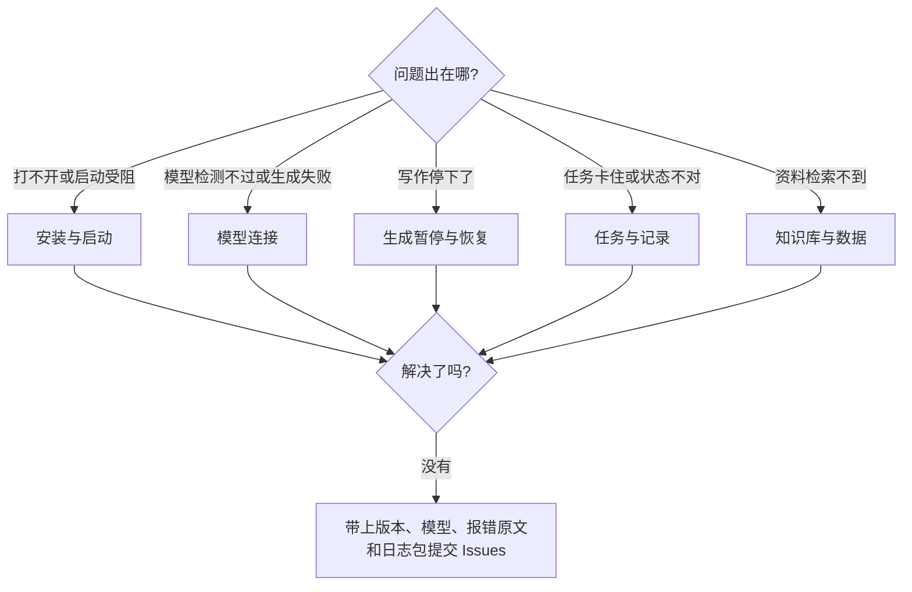

遇到异常时，先把问题归类到安装与启动、模型连接、生成暂停与恢复、任务记录或其他类型，再按对应入口逐项排查。处理任何可能影响数据的操作前，请先备份。

<Note>
  本页处理「出错了怎么办」。「是什么、怎么选、能不能」类的使用疑问，例如全自动为什么会停、导演 V1 和 V2 怎么选、不配 Qdrant 能不能用，见 [常见问题](/faq)。
</Note>



## 安装与启动

<AccordionGroup>
  <Accordion title="Mac 提示「无法打开」或「已损坏」">
    当前 Mac 安装包未做 Apple 签名与公证。到 **系统设置 → 隐私与安全性** 点「仍要打开」；提示「已损坏」时在终端执行：

    ```bash
    xattr -dr com.apple.quarantine "/Applications/Biz Novel Studio.app"
    ```
  </Accordion>

  <Accordion title="启动页一直停在「启动受阻」">
    1. 完全退出应用，再重新打开。
    2. 检查杀毒软件或安全软件是否拦截了本地服务。
    3. 仍然失败时，从启动页打开日志，或在「版本与更新」里保存日志包，附在 GitHub Issues 中反馈。
  </Accordion>

  <Accordion title="源码运行时安装卡住或桌面运行时未准备">
    先检查 Node 版本与包管理器配置：

    ```bash
    node -v
    pnpm -v
    pnpm config get script-shell
    npm config get script-shell
    ```

    如果 `script-shell` 配置为 `cmd.exe /k`，安装脚本可能停在交互式提示符；移除该自定义设置后重开终端再安装。桌面开发首次需要下载 Electron 运行时，网络不可用时先处理代理或镜像；也可单独执行 `pnpm run prepare:desktop-runtime`。
  </Accordion>
</AccordionGroup>

## 模型连接

<AccordionGroup>
  <Accordion title="连接测试失败">
    依次检查：

    1. API Key 是否完整，有没有多复制空格。
    2. API 地址是否是接口地址，而不是供应商的网页地址；路径有没有多写或少写。
    3. 模型名称是否和供应商文档完全一致。
    4. 网络能否访问供应商接口，账户是否还有额度。

    连接不通时不要继续开书，先让检测通过。
  </Accordion>

  <Accordion title="普通文本通过，结构化输出不通过">
    规划步骤需要模型返回严格的结构化结果。思考型（推理）模型容易把输出额度耗在思考过程上。换一个非思考模型，或在供应商支持时关闭思考模式；新版已内置兼容层，先升级到最新版本再试。
  </Accordion>

  <Accordion title="连接测试通过，生成还是失败">
    连接测试只验证地址、密钥和模型可达。生成失败通常是：额度不足、某个步骤路由到了不可用的模型、或输出上限（maxTokens）设得太小导致截断。到本书导演台看暂停原因，再到 [模型配置](/model-configuration) 调整对应步骤。
  </Accordion>

  <Accordion title="本地模型总是超时">
    本地大参数模型生成慢，规划这类长输出步骤最容易超时。把规划步骤路由到云端模型、本地模型只跑正文，或换更小的本地模型，并确认本地服务全程开着。
  </Accordion>
</AccordionGroup>

## 生成暂停与恢复

<AccordionGroup>
  <Accordion title="暂停后怎么继续">
    暂停不等于失败，进度和已保存正文都会保留。为什么会暂停见 [常见问题](/faq) 和 [自动导演](/features/auto-director)。

    1. 打开本书导演台，阅读暂停原因。
    2. 排除外部问题：补充额度、切换模型、检查网络。
    3. 按提示从本书导演台继续。

    需要追溯时打开「运行记录」查看状态和来源。不要靠重复点击生成来代替恢复，也不要删除小说重来。
  </Accordion>

  <Accordion title="提示达到单章用量上限">
    V2 单章默认上限是 100,000 Tokens，累计该章的生成、检查、修文和资料整理调用。可以在本书导演台按建议或自定额度继续本章；想改全局默认值，到 **设置 → 自动导演** 调整。详见 [AI 用量](/features/token-usage)。
  </Accordion>
</AccordionGroup>

## 任务与记录

<AccordionGroup>
  <Accordion title="任务卡住或失败，不知道从哪里恢复">
    长任务优先看「运行记录」（旧称任务中心），它会展示排队、运行中、完成、失败和等待恢复状态。建议记录：任务名称、关联小说、最近一次状态、错误信息，以及是否有重试或恢复按钮。

    如果任务仍在运行，不要重复点击多个入口发起同类任务，先确认后台是否正在处理。具体用法见 [运行记录](/features/task-center)。
  </Accordion>

  <Accordion title="导演跟进显示不一致">
    不要只凭单个页面判断任务是否失败。后台任务、导演跟进和小说页可能展示同一流程的不同侧面。优先看导演跟进的暂停原因，再看运行记录的后台状态，很多情况下只是等待确认而不是失败。
  </Accordion>

  <Accordion title="页面状态看起来不对">
    1. 刷新页面。
    2. 回到首页或小说列表重新进入。
    3. 检查运行记录里是否有后台任务仍在运行。
    4. 查看导演跟进是否显示等待确认。
    5. 记录入口、操作步骤和错误截图。
  </Accordion>

  <Accordion title="运行记录里的状态和来源怎么看">
    「运行记录」负责查看状态和打开来源页；继续、恢复、取消等操作在来源工作台处理。V1 与 V2 分别使用独立的运行、阶段结果与保存进度，切换版本不会自动恢复另一个版本的旧任务。
  </Accordion>
</AccordionGroup>

## 知识库与数据

<AccordionGroup>
  <Accordion title="知识库检索不到内容">
    Qdrant 不是开书的前提；只有用到知识库检索时才需要排查它。按顺序检查：文档是否上传成功、索引任务是否完成、Qdrant 是否能连接、检索设置是否过窄。文档很长时，在标题或关键段落里写明设定名、角色名和地点名，更容易被召回。详见 [知识库](/features/knowledge-base)。
  </Accordion>

  <Accordion title="数据存在哪里，怎么备份">
    见 [安装下载](/installation) 中的「数据保存在哪里」。备份前先完全退出应用，再复制整个数据目录。在执行数据清理、迁移、数据库重置或手动删除前，必须先备份：复制数据库文件到明确路径，检查备份文件存在且大小正常，并记录备份时间和来源目录。
  </Accordion>
</AccordionGroup>

## 反馈问题

到 [GitHub Issues](https://github.com/ExplosiveCoderflome/AI-Novel-Writing-Assistant/issues) 提交时，尽量带上：

- 应用版本（顶部栏版本号）和系统
- 操作入口和步骤
- 使用的模型供应商和模型名
- 暂停原因或报错原文、截图
- 桌面版日志包（在「版本与更新」中保存）

信息越完整，越容易判断是模型、任务、知识库、数据还是页面问题。
